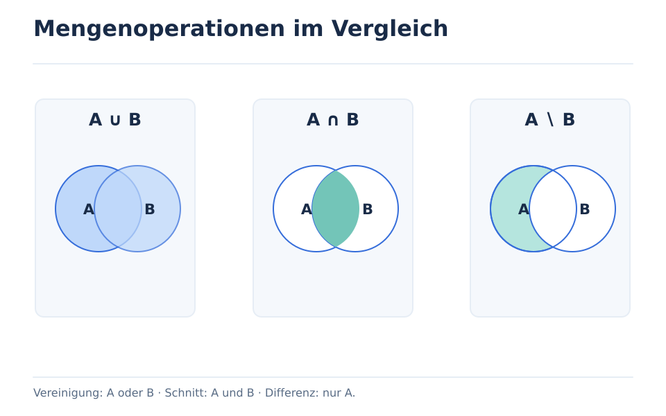

# M1-L1 – Universität: Mengen, Aussagenlogik und Beweisdenken {#L1}

**Kursbereich:** M1 – Bachelor: mathematische Grundlagen

**Niveau:** Bachelor

**Vorwissen:** Keine festen Voraussetzungen angegeben.

**Einordnung:** Universitäres Kerngebiet · mathematische Grundlagen

## Worum geht es? {#S1}

An der Universität wird Mathematik zu einer Sprache präziser Aussagen. Es reicht nicht, dass eine Formel in ein paar Beispielen funktioniert: Man will wissen, **für welche Objekte** sie gilt und **warum** sie gelten muss. Dazu braucht man Mengen als Sammlungen von Objekten, Logik zur Verknüpfung von Aussagen und Beweise als begründete Schlussketten. Das Ziel dieser Lektion ist zunächst das Lesen solcher Texte, nicht das selbstständige Führen schwieriger Beweise.

## Grundidee und Anschauung {#S2}

In der Programmierung kennst du Datenmengen, Bedingungen und Typvorgaben. Die mathematische Logik ergänzt eine entscheidende Forderung: Jede Aussage muss erkennen lassen, welche Objekte zugelassen sind, welche Behauptung gemacht wird und welche Voraussetzungen gelten. Ein **Gegenbeispiel** kann eine universelle Behauptung widerlegen. Ein **Beweis** erklärt dagegen, warum sie in jedem zugelassenen Fall zutrifft.

## Neue Zeichen – unbedingt vor den Formeln lesen {#S3}

  Zeichen                                   Name / Aussprache                      Bedeutung hier                                                       Anderer Gebrauch oder Stolperfalle
  ----------------------------------------- -------------------------------------- -------------------------------------------------------------------- -----------------------------------------------------------------------
  `{…}`                                     geschweifte Klammern                   Elemente einer Menge zusammenfassen                                  In Programmen auch Blöcke und Objekte
  $\in$                                     „ist Element von“                      Ein Objekt gehört zu einer Menge                                     Nicht dasselbe wie Teilmenge
  $\notin$                                  „ist nicht Element von“                Objekt gehört nicht zur Menge                                        Negation einer Mitgliedschaft
  $\subseteq$                               „ist Teilmenge von“                    Alle Elemente links sind auch rechts enthalten; Gleichheit erlaubt   Manchmal wird $\subset$ anders konventioniert
  $\subset$                                 „echte Teilmenge von“ in diesem Kurs   Teilmenge, aber nicht identisch                                      In manchen Lehrbüchern bedeutet $\subset$ auch nicht-strikte Teilmenge
  $\cup$                                    „Vereinigung“                          Elemente in der ersten oder zweiten oder beiden Mengen               Logisches „oder“ für Mengen
  $\cap$                                    „Schnittmenge“                         Elemente in beiden Mengen                                            Bei Ereignissen gemeinsames Eintreten
  $\varnothing$                             „leere Menge“                          Menge ohne Elemente                                                  Nicht dasselbe wie die Zahl null
  $\mathbb{N}$, $\mathbb{Z}$, $\mathbb{R}$  natürliche, ganze, reelle Zahlen       Zahlenbereiche aus Schule M1-L1                                      $0\in\mathbb{N}$ hängt von Konvention ab
  $\Rightarrow$                             „daraus folgt“                         Schlussrichtung von Voraussetzung zu Folgerung                       Nicht automatisch umkehrbar
  $\Leftrightarrow$                         „genau dann, wenn“ / „äquivalent“      Beide Richtungen gelten                                              Nicht bloß gewöhnliche Gleichheit
  $\land$                                   „und“                                  Beide Aussagen sind wahr                                             `&&` in vielen Programmiersprachen
  $\lor$                                    „oder“                                 Mindestens eine der Aussagen ist wahr                                Üblicherweise einschließendes Oder
  $\neg$                                    „nicht“                                Negation einer Aussage                                               `!` in vielen Programmiersprachen
  $\forall$                                 „für alle“                             Aussage gilt für jedes Objekt im angegebenen Bereich                 Allgemeiner Quantor
  $\exists$                                 „es existiert“                         Mindestens ein Objekt erfüllt die Aussage                            Existenzquantor
  $\exists!$                                „es existiert genau ein“               Eindeutige Existenz                                                  Nicht mit Fakultätszeichen verwechseln
  `:` nach Mengenvariable                   „mit der Eigenschaft“ / „so dass“      Trennt Auswahlbereich und Bedingung                                  In anderen Kontexten Division oder Verhältnis
  $n$, $k$, $m$                             „enn“, „ka“, „emm“                     Ganzzahlige Indizes bzw. Zählzahlen im Beweis                        Auch andere Variablen möglich
  $P$, $Q$, $R$; $P(x)$                     „pe“, „ku“, „err“; „pe von iks“        Aussagen; $P(x)$ ist eine Aussage über x                             $P$ steht in der Stochastik auch für Wahrscheinlichkeit

## Mengen: Wer gehört dazu? {#S4}

Eine **Menge** ist eine Zusammenfassung klar unterscheidbarer Objekte, ihrer **Elemente**. Reihenfolge und Wiederholung ändern die Menge nicht.

$$
\begin{aligned}
A&=\{2,4,6\}\\
2&\in A\\
5&\notin A
\end{aligned}
$$

**Vollständig gelesen:** „Die Menge A enthält die Zahlen zwei, vier und sechs. Zwei ist Element von A. Fünf ist kein Element von A.“ Objekte können Zahlen, Zeichenketten, Funktionen oder sogar andere Mengen sein.

Beispiel für Mengenoperationen:

$$
\begin{aligned}
A&=\{1,2,3\},\quad B=\{3,4\}\\
A\cap B&=\{3\}\\
A\cup B&=\{1,2,3,4\}
\end{aligned}
$$

**Gesprochen:** „Die Schnittmenge von A und B enthält die drei; die Vereinigung enthält alle Zahlen, die in mindestens einer der beiden Mengen vorkommen.“ Mengen können auch durch Eigenschaften definiert werden, statt alle Elemente aufzuzählen.

$$
M=\{x\in\mathbb{Z}:x>0\}
$$

**Vollständig gelesen:** „M ist die Menge aller ganzen Zahlen x, für die x größer als null ist.“ Die geschweiften Klammern beschreiben die Menge; der Doppelpunkt bedeutet hier „mit der Eigenschaft“. $M$ enthält also alle **positiven** ganzen Zahlen, nicht null oder negative Zahlen.

**Wichtig:** $2\in A$ redet über **ein einzelnes Element**; $\{2\}\subseteq A$ redet über **eine Menge**, die als Ganzes Teilmenge von A ist. Diese beiden Sätze sind nicht austauschbar.

## Logische Aussagen und Verknüpfungen {#S5}

Eine mathematische Aussage ist ein Satz, der – im gewählten Modell und mit festgelegten Begriffen – entweder wahr oder falsch ist. „Diese Zahl ist groß“ ist ohne Definition zu unklar. „Diese Zahl ist größer als zehn“ ist dagegen für einen gegebenen Zahlenwert prüfbar.

$$
\begin{aligned}
&(P\land Q)\implies R
\end{aligned}
$$

**Gesprochen:** „Wenn P und Q beide wahr sind, dann folgt R.“ $P$, $Q$ und $R$ bezeichnen Aussagen, nicht zwangsläufig Zahlen. Eine Folgerung bedeutet nicht, dass auch $R\Rightarrow(P\land Q)$ gilt. In der **klassischen Aussagenlogik** ist eine Implikation „wenn P, dann Q“ genau dann falsch, wenn P wahr und Q falsch ist. Sie behauptet keine zeitliche Abfolge und keine Kausalität.

**Mini-Beispiel:** Wenn ein Download vollständig ist **und** die Prüfsumme stimmt, soll ein Programm die Datei als technisch konsistent kennzeichnen. Die reale Anwendung benötigt zusätzliche Sicherheitsannahmen; mathematisch beschreibt die Bedingung aber einen eindeutigen logischen Test.

Der logische Ausdruck $P\lor Q$ verwendet das **einschließende Oder**: Er ist auch dann wahr, wenn beide Aussagen wahr sind. $\neg P$ bedeutet „nicht P“. **Gegenbeispiel zur Umkehrung:** Aus „Wenn eine ganze Zahl durch vier teilbar ist, dann ist sie gerade“ folgt **nicht**, dass jede gerade Zahl durch vier teilbar ist. Die Zahl sechs ist gerade, aber nicht durch vier teilbar.

## Quantoren: Gilt das immer oder wenigstens einmal? {#S6}

Die Wörter „alle“, „mindestens ein“ und „genau ein“ sind mathematisch entscheidend. Ihre Stellung und Reihenfolge verändern die Bedeutung eines Satzes.

$$
\forall x\in\mathbb{R}:x^2\geq0
$$

**Vollständig gelesen:** „Für jede reelle Zahl x gilt: x zum Quadrat ist größer als oder gleich null.“ Dieser Satz gilt unabhängig davon, welche reelle Zahl wir wählen.

$$
\exists x\in\mathbb{R}:x^2=4
$$

**Vollständig gelesen:** „Es existiert mindestens eine reelle Zahl x, deren Quadrat vier ergibt.“ Hier gibt es sogar zwei mögliche Werte, nämlich zwei und minus zwei. Der Existenzquantor $\exists$ sagt **nicht**, dass die Lösung eindeutig ist. Dafür gäbe es das gesonderte Zeichen $\exists!$.

**Die Reihenfolge zählt:** „Für jeden Nutzer gibt es ein Passwort“ ist nicht dieselbe Aussage wie „Es gibt ein Passwort für alle Nutzer“. Mathematik macht diesen Unterschied durch die Reihenfolge der Quantoren sichtbar. **Konkrete Gegenprobe:** Für jede Zahl x aus $\{1,2\}$ gibt es eine Zahl y aus $\{1,2\}$ mit $y=x$ (zu $x=1$ wähle $y=1$, zu $x=2$ wähle $y=2$). Es gibt aber **keine einzige** Zahl y aus $\{1,2\}$, die zugleich gleich eins und gleich zwei wäre. „Für alle x gibt es ein y“ und „Es gibt ein y für alle x“ dürfen also nicht vertauscht werden.

Eine wichtige Negationsregel lautet in Worten: „Nicht alle erfüllen die Eigenschaft“ bedeutet „Es gibt wenigstens ein Gegenbeispiel“. Dagegen bedeutet „Niemand erfüllt die Eigenschaft“ etwas Stärkeres.

$$
\begin{aligned}
&\neg(\forall x\in M:\ P(x))\iff\exists x\in M:\ \neg P(x)
\end{aligned}
$$

**Vollständig gelesen:** „Es ist nicht wahr, dass jedes Element x der Menge M die Eigenschaft P besitzt, genau dann, wenn es wenigstens ein Element x gibt, das P nicht besitzt.“ $P(x)$ bedeutet hier: die Aussage P trifft auf das Objekt x zu. Die Regel ist in der üblichen klassischen Aussagenlogik gültig. In demselben Rahmen gilt auch die andere Negation: „Es gibt **kein** x mit $P(x)$“ ist gleichbedeutend mit „**Alle** x erfüllen nicht $P(x)$“. Auf der **leeren Menge** ist eine All-Aussage (für alle Elemente) wahr, während eine Existenz-Aussage (es gibt mindestens eines) falsch ist; es existiert dort kein Gegenbeispiel zur All-Aussage.

## Relationen und Funktionen: Verbindungen zwischen Objekten {#S7}

Eine **Relation** beschreibt, welche Objekte in einer festgelegten Beziehung stehen, beispielsweise „ist kleiner als“. Bei einer **Funktion** wird jedem zulässigen Eingabeelement **genau ein** Ausgabeelement zugeordnet. Unterschiedliche Eingaben dürfen denselben Ausgabewert besitzen; der Funktionsbegriff verlangt nicht automatisch Umkehrbarkeit.

$$
\begin{aligned}
&f\colon A\to B
\end{aligned}
$$

**Gesprochen:** „f ist eine Abbildung von A nach B.“ $A$ ist der Definitionsbereich und $B$ die Zielmenge. Das Pfeilzeichen $\to$ bedeutet hier eine **Zuordnung zwischen Mengen** und nicht den Grenzübergang aus Schule M2-L2. Die tatsächliche Bildmenge kann kleiner als B sein.

**Mini-Beispiel:** $f(x)=x^2$ für reelle Zahlen als Eingaben und reelle Zahlen als Zielmenge ist eine gültige Funktion. Die Eingaben zwei und minus zwei liefern beide vier. Auf diesem Bereich gibt es daher keine eindeutige Umkehrfunktion, obwohl jede Eingabe exakt einen Funktionswert besitzt.

## Was ist ein Beweis? {#S8}

Eine **Definition** legt fest, was ein Wort bedeutet. Ein **Satz** behauptet unter angegebenen Voraussetzungen eine Folgerung. Ein **Beweis** zeigt durch nachvollziehbare Schlussregeln, dass die Folgerung aus den Voraussetzungen hervorgeht.

**Direkter Beweis, als Prinzip:** Die Summe zweier gerader ganzer Zahlen ist gerade. Jede gerade ganze Zahl lässt sich als das Doppelte einer ganzen Zahl schreiben. Für zwei beliebige ganze Zahlen $m$ und $k$ sind die geraden Ausgangszahlen $2m$ und $2k$; ihre Summe ist $2m+2k=2(m+k)$. Weil auch $m+k$ ganzzahlig ist, erhalten wir wieder das Doppelte einer ganzen Zahl. Damit ist die Summe gerade – nicht nur in einzelnen getesteten Beispielen, sondern allgemein.

Ein **Gegenbeispiel** genügt, um die Behauptung „Alle Primzahlen sind ungerade“ zu widerlegen: Die Zahl zwei ist eine gerade Primzahl. Viele bestätigende Beispiele sind dagegen für eine universelle Aussage kein vollständiger Beweis.

Weitere Beweisprinzipien, die wir später wiedersehen:

- **Widerspruch:** Man nimmt vorübergehend das Gegenteil an und zeigt, dass es logisch unmöglich ist.
- **Kontraposition:** Statt „Wenn P, dann Q“ zeigt man die gleichwertige Richtung „Wenn nicht Q, dann nicht P“.
- **Vollständige Induktion:** Man beweist einen Startfall und zeigt, dass aus der Gültigkeit für einen Index die Gültigkeit für den nächsten folgt.

## Vollständige Induktion an einem lesbaren Beispiel {#S9}

Wir betrachten die Summe der ersten $n$ positiven ganzen Zahlen. $n$ ist eine positive natürliche Zahl; $k$ ist eine Zählvariable. Das Zeichen $\sum$ („großes Sigma“) aus Schulmathematik M2-L16 steht für das Addieren von Einzelbeiträgen.

$$
1+2+\cdots+n=\frac{n(n+1)}{2}
$$

**Vollständig gelesen:** „Eins plus zwei und so weiter bis einschließlich n ist gleich: **n mal die Klammer n plus eins, und dieses ganze Produkt geteilt durch zwei**.“ Die rechte Seite ist eine kompakte Formel für die Summe links.

Beim **Startfall** $n=1$ steht links eins und rechts $\frac{1\cdot 2}{2}=1$. Für den **Induktionsschritt** nehmen wir an, die Aussage gelte für eine beliebige positive Zahl $n$. Addieren wir auf beiden Seiten $n+1$, so ergibt sich rechts:

$$
\frac{n(n+1)}{2}+(n+1)=\frac{(n+1)(n+2)}{2}
$$

**Gesprochen:** „Das Produkt n mal Klammer n plus eins, geteilt durch zwei, und danach plus Klammer n plus eins, ist gleich dem Produkt aus Klammer n plus eins und Klammer n plus zwei, insgesamt geteilt durch zwei.“ Rechnerisch klammern wir zunächst $n+1$ aus: $(n+1)\cdot\left(\frac{n}{2}+1\right)=\frac{(n+1)(n+2)}{2}$. Die rechte Seite ist genau die behauptete Formel für die folgende Zahl $n+1$. **Logischer Schluss:** Weil der Start bei eins stimmt und für jede positive ganze Zahl aus der Gültigkeit für n diejenige für $n+1$ folgt, gilt die Formel für **alle positiven natürlichen Zahlen**. Das ist mehr als das Prüfen vieler Zahlen auf einem Computer.

## Wofür nützlich? {#S10}

Logik und Mengen sind das Fundament für Typsysteme, formale Spezifikationen, Datenbankabfragen und Verifikation von Algorithmen. Die Quantoren trennen präzise Aussagen wie „jede Eingabe besitzt eine Ausgabe“ von stärkeren Behauptungen wie „eine Ausgabe passt für sämtliche Eingaben“. Auch bei KI-Agenten hilft diese Sprache, erlaubte Zustände, Vorbedingungen und überprüfbare Garantien voneinander zu unterscheiden.

**Grenzen:** Mathematische Gewissheit gilt nur innerhalb der festgelegten Definitionen und Annahmen. Ein korrekt bewiesener Satz über ein vereinfachtes Modell beweist nicht automatisch, dass die reale Welt alle Modellvoraussetzungen erfüllt.

## Annahmen und Grenzen {#S11}

Die Aussagen zur Mengenmitgliedschaft und zu Quantoren setzen einen **festgelegten Grundbereich** und eindeutige Definitionen voraus. Ein Quantor kann seinen Wert ändern, wenn der Grundbereich geändert wird; ein scheinbar allgemeiner Satz ohne genannten Bereich kann deshalb mehrdeutig sein. Die Negationsregeln sind hier in **klassischer Logik** formuliert; in anderen Logiksystemen können zusätzliche Unterscheidungen nötig sein. Dass eine Formel für einzelne Beispiele stimmt, beweist keine Aussage über alle Elemente ihres Grundbereichs.

Die hier gezeigte vollständige Induktion beweist eine Formel für **positive natürliche Zahlen**. Sie lässt sich nicht ohne zusätzliche Struktur auf jede beliebige Menge übertragen. Bei der Übertragung auf Software trennt man außerdem die Korrektheit einer formal bewiesenen Spezifikation davon, ob diese Spezifikation reale Anforderungen vollständig abbildet.

## Verbindung zu M1-L2 {#S12}

In M1-L2 wenden wir diese Sprache auf **Folgen und Reihen** an. Dort sehen wir, wie die vertraute Formulierung „die Werte kommen einem Grenzwert immer näher“ in eine exakte Aussage mit Quantoren übersetzt wird.

## Quellen {#S13}

In dieser Lektion sind keine Einzelquellen gesondert verzeichnet.
