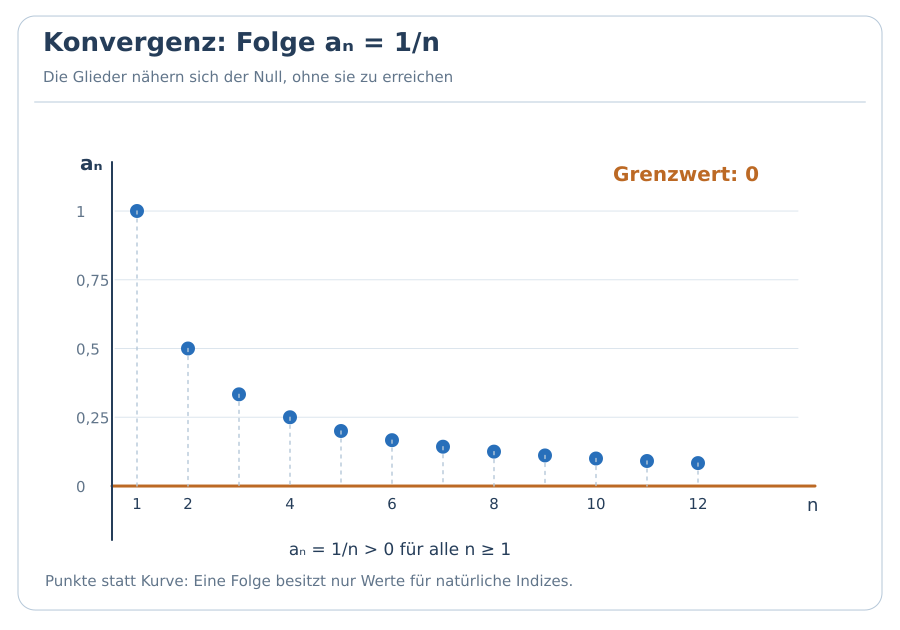

# M1-L2 – Universität: Analysis I – Folgen, Reihen und Konvergenz {#L2}

**Kursbereich:** M1 – Bachelor: mathematische Grundlagen

**Niveau:** Bachelor

**Vorwissen:** Keine festen Voraussetzungen angegeben.

**Einordnung:** Universitäres Kerngebiet · Grundlagen der Analysis

## Worum geht es? {#S1}

Ein Algorithmus kann immer neue Näherungswerte berechnen, ohne je einen exakt „letzten“ Schritt zu erreichen. In der Analysis fragen wir, ob sich solche Werte dennoch einem festen Wert annähern und was „beliebig genau“ wirklich bedeutet. Eine **Folge** ist eine geordnete Liste von Zahlen, die theoretisch unendlich weit fortgesetzt werden kann. Eine **Reihe** entsteht, wenn wir die Glieder einer Folge nacheinander addieren. Der Grenzwert verbindet diese Begriffe und erlaubt es, endliche Berechnungen von idealisierten unendlichen Prozessen zu unterscheiden.

## Grundidee und Anschauung {#S2}

Stell dir vor, eine Routine halbiert nach jeder Iteration den Abstand zu einer Zielmarke. Der verbleibende Abstand wird kleiner: ein Halb, ein Viertel, ein Achtel und so weiter. Obwohl jeder einzelne Wert positiv bleibt, gibt es keine positive feste Schwelle, unterhalb derer die Folge irgendwann nicht mehr kleiner werden könnte. Diese präzise Form der Annäherung heißt **Konvergenz**.

## Neue Zeichen – zuerst lesen {#S3}

  Zeichen                Name / Aussprache                          Bedeutung hier                                  Andere Verwendung
  ---------------------- ------------------------------------------ ----------------------------------------------- --------------------------------------------------------
  $a_n$                  „a mit Index enn“                          n-tes Glied einer Folge                         Index kann allgemeiner einen Messwert bezeichnen
  $(a_n)$                „die Folge a enn“                          gesamte geordnete Folge                         Klammer sonst auch Termgruppierung
  $n\in\mathbb{N}$       „enn ist Element der natürlichen Zahlen“   Laufender positiver Index; Start wird genannt   In manchen Definitionen beginnt $\mathbb N$ bei null
  $n\to\infty$           „enn geht gegen unendlich“                 Index wächst ohne feste Obergrenze              $\infty$ ist hier keine einsetzbare reelle Zahl
  $\lim$                 „Limes“                                    Grenzwert                                       Auch Grenzwerte von Funktionen
  $L$                    „ell“                                      Möglicher Grenzwert                             Beliebiger anderer Parameter
  $\varepsilon$          „Epsilon“                                  Eine beliebige, streng positive Genauigkeit     In Anwendungen Fehlertoleranz
  $N$                    „groß enn“                                 Schwelle für den Folgeindex                     Oft auch Menge natürlicher Zahlen in anderer Schrift
  $\forall$ / $\exists$  „für alle“ / „es gibt“                     Quantoren aus M1-L1                             Formale Logik allgemein
  $\lvert a_n-L\rvert$   „Betrag von a enn minus ell“               Abstand zwischen Folgenglied und Zielwert       Betrag bei komplexen Zahlen anders geometrisch deutbar
  $<$                    „kleiner als“                              Strenge Schranke                                $\leq$ erlaubt Gleichheit
  $\sum$                 „großes Sigma“                             Summe von Reihengliedern                        Statistik-Summenzeichen
  $k=1$ unter $\sum$     „ka beginnt bei eins“                      Startindex der Addition                         Andere Indexgrenzen möglich
  $s_n$                  „ess mit Index enn“                        n-te Partialsumme                               Andere Folgenbezeichnung möglich
  $q$                    „ku“                                       Konstanter Faktor geometrischer Folge           Beliebiger Modellparameter
  $\lvert q\rvert$       „Betrag von ku“                            Positiver Abstand von null                      Allgemeiner Betrag
  $\sum$                 „Summe“                                    Typografische Form des großen Sigma             Identisch in der Bedeutung mit $\sum$
  `↛`                    „konvergiert nicht gegen“                  Verneint angegebenen Grenzwert                  Nicht zwingend alleinige Divergenznotation

## Folgen: Zahlen mit laufender Nummer {#S4}

Eine Folge ordnet jedem zugelassenen ganzzahligen Index genau einen Zahlenwert zu. Man kann sie als Funktion mit natürlichem Definitionsbereich auffassen.

$$
a_n=\frac1n\qquad\text{für }n=1,2,3,\ldots
$$

**Vollständig gesprochen:** „a mit Index n ist gleich eins durch n, für n gleich eins, zwei, drei und so weiter.“ Die ersten Glieder lauten $1$, $\frac12$, $\frac13$ und $\frac14$. Für immer größere Indizes nähert sich der Wert null.

$$
\lim_{n\to\infty}a_n=0
$$

**Gesprochen:** „Der Grenzwert von a enn für enn gegen unendlich ist null.“ Ein Grenzwert muss **kein Glied der Folge** sein. In diesem Beispiel wird null nie als Folgenglied angenommen, aber beliebig dicht angenähert.

Eine Folge kann **beschränkt** sein, ohne zu konvergieren. Die alternierende Folge $1,-1,1,-1,\ldots$ bleibt beispielsweise stets zwischen minus eins und eins, hat jedoch keinen Grenzwert. Ebenso kann eine Folge unbeschränkt wachsen: $a_n=n$ überschreitet jede vorgegebene reelle Schranke; sie konvergiert nicht zu einer endlichen reellen Zahl.

## Was bedeutet „beliebig nahe“ exakt? {#S5}

Das mathematische Wort **Konvergenz** heißt nicht einfach „wird meistens kleiner“. Es verlangt, dass die Glieder **ab einem ausreichend späten Index dauerhaft innerhalb jeder noch so kleinen positiven Entfernung vom Zielwert bleiben**.

Zunächst die Wörter: $\varepsilon$ („Epsilon“) ist eine beliebige erlaubte Genauigkeit, beispielsweise ein Hundertstel. $N$ („groß N“) ist ein dazu passender Startindex. $n\geq N$ („enn größer gleich groß N“) bedeutet: Ab hier betrachten wir alle späteren Folgenglieder.

$$
\forall\varepsilon>0\quad\exists N\in\mathbb{N}\quad\forall n\geq N:\ \lvert a_n-L\rvert<\varepsilon
$$

**Vollständig gesprochen:** „Für jede positive Zahl Epsilon gibt es einen natürlichen Index N, so dass für alle **natürlichen** Indizes n ab N der Abstand zwischen a enn und dem Grenzwert L kleiner als Epsilon ist.“ Hier sind die Folgenglieder reelle Zahlen und $L$ ist eine feste reelle Zahl; die Menge der Indizes beginnt wie in der ersten Folge bei eins. Der Quantor $\forall$ bedeutet „für alle“, $\exists$ „es existiert“; beide wurden in M1-L1 erklärt.

Das **N darf von Epsilon abhängen**, aber nicht für jedes spätere n erneut anders gewählt werden. Die Reihenfolge der Quantoren ist entscheidend. Je enger die geforderte Genauigkeit, desto weiter hinten darf die passende Indexschwelle liegen.

**Mini-Beispiel:** Bei $a_n=\frac1n$ und Zielwert $L=0$ wollen wir $\lvert a_n-0\rvert<0{,}01$ erreichen. Das bedeutet $\frac1n<0{,}01$ oder $n>100$. Wir können $N=101$ wählen: Ab dem 101. Glied liegen **alle** späteren Werte unter der Toleranz 0,01. Beim 100. Glied gilt dagegen $\frac1{100}=0{,}01$, was die verlangte **strenge** Ungleichung noch nicht erfüllt. Allgemein genügt es, zu jedem $\varepsilon>0$ eine positive ganze Zahl $N$ **größer als $\frac1\varepsilon$** zu wählen. Dann ist für jedes $n\geq N$ auch $\frac1n<\varepsilon$; damit ist die Konvergenz gegen null für **jede** positive Toleranz gezeigt.

## Monotonie, Beschränktheit und Grenzwert {#S6}

Eine Folge heißt **monoton wachsend**, wenn ihre Glieder nie kleiner werden; **monoton fallend**, wenn sie nie größer werden. „Streng“ bedeutet, dass die Änderung bei jedem Schritt tatsächlich positiv beziehungsweise negativ ist.

{alt="Punktfolge a n gleich eins durch n für n von eins bis zwölf, positiv und streng fallend gegen null."}

Die Folge $a_n=\frac1n$ hat positive Glieder, konvergiert aber gegen 0.

Die Folge $a_n=\frac1n$ ist streng fallend und nach unten durch null beschränkt. Ein grundlegender Satz der reellen Analysis lautet: **Jede monotone und beschränkte Folge reeller Zahlen konvergiert.** Das ist ein wichtiges Resultat über die Vollständigkeit der reellen Zahlen.

**Warum kann man dem vertrauen – Beweisidee?** Bei einer monoton steigenden, nach oben beschränkten Folge gibt es eine kleinste obere Schranke. Die Folgenglieder können dieser Schranke nicht dauerhaft mit positivem Abstand fernbleiben, sonst wäre eine kleinere obere Schranke möglich. Für fallende Folgen argumentiert man entsprechend mit einer größten unteren Schranke. Die genaue Begründung nutzt eine fundamentale Eigenschaft von $\mathbb{R}$, die Vollständigkeit.

**Grenze:** Monotonie allein reicht nicht aus. Die Folge $1,2,3,\ldots$ ist streng wachsend, aber nach oben unbeschränkt; sie besitzt keinen endlichen reellen Grenzwert.

## Reihen: Unendlich viele Glieder aufsummieren {#S7}

Eine **Reihe** wird über die **Partialsummen** einer Folge definiert. Die n-te Partialsumme enthält nur die ersten n Glieder – ist also eine gewöhnliche endliche Rechnung.

$$
s_n=a_1+a_2+\cdots+a_n=\sum_{k=1}^{n}a_k
$$

**Vollständig gelesen:** „Die n-te Partialsumme s enn ist a eins plus a zwei und so weiter bis a enn. Das ist die Summe der Glieder a ka für ka von eins bis n.“ $\sum$ („großes Sigma“) steht für das Aufaddieren; $k$ ist der Laufindex und $n$ die obere Grenze.

Eine unendliche Reihe **konvergiert**, wenn die Folge ihrer Partialsummen einen endlichen Grenzwert hat.

$$
\sum_{k=1}^{\infty}a_k=\lim_{n\to\infty}s_n
$$

**Gesprochen:** „Die unendliche Summe von a ka ab ka gleich eins ist der Grenzwert der Partialsummen s enn für enn gegen unendlich.“ Das Zeichen $\infty$ bedeutet „unendlich“ und kennzeichnet hier die unbeschränkte Fortsetzung der Summation; wir setzen dafür nicht einfach eine unendlich große Zahl ein.

### Beispiel: geometrische Reihe {#abschnitt-8}

Wenn ein fester Faktor $q$ von einem Glied zum nächsten multipliziert wird, entsteht eine geometrische Folge. Für $\lvert q\rvert<1$ konvergiert die Reihe ab dem Startindex null:

$$
1+q+q^2+q^3+\cdots=\frac1{1-q}\qquad\text{falls }\lvert q\rvert<1
$$

**Vollständig gelesen:** „Eins plus ku plus ku Quadrat plus ku hoch drei und so weiter ergibt eins geteilt durch eins minus ku, sofern der Betrag von ku kleiner als eins ist.“

**Mini-Beispiel:** Mit $q=\frac12$ erhalten wir $1+\frac12+\frac14+\frac18+\cdots=2$. Die Partialsummen $1$, $1{,}5$, $1{,}75$, $1{,}875$ nähern sich von unten der zwei. Das bedeutet nicht, dass ein einzelner Summand jemals zwei beträgt.

**Beweisidee:** Für $q\ne 1$ lassen sich die ersten $n+1$ Glieder (also $1+q+\cdots+q^n$) zu $\frac{1-q^{n+1}}{1-q}$ zusammenfassen. Dies kann man durch Multiplikation der Teilsumme mit $1-q$ überprüfen: Die mittleren Terme heben sich gegenseitig auf. Für $\lvert q\rvert<1$ geht $q^{n+1}$ gegen null. Deshalb bleibt im Grenzwert $\frac1{1-q}$ übrig. Für $q=1$ beträgt die Summe der ersten $n+1$ Glieder dagegen $n+1$ und wächst unbegrenzt. Für $q=-1$ wechseln die Partialsummen zwischen eins und null. Insgesamt gilt: Für $\lvert q\rvert\geq 1$ konvergiert die dargestellte unendliche geometrische Reihe nicht zu einem endlichen reellen Wert; bei anderen $\lvert q\rvert>1$ gibt es ebenso keinen endlichen reellen Summengrenzwert.

**Vorzeichen-Gegenprobe:** Für $q=-\frac12$ lauten die ersten Partialsummen $1$, $\frac12$, $\frac34$, $\frac58$. Sie schwanken um den Grenzwert $\frac1{1+\frac12}=\frac23$ und nähern sich ihm dennoch an. **Monotonie ist für Konvergenz nicht notwendig.**

## Wichtig: Glieder gegen null reichen nicht aus {#S8}

Eine notwendige Bedingung für die Konvergenz einer Reihe ist, dass ihre Summanden gegen null gehen. Sie ist **nicht hinreichend**: Wenn die Partialsummen $s_n$ gegen einen endlichen Wert konvergieren, dann muss die Differenz zwischen zwei aufeinanderfolgenden Partialsummen, also der hinzugefügte Summand $a_n$, gegen null gehen. Die Umkehrung folgt daraus nicht.

Die sogenannte **harmonische Reihe** lautet:

$$
\begin{aligned}
&1+\frac12+\frac13+\frac14+\frac15+\ldots
\end{aligned}
$$

Ihre Summanden gehen gegen null, aber die Partialsummen wachsen ohne endliche obere Schranke. **Begründung durch Gruppen:** Hinter dem ersten Glied lassen sich $\left(\frac12\right)$, $\left(\frac13+\frac14\right)$, $\left(\frac15+\frac16+\frac17+\frac18\right)$ und so weiter gruppieren. Jede Gruppe besitzt mindestens den Wert $\frac12$, denn ihre Anzahl an Summanden verdoppelt sich jeweils, während jeder Summand mindestens so groß wie der letzte (kleinste) der Gruppe ist. Es kommen unbegrenzt viele solcher Gruppen hinzu; die Partialsummen können daher nicht durch eine feste reelle Zahl nach oben beschränkt sein.

**Grenze der Alltagserwartung:** „Jeder neue Summand wird winzig“ heißt also nicht automatisch „die Gesamtsumme bleibt endlich“. Die Geschwindigkeit des Abklingens ist entscheidend.

## Rechnen mit Grenzwerten – mit Voraussetzungen {#S9}

Wenn zwei reelle Folgen gegen endliche Grenzwerte konvergieren, dürfen wir ihre Summen und Produkte unter üblichen Regeln ebenfalls im Grenzwert bilden. Bei einem Quotienten muss der Grenzwert des Nenners **ungleich null** sein, und der Quotient muss für hinreichend späte Indizes definiert sein.

Anders sieht es bei Ausdrücken aus, in denen etwa „null geteilt durch null“ als bloße Grenzwertgestalt auftritt: Das ist keine erlaubte Division, sondern signalisiert, dass wir den Grenzprozess genauer untersuchen müssen. Solche Fälle werden in höheren Analysis-Lektionen systematischer behandelt.

## Wofür nützlich? {#S10}

Folgen modellieren iterative Verfahren, beispielsweise die wiederholte Verbesserung eines Näherungswerts für eine Gleichung. Reihen begegnen bei Filterberechnungen, Zahlendarstellungen und der Analyse unendlich fortsetzbarer Prozesse. In KI-Optimierung ist Konvergenz die Frage, ob sich ein Verfahren stabilisiert und unter welchen Annahmen eine Folge von Modellparametern oder Fehlerwerten zu einem Grenzwert gelangt.

**Praktische Grenzen:** Ein endlicher Computer führt keine unendlichen Schritte aus und rechnet mit begrenzter Genauigkeit. Numerisch „kaum noch Änderung“ ist kein Beweis für mathematische Konvergenz; Rundung, Stagnation oder ein schlecht gewähltes Abbruchkriterium können diesen Eindruck ebenfalls erzeugen.

## Annahmen und Grenzen {#S11}

Die Aussage „monoton und beschränkt impliziert konvergent“ nutzt die **Vollständigkeit der reellen Zahlen**; in anderen Zahlbereichen muss der Satz nicht in derselben Form gelten. Eine geometrische Reihe darf nur für $\lvert q\rvert<1$ durch $\frac1{1-q}$ ersetzt werden, wenn die Summe unendlich vieler Glieder gemeint ist. Bei einer **endlichen** Summe gilt stattdessen die passende Partialsummenformel.

Die Epsilon-N-Definition beschreibt **Konvergenz einer reellwertigen Zahlenfolge**, nicht automatisch den Konvergenzbegriff einer Funktionenfolge oder eines numerischen Programms. Auch wenn alle Glieder positiv sind, darf man ohne weitere Begründung nicht behaupten, dass die Folge monoton fällt; das Gegenbeispiel mit negativem geometrischen Faktor zeigt sogar eine konvergente, aber nicht monotone Folge von Partialsummen. Ein Rechner prüft nur endlich viele Indizes mit endlicher Genauigkeit; ein einzelner kleiner Zahlenunterschied ist kein Grenzwertbeweis. Auch darf man Summen, Produkte oder Quotienten erst unter den jeweiligen Voraussetzungen durch Grenzwerte ersetzen.

## Verbindung zu M1-L3 {#S12}

Mit der präziseren Grenzwertidee können wir als Nächstes **Stetigkeit, Ableitungen und Integrale strengere Voraussetzungen** geben. M1-L3 führt die bekannte Analysis weiter, ohne stillschweigend mehr Symbolkenntnis vorauszusetzen.

## Quellen (extern) {#S13}

Keine externen Quellen angegeben.
