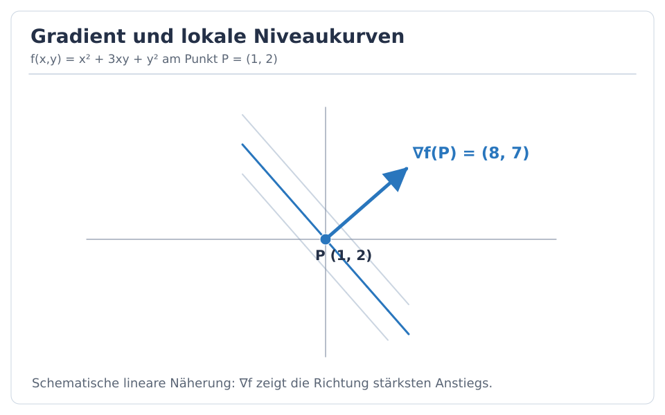

# M1-L4 – Universität: Analysis III – Funktionen mehrerer Variablen {#L4}

**Kursbereich:** M1 – Bachelor: mathematische Grundlagen

**Niveau:** Bachelor

**Vorwissen:** Keine festen Voraussetzungen angegeben.

**Einordnung:** Universitäres Kerngebiet · mehrdimensionale Analysis

## Worum geht es? {#S1}

Viele praktische Größen hängen von mehr als einer Einflussgröße ab. Die Temperatur in einem Raum verändert sich beispielsweise mit dem Ort; die Laufzeit eines Dienstes kann von Last und Speichergröße abhängen. Für solche Zusammenhänge genügt eine einzige Steigung nicht. Wir fragen stattdessen, wie sich ein Ergebnis verändert, wenn wir nur eine Eingabe verändern, und in welche Richtung es insgesamt am stärksten ansteigt. Außerdem können wir Werte über Flächen und räumliche Gebiete aufsummieren.

## Grundidee und Anschauung {#S2}

Stell dir eine Landschaft vor. Ihre Höhe hängt davon ab, wie weit du nach Osten und Norden gegangen bist. Für jede der beiden Koordinaten lässt sich separat eine Änderungsrate berechnen: Wie steil wird es nach Osten, wenn Norden unverändert bleibt? Wie steil nach Norden, wenn Osten festgehalten wird? Beide Werte zusammen bilden einen Vektor – den **Gradienten**. Er zeigt in der gewöhnlichen ebenen Geometrie lokal in die Richtung des stärksten Anstiegs.

## Neue Zeichen – zuerst lesen {#S3}

  Zeichen                            Name / Aussprache                                 Bedeutung hier                                                       Andere Verwendung
  ---------------------------------- ------------------------------------------------- -------------------------------------------------------------------- --------------------------------------------------------------------
  $\mathbb{R}^2$                     „er zwei“ oder „reeller zweidimensionaler Raum“   Paare reeller Eingaben $(x,y)$                                       Allgemein ein Vektorraum
  $f:\mathbb{R}^2\to\mathbb{R}$      „eff bildet er zwei nach er ab“                   Funktion mit zwei reellen Eingaben und einem reellen Ergebnis        Definitionsbereich kann kleiner sein
  $(x,y)$                            „geordnetes Paar iks, ypsilon“                    Ort beziehungsweise Eingabepaar                                      Auch Zahlenpaar in Statistik
  `∂`                                „partielles De“ oder „d partiell“                 Ableitung nach einer Eingabe bei festgehaltener anderer Eingabe      Auch bei partiellen Differentialgleichungen
  $\frac{\partial f}{\partial x}$    „partielle Ableitung von eff nach iks“            Änderungsrate nur in x-Richtung                                      Bei mehreren Variablen zu unterscheiden von gewöhnlicher Ableitung
  $\frac{\partial f}{\partial y}$    „partielle Ableitung von eff nach ypsilon“        Änderungsrate nur in y-Richtung                                      Entsprechend bei anderen Eingaben
  `∇`                                „Nabla“                                           Operator, der aus den partiellen Ableitungen den Gradienten bildet   Divergenz und Rotation in der Vektoranalysis
  $\nabla f$                         „Gradient von eff“                                Vektor aller ersten partiellen Ableitungen                           Bei höherdimensionalen Eingaben mehr Komponenten
  $\vec{u}$                          „Vektor u“                                        Richtung, idealerweise auf Länge eins normiert                       u kann sonst eine skalare Variable sein
  $D_u f$                            „Richtungsableitung von eff in Richtung u“        Änderungsrate entlang u                                              Andere Notationen sind verbreitet
  $\lVert\vec u\rVert$               „Norm von Vektor u“                               Vektorlänge                                                          Auch andere Normen als euklidische möglich
  `∫∫` / $\mathrm{d}x\,\mathrm{d}y$  „Doppelintegral“ / „de iks de ypsilon“            Aufsummierung über eine Fläche, mit angegebenem Integrationsgebiet   Differentialzeichen in iterierten Integralen
  $Hf$                               „Hesse-Matrix von eff“                            Tabelle zweiter partieller Ableitungen                               H kann sonst ein anderer Operator sein

Bereits bekannt: $\cdot$ zwischen Vektoren ist das Skalarprodukt (Schule M2-L11); $t$ wird als Parameter für einen Weg benutzt (Schule M2-L12). Im Folgenden heißt $f(x,y)$ „eff von iks und ypsilon“. Wo ein Paar als Funktionsargument steht, kennzeichnet das Komma die beiden Eingaben, nicht eine Dezimalzahl.

## Partielle Ableitung: nur eine Variable verändert sich {#S4}

Wir betrachten ein Modell mit zwei Eingaben:

$$
f(x,y)=x^2+3xy+y^2
$$

**Gesprochen:** „Eff von iks und ypsilon ist iks Quadrat plus drei mal iks mal ypsilon plus ypsilon Quadrat.“ Wird nur $x$ verändert, behandeln wir $y$ wie eine Konstante. Entsprechend wird bei einer Änderung von $y$ die Variable $x$ festgehalten.

$$
\begin{aligned}
\frac{\partial f}{\partial x}&=2x+3y\\
\frac{\partial f}{\partial y}&=3x+2y
\end{aligned}
$$

**Gesprochen:** „Die partielle Ableitung von eff nach iks ist zwei iks plus drei ypsilon; die partielle Ableitung nach ypsilon ist drei iks plus zwei ypsilon.“ Das folgt aus den bereits gelernten Ableitungsregeln, aber jeweils nur für eine Eingabe zugleich.

**Mini-Beispiel.** Am Punkt $(1,2)$ ist der Funktionswert $f(1,2)=1+6+4=11$. Die partiellen Ableitungen dort lauten $8$ in x-Richtung und $7$ in y-Richtung. Das sind **lokale Änderungsraten**, keine zwei neuen Funktionswerte.

Wichtig ist, dass partielle Ableitungen existieren können, obwohl eine Funktion als Ganzes an einer Stelle nicht stetig oder nicht **total differenzierbar** ist. Total differenzierbar bedeutet: Es gibt eine lineare Näherung, deren Restfehler im Vergleich zur Länge der Eingabeänderung gegen null geht.

**Gegenbeispiel für einen häufigen Fehlschluss.** Setzen wir $g(x,y)=\frac{xy}{x^2+y^2}$ für $(x,y)\neq(0,0)$ und $g(0,0)=0$. Entlang beider Koordinatenachsen ist $g$ stets null; daher existieren bei $(0,0)$ beide partiellen Ableitungen und sind null. Nähern wir uns aber entlang der Geraden $x=y=t$ mit $t\neq0$, so ist $g(t,t)=\frac12$ und geht nicht gegen $g(0,0)=0$. Die Funktion ist im Ursprung also nicht stetig und folglich dort nicht total differenzierbar. **Zwei partielle Ableitungen allein genügen nicht**. Unser Polynom $f$ dagegen ist überall glatt und erfüllt die stärkeren Voraussetzungen.

## Gradient: lokale Änderung als Vektor {#S5}

Im euklidischen Koordinatensystem schreiben wir die partiellen Ableitungen als Vektor:

{alt="Lokale lineare Niveaukurven um Punkt eins zwei mit senkrecht dazu gezeichnetem Gradienten Vektor acht sieben."}

Am Punkt (1, 2) steht $\nabla f=(8,7)$ senkrecht auf der linearisierten Niveaukurve.

$$
\nabla f(x,y)=\left(\frac{\partial f}{\partial x},\frac{\partial f}{\partial y}\right)
$$

**Gesprochen:** „Der Gradient von eff ist der Vektor, dessen erste Komponente die partielle Ableitung nach iks und dessen zweite Komponente die partielle Ableitung nach ypsilon ist.“ Für unser Beispiel gilt am Punkt $(1,2)$ somit $\nabla f(1,2)=(8,7)$.

Ist $f$ total differenzierbar, steht ein **nicht verschwindender Gradient** senkrecht auf einer glatten **Höhenlinie** – einer Kurve mit gleichem Funktionswert. Bei gewöhnlicher euklidischer Längenmessung ist die Richtung des Gradienten die Richtung des stärksten lokalen Anstiegs. Ist der Gradient null, haben alle Einheitsrichtungen zunächst dieselbe Richtungsableitung null; eine ausgezeichnete Anstiegsrichtung lässt sich dann nicht aus dem Gradienten ablesen. Die Gegenrichtung eines nicht verschwindenden Gradienten führt zum stärksten lokalen Abfall.

Für einen **Einheitsvektor** $\vec{u}$, dessen Norm $1$ ist, ergibt sich die Richtungsableitung bei einer differenzierbaren Funktion als:

$$
D_u f=\nabla f\cdot\vec{u}
$$

**Vollständig gesprochen:** „Die Richtungsableitung in Richtung u ist das Skalarprodukt des Gradienten und des Einheitsvektors u.“ Für $\vec{u}=(\frac35,\frac45)$ ist die Länge tatsächlich eins. Daher beträgt die **lokale Richtungsableitung** im Beispiel $(8,7)\cdot(\frac35,\frac45)=\frac{24}{5}+\frac{28}{5}=\frac{52}{5}=10{,}4$ Einheiten des Funktionswertes je Längeneinheit in dieser Richtung. Das ist nicht die endliche Änderung bei einer großen Bewegung. Zum Vergleich: Der größte mögliche Anstieg pro euklidischer Längeneinheit ist $\lVert\nabla f(1,2)\rVert=\sqrt{8^2+7^2}=\sqrt{113}\approx10{,}630$; $10{,}4$ liegt darunter. `√` heißt Quadratwurzel. Gleichheit tritt für einen Einheitsvektor in Gradientenrichtung ein.

## Mehrdimensionale Kettenregel: Veränderung entlang eines Weges {#S6}

Manchmal ändern sich beide Eingaben gleichzeitig, etwa wenn ein Roboter einer Bahn folgt. Dann können wir nicht nur die x- oder nur die y-Ableitung verwenden. Nennen wir den Weg $(x(t),y(t))$, so ergibt sich unter Differenzierbarkeit:

$$
\frac{\mathrm{d}}{\mathrm{d}t}f(x(t),y(t))=\frac{\partial f}{\partial x}\cdot x^{\prime}(t)+\frac{\partial f}{\partial y}\cdot y^{\prime}(t)
$$

**Gelesen:** „Die zeitliche Ableitung der zusammengesetzten Funktion ist die partielle Ableitung nach iks mal die Geschwindigkeit in iks-Richtung plus die partielle Ableitung nach ypsilon mal die Geschwindigkeit in ypsilon-Richtung.“ $\frac{\mathrm{d}}{\mathrm{d}t}$ bedeutet gewöhnliche Ableitung nach der Zeitvariablen $t$ und die Striche `′` bezeichnen die entsprechenden Ableitungen. Die beiden partiellen Ableitungen werden an der jeweils aktuellen Wegposition ausgewertet.

**Mini-Beispiel.** Für das obige $f$ wählen wir $x(t)=t$ und $y(t)=t^2$. Bei $t=1$ befindet sich der Weg am Punkt $(1,1)$; dort ist der Gradient $(5,5)$. Da $x^{\prime}(1)=1$ und $y^{\prime}(1)=2$, folgt die **momentane zeitliche Änderungsrate** $5\cdot1+5\cdot2=15$. Die Zahl 15 ist kein Funktionswert und keine Gesamtänderung über ein Zeitintervall. Direktes Einsetzen liefert $f(t,t^2)=t^2+3t^3+t^4$; dessen gewöhnliche Ableitung ist $2t+9t^2+4t^3$, bei $t=1$ ebenfalls $15$.

## Doppelintegral: nicht nur eine Linie aufsummieren {#S7}

Ein Integral über eine Fläche kann beispielsweise eine Dichte, Temperatur oder eine Höhenfunktion über einem Gebiet aufsummieren. Für ein Rechteck lässt sich das Integral unter geeigneten Voraussetzungen nacheinander in beiden Koordinaten berechnen.

$$
\int_0^1\int_0^1(x+y)\,\mathrm{d}y\,\mathrm{d}x=1
$$

**Gelesen:** „Integriere zuerst iks plus ypsilon nach ypsilon von null bis eins, dann das Ergebnis nach iks von null bis eins; der Gesamtwert ist eins.“ Zuerst ist $x$ konstant und das innere Integral ergibt $x+\frac12$. Das äußere Integral liefert $\frac12+\frac12=1$.

Bei stetigen Funktionen auf abgeschlossenen Rechtecken darf man die Integrationsreihenfolge entsprechend vertauschen (ein geeigneter Spezialfall des Satzes von Fubini). In unserem Beispiel ist auch die umgekehrte Reihenfolge $\int_0^1\int_0^1(x+y)\,\mathrm{d}x\,\mathrm{d}y=1$: Zuerst ergibt sich $\frac12+y$, danach wieder $1$. Bei nichtrechteckigen Gebieten hängen die Grenzen häufig von der jeweils anderen Variablen ab; beim Vertauschen muss man diese Grenzen korrekt umschreiben.

## Zweite Ableitungen und lokale Krümmung – Ausblick {#S8}

Die **Hesse-Matrix** sammelt die zweiten partiellen Ableitungen einer hinreichend glatten Funktion. Sie hilft, die Krümmung in verschiedenen Richtungen und damit beispielsweise stationäre Punkte in Optimierungsproblemen zu beurteilen.

Für unsere Beispielfunktion ist:

$$
\begin{aligned}
Hf&=\begin{bmatrix}2&3\\3&2\end{bmatrix}
\end{aligned}
$$

Die Einträge $2$ und $2$ stammen aus zweimaligem Ableiten nach derselben Koordinate; die beiden $3$ sind die gemischten Ableitungen. Sind die zweiten partiellen Ableitungen in einer Umgebung stetig, stimmen die beiden gemischten Ableitungen überein (Satz von Schwarz); dann ist die Hesse-Matrix symmetrisch. Im Polynom ist diese Voraussetzung erfüllt. Am Punkt $(0,0)$ ist der Gradient null, trotzdem liegt **kein Minimum** vor: Entlang der Richtung $x=y=t$ ist der Funktionswert $5t^2$ positiv, entlang $x=t,\ y=-t$ dagegen $-t^2$ negativ. Ein solcher Punkt heißt **Sattelpunkt**. Auch die Determinante der Hesse-Matrix zeigt hier eine gemischte Krümmung: $2\cdot2-3\cdot3=-5<0$. Die Matrix hat deshalb Eigenwerte mit entgegengesetztem Vorzeichen; der stationäre Punkt ist ein strenger Sattelpunkt. Dieser Zweite-Ableitungs-Test verlangt eine hinreichend glatte Funktion und gilt für einen **inneren stationären Punkt**. Wir sehen erneut: Eine verschwindende erste Ableitung allein entscheidet nicht über ein Extremum.

## Wofür nützlich? {#S9}

In neuronalen Netzen ist jeder Modellfehler von vielen Parametern abhängig; der Gradient ordnet jedem Parameter eine lokale Änderungsrate zu und ermöglicht darauf aufbauend Gradientenverfahren. In Robotik und Computergrafik beschreiben partielle Ableitungen die Veränderung von Oberflächen, Trajektorien und Koordinatentransformationen. Doppelintegrale liefern beispielsweise die Gesamtmasse einer Fläche aus einer Flächendichte oder die Wahrscheinlichkeit für ein zweidimensionales Gebiet bei gegebener gemeinsamer Dichte.

## Annahmen und Grenzen {#S10}

- Eine partielle Ableitung betrachtet zunächst nur eine Koordinatenrichtung; ihre Existenz allein garantiert weder Stetigkeit noch totale Differenzierbarkeit.
- Die Gradienteninterpretation als Richtung des steilsten Anstiegs setzt eine festgelegte Geometrie beziehungsweise Norm voraus; üblich ist die euklidische.
- Die Formel für eine Richtungsableitung als Skalarprodukt erfordert Differenzierbarkeit. Ohne normierten Richtungsvektor erhält man eine anders skalierte Änderungsrate.
- Integration über ein Gebiet setzt die Grenzen und – je nach Satz – geeignete Bedingungen wie Stetigkeit oder Integrabilität voraus.
- Bei numerischer Optimierung kann der Gradient null sein, obwohl kein Minimum gefunden wurde.

## Verbindung zur nächsten Lektion {#S11}

Die Änderungsraten mehrerer Variablen sind Vektoren; ihre Zusammensetzung wird mit Matrizen beschrieben. **M1-L5** klärt deshalb zuerst, was Vektorräume, Basen und lineare Abbildungen eigentlich sind.

## Quellen {#S12}

In dieser Lektion sind keine Einzelquellen gesondert verzeichnet.
