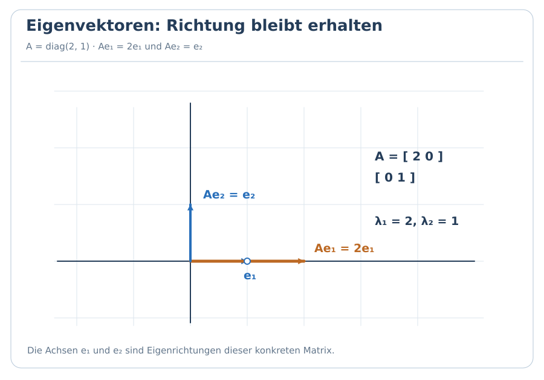

# M1-L6 – Universität: Lineare Algebra II – Rang, Determinanten und Eigenwerte {#L6}

**Kursbereich:** M1 – Bachelor: mathematische Grundlagen

**Niveau:** Bachelor

**Vorwissen:** Keine festen Voraussetzungen angegeben.

**Einordnung:** Universitäres Kerngebiet · lineare Algebra II

## Worum geht es? {#S1}

In M1-L5 haben wir gelernt, dass eine Matrix eine lineare Abbildung in gewählten Basen beschreibt. Nun untersuchen wir diese Abbildung genauer. **Rang** sagt, wie viele voneinander unabhängige Ausgaberichtungen erhalten bleiben. **Determinante** hilft bei quadratischen Matrizen zu erkennen, ob eine Transformation Raumfläche oder Raumvolumen auf null zusammendrückt. **Eigenvektoren** sind besondere Richtungen, deren Richtung durch die Transformation erhalten bleibt; der zugehörige **Eigenwert** sagt, wie sie skaliert oder umgedreht werden. Solche Eigenschaften sind nützlich, um große Modelle zu verstehen, ohne jede einzelne Eingabe separat auszuprobieren.

## Grundidee und Anschauung {#S2}

Stelle dir ein kariertes Blatt vor, das gestreckt, gespiegelt oder zusammengedrückt wird. Nach einer gewöhnlichen Streckung bleibt aus einem Quadrat ein Parallelogramm: Das Blatt besitzt weiterhin zwei unabhängige Richtungen. Wenn das gesamte Blatt auf eine einzige Linie zusammenfällt, geht eine Dimension verloren. Häufig gibt es Richtungen, die bei der Deformation auf derselben Geraden bleiben: Das sind Eigenrichtungen. Bei höherdimensionalen Datensätzen entspricht das dem Verlust von Information oder der besonderen Verstärkung bestimmter Merkmalskombinationen.

## Neue Zeichen – vor den Formeln {#S3}

  Zeichen                                                            Name / Aussprache                     Bedeutung in dieser Lektion                                 Möglicher anderer Gebrauch
  ------------------------------------------------------------------ ------------------------------------- ----------------------------------------------------------- --------------------------------------------------------------------------
  $A$                                                                „Matrix A“                            Zahlentabelle der linearen Abbildung                        Fläche, Ereignis oder Menge in anderen Kapiteln
  $\operatorname{rang}(A)$ beziehungsweise $\operatorname{rank}(A)$  „Rang von A“                          Anzahl linear unabhängiger Spalten beziehungsweise Zeilen   `rank` im Code kann Rangfolge meinen
  $\det(A)$                                                          „Determinante von A“                  Einzelne Zahl zu einer **quadratischen** Matrix             Auch $\lvert A\rvert$ in manchen Büchern; Vorsicht bei Betrag/Mächtigkeit
  $\lambda$                                                          „Lambda“                              Eigenwert; eine Zahl, gegebenenfalls komplex                Parameter oder Skalierungsfaktor
  $\vec{v}$                                                          „Vektor v“                            Von null verschiedener Eigenvektor                          Allgemeiner Vektor aus M1-L5
  $A\cdot\vec v$                                                     „A mal Vektor v“                      Matrix-Vektor-Produkt                                       Nicht die Multiplikation zweier gewöhnlicher Zahlen
  $I$                                                                „Einheitsmatrix I“                    Matrix, die Vektoren unverändert lässt                      Buchstabe I kann auch ein Index sein
  $\vec{0}$                                                          „Nullvektor“                          Vektor, dessen Komponenten alle null sind                   Nicht dieselbe Art Objekt wie die Zahl 0
  `≠`                                                                „ungleich“                            Verschiedenheit, etwa $\vec v\ne\vec0$                      Allgemeines Vergleichszeichen
  $A^{-1}$                                                           „A hoch minus eins“, inverse Matrix   Umkehrabbildung bei invertierbarer Matrix                   Bei Zahlen bedeutet hoch minus eins Kehrwert
  $\operatorname{diag}(\ldots)$                                      „Diagonalmatrix mit &#46;&#46;&#46;“              Zahlen nur auf der Hauptdiagonalen                          In Programmen auch Hilfsfunktion
  `⊥`                                                                „senkrecht zu“, orthogonal            Skalarprodukt null bei gewöhnlichem euklidischem Raum       Geometrisches Senkrechtstehen
  $\ker(A)$                                                          „Kern von A“                          Eingabevektoren, die A auf den Nullvektor abbildet          Kern auch bei allgemeinen linearen Abbildungen
  $\dim$                                                             „Dimension“                           Anzahl der Basisvektoren eines Raums                        Kann in der Informatik die Form eines Arrays meinen
  $P$, $D$                                                           „Matrix P“, „Diagonalmatrix D“        Eigenvektorspalten und passende Eigenwerte                  P bezeichnet in M1-L7 Wahrscheinlichkeit

Die Buchstaben $m$ und $n$ bezeichnen die Zeilen- beziehungsweise Spaltenanzahl einer Matrix. Eine $m\times n$-Matrix hat $m$ Zeilen und $n$ Spalten. Die Einheitsmatrix $I$ hat dieselbe quadratische Größe wie $A$, wenn beide in einer Formel kombiniert werden. Eigenwerte können sogar bei reellen Matrizen komplex sein; zunächst betrachten wir Beispiele mit reellen Eigenwerten.

## Rang: Wie viele unabhängige Richtungen bleiben übrig? {#S4}

Die Spalten einer Matrix beschreiben die Bilder der Standardbasisvektoren. Der **Rang** ist die Dimension des von diesen Spalten aufgespannten Raums. Er ist zugleich die maximale Anzahl linear unabhängiger Zeilen. Für eine Matrix mit $m$ Zeilen und $n$ Spalten kann der Rang höchstens die kleinere dieser beiden Zahlen sein.

**Mini-Beispiel: Eine Projektion auf eine Linie.**

$$
\begin{aligned}
B&=\begin{bmatrix}1&2\\2&4\end{bmatrix}
\end{aligned}
$$

Die zweite Spalte $(2,4)$ ist das Doppelte der ersten $(1,2)$. Es gibt also nur **eine** unabhängige Spaltenrichtung: $\operatorname{rang}(B)=1$. Die Abbildung kann nur Punkte auf einer Geraden im Zielraum erreichen. Eine Eingabeinformation geht dabei verloren. So gilt beispielsweise $B\cdot(-2,1)=(0,0)$: Zwei Eingaben, die sich um $(-2,1)$ unterscheiden, besitzen dasselbe Bild. Der Kern ist damit nicht nur der Nullvektor. Für eine lineare Abbildung aus einem $n$-dimensionalen Raum lautet die **Rang-Nullität-Formel**: $\dim\ker(A)+\operatorname{rang}(A)=n$. Hier ergibt sich $1+1=2$.

Zum Vergleich besitzt die Einheitsmatrix der Ebene zwei unabhängige Spalten; ihr Rang ist zwei. Der Rang liefert auch die Grundlage für die Lösbarkeit linearer Gleichungssysteme: Haben Koeffizientenmatrix und um die rechte Seite erweiterte Matrix denselben Rang, ist das System lösbar. Bei einer eindeutigen Lösung entspricht dieser Rang zusätzlich der Anzahl der Unbekannten. Diese Bedingungen gelten für lineare Systeme über einem Körper, hier den reellen Zahlen. **Gegenprobe:** Für $B\cdot(x,y)=(1,0)$ ist die erweiterte Matrix von Rang zwei, die Koeffizientenmatrix aber nur von Rang eins: Das System hat keine Lösung. Bei $B\cdot(x,y)=(1,2)$ stimmen beide Ränge mit eins überein; es gibt unendlich viele Lösungen, weil zwei Unbekannte und nur eine unabhängige Gleichung vorliegen.

## Determinante: Wird Fläche oder Volumen zusammengedrückt? {#S5}

Nur für **quadratische Matrizen** ist die Determinante im üblichen Sinn definiert. Bei einer $2\times2$-Matrix mit den Einträgen $a,b$ in der ersten und $c,d$ in der zweiten Zeile lautet die Rechnung:

$$
\begin{aligned}
A&=\begin{bmatrix}a&b\\c&d\end{bmatrix}\\
\det(A)&=a\cdot d-b\cdot c
\end{aligned}
$$

**Gesprochen:** „Determinante von A ist a mal d minus b mal c.“ Jeder Buchstabe benennt hier den Eintrag an einer festen Position der Matrix. Der Betrag $\lvert\det(A)\rvert$ gibt in der Ebene den **Flächenskalierungsfaktor** einer linearen Abbildung an; in drei Dimensionen entsprechend den Volumenskalierungsfaktor. Ein negatives Vorzeichen bedeutet, dass die Orientierung umkehrt.

Bei der eben gezeigten Matrix $B$ ist $\det(B)=1\cdot4-2\cdot2=0$. Ein Quadrat kann dadurch auf eine Strecke schrumpfen, deren Fläche null ist. Daraus folgt: $B$ ist nicht invertierbar. **Für quadratische Matrizen gilt:** Determinante ungleich null, voller Rang und Existenz einer inversen Matrix sind äquivalente Eigenschaften.

Eine große oder kleine Determinante allein verrät allerdings **nicht**, ob eine numerische Rechnung stabil ist: Sehr unterschiedliche Streckungen können sich in der Determinante gegenseitig ausgleichen. Die numerische *Kondition* betrachten wir in M1-L8. Beispiel: $\operatorname{diag}(1000000,\;0{,}000001)$ besitzt die Determinante $1$, aber in der euklidischen Norm eine Konditionszahl von $10^{12}$. Ein Flächenfaktor von eins schließt also eine äußerst empfindliche Richtung nicht aus.

## Eigenvektoren: Richtungen, die Richtungen bleiben {#S6}

Ein Eigenvektor ist ein von null verschiedener Vektor, dessen Bild bei einer quadratischen Matrix auf derselben Geraden liegt. Der Eigenwert ist der zugehörige Skalierungsfaktor.

{alt="Matrix A mit Diagonale zwei und eins: e1 wird zu 2e1 skaliert, e2 bleibt e2."}

Eigenvektoren behalten ihre Richtung; in diesem Beispiel sind die Eigenwerte 2 und 1.

$$
A\vec{v}=\lambda\vec{v}\qquad\text{mit }\vec{v}\neq\vec{0}
$$

**Gesprochen:** „Matrix A mal Vektor v ist gleich Lambda mal Vektor v, wobei v nicht der Nullvektor ist.“ Der Faktor $\lambda$ darf positiv, negativ oder null sein. Bei $\lambda=0$ wird der Eigenvektor auf den Nullvektor abgebildet; dies ist bei einer singulären Matrix möglich. Seine Ausgangsgerade ist ein Eigenraum, auch wenn der Nullvektor selbst keine Richtung besitzt. Das Wort **Eigenrichtung** meint bei nicht verschwindendem Bild die durch einen reellen Eigenvektor bestimmte Gerade.

**Durchgerechnetes Mini-Beispiel – zwei besonders einfache Richtungen.**

$$
\begin{aligned}
A&=\begin{bmatrix}2&1\\1&2\end{bmatrix}\\
A\cdot(1,1)&=(3,3)=3\cdot(1,1)\\
A\cdot(1,-1)&=(1,-1)=1\cdot(1,-1)
\end{aligned}
$$

Die Richtung $(1,1)$ wird verdreifacht; ihr Eigenwert ist $3$. Die Richtung $(1,-1)$ bleibt unverändert; ihr Eigenwert ist $1$. Damit haben wir die zwei reellen Eigenwerte und zugehörigen Eigenvektoren gefunden. Der Rang von $A$ ist zwei und die Determinante ist $2\cdot2-1\cdot1=3$. Das passt zum Produkt der beiden Eigenwerte $3\cdot1=3$.

## Wie findet man Eigenwerte systematisch? {#S7}

Die Eigenwertgleichung lässt sich umstellen: $A\cdot\vec v-\lambda\cdot\vec v=\vec0$. Da $I\cdot\vec v=\vec v$ gilt, schreiben wir $(A-\lambda I)\cdot\vec v=\vec0$. Eine von null verschiedene Lösung ist für eine quadratische Matrix genau dann möglich, wenn die entsprechende Determinante null wird.

$$
\det(A-\lambda I)=0
$$

**Gesprochen:** „Die Determinante von A minus Lambda mal Einheitsmatrix ist gleich null.“ Dies nennt man die **charakteristische Gleichung**. In unserem Beispiel wird daraus ${(2-\lambda)}^2-1=0$, also $\lambda^2-4\lambda+3=(\lambda-1)(\lambda-3)=0$ und damit $\lambda=1$ oder $\lambda=3$. Für $\lambda=3$ löst $(A-3I)\cdot\vec v=\vec0$ die Bedingung $v_1=v_2$; für $\lambda=1$ ergibt sich $v_1=-v_2$. Allgemein muss für jeden Eigenwert das lineare Gleichungssystem $(A-\lambda I)\cdot\vec v=\vec0$ gelöst werden. Die Eigenvektoren sind jeweils beliebig mit einer **von null verschiedenen** Zahl skalierbar.

## Diagonalisierung und Grenzen der Methode {#S8}

Wenn eine $n\times n$-Matrix $n$ linear unabhängige Eigenvektoren besitzt, kann man diese zu einer Matrix $P$ zusammensetzen. Mit der Diagonalmatrix $D$ der passenden Eigenwerte gilt:

$$
A=P\cdot D\cdot P^{-1}
$$

**Gesprochen:** „A ist gleich P mal D mal der inversen Matrix P.“ Diese Darstellung erleichtert wiederholte Matrixmultiplikationen, denn Potenzen einer Diagonalmatrix werden komponentenweise berechnet. **Nicht jede Matrix ist diagonalisierbar.** Gegenbeispiel: $J=\begin{pmatrix}1&1\\0&1\end{pmatrix}$ besitzt nur den Eigenwert $1$ (zweifach gezählt), aber $(J-I)\cdot(x,y)=(y,0)$ erzwingt $y=0$. Daher existiert nur **eine** unabhängige Eigenvektorrichtung; eine invertierbare Eigenvektormatrix P mit zwei Spalten ist unmöglich. Eine reelle symmetrische Matrix wie unser Beispiel besitzt dagegen eine orthonormale Basis reeller Eigenvektoren, also paarweise senkrechte Einheitsvektoren, und ist besonders gut handhabbar. Bei nicht symmetrischen Matrizen können komplexe Eigenwerte oder unvollständige Eigenvektorsysteme auftreten.

## Wofür nützlich? {#S9}

- **PCA und Datenanalyse:** Eigenvektoren einer passend berechneten Kovarianzmatrix beschreiben Richtungen der Variation; die Eigenwerte quantifizieren die zugehörige Varianz. Das setzt eine sinnvolle Datenvorverarbeitung voraus.
- **Dynamische Systeme und Robotik:** Eigenwerte von Systemmatrizen geben Hinweise auf Stabilität und das Verhalten wiederholter Zustandsübergänge; bei diskreten linearen Systemen ist insbesondere ihr Betrag relevant.
- **Bildverarbeitung und KI:** Matrixrang, Kompression und niedrigdimensionale Approximationen helfen, redundante Datenrichtungen zu erkennen. In der Praxis wird oft die Singulärwertzerlegung (SVD) statt einer direkten Eigenwertzerlegung genutzt.

## Annahmen und typische Fehlinterpretationen {#S10}

- Ein **Eigenvektor darf nicht der Nullvektor** sein; sonst wäre die Gleichung für jedes Lambda trivial erfüllt.
- Ein **Eigenwert null** ist dagegen ausdrücklich möglich und kennzeichnet bei quadratischen Matrizen einen Informationsverlust.
- Nur quadratische Matrizen haben Eigenwerte im hier verwendeten Sinn; für rechteckige Matrizen sind die **Singulärwerte** oft das passendere Werkzeug.
- Die Determinante ist kein allgemeines Maß für Berechnungsgenauigkeit. Insbesondere kann eine invertierbare Matrix numerisch sehr schlecht konditioniert sein.
- Mathematische lineare Unabhängigkeit ist exakt definiert. Bei gerundeten Daten entscheidet ein numerischer Algorithmus häufig nur anhand einer Toleranz über einen *effektiven* Rang.

## Verbindung zur nächsten Lektion {#S11}

M1-L7 wechselt von deterministischen Transformationen zu unsicheren Größen: Wahrscheinlichkeitsverteilungen, Erwartungswert, bedingte Information und statistische Schlüsse. Später verbinden wir beides etwa bei der Kovarianzmatrix und bei KI-Modellen.

## Quellen {#S12}

In dieser Lektion sind keine Einzelquellen gesondert verzeichnet.
