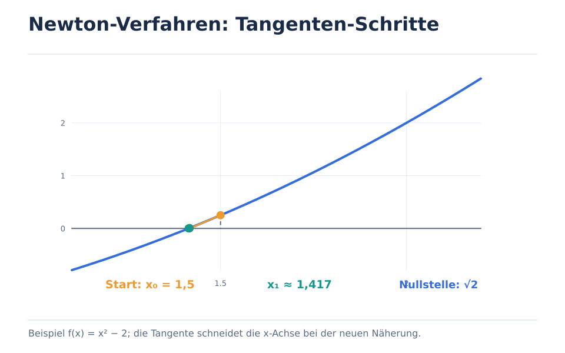

# M1-L8 – Universität: Numerische und computerorientierte Mathematik {#L8}

**Kursbereich:** M1 – Bachelor: mathematische Grundlagen

**Niveau:** Bachelor

**Vorwissen:** Keine festen Voraussetzungen angegeben.

**Einordnung:** Universitäres Kerngebiet · Numerische Mathematik

## Worum geht es? {#S1}

Mathematische Formeln arbeiten gedanklich mit exakten Zahlen. Ein Computer besitzt dagegen endlich viele Bits, begrenzten Speicher und endliche Rechenzeit. Deshalb müssen viele Ergebnisse **näherungsweise** ermittelt werden. Die Numerische Mathematik entwirft Verfahren dafür und untersucht, wann die berechnete Näherung vertrauenswürdig ist. Sie trennt zwei Probleme: Eine mathematische Aufgabe kann schon durch kleine Änderungen der Eingaben empfindlich reagieren; zusätzlich kann ein gewählter Algorithmus selbst Fehler verstärken. Diese Unterscheidung ist zentral für robuste Software, Simulation und KI.

## Grundidee und Anschauung {#S2}

Stelle dir vor, du suchst die Quadratwurzel aus zwei. Die exakte Zahl besitzt unendlich viele nichtperiodische Dezimalstellen; der Computer kann nur eine endliche Darstellung speichern. Er muss sich der Lösung schrittweise annähern oder einen eingebauten Algorithmus benutzen. Entscheidend ist nicht nur, dass viele Nachkommastellen erscheinen, sondern **wie groß der wirkliche Fehler noch sein kann**. Ein gutes numerisches Verfahren kann seine Näherung erklären, messen und gegen Rundungsprobleme absichern.

## Neue Zeichen – vor der Verwendung {#S3}

  Zeichen                       Name / Aussprache                      Bedeutung hier                                                           Andere Verwendung
  ----------------------------- -------------------------------------- ------------------------------------------------------------------------ ---------------------------------------------------------
  $x^{\ast}$                    „iks Stern“                            Gesuchte exakte Lösung                                                   In Optimierung häufig optimale Lösung
  $x_k$                         „iks Index ka“                         Näherung nach dem k-ten Schritt                                          Allgemeiner Folgenglied-Index
  $k$                           „ka“                                   Iterationsnummer                                                         In Geometrie auch Konstante
  $f(x)$                        „eff von iks“                          Funktion, deren Nullstelle gesucht wird                                  Allgemeine Funktion
  $f^{\prime}(x)$               „eff Strich von iks“                   Ableitung für Newtons Verfahren                                          Lokale Änderungsrate
  $\epsilon$                    „Epsilon“                              Eine gewählte Fehlertoleranz                                             Bei formalen Grenzwerten beliebig kleine positive Zahl
  $\approx$                     „ungefähr gleich“                      Genäherter statt exakter Wert                                            Generelles Näherungszeichen
  $\lvert e\rvert$              „Betrag von e“                         Nichtnegative Größe eines Fehlers                                        $e$ andernorts Eulersche Zahl
  $\lVert\vec r\rVert$          „Norm von r“                           Größe eines Fehler- oder Residuenvektors                                 Verschiedene Normen möglich
  $\kappa(A)$                   „Kappa von A“                          Konditionszahl einer Matrix in gewählter Norm                            Kappa kann beliebiger Parameter sein
  $\Delta x$                    „Delta iks“                            Änderung oder Störung einer Eingabe                                      In Ableitungen endliche Differenz
  $O(h^p)$                      „groß O von h hoch p“                  Fehlerordnung für kleine Schrittweite h                                  Informatik: ähnliche Notation für Wachstum der Laufzeit
  $A\cdot\vec x=\vec b$         „Matrix A mal Vektor x ist Vektor b“   Lineares Gleichungssystem                                                Vektoren und Matrizen aus M1-L5–M1-L6
  $\vec r=\vec b-A\cdot\vec x$  „r ist b minus A mal x“                Residuum einer Näherung                                                  Nicht identisch mit dem Lösungsfehler
  `MC`                          „Monte Carlo“                          Schätzung durch Zufallsstichproben                                       Kein mathematisches Zeichen im engeren Sinn
  $h$                           „ha“                                   Positive Schrittweite bei einer Diskretisierung                          Variable auch für Höhe
  $p$                           „pe“                                   Positive Fehlerordnung in $O(h^p)$                                       Wahrscheinlichkeit in M1-L7
  $n$                           „enn“                                  Anzahl der unabhängigen Simulationen                                     In Matrizen auch Spaltenanzahl
  $\lVert A^{-1}\rVert$         „Norm der inversen Matrix A“           Verstärkungsfaktor für ein lineares Residuum bei invertierbarer Matrix   Die Norm muss feststehen

Das Sternchen an $x^{\ast}$ ist nur ein **Namenszusatz**: Es bedeutet keine Multiplikation. Ein Index wie $k$ benennt den Schritt einer iterativen Folge. Die verwendete Norm – beispielsweise die euklidische Länge – muss bei Fehlervergleichen feststehen.

## Warum der Computer anders rechnet als das Papier {#S4}

Eine binäre Gleitkommazahl speichert Vorzeichen, eine endliche Folge signifikanter Bits und einen Exponenten. Viele einfache Dezimalbrüche, darunter $0{,}1$, besitzen im Binärsystem keine endliche Darstellung. In einem üblichen binären Gleitkommaformat kann daher beispielsweise `0.1 + 0.2` im Programm einen Wert ergeben, der nicht bitgenau gleich der gespeicherten Näherung von `0.3` ist. Das ist keine Widerlegung der Mathematik, sondern eine Folge unterschiedlicher gerundeter Maschinenwerte.

Die Rechenreihenfolge kann wegen der Rundung bedeutsam sein. Für Gleitkommazahlen gilt das Assoziativgesetz der gewöhnlichen reellen Addition nicht in jeder Maschinenrechnung. Bei extrem verschiedenen Größen können kleine Summanden ganz verloren gehen. Ebenso riskant ist **Auslöschung** (*catastrophic cancellation*), wenn man fast gleiche Zahlen subtrahiert und dadurch wenige aussagekräftige Stellen übrig bleiben.

**Mini-Beispiel für stabilere Umformung:** Der mathematische Ausdruck $\sqrt{x^2+1}-x$ kann für große positive $x$ schwer genau berechenbar sein, weil die beiden Terme fast gleich groß sind. Multiplizieren wir mit dem passenden Gegenfaktor, entsteht der exakt gleichwertige Ausdruck $\frac{1}{\sqrt{x^2+1}+x}$. Er vermeidet diese spezielle Subtraktion fast gleicher Zahlen. In realer Software müssen zusätzlich Überläufe bei $x^2$ vermieden werden, etwa durch eine entsprechend robuste Quadratwurzel-/Hypotenusenroutine. **Einschränkung:** Für sehr große **negative** $x$ kann nun im Nenner $\sqrt{x^2+1}+x$ eine Auslöschung entstehen. Die umgeformte Variante ist deshalb besonders für **große positive** $x$ günstig, nicht universell überlegen.

## Fehler, Residuum und Kondition {#S5}

Die Differenz zwischen einer Näherung $x_k$ und der exakten Lösung $x^{\ast}$ heißt **Lösungsfehler**; bei einer skalaren Größe betrachten wir ihren absoluten Betrag:

$$
\text{absoluter Fehler}=\lvert x_k-x^*\rvert
$$

**Gesprochen:** „Absoluter Fehler ist der Betrag von iks Index ka minus iks Stern.“ In vielen realen Aufgaben ist die exakte Lösung unbekannt; wir können den wirklichen Fehler also gerade **nicht direkt ausrechnen**.

Bei einer Gleichung $f(x)=0$ ist das **Residuum** der noch nicht verschwindende Wert $f(x_k)$. Ein kleiner Funktionsrest bedeutet nicht unter allen Umständen einen kleinen Lösungsfehler. Beispiel: Für $f(x)=0{,}000001\cdot(x-100)$ besitzt $x=0$ nur das Residuum $-0{,}0001$, obwohl die exakte Nullstelle 100 beträgt und der Lösungsfehler somit 100 ist. Eine winzige Steigung macht die Nullstellensuche empfindlich. Bei einem **invertierbaren** linearen System $A\cdot\vec x=\vec b$ gilt für die Näherung $\vec x_k$ und das Residuum $\vec r=\vec b-A\cdot\vec x_k$ exakt $\vec x-\vec x_k=A^{-1}\cdot\vec r$. Deshalb folgt die Schranke $\lVert\vec x-\vec x_k\rVert\leq\lVert A^{-1}\rVert\cdot\lVert\vec r\rVert$ für zusammenpassende Vektor- und induzierte Matrixnormen. Ohne Kenntnis oder Schätzung des Verstärkungsfaktors ist ein kleines Residuum keine allgemeine Fehlergarantie.

Die **Kondition** beschreibt diese Eingabeempfindlichkeit der mathematischen Aufgabe. Die **Stabilität** beschreibt, wie gut ein Algorithmus mit unvermeidlichen Störungen und Rundungsfehlern umgeht. Bei Matrixgleichungen sind sehr große Konditionszahlen ein Warnsignal: Selbst kleine Datenfehler oder Rundungsfehler können zu deutlich anderen Lösungen führen. Hier gibt es keine allgemeine Garantie durch eine bloße Kontrolle der Determinante. **Rechengegenbeispiel:** $A=\operatorname{diag}(1000000,\ 0{,}000001)$ hat Determinante $1$. In der euklidischen Norm ist die Konditionszahl jedoch $\kappa(A)=\frac{1000000}{0{,}000001}=10^{12}$. Eine Störung in der schwach skalierten zweiten Koordinate kann also relativ erheblich verstärkt werden, obwohl die Determinante unauffällig ist.

## Intervallschachtelung: eine sichere Nullstelle einkreisen {#S6}

Wir suchen die positive Lösung von $x^2=2$. Dazu betrachten wir die Funktion $f(x)=x^2-2$. Sie ist stetig. Da $f(1)=-1$ und $f(2)=2$ unterschiedliche Vorzeichen haben, liegt nach dem Zwischenwertsatz eine Nullstelle zwischen 1 und 2.

Das **Bisektionsverfahren** halbiert dieses Intervall und behält jeweils die Hälfte, an deren Endpunkten ein Vorzeichenwechsel vorliegt:

$$
\begin{aligned}
&\begin{array}{lll}
\text{Start: }[1;2]&f(1)=-1,\quad f(2)=2&\\
\text{Mitte: }1{,}5&f(1{,}5)=0{,}25&\to[1;1{,}5]\\
\text{Mitte: }1{,}25&f(1{,}25)=-0{,}4375&\to[1{,}25;1{,}5]\\
\text{Mitte: }1{,}375&f(1{,}375)=-0{,}109375&\to[1{,}375;1{,}5]
\end{array}
\end{aligned}
$$

**Gesprochen:** „Wir halbieren das Intervall, berechnen den Wert der Funktion an der Mitte und behalten die Hälfte mit Vorzeichenwechsel.“ Nach drei Halbierungen ist die verbleibende Intervallbreite $0{,}125$ statt ursprünglich $1$. Im exakten mathematischen Modell liegt die gesuchte Nullstelle weiterhin darin. Der Mittelpunkt der verbleibenden Klammer hat dann höchstens die halbe Intervallbreite als absoluten Fehler. **Diese garantierte Einschließung gilt zunächst für exakte Vorzeichenentscheidungen.** In einer gewöhnlichen Gleitkomma-Implementierung können Rundungsfehler sogar das berechnete Vorzeichen verfälschen; wer eine *strenge* Einschließung garantieren will, benötigt geeignete Fehlerabschätzungen oder nach außen gerundete Intervallarithmetik. Außerdem braucht man ein sinnvolles Abbruchkriterium. Bei Ausgangsintervallbreite $b-a$ und $k$ Halbierungen ist die Breite $\frac{b-a}{2^k}$, also die Fehlergrenze des Intervallmittelpunkts höchstens $\frac{b-a}{2^{k+1}}$, **sofern** der Einschluss nach jedem Schritt gültig bleibt. Für $[1,2]$ sind nach drei Schritten daher höchstens $\frac1{16}=0{,}0625$ Fehler garantiert. Das Verfahren findet damit eine Nullstelle im Intervall; die Eindeutigkeit folgt nicht allein aus dem Vorzeichenwechsel.

## Newton-Verfahren: eine Tangente liefert die nächste Näherung {#S7}

Das Newton-Verfahren ersetzt die Funktion lokal durch ihre Tangente und verwendet deren Schnittpunkt mit der x-Achse als neue Schätzung:

{alt="Tangenteniteration zur Nullstelle von x² minus 2"}

$$
x_{k+1}=x_k-\frac{f(x_k)}{f\prime(x_k)}
$$

**Gesprochen:** „Die nächste Näherung x Index k plus eins ist die bisherige Näherung x Index k minus dem Funktionswert geteilt durch die Ableitung an der bisherigen Näherung.“ $f^{\prime}$ ist die erste Ableitung, erklärt in Schule M2-L3–Schule M2-L4. Durch null darf nicht dividiert werden; die Ableitung muss am aktuellen Punkt definiert und von null verschieden sein.

Für $f(x)=x^2-2$ gilt $f^{\prime}(x)=2x$. Beginnen wir bei $x_0=1{,}5$, ergibt sich:

$$
\begin{aligned}
x_1&=1{,}5-\frac{{(1{,}5)}^2-2}{2\cdot1{,}5}=1{,}416666\ldots\\
x_2&=1{,}416666\ldots-\frac{{(1{,}416666\ldots)}^2-2}{2\cdot(1{,}416666\ldots)}
\approx1{,}414215686
\end{aligned}
$$

Die echte positive Wurzel liegt ungefähr bei $1{,}414213562$. Bei einem guten Startwert ist Newton hier erheblich schneller als Bisektion. Aber: Newton garantiert **nicht** von jedem Startwert aus Konvergenz. Es kann weit wegspringen, zyklisch werden oder wegen einer ungeeigneten Ableitung scheitern. In robusten Anwendungen kombinieren numerische Bibliotheken deshalb häufig schnelle Schritte mit abgesicherten Intervallen. **Grenzfall:** Für $f(x)=x^3$ ist die Ableitung am Startwert $x_0=0$ gleich null, die Nullstelle aber bereits erreicht. Ein Programm muss zuerst prüfen, ob das Residuum ausreichend klein ist, bevor es blind durch die Ableitung teilt. Quadratische lokale Konvergenz ist für Newton nur unter geeigneten Glattheits-, Startwert- und einfachen-Nullstellen-Bedingungen zu erwarten.

## Fehlerordnungen, lineare Systeme und Simulationen {#S8}

Bei Näherungsformeln gibt die Schreibweise $O(h^p)$ an, dass der Betrag des betrachteten Fehlers für hinreichend kleine positive Schrittweiten $h$ durch eine Konstante mal $h^p$ beschränkt ist. **Gesprochen:** „Der Fehler ist von der Ordnung h hoch p.“ Ist $p=2$, kann eine Halbierung der Schrittweite im asymptotischen Bereich den führenden Fehler ungefähr vierteln. Das gilt nicht unbegrenzt: Bei sehr kleinen Schritten können Rundungsfehler überwiegen.

Große lineare Systeme $A\cdot\vec x=\vec b$ werden in der Praxis meist **nicht** durch explizites Berechnen der inversen Matrix gelöst. Stattdessen kommen etwa Gauß-Elimination mit Pivotwahl, LU- oder QR-Zerlegungen sowie bei geeigneten großen dünn besetzten Matrizen iterative Verfahren zum Einsatz. Die Wahl hängt von Matrixstruktur, Kondition, Speicher und Genauigkeitsanspruch ab.

Für Simulationen sind zusätzliche Fehlerquellen wichtig: eine nur angenäherte Modellgleichung, ein diskretes Zeitschrittschema, Zufallsschwankungen und begrenzte Rechenpräzision. Eine **Monte-Carlo-Simulation** mittelt viele Zufallsversuche. Typischerweise sinkt der Standardfehler eines Stichprobenmittels bei unabhängigen, identisch verteilten Versuchen mit endlicher Varianz proportional zu $\frac1{\sqrt n}$, wobei $n$ die Zahl der Versuche ist. Viermal so viele Versuche halbieren unter diesen Annahmen ungefähr den Standardfehler – nicht den gesamten Modellfehler. Bei abhängigen Stichproben oder unendlicher Varianz gilt diese einfache Standardfehlerregel nicht allgemein. Ebenso stellt $O(h^2)$ nur eine **asymptotische** Schranke dar, keinen Fehlerwert für jede beliebige Schrittweite.

## Wofür nützlich? {#S9}

- **KI-Training:** Gewichte werden iterativ verändert; Rundung, schlecht skalierte Gradienten und schlecht konditionierte Probleme beeinflussen die Berechnung.
- **Robotik:** Bewegungs- und Regelgleichungen müssen mit realen Messwerten, begrenzten Rechenzeiten und numerischen Integratoren approximiert werden.
- **Datenverarbeitung:** Matrixzerlegungen, stabile Normberechnungen und Fehlerabschätzungen schützen vor scheinbar plausiblen, aber unzuverlässigen Ergebnissen.
- **Simulation und Agentenplanung:** Näherungsverfahren erlauben die Bewertung zahlreicher Zustandsvarianten, sofern ihre Annahmen und Fehler kontrolliert werden.

## Annahmen und typische Fehlinterpretationen {#S10}

- Viele Nachkommastellen sind **kein Beweis** für Genauigkeit. Man braucht ein passendes Fehlermodell oder eine belastbare Schranke.
- Kleines Residuum bedeutet nicht zwangsläufig kleiner Lösungsfehler, vor allem bei schlecht konditionierten Aufgaben.
- Eine symbolisch exakte Formel ist im Computer nicht automatisch die numerisch günstigste Formel.
- Eine schnelle Iteration kann scheitern. Eine langsamere Methode mit garantierter Intervallschachtelung ist oft ein sinnvoller Sicherheitsbaustein.
- Simulationsergebnisse übernehmen die Schwächen der Eingabedaten und Modellannahmen. Mehr Rechenleistung beseitigt keinen systematischen Modellfehler.

## Verbindung zur nächsten Lektion {#S11}

M1-L9 behandelt gewöhnliche Differentialgleichungen: Wie formuliert und untersucht man zeitliche Veränderungen von Beständen, Bewegungen und Rückkopplungen? Dort treffen Analysis, lineare Algebra und numerische Berechnung unmittelbar aufeinander.

## Quellen {#S12}

In dieser Lektion sind keine Einzelquellen gesondert verzeichnet.
