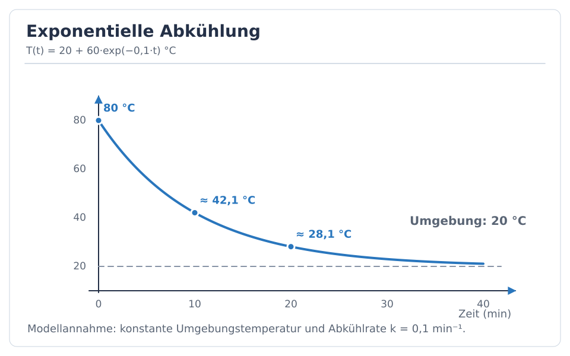

# M1-L9 – Gewöhnliche Differentialgleichungen: Dynamik, Stabilität und Regelkreise {#L9}

**Kursbereich:** M1 – Bachelor: mathematische Grundlagen

**Niveau:** Bachelor

**Vorwissen:** Keine festen Voraussetzungen angegeben.

**Einordnung:** Universität – typisches mathematisches Studiengebiet

## Worum geht es? {#S1}

Viele Systeme werden nicht durch ihren momentanen Zustand allein beschrieben, sondern durch die Frage, wie schnell sich dieser Zustand gerade verändert. Wie rasch kühlt ein Gegenstand ab? Wie entwickelt sich ein Bestand im Laufe der Zeit? Wie reagiert ein Roboter, wenn seine Steuerung ständig kleine Korrekturen vornimmt? Eine **Differentialgleichung** gibt eine Beziehung zwischen einer gesuchten Funktion und einer oder mehreren ihrer Ableitungen an. Wir lernen die Idee, einige typische Modelle und ihre Grenzen kennen, ohne einen vollständigen Hochschulkurs über Lösungsmethoden zu ersetzen.

## Grundidee und Anschauung {#S2}

Bei einer gewöhnlichen Gleichung suchen wir eine Zahl, bei einer **gewöhnlichen Differentialgleichung** (kurz: ODE, englisch *ordinary differential equation*) meist einen ganzen zeitlichen Verlauf. Statt die Temperatur eines Objekts zu jedem Zeitpunkt einzeln vorzugeben, formulieren wir ein Veränderungsgesetz. Zusammen mit einem bekannten Anfangswert lässt sich daraus unter geeigneten Bedingungen eine zeitabhängige Funktion bestimmen.

„Gewöhnlich“ bedeutet hier: Die gesuchte Funktion hängt von **einer unabhängigen Variablen** ab, oft der Zeit. Ist sie von mehreren Orts- und Zeitvariablen abhängig und kommen partielle Ableitungen vor, sprechen wir von einer **partiellen Differentialgleichung** (Ausblick M2-L8).

Eine ODE erster Ordnung benutzt die erste Ableitung. Eine Gleichung zweiter Ordnung kann auch eine zweite Ableitung enthalten; in der Mechanik wird damit zum Beispiel Beschleunigung beschrieben. Ein **Anfangswertproblem** kombiniert das Änderungsgesetz mit dem Zustand zu Beginn.

## Neue Zeichen vor der ersten Formel {#S3}

  Zeichen                                               Aussprache                                          Bedeutung hier                                                Anderer möglicher Gebrauch
  ----------------------------------------------------- --------------------------------------------------- ------------------------------------------------------------- ---------------------------------------------------
  $t$                                                   „te“                                                Zeit als unabhängige Variable                                 Allgemeiner Parameter
  $y(t)$                                                „ypsilon von te“                                    gesuchte Zustandsfunktion zur Zeit t                          Beliebige Funktion
  $\frac{\mathrm dy}{\mathrm dt}$ oder $y^{\prime}(t)$  „De ypsilon nach De te“ / „ypsilon Strich von te“   momentane zeitliche Änderungsrate                             Ableitung nach einer anderen Variablen
  $\frac{\mathrm d^2y}{\mathrm dt^2}$                   „zweite Ableitung von ypsilon nach te“              Änderung der Änderungsrate, z. B. Beschleunigung              keine gewöhnliche zweite Potenz von y
  $k$                                                   „ka“                                                hier eine **positive** Rate pro Zeiteinheit                   Allgemeine Konstante oder Iterationsindex
  $y_0$                                                 „ypsilon null“                                      vorgegebener Anfangswert                                      Erstes Glied einer Folge
  $e$                                                   „Eulersche Zahl“                                    Basis der natürlichen Exponentialfunktion, ungefähr 2,71828   Im Code oft Fehler-/Ereignisvariable
  $e^{-kt}$                                             „e hoch minus ka mal te“                            zeitlicher exponentieller Abklingfaktor                       Exponentialterme können auch Wachstum beschreiben
  $f(t,y)$                                              „eff von te und ypsilon“                            allgemeines Änderungsgesetz                                   Mehrdimensionale Funktion
  $h$                                                   „ha“                                                Schrittweite bei numerischer Berechnung                       Höhe in der Geometrie
  $y_n$ / $t_n$                                         „ypsilon / te mit Index enn“                        numerische Näherung im n-ten Zeitschritt                      Allgemeine Folgenglieder
  $\approx$                                             „ungefähr gleich“                                   gerundete Zahl, nicht exakte Identität                        Näherung allgemein
  $x^{\ast}$                                            „iks Stern“                                         Gleichgewichtszustand                                         In M1-L8 auch gesuchte exakte Lösung
  $\ln$                                                 „natürlicher Logarithmus“                           Umkehrfunktion der Exponentialfunktion zur Basis $e$          In Schule M1-L19 bereits eingeführt

## Ein einfaches Änderungsgesetz {#S4}

Wenn ein Bestand umso schneller abnimmt, je größer er gerade ist, entsteht ein sehr verbreitetes Modell:

$$
\frac{\mathrm{d}y}{\mathrm{d}t}=-k\cdot y(t)\qquad\text{mit }k>0
$$

**Laut gelesen:** „Die Ableitung von ypsilon nach der Zeit te ist gleich minus ka mal dem momentanen Wert von ypsilon; ka ist positiv.“ Das Minuszeichen sagt: Bei positivem Bestand fällt die Größe. $k$ regelt die Geschwindigkeit. Ist $t$ in Stunden angegeben, trägt $k$ die Einheit „pro Stunde“; so hat die rechte Seite dieselbe Einheit wie die Änderungsrate links.

Die Funktion, die dieses Gesetz erfüllt und zur Zeit null den Wert $y_0$ hat, lautet:

$$
y(t)=y_0e^{-kt}\qquad\text{mit }y(0)=y_0
$$

**Laut gelesen:** „Der Zustand zur Zeit te ist der Anfangswert ypsilon null mal e hoch minus ka mal te. Zu Beginn ist der Zustand gleich ypsilon null.“ Das ist **eine mögliche Lösung** für genau dieses Änderungsgesetz; bei den genannten Voraussetzungen die eindeutige Lösung zum vorgegebenen Anfangswert. Ohne Anfangsbedingung gäbe es viele Lösungen mit verschiedenen Startwerten. Hier ist die rechte Seite $-k\cdot y$ überall stetig und bezüglich $y$ Lipschitz-stetig; deshalb ist die Lösung für jeden reellen Anfangswert eindeutig. Für allgemeinere Gleichungen genügt die bloße Angabe eines Anfangswerts **nicht** als Eindeutigkeitsgarantie.

Warum passt die Funktion? Ihre Ableitung ist wieder dieselbe Exponentialfunktion, diesmal mit dem Faktor $-k$. Dadurch erfüllt sie das Änderungsgesetz. Das Konzept kennen wir aus Ableitungen (Schulmathematik M2-L3) und der Exponentialfunktion (Schule M1-L17/Schule M1-L19).

## Vollständig erklärtes Mini-Beispiel: Abkühlung {#S5}

Ein zunächst 80 °C warmer Gegenstand befindet sich in einer Umgebung mit unveränderlichen 20 °C. Wir betrachten die **Temperaturdifferenz zur Umgebung**. Anfangs beträgt sie 60 °C. Als Modell wählen wir eine Abkühlrate von $k=0{,}1\,\mathrm{min}^{-1}$ (gesprochen: „null Komma eins pro Minute“); die Zeit $t$ wird in Minuten gemessen. So ist das Produkt $k\cdot t$ im Exponenten **dimensionslos**. Die vereinfachte Schreibweise $-0{,}1\cdot t$ in der folgenden Zahlenwertformel gilt nur, wenn man für $t$ den Zahlenwert in Minuten einsetzt.

{alt="Temperaturkurve T(t) gleich 20 plus 60 mal e hoch minus 0,1t. Sie startet bei 80 Grad Celsius und nähert sich der Umgebungstemperatur 20 Grad Celsius."}

Exponentialmodell der Abkühlung bei konstant 20 °C Umgebungstemperatur.

Für die absolute Temperatur $T(t)$ gilt damit:

$$
T(t)=20\,^{\circ}\mathrm{C}+60\,^{\circ}\mathrm{C}\cdot e^{-0{,}1t}
$$

**Laut gelesen:** „Die Temperatur nach te Minuten beträgt zwanzig Grad Celsius plus sechzig Grad Celsius mal e hoch minus null Komma eins mal te.“ Die Exponentialfunktion wirkt auf die **Differenz zur Umgebung**, nicht auf die absolute Temperatur in Grad Celsius.

- Zu Beginn ($t=0$) ist $e^0=1$, also beträgt die Temperatur $20+60=80\,^{\circ}\mathrm C$.
- Nach zehn Minuten gilt $e^{-1}\approx0{,}3679$. Damit ist $T(10)\approx20+60\cdot0{,}3679\approx42{,}07\,^{\circ}\mathrm C$.
- Für immer größere Zeiten nähert sich die Temperatur den 20 °C, ohne im idealisierten Modell darunterzufallen.

Das Modell ist eine vereinfachte Form des Newtonschen Abkühlungsgesetzes. Es setzt unter anderem eine konstante Umgebungstemperatur und einen näherungsweise konstanten Wärmeübergangskoeffizienten voraus. Das Beispiel ist kein allgemeines Naturgesetz für jede Temperaturentwicklung.

## Wachstum, Kapazitätsgrenzen und Gleichgewichte {#S6}

Mit einem **positiven** Vorzeichen anstelle des Minuszeichens ergibt sich das Wachstumsgesetz $\frac{\mathrm dy}{\mathrm dt}=k\cdot y$. Die Größe nimmt dann umso schneller zu, je größer sie ist. Das ist ein Modell für bestimmte ungebremste Prozesse, aber auf lange Sicht oft unrealistisch.

Soll sich eine Population oder ein Bestand einer Kapazitätsgrenze annähern, kann ein logistisches Modell verwendet werden. Vor der Formel benötigen wir zwei zusätzliche Bezeichnungen: $r$ ist die positive Grundwachstumsrate und $K$ die positive Kapazität beziehungsweise Sättigungsgrenze.

$$
\frac{\mathrm{d}y}{\mathrm{d}t}=r\cdot y\cdot\left(1-\frac{y}{K}\right)
$$

**Laut gelesen:** „Die zeitliche Änderung von ypsilon ist gleich der Wachstumsrate er mal dem Bestand ypsilon mal eins minus Bestand geteilt durch Kapazität ka.“ Solange der Bestand zwischen null und $K$ liegt, ist die Wachstumsrate positiv. Bei $y=K$ wird sie null; ein Bestand oberhalb von $K$ nimmt im Modell ab. Da $y$ und $K$ dieselbe Einheit haben, ist der Klammerfaktor $1-\frac yK$ dimensionslos; $r$ hat die Einheit pro Zeiteinheit.

Ein **Gleichgewicht** ist ein Zustand, bei dem die Änderungsrate null ist. Im logistischen Modell sind $y=0$ und $y=K$ Gleichgewichte. Für positive Anfangsbestände in der Nähe von $K$ wirkt $K$ stabilisierend; bei kleinen positiven Beständen ist $0$ dagegen instabil. Für $r>0$, $K>0$ und einen **positiven Anfangsbestand** $y_0$ kann man die Gleichung sogar ausdrücklich lösen. Die Exponentialfunktion wird dabei nur auf einen dimensionslosen Ausdruck angewendet:

$$
y(t)=\frac{K}{1+\frac{K-y_0}{y_0}\cdot e^{-rt}}\qquad\text{für }t\geq0\text{ und }y_0>0
$$

**Laut gelesen:** „Kapazität ka geteilt durch eins plus Anfangsabstand zur Kapazität relativ zum Anfangsbestand, multipliziert mit dem exponentiellen Abklingfaktor.“ Für $y_0=20$, $K=100$, $r=0{,}2\,\mathrm{Tag}^{-1}$ ist $y(0)=\frac{100}{1+4}=20$. Nach $t=\frac{\ln(4)}{0{,}2}\approx6{,}93$ Tagen gilt $e^{-0{,}2t}=\frac14$ und deshalb $y(t)=\frac{100}{1+4\cdot\frac14}=50$. Für $y_0=0$ ist dagegen die konstante Nullfunktion eine Lösung; die dargestellte Bruchformel darf wegen der Division durch $y_0$ dann nicht verwendet werden. Die Gleichgewichtsanalyse beschreibt die Richtung möglicher Veränderungen – sie beweist keine biologische Vorhersage ohne passende Daten und Annahmen.

## Rückkopplung und Stabilität {#S7}

Stell dir einen Regler vor, der den Fehler zwischen gewünschtem und aktuellem Zustand laufend verkleinert. Wir nennen diesen Fehler $x(t)$ und wählen wieder eine positive Regelstärke $k$:

$$
\frac{\mathrm{d}x}{\mathrm{d}t}=-k\cdot x(t)
$$

**Laut gelesen:** „Die Änderung des Fehlers nach der Zeit ist minus ka mal der augenblickliche Fehler.“ Ein positiver Fehler nimmt ab; ein negativer Fehler nähert sich ebenfalls null, sofern das Modell gilt. Der Gleichgewichtszustand ist $x^{\ast}=0$ und im kontinuierlichen Modell für $k>0$ **asymptotisch stabil**: Kleine Abweichungen klingen mit der Zeit ab.

Realistische Regelkreise können Trägheit, Zeitverzögerungen, Rauschen, Stellgrenzen und weitere Zustandsgrößen besitzen. Zu starkes Nachregeln kann dann zu Schwingungen oder Instabilität führen. Das einfache Modell ist ein Einstieg, keine fertige Robotersteuerung.

Bei mehreren Zustandsgrößen können wir ein lineares System mit Matrix $A$ und Zustandsvektor $\vec x$ modellieren: $\frac{\mathrm d\vec x}{\mathrm dt}=A\cdot\vec x$. Die Eigenwerte von $A$ (M1-L6) helfen, die Stabilität zu verstehen: Sind bei einem **zeitlich unveränderlichen linearen System** alle Realteile der Eigenwerte negativ, ist der Nullzustand asymptotisch stabil. Das ist ein Zusammenhang zur linearen Algebra, kein Ersatz für die Prüfung nichtlinearer Systeme.

## Wenn keine handliche Lösung existiert: Euler-Verfahren {#S8}

Viele ODEs haben keine einfache geschlossene Lösungsformel. Dann berechnen wir den Zeitverlauf schrittweise. Bei einem Änderungsgesetz $\frac{\mathrm dy}{\mathrm dt}=f(t,y)$ und Schrittweite $h$ lautet das **explizite Euler-Verfahren**:

$$
\begin{aligned}
t_{n+1}&=t_n+h\\
y_{n+1}&=y_n+h f(t_n,y_n)
\end{aligned}
$$

**Laut gelesen:** „Die nächste Zeit ist die bisherige Zeit plus Schrittweite. Der nächste Zustandswert ist der bisherige Zustandswert plus Schrittweite mal momentan geschätzter Änderungsrate.“ Dieses Verfahren nimmt an, dass die Rate während des kurzen Schrittes ungefähr unverändert bleibt.

Für die Abkühlungsdifferenz $y(0)=60\,^{\circ}\mathrm C$ und $\frac{\mathrm dy}{\mathrm dt}=-0{,}1\cdot y$ ergibt sich bei einem Zeitschritt von **einer Minute**: $y_1=60+1\cdot(-0{,}1\cdot60)=54\,^{\circ}\mathrm C$. Die absolute Temperatur nach einer Minute ist also näherungsweise 74 °C. Der exakte Modellwert beträgt $20+60\cdot e^{-0{,}1}\approx74{,}29\,^{\circ}\mathrm C$. Die Abweichung entsteht durch die Zeitdiskretisierung.

Bei zehn Schritten zu einer Minute ergibt Euler $20+60\cdot\left(0{,}9\right)^{10}\approx40{,}92\,^{\circ}\mathrm C$; die analytische Modelllösung ergab nach zehn Minuten ungefähr 42,07 °C. Kleinere Schritte verbessern bei dieser Aufgabe typischerweise die Näherung, erhöhen aber den Rechenaufwand. **Nicht jede Schrittweite ist stabil:** Für das Modell $\frac{\mathrm dx}{\mathrm dt}=-k\cdot x$ ergibt die Euler-Formel genau $x_{n+1}=(1-h\cdot k)\cdot x_n$. Die wiederholte Näherung fällt nur dann asymptotisch gegen null, wenn $\lvert1-h\cdot k\rvert<1$, also **$0<h\cdot k<2$**. Bei $0<h\cdot k\leq1$ wechselt ein positiver Anfangsfehler nicht das Vorzeichen; bei $1<h\cdot k<2$ entsteht eine gedämpfte Vorzeichenoszillation. An der Grenze $h\cdot k=2$ springt der Fehler ohne Abklingen zwischen zwei Vorzeichen, und für $h\cdot k>2$ wächst sein Betrag.

**Kontrollbeispiel:** Beginnen wir mit $x_0=10$, $k=0{,}1\,\mathrm{min}^{-1}$ und wählen $h=15\,\mathrm{min}$, dann ist $1-h\cdot k=-0{,}5$: Euler liefert $x_1=-5$ und $x_2=2{,}5$ – die Näherung schwingt um null, obwohl die exakte Lösung $10\cdot e^{-0{,}1t}$ positiv bleibt. Bei $h=25\,\mathrm{min}$ ist der Faktor $-1{,}5$ und Euler liefert $-15$, dann $22{,}5$: ein künstlich instabiler Verlauf. Dies ist eine **numerische** Instabilität, nicht eine Instabilität des zugrunde liegenden kontinuierlichen Modells.

## Wofür nützlich? {#S9}

- **Robotik und Regelung:** Gelenkbewegungen, Geschwindigkeit, Trägheit und Korrektursignale werden als Zustandsverläufe beschrieben.
- **Server- und Agentensysteme:** Bestandsänderungen, Arbeitsrückstände oder Ressourcenverbrauch lassen sich mit geeigneten kontinuierlichen Näherungsmodellen untersuchen.
- **Simulation:** Numerische ODE-Löser ermöglichen Vorhersagen über dynamische Systeme, auch wenn keine einfache geschlossene Formel existiert.
- **KI und Optimierung:** Kontinuierliche Lern- und Anpassungsmodelle knüpfen an Gradienten und Differentialgleichungen an.

## Annahmen, Grenzen und typische Fehlinterpretationen {#S10}

- Ein Änderungsgesetz allein legt normalerweise noch keinen eindeutigen zeitlichen Verlauf fest; Anfangswerte beziehungsweise andere Bedingungen sind notwendig.
- Eine Differentialgleichung ist **ein Modell**. Messdaten können Rauschen, abrupte Ereignisse und Parameteränderungen enthalten, die im Modell fehlen.
- Die mathematische Existenz und Eindeutigkeit einer Lösung hängt von Voraussetzungen ab, etwa ausreichender Regularität der rechten Seite; das ist nicht automatisch garantiert.
- Numerische Näherung ist keine exakte Lösung; zusätzlich zum Rundungsfehler treten Diskretisierungsfehler auf.
- Die Stabilität eines kontinuierlichen Systems garantiert nicht die Stabilität einer beliebig groben numerischen Diskretisierung. Auch eine für das lineare Testmodell stabile Schrittweite ist kein universeller Fehler- oder Stabilitätsnachweis für andere ODEs; bei allgemeinen rechten Seiten sind lokale Glattheits- beziehungsweise Lipschitz-Bedingungen und gegebenenfalls anpassbare Schritte zu prüfen.

## Verbindung zur nächsten Einheit {#S11}

Mit M1-L9 ist der vorgesehene universitäre Grundlagenblock abgeschlossen. M2-L1 wechselt in die **diskrete Mathematik**: Dort werden nicht kontinuierliche Zeitverläufe, sondern Knoten, Kanten, endliche Strukturen und algorithmisch durchsuchbare Zustandsräume betrachtet.

## Quellen (extern) {#S12}

Keine externen Quellen angegeben.
