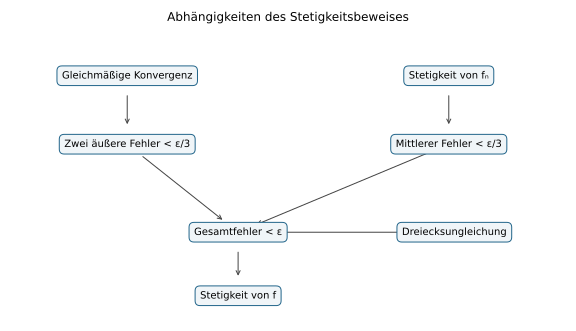

# M10-L1 – Mathematische Literatur, Beweislektüre und Seminar {#L1}

**Kursbereich:** M10 – Seminar und Forschung

**Niveau:** Bachelor · Seminar

**Vorwissen:** [M1-L1](M1-L1.md); [M1-L2](M1-L2.md); [M1-L3](M1-L3.md)

**Einordnung:** Bachelor-Seminar-Lernweg

## Lernziele {#S1}

Du rekonstruierst die Abhängigkeiten eines mathematischen Beweises, unterscheidest Voraussetzungen und Folgerungen, findest Gegenbeispiele zu verschärften Behauptungen und erstellst eine eigenständige, belegte Seminarfassung.

## Eine Literaturfrage formulieren {#S2}

Eine Seminararbeit beginnt nicht mit einer Sammlung von Formeln, sondern mit einer überprüfbaren Frage: Warum bleibt Stetigkeit beim gleichmäßigen Grenzübergang erhalten, beim punktweisen jedoch nicht? Wähle dazu ein Intervall $I\subseteq\mathbb R$ und reellwertige Funktionen $f_n:I\to\mathbb R$. Die Grundbegriffe stehen in [M1-L2](M1-L2.md) und [M1-L3](M1-L3.md). Erfasse für jede Quelle Autor oder Institution, Titel, Ausgabe, konkrete Fundstelle und Abrufdatum. Notiere in eigenen Worten die Rolle einer Aussage: Definition, bereits bewiesenes Lemma, Hauptsatz oder bloßes Beispiel. Eine übereinstimmende Formulierung aus zwei Texten ist noch kein unabhängiger Beweis. Bei abweichenden Voraussetzungen prüfe zuerst, ob tatsächlich dieselbe Aussage gemeint ist.

## Beweis rekonstruieren {#S3}

**Satz.** Sind alle $f_n$ stetig auf $I$ und konvergiert $f_n$ gleichmäßig gegen $f:I\to\mathbb R$, dann ist $f$ stetig auf $I$.

**Beweis.** Sei $x_0\in I$ beliebig und $\varepsilon>0$. Aus gleichmäßiger Konvergenz wähle ein einziges $n$ so, dass $|f_n(x)-f(x)|<\varepsilon/3$ für alle $x\in I$. Weil dieses feste $f_n$ stetig in $x_0$ ist, existiert $\delta>0$, sodass für $x\in I$ mit $|x-x_0|<\delta$ auch $|f_n(x)-f_n(x_0)|<\varepsilon/3$ gilt. Die Dreiecksungleichung liefert

$$|f(x)-f(x_0)|\le |f(x)-f_n(x)|+|f_n(x)-f_n(x_0)|+|f_n(x_0)-f(x_0)|<\varepsilon.$$

Damit ist $f$ in $x_0$ stetig. Weil $x_0$ beliebig gewählt war, gilt dies überall auf $I$. Der Beweis benötigt keine Kompaktheit von $I$; am Rand gilt die relative Stetigkeit. Die Reihenfolge der Wahl von $n$ und $\delta$ ist entscheidend. Im Beweisgraphen werden die Definition der gleichmäßigen Konvergenz, die Stetigkeit des festen Glieds und die Dreiecksungleichung als separate Abhängigkeiten erfasst.

{alt="Beweisgraph von Konvergenz und Stetigkeit zur Fehlerabschätzung"}

## Hypothesen durch Gegenbeispiele prüfen {#S4}

Wird gleichmäßige Konvergenz durch punktweise Konvergenz ersetzt, ist der Satz falsch. Wähle $f_n(x)=x^n$ für $x\in[0,1]$, $n\ge1$. Jedes Glied ist stetig; der Grenzwert ist null für $x<1$ und eins bei $x=1$. Daher ist er bei eins unstetig. Für jedes feste $n$ gilt $\sup_{x\in[0,1]}|f_n(x)-f(x)|=1$, obwohl dieser Fehlerwert nicht angenommen wird: von links strebt $x^n$ gegen eins und bei eins ist der Fehler null. Auf $[0,a]$ mit $0<a<1$ ist dagegen der maximale Fehler $a^n\to0$. So lässt sich derselbe Ansatz zur Prüfung der Rolle des Definitionsbereichs verwenden. Das Supremumargument ist der Nachweis; ein zusätzlich selbst erstellter Plot der Funktionen kann die Randzone veranschaulichen.

## Seminarablauf und Nachweis {#S5}

Erstelle eine zwei- bis dreiseitige Seminarfassung mit Frage, Definitionen, Satz, Beweis, Gegenbeispiel und Grenzen. Markiere jede externe Aussage, die du nicht selbst beweist, mit einer konkreten Fundstelle. Unterscheide im Entwurf das Quellenexzerpt von deinem eigenständigen Beweis. Für das obige Beispiel kannst du den Beweis zuerst ohne Vorlage rekonstruieren und anschließend die Wahlreihenfolge mit den Definitionen vergleichen. Die Hinweise der Universität Oxford zur Gegenbeispielsuche und die Stanford-Checkliste für die Darstellung von Beweisen dienen als methodische Orientierung; der obige Beweis und die Beispiele sind eigenständig ausgearbeitet.

Für den Vortrag plane etwa zehn Minuten: zwei für Begriffe, vier für den Beweis, drei für das Gegenbeispiel und eine für die Grenzen. Bitte eine zweite Person, die Abhängigkeiten rückwärts zu verfolgen, insbesondere die Stelle, an der $n$ unabhängig von $x$ gewählt wird. Im Selbststudium kann eine zeitversetzte eigene Nachprüfung helfen, ersetzt aber kein unabhängiges Gutachten. Eine ungelöste Frage bleibt als solche gekennzeichnet.

## Selbstkontrolle {#S6}

### Aufgaben

1. Gib die Quantorenreihenfolge der gleichmäßigen Konvergenz an.
2. Warum reicht die punktweise Konvergenz im Beweis nicht aus?
3. Bestimme eine ganze Zahl $n$, sodass auf $[0,1/2]$ der Fehler von $x^n$ kleiner als $1/100$ ist.
4. Zeige durch ein Gegenbeispiel, dass gleichmäßige Konvergenz allein keine Stetigkeit garantiert, wenn die Glieder nicht stetig sind.
5. Skizziere einen Beweisgraphen und eine Quellenkarte für den Satz.

::: {.lc-solutions data-lc-section="S6"}
1. Für jedes $\varepsilon>0$ existiert $N$, sodass für jedes $n\ge N$ und jedes $x\in I$ der Fehler kleiner als $\varepsilon$ ist.
2. Die notwendige Indexwahl könnte von $x$ abhängen; die Stetigkeit eines einzigen festen Glieds kontrolliert dann die Fehler nicht gemeinsam.
3. $n=7$ genügt, da $2^{-7}=1/128<1/100$.
4. Sei jedes $f_n$ dieselbe Sprungfunktion $1_{[0,\infty)}$ auf $\mathbb R$. Der Fehler ist identisch null, der Grenzwert ist unstetig bei null.
5. Gleichmäßige Konvergenz liefert zwei Fehlergrenzen, Stetigkeit die mittlere, Dreiecksungleichung verbindet alle drei. Quellenkarte: Institution, Titel, URL, Abschnitt, Datum, verwendete Aussage und eigene Prüfung; methodische Belege siehe S7.
:::

## Quellen {#S7}

- [University of Oxford, Introduction to University Mathematics (2025–26): Logic and Proof](https://courses.maths.ox.ac.uk/mod/page/view.php?id=65664) · Counterexamples · Zuletzt abgerufen: 2026-11-24 · Inhaltlich geprüft: 2026-11-24
- [Stanford University, CS103 Proofwriting Checklist](https://web.stanford.edu/class/cs103/proofwriting_checklist) · Clearly articulate assumptions; scope variables · Zuletzt abgerufen: 2026-11-24 · Inhaltlich geprüft: 2026-11-24
