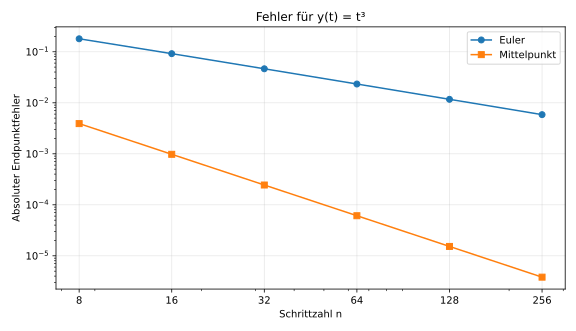

# M10-L2 – Mathematisches Forschungsprojekt und Reproduzierbarkeit {#L2}

**Kursbereich:** M10 – Seminar und Forschung

**Niveau:** Master · Forschungsprojekt

**Vorwissen:** [M10-L1](M10-L1.md); [M7-L3](M7-L3.md)

**Einordnung:** Master Forschungs-Lernweg

## Lernziele {#S1}

Du formulierst eine begrenzte Forschungsfrage mit überprüfbarer Hypothese, trennst analytischen Beweis und numerisches Experiment, dokumentierst Code, Eingaben und Resultate und erklärst, warum negative oder nicht auswertbare Befunde erhalten bleiben müssen.

## Forschungsfrage und vorab definierter Prüfplan {#S2}

Knüpfe an [M10-L1](M10-L1.md) und [M7-L3](M7-L3.md) an. Untersuche die Frage: Wie ändert sich der Endpunktfehler von Euler und explizitem Mittelpunktverfahren, wenn bei $y'=3t^2$, $y(0)=0$ auf $[0,1]$ die Schrittweite halbiert wird? Die exakte Lösung $y(t)=t^3$ ist eine unabhängige Referenz. Für $n$ gleich große Schritte ist $h=1/n$. Definiere vor dem Rechnen den absoluten Endpunktfehler $E_n=|1-y_n|$ und die beobachtete Ordnung $p_n=\log_2(E_n/E_{2n})$, sofern beide Fehler positiv sind. Hypothese: $p_n$ nähert sich für Euler der Eins und für das Mittelpunktverfahren der Zwei. Als endlichen Prüfplan wähle $n=8,16,32,64,128$ und deren Verdopplungen. Für alle fünf Paare soll $|p_n-1|<0{,}05$ bei Euler und $|p_n-2|<0{,}05$ beim Mittelpunktverfahren gelten. Diese Toleranzen sind eine vorab gewählte Entscheidung für dieses Lehrprojekt, kein allgemeiner statistischer Test. Prüfe zusätzlich $y'=2t$ mit derselben Anfangsbedingung als Kontrolle. Protokolliere Änderungen des Prüfplans, statt ihn nachträglich an die Daten anzupassen.

## Analytischer Nachweis für das Testproblem {#S3}

Die rechte Seite hängt nur von $t$ ab. Daher entspricht Euler der linken Rechtecksumme, das explizite Mittelpunktverfahren der Mittelpunktquadratur. Mit $t_j=j/n$ gilt

$$y_n^{E}=\frac{3}{n^3}\sum_{j=0}^{n-1}j^2=1-\frac{3}{2n}+\frac{1}{2n^2},$$

$$y_n^{M}=\frac{3}{n^3}\sum_{j=0}^{n-1}(j+1/2)^2=1-\frac{1}{4n^2}.$$

Die erste Gleichung folgt aus $\sum j^2=n(n-1)(2n-1)/6$. Für die zweite entwickle $(j+1/2)^2=j^2+j+1/4$ und benutze $\sum j=n(n-1)/2$. Somit sind $E_n^{E}=3/(2n)-1/(2n^2)$ und $E_n^{M}=1/(4n^2)$. Die Grenzwerte der Fehlerquotienten sind 2 beziehungsweise 4; für das Mittelpunktverfahren ist der Quotient sogar exakt 4. Das beweist die Ordnungen für dieses Testproblem, nicht für jede Differentialgleichung. Die allgemeine Verfahrensanalyse benötigt weitere Regularitäts- und Stabilitätsannahmen.

## Reproduzierbarer Versuch {#S4}

Das folgende eigenständige Skript benötigt nur Python und dessen Standardbibliothek. Speichere es als `experiment.py`, dokumentiere die Ausgabe von `python --version` und starte `python experiment.py`. Die Bruchrechnung hält die Endpunktfehler exakt; nur die logarithmische Anzeige nutzt Gleitkommazahlen. `None` bedeutet, dass die Ordnung nicht auswertbar ist, nicht dass sie null ist.

```python
from fractions import Fraction as F
from math import log2

def error(n, degree, midpoint=False):
    if type(n) is not int or n < 1 or degree not in (2, 3):
        raise ValueError("positive integer n; degree 2 or 3")
    h = F(1, n)
    offset = F(1, 2) if midpoint else F(0)
    y = h * sum(degree * ((j + offset)*h)**(degree-1)
                for j in range(n))
    return abs(1-y)

def observed_order(e, refined):
    if e <= 0 or refined <= 0:
        return None
    return log2(float(e / refined))

for n in (8, 16, 32, 64, 128):
    for midpoint in (False, True):
        e = error(n, 3, midpoint)
        print(n, midpoint, e,
              observed_order(e, error(2*n, 3, midpoint)))
print("control", error(8, 2, True))
```

Für $n=8$ ergeben sich $E_8^E=23/128$ und $E_8^M=1/256$; bei $n=16$ sind es $47/512$ und $1/1024$. Damit ist $p_8^E=\log_2(92/47)\approx0{,}969$ und $p_8^M=2$. Die Grafik zeigt die Fehlerkurven aus den bewiesenen Formeln. Prüfe die Skriptausgabe dagegen. Bei gleicher Schrittzahl ist das allgemeine Mittelpunktverfahren mit zwei Funktionsauswertungen pro Schritt teurer als Euler mit einer; in diesem besonderen zeitabhängigen Fall genügt für beide je eine Auswertung. Eine Laufzeitstudie müsste Aufwand und Genauigkeit gesondert messen.

{alt="Logarithmischer Fehlervergleich von Euler und Mittelpunktverfahren"}

## Negative Befunde und Forschungsartefakt {#S5}

Bei $y'=2t$, $y(0)=0$ integriert die Mittelpunktregel die lineare Funktion exakt. Daher sind beide Fehler im Quotienten null und die beobachtete Ordnung ist undefiniert. Dieses Ergebnis ist zu berichten, nicht durch eine künstliche kleine Zahl zu ersetzen. Es widerlegt die uneingeschränkte Behauptung, die Ordnung sei bei jedem Testfall messbar, nicht die theoretische Ordnung zwei. Auch eine Folge kleiner Fehler beweist keine Stabilität auf steifen Problemen.

Lege einen Projektordner mit `README.md` (Frage, Annahmen, Versionen, Startbefehl), `experiment.py`, unveränderter `results.txt`, einer Beschreibung der Ausgabespalten, einer Beweisnotiz und einem Ergebnisbericht an. Vermerke SHA-256 für die versionierten Dateien; ein Hash bestätigt Identität, nicht Richtigkeit. Notiere jede Änderung mit Anlass und Version. Das ACM-SIGIR-Verfahren zur Artefaktprüfung dient als methodische Orientierung: Ein erneuter Lauf durch dieselbe Person ist keine unabhängige Reproduktion. Eine zweite Person soll aus den bereitgestellten Dateien die Ergebnisse gewinnen; eine getrennte Neuimplementierung prüft zusätzlich die Abhängigkeit vom Code. Melde abweichende Resultate mit Umgebung und Eingaben. Dieses kleine Projekt ist ein Selbststudienbeispiel und beansprucht keine wissenschaftliche Neuheit oder Zertifizierung.

## Selbstkontrolle {#S6}

### Aufgaben

1. Bestimme beide Fehler für $n=4$ exakt.
2. Berechne den Mittelpunkt-Fehlerquotienten beim Verdoppeln von $n$ und seine beobachtete Ordnung.
3. Begründe, warum beim Kontrollproblem kein logarithmischer Fehlerquotient existiert.
4. Welche Aussage kann der Versuch nicht über steife Differentialgleichungen begründen?
5. Skizziere ein minimales Reproduktionsprotokoll für eine zweite Person.

::: {.lc-solutions data-lc-section="S6"}
1. Euler: $11/32$; Mittelpunkt: $1/64$.
2. Quotient $4$, Ordnung $\log_2 4=2$.
3. Beide Fehler sind null; $0/0$ und dessen Logarithmus sind undefiniert.
4. Der Versuch belegt weder absolute Stabilität bei großen negativen Eigenwerten noch Konvergenz für beliebige steife Probleme.
5. Version und Hashes prüfen, Python-Version erfassen, Startbefehl ausführen, exakte Brüche und Nullkontrolle vergleichen, Abweichungen mit Eingaben und Umgebung protokollieren; Ergebnis unabhängig beurteilen.
:::

## Quellen {#S7}

- [ACM SIGIR, Artifact Badging](https://sigir.org/general-information/acm-sigir-artifact-badging/) · Artifact Packaging; Results Reproduced and Replicated · Zuletzt abgerufen: 2026-11-24 · Inhaltlich geprüft: 2026-11-24
- [Gustav Delius, Numerical Analysis, Chapter 6](https://gustavdelius.github.io/NumericalAnalysis2024/nmODE.html) · Definition 6.2; Exercise 6.23 · Zuletzt abgerufen: 2026-11-24 · Inhaltlich geprüft: 2026-11-24
