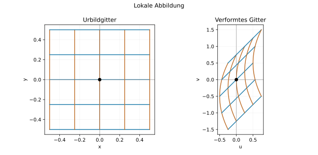

# M11-L1 – Totale Ableitung, Jacobi-Matrix und Umkehrsatz {#L1}

**Kursbereich:** M11 – Analysis, lineare Algebra und Wahrscheinlichkeit vertieft

**Niveau:** Bachelor · Studiengrundlagen und Vertiefung

**Vorwissen:** [M1-L4](M1-L4.md); [M1-L6](M1-L6.md)

**Einordnung:** Bachelor Analysis-Kern/Vertiefung

## Lernziele {#S1}

Du unterscheidest partielle und totale Differenzierbarkeit, berechnest die Jacobi-Matrix und die Ableitung einer Verkettung, wendest den lokalen Umkehrsatz an und prüfst seine Voraussetzungen an Gegenbeispielen.

## Lineare Näherung und Restterm {#S2}

Die in [M1-L4](M1-L4.md) eingeführten partiellen Ableitungen beschreiben Änderungen entlang einzelner Koordinaten. Die totale Ableitung erfasst gleichzeitig beliebige kleine Änderungen. Sei $U\subset\mathbb R^n$ offen und $f:U\to\mathbb R^m$. In $a\in U$ heißt $f$ total differenzierbar, wenn eine lineare Abbildung $A$ existiert mit

$$f(a+h)=f(a)+Ah+r(h),\qquad \lim_{h\to0,h\ne0}\frac{\|r(h)\|}{\|h\|}=0.$$

Die Norm sei euklidisch. Die Abbildung ist eindeutig: Sind $A,B$ zulässig, folgt für $h=tv$ nach Division durch $|t|$ und Grenzübergang $(A-B)v=0$ für jeden Vektor $v$. Für $h=te_j$ folgt aus dem Restterm, dass die $j$-te Spalte von $A$ die partiellen Ableitungen in Richtung der $j$-ten Koordinate enthält. Somit gilt $A=Df(a)=J_f(a)=(\partial_j f_i(a))_{i,j}$, eine $m\times n$-Matrix. Stetige partielle Ableitungen in einer offenen Umgebung sind hinreichend: Entlang der Strecke von $a$ nach $a+h$ liefert der Hauptsatz komponentenweise den Rest $\int_0^1 (J_f(a+th)-J_f(a))h\,dt$. Seine Norm geteilt durch $\|h\|$ geht wegen Stetigkeit gegen null. Die Strecke liegt für kleine $h$ vollständig in $U$.

## Beispiel, Kettenregel und Gegenbeispiel {#S3}

Für $f(x,y)=(x+y^2,2y+x)$ gilt $J_f(x,y)=\begin{pmatrix}1&2y\\1&2\end{pmatrix}$. Bei $a=(0,0)$ ergibt sich für $h=(s,t)$ exakt der Rest $(t^2,0)$; der normierte Rest ist höchstens $\|h\|$. Für eine differenzierbare Folgeabbildung $g$ gilt $D(g\circ f)(a)=Dg(f(a))Df(a)$. Denn der Zuwachs von $f$ ist $Ah+o(\|h\|)=O(\|h\|)$; Einsetzen in die lineare Näherung von $g$ liefert den behaupteten linearen Term mit Rest $o(\|h\|)$. Die Reihenfolge der Matrizen ist wesentlich. Mit $g(u,v)=u+v^2$ erhält man am Ursprung $D(g\circ f)=(1,0)$.

Dagegen sei $q(x,y)=xy/\sqrt{x^2+y^2}$ außerhalb des Ursprungs und $q(0,0)=0$. Auf beiden Achsen ist $q=0$, also existieren dort die partiellen Ableitungen am Ursprung und sind null. Die Funktion ist stetig, weil $|xy|\le (x^2+y^2)/2$. Für $h=(t,t)$ mit $t\ne0$ ist jedoch $|q(h)|/\|h\|=1/2$. Die notwendige lineare Abbildung wäre null, ihr Rest erfüllt die Definition nicht. Auch Stetigkeit zusammen mit vorhandenen partiellen Ableitungen genügt daher nicht.

## Lokaler Umkehrsatz {#S4}

Sei $f:U\subset\mathbb R^n\to\mathbb R^n$ von Klasse $C^1$ und $\det Df(a)\ne0$. Der Umkehrsatz garantiert offene Umgebungen $V$ von $a$ und $W$ von $f(a)$, auf denen $f:V\to W$ bijektiv ist und eine $C^1$-Umkehrabbildung besitzt. Aus $f^{-1}\circ f=\operatorname{id}$ und der Kettenregel folgt

$$D(f^{-1})(f(a))=[Df(a)]^{-1}.$$

Für das vorige Beispiel ist $\det Df(0,0)=2$, also existiert eine lokale Umkehrung mit Ableitung $\begin{pmatrix}1&0\\-1/2&1/2\end{pmatrix}$. Die Grafik zeigt das lokale Koordinatengitter und seine Verformung. Die Aussage ist lokal, nicht global: $f(0,0)=(0,0)=f(-4,2)$, obwohl der Satz am Ursprung anwendbar ist. Bei $f(x,y)=(x^3,y)$ ist die Determinante am Ursprung null, die Funktion aber dennoch bijektiv; die Umkehrung $(\sqrt[3]{u},v)$ ist dort nicht differenzierbar. Eine singuläre Ableitung widerlegt somit eine differenzierbare lokale Umkehrung, nicht jede Umkehrbarkeit.

Der Existenzteil des Umkehrsatzes wird hier als Satz verwendet; sein vollständiger analytischer Beweis ist eine weiterführende Aufgabe. Die Ableitungsformel wurde oben aus der Kettenregel hergeleitet.

{alt="Lokales Gitter und Bild unter f"}

## Anwendung und Kontrolle {#S5}

Für eine kleine Zieländerung $(\Delta u,\Delta v)=(0{,}02,0{,}06)$ um $f(0,0)$ sagt die lineare Umkehrung $(\Delta x,\Delta y)\approx(0{,}02,0{,}02)$ voraus. Einsetzen ergibt $(0{,}0204,0{,}06)$; der Fehler der ersten Koordinate ist quadratisch. Die exakte lokale Lösung folgt aus $x=v-2y$ und $y^2-2y+v-u=0$: nahe null gilt $y=1-\sqrt{1+u-v}$, $x=v-2y$. Der andere Zweig liegt nahe $y=2$ und gehört nicht zur betrachteten lokalen Umkehrung. Eine kleine Determinante allein misst die numerische Kondition nicht zuverlässig; dazu sind unter anderem die Singulärwerte relevant. In [M11-L2](M11-L2.md) wird die Determinante zur Flächenskalierung eingesetzt.

## Selbstkontrolle {#S6}

### Aufgaben

1. Berechne die Jacobi-Matrix von $(xy,x^2+y)$ bei $(1,2)$.
2. Bestimme für das Beispiel $f$ aus S3 die Determinante bei $y=1$ und beurteile die Anwendbarkeit des Umkehrsatzes.
3. Berechne die normierte Restgröße von $q$ entlang $(t,t)$.
4. Bestimme die Ableitung der lokalen Umkehrung von $(2x+y,x+y)$.
5. Erkläre, warum lokale Umkehrbarkeit keine globale Injektivität garantiert.

::: {.lc-solutions data-lc-section="S6"}
1. $\begin{pmatrix}2&1\\2&1\end{pmatrix}$.
2. $2-2y=0$; der Satz liefert dort keine lokale $C^1$-Umkehrung.
3. $1/2$ für jedes $t\ne0$; der Grenzwert ist nicht null.
4. $\begin{pmatrix}1&-1\\-1&2\end{pmatrix}$, überall konstant.
5. Der Satz beschränkt die Abbildung auf geeignete Umgebungen. Das Beispiel aus S4 hat zwei verschiedene Urbilder von $(0,0)$.
:::

## Quellen {#S7}

- [University of Toronto, MAT237, §2.2](https://www.math.toronto.edu/courses/mat237y1/20189/notes/Chapter2/S2.2.html) · Theorem 1, differentiability and Jacobian · Zuletzt abgerufen: 2026-11-24 · Inhaltlich geprüft: 2026-11-24
- [University of Toronto, MAT237, §3.3](https://www.math.toronto.edu/courses/mat237y1/20189/notes/Chapter3/S3.3.html) · Theorem 1, inverse function theorem · Zuletzt abgerufen: 2026-11-24 · Inhaltlich geprüft: 2026-11-24
