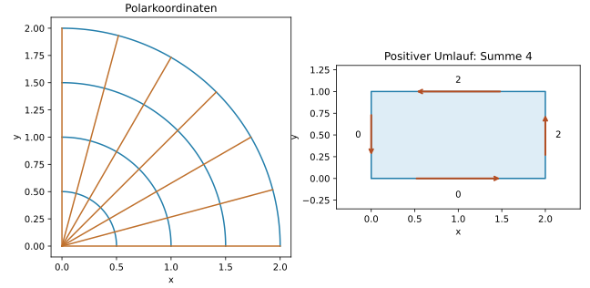

# M11-L2 – Variablentransformation und Integralsätze {#L2}

**Kursbereich:** M11 – Analysis, lineare Algebra und Wahrscheinlichkeit vertieft

**Niveau:** Bachelor · Studiengrundlagen und Vertiefung

**Vorwissen:** [M11-L1](M11-L1.md); [M1-L4](M1-L4.md)

**Einordnung:** Bachelor Analysis-Kern/Vertiefung

## Lernziele {#S1}

Du berechnest Flächenelemente nach Koordinatenwechsel, erkennst Mehrfachüberdeckungen und unterscheidest nichtnegative Flächenskalierung von orientierten Randintegralen. Du beweist den Satz von Green für Rechtecke und berechnest Zirkulation und Fluss.

## Variablentransformation {#S2}

Aufbauend auf [M11-L1](M11-L1.md) und [M1-L4](M1-L4.md) sei $T:U\to V$ ein $C^1$-Diffeomorphismus offener Teilmengen von $\mathbb R^2$, also bijektiv mit stetig differenzierbarer Umkehrabbildung. Für integrierbares $f$ auf $V$ gilt

$$\int_V f(x,y)\,dx\,dy=\int_U f(T(u,v))\,|\det DT(u,v)|\,du\,dv.$$

Das lokale Rechteck mit Seiten $du,dv$ wird in erster Ordnung durch die beiden Spalten von $DT$ aufgespannt. Die Fläche des Parallelogramms ist der Betrag ihrer Determinante mal $du\,dv$. Dies motiviert die Formel; der allgemeine Integralsatz benötigt einen eigenen Grenzübergangsbeweis. Beispielsweise liefert $T(u,v)=(2u+v,u-v)$ die Determinante $-3$. Das Einheitsquadrat hat als Bild ein Parallelogramm mit Fläche 3, nicht $-3$. Die Orientierung wird umgekehrt, die Fläche bleibt nichtnegativ. Randstücke von Flächenmaß null können bei diesen Integralen weggelassen werden.

## Polarkoordinaten und Mehrfachüberdeckung {#S3}

Für $T(r,\theta)=(r\cos\theta,r\sin\theta)$ ist $DT=\begin{pmatrix}\cos\theta&-r\sin\theta\\\sin\theta&r\cos\theta\end{pmatrix}$ und $\det DT=r$. Auf $0<r<R$, $0<\theta<2\pi$ ist $T$ ein Diffeomorphismus auf die offene Kreisscheibe ohne Ursprung und positiven radialen Schnitt. Die ausgelassenen Mengen haben Flächenmaß null. Für $f(x,y)=x^2+y^2$ folgt

$$\int_{x^2+y^2<R^2}(x^2+y^2)\,dA=\int_0^{2\pi}\int_0^R r^3\,dr\,d\theta=\frac{\pi R^4}{2}.$$

Für $R=2$ ergibt sich $8\pi$. Wird das Winkelintervall auf $(0,4\pi)$ erweitert, ist die Abbildung nicht injektiv und das naive Integral liefert den doppelten Wert. Die Singularität bei $r=0$ darf nicht als lokaler Diffeomorphismus behandelt werden; hier ist das Entfernen einer Nullmenge zulässig. Die Formel setzt außerdem voraus, dass das transformierte Integrand und die Grenzen zur selben Abbildung gehören.

## Satz von Green: Zirkulation und Beweis am Rechteck {#S4}

Sei $D$ eine beschränkte ebene Region mit stückweise glattem, einfachem geschlossenem Rand, positiv (gegen den Uhrzeigersinn) orientiert, und $P,Q$ seien $C^1$ auf einer offenen Umgebung von $\overline D$. Dann gilt

$$\oint_{\partial D} P\,dx+Q\,dy=\iint_D(\partial_xQ-\partial_yP)\,dA.$$

Für das Rechteck $D=[a,b]\times[c,d]$ trägt die untere Kante $\int_a^b P(x,c)dx$ bei, die rechte $\int_c^d Q(b,y)dy$, die obere $-\int_a^b P(x,d)dx$ und die linke $-\int_c^d Q(a,y)dy$. Die Summe ist

$$\int_c^d[Q(b,y)-Q(a,y)]dy-\int_a^b[P(x,d)-P(x,c)]dx.$$

Der eindimensionale Hauptsatz ersetzt die Differenzen durch Integrale der jeweiligen partiellen Ableitung. Fubini erlaubt wegen Stetigkeit, die Integrationsreihenfolge anzugleichen; damit entsteht exakt das Flächenintegral. Das beweist den Rechteckfall. Für allgemeinere Gebiete ist eine zusätzliche Argumentation erforderlich, die hier nicht bewiesen wird. Bei einem Gebiet mit Löchern ist die positive Orientierung innen im Uhrzeigersinn, sodass das Gebiet stets links der Laufrichtung liegt. Dort muss der Satz auf sämtliche Randkomponenten angewendet werden, sofern die Regularitätsannahmen erfüllt sind.

## Zirkulation, Fluss und Orientierung {#S5}

Für $P=-y^2$, $Q=2xy$ auf $D=[0,2]\times[0,1]$ ist $Q_x-P_y=4y$; die Zirkulation beträgt $\int_0^2\int_0^1 4y\,dy\,dx=4$. Direkte Randkontrolle: unten 0, rechts $\int_0^1 4y\,dy=2$, oben $\int_2^0 -1\,dx=2$, links 0. Die Grafik zeigt die vier Beiträge. Bei umgekehrter Randorientierung beträgt die Zirkulation $-4$.

Für ein Vektorfeld $F=(P,Q)$ und den äußeren Einheitsnormalenvektor $n$ gilt bei positivem Randumlauf $F\cdot n\,ds=P\,dy-Q\,dx$. Anwendung des Zirkulationssatzes auf $(-Q,P)$ ergibt die Flussform $\oint F\cdot n\,ds=\iint_D(P_x+Q_y)dA$. Beim selben Feld ist die Divergenz $2x$ und der äußere Fluss 4. Er ist eine geometrisch definierte Größe; wenn der Weg umgekehrt wird, muss die Formel für die äußere Normale angepasst werden. Die beiden Sätze sind ebene Spezialfälle der Verbindung zwischen Ableitung und Randintegration; Stokes- und Gauß-Satz verallgemeinern sie auf geeignete dreidimensionale Gebiete und Flächen. Ein singuläres Feld, etwa $(-y,x)/(x^2+y^2)$, darf nicht ohne Prüfung der Definitionsmenge auf eine volle Kreisscheibe angewendet werden.

{alt="Polargitter und positiv orientierter Rechteckrand"}

## Selbstkontrolle {#S6}

### Aufgaben

1. Berechne die Fläche des Bildes von $[0,2]\times[0,3]$ unter $T(u,v)=(2u+v,u-v)$.
2. Integriere $1$ über die Kreisscheibe mit Radius 3 in Polarkoordinaten.
3. Warum ist $\theta\in(0,4\pi)$ für eine einfache Polarkoordinatentransformation ungeeignet?
4. Berechne die Zirkulation von $(-y,x)$ um das positiv orientierte Rechteck $[0,3]\times[0,2]$.
5. Bestimme den äußeren Fluss von $(x,y)$ durch denselben Rand.

::: {.lc-solutions data-lc-section="S6"}
1. $3\cdot2\cdot3=18$.
2. $\int_0^{2\pi}\int_0^3 r\,dr\,d\theta=9\pi$.
3. Fast jeder Punkt der Scheibe wird zweimal überdeckt; Injektivität fehlt.
4. $Q_x-P_y=2$; Zirkulation $12$, im Uhrzeigersinn $-12$.
5. $P_x+Q_y=2$; äußerer Fluss $12$.
:::

## Quellen {#S7}

- [MIT 18.013A, §24.2](https://ocw.mit.edu/ans7870/18/18.013a/textbook/chapter24/section02.html) · Area integrals and absolute Jacobian · Zuletzt abgerufen: 2026-11-24 · Inhaltlich geprüft: 2026-11-24
- [De Anza College, Calculus IV, §3.4](https://math.libretexts.org/Courses/De_Anza_College/Calculus_IV:_Multivariable_Calculus/03:_Vector_Calculus/3.04:_Greens_Theorem) · Circulation, rectangle proof, flux and regions with holes · Zuletzt abgerufen: 2026-11-24 · Inhaltlich geprüft: 2026-11-24
