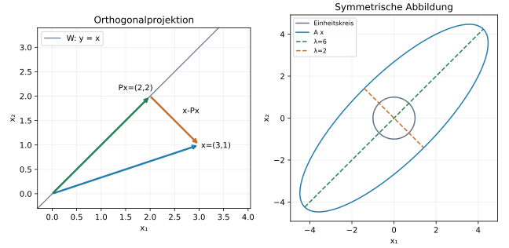

# M11-L3 – Skalarprodukte, Orthogonalprojektion und Spektralsatz {#L3}

**Kursbereich:** M11 – Analysis, lineare Algebra und Wahrscheinlichkeit vertieft

**Niveau:** Bachelor · Studiengrundlagen und Vertiefung

**Vorwissen:** [M1-L5](M1-L5.md); [M1-L6](M1-L6.md)

**Einordnung:** Bachelor Kern/Vertiefung

## Lernziele {#S1}

Du berechnest Orthogonalprojektionen und Gram–Schmidt-Basen, beweist die Bestapproximation in endlichdimensionalen Unterräumen und diagonalisierst reelle symmetrische Matrizen orthogonal.

## Skalarprodukt und Bestapproximation {#S2}

Auf einem reellen Vektorraum ist ein Skalarprodukt eine symmetrische bilineare Form mit $\langle x,x\rangle>0$ für $x\ne0$. Es induziert die Norm $\|x\|=\sqrt{\langle x,x\rangle}$. Aus der Nichtnegativität von $\|x-ty\|^2$ für alle $t\in\mathbb R$ folgt durch Minimieren bei $t=\langle x,y\rangle/\|y\|^2$ (für $y\ne0$) die Cauchy–Schwarz-Ungleichung $|\langle x,y\rangle|\le\|x\|\|y\|$. Orthogonalität bedeutet $\langle x,y\rangle=0$.

Sei $W$ ein Unterraum mit endlicher Orthonormalbasis $q_1,\ldots,q_m$. Setze $Px=\sum_i\langle x,q_i\rangle q_i$. Dann ist $x-Px$ orthogonal zu jedem Basisvektor und damit zu $W$. Für jedes $w\in W$ gilt nach Pythagoras

$$\|x-w\|^2=\|x-Px\|^2+\|Px-w\|^2.$$

Die rechte Seite ist genau bei $w=Px$ minimal. In euklidischen Koordinaten mit $Q=(q_1\ \cdots\ q_m)$ gilt $P=QQ^T$ und $P^2=P=P^T$. Für eine nichtorthogonale Basis mit vollrangiger Spaltenmatrix $B$ lautet die Projektionsmatrix $B(B^TB)^{-1}B^T$: Die Normalgleichung $B^T(x-Bc)=0$ liefert die Koeffizienten. Ohne vollen Spaltenrang ist diese Inversenformel nicht gültig.

## Gram–Schmidt und QR-Zerlegung {#S3}

Aus unabhängigen Vektoren $a_1,\ldots,a_m$ konstruiert man rekursiv $v_j=a_j-\sum_{i<j}\langle a_j,q_i\rangle q_i$ und $q_j=v_j/\|v_j\|$. Das Skalarprodukt von $v_j$ mit jedem früheren $q_i$ ist null. Weil die bisherigen $q_i$ denselben Raum wie die bisherigen $a_i$ aufspannen, ist $v_j\ne0$ aufgrund linearer Unabhängigkeit. Induktiv bleiben die aufgespannten Teilräume gleich. In euklidischen Koordinaten ergibt sich $B=QR$, $R_{ij}=q_i^Ta_j$ für $i\le j$, sonst null. Die Diagonale ist positiv. Bei nahezu abhängigen Vektoren können Rundungsfehler die Orthogonalität beeinträchtigen; numerisch werden häufig Householder-Transformationen oder modifiziertes Gram–Schmidt eingesetzt.

Beispiel: $a_1=(1,1,0)^T$, $a_2=(1,0,1)^T$. Dann $q_1=(1,1,0)^T/\sqrt2$ und $q_2=(1,-1,2)^T/\sqrt6$. Die Projektion von $(2,0,0)^T$ auf ihren Spann ist $(4/3,2/3,2/3)^T$. Der Rest $(2/3,-2/3,-2/3)^T$ ist zu beiden Ausgangsvektoren orthogonal. In der Grafik wird der zweidimensionale Spezialfall $x=(3,1)$, $W=\operatorname{span}(1,1)$ mit $Px=(2,2)$ gezeigt.

{alt="Orthogonalprojektion und Eigenrichtungen"}

## Spektralsatz und Beweis {#S4}

Für jede reelle symmetrische Matrix $A=A^T$ existiert eine orthonormale Eigenbasis, also $A=Q\Lambda Q^T$ mit orthogonalem $Q$ und reeller Diagonalmatrix $\Lambda$. Ein Beweis verwendet das Maximum von $x^TAx$ auf der kompakten Einheitssphäre. Sei $u$ ein Maximierer. Für jeden Einheitsvektor $v\perp u$ muss die Ableitung von $(u\cos t+v\sin t)^TA(u\cos t+v\sin t)$ bei $t=0$ null sein. Sie ist $2v^TAu$. Also $Au=\lambda u$. Wegen Symmetrie ist $u^\perp$ invariant: $u^TAw=(Au)^Tw=0$ für $w\perp u$. Die Einschränkung ist erneut symmetrisch. Induktion über die Dimension, mit Dimension eins als Basisfall, liefert die Eigenbasis.

Für $A=\begin{pmatrix}4&2\\2&4\end{pmatrix}$ sind $q_+=(1,1)^T/\sqrt2$, $q_-=(1,-1)^T/\sqrt2$ Eigenvektoren mit Eigenwerten 6 und 2. Damit $A=6q_+q_+^T+2q_-q_-^T$ und $A^k=6^k q_+q_+^T+2^k q_-q_-^T$ für $k\ge0$. Die Matrix ist positiv definit, weil $x^TAx=6(q_+^Tx)^2+2(q_-^Tx)^2>0$ für $x\ne0$.

## Grenzen und Anwendungen {#S5}

Bei der linearen Ausgleichsrechnung minimiert eine QR-Zerlegung $\|Bc-y\|$: Weil $Q^TQ=I$, lautet die eindeutige Lösung bei vollem Rang $Rc=Q^Ty$. Dies vermeidet die explizite Bildung von $B^TB$, deren 2-Norm-Konditionszahl bei vollem Rang das Quadrat der von $B$ ist. Eine idempotente Matrix ist nicht notwendig eine Orthogonalprojektion: $\begin{pmatrix}1&1\\0&0\end{pmatrix}$ projiziert schief auf die erste Achse. Sie ist auch nicht symmetrisch. Eine reelle Matrix kann selbst bei reellen Eigenwerten nicht diagonalisierbar sein, etwa $\begin{pmatrix}1&1\\0&1\end{pmatrix}$. Der Spektralsatz hier ist endlichdimensional; unendlichdimensionale Operatoren erfordern weitere Voraussetzungen.

## Selbstkontrolle {#S6}

### Aufgaben

1. Projiziere $(4,2)$ auf die Gerade mit Richtungsvektor $(1,2)$.
2. Orthogonalisiere $(1,0,1)$ und $(1,1,0)$ (ohne Normierung).
3. Bestimme die Eigenwerte von $\begin{pmatrix}3&1\\1&3\end{pmatrix}$ und eine orthonormale Eigenbasis.
4. Warum ist $P=QQ^T$ für $Q^TQ=I$ idempotent?
5. Prüfe die schiefe Projektion aus S5 auf Symmetrie und gib ihren Kern an.

::: {.lc-solutions data-lc-section="S6"}
1. $(8/5,16/5)$.
2. $(1,0,1)$ und $(1/2,1,-1/2)$.
3. $4,2$ mit $(1,1)/\sqrt2$ und $(1,-1)/\sqrt2$.
4. $P^2=Q(Q^TQ)Q^T=P$.
5. Nicht symmetrisch; Kern $\operatorname{span}(1,-1)$.
:::

## Quellen {#S7}

- [TU Delft, R. Koekoek, The Gram-Schmidt process](https://tudelft.roelofkoekoek.nl/teaching/linalg/orthogonality/gram-schmidt.html) · Projection formula, Gram–Schmidt, QR · Zuletzt abgerufen: 2026-11-24 · Inhaltlich geprüft: 2026-11-24
- [TU Delft, R. Koekoek, The spectral theorem](https://tudelft.roelofkoekoek.nl/teaching/linalg/symmetric/spectral_theorem.html) · Orthogonal diagonalization and spectral decomposition · Zuletzt abgerufen: 2026-11-24 · Inhaltlich geprüft: 2026-11-24
