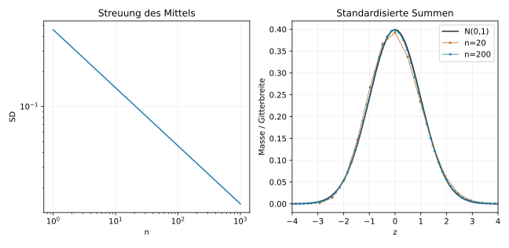

# M11-L4 – Gesetz der großen Zahlen und zentraler Grenzwertsatz {#L4}

**Kursbereich:** M11 – Analysis, lineare Algebra und Wahrscheinlichkeit vertieft

**Niveau:** Bachelor · Studiengrundlagen und Vertiefung

**Vorwissen:** [M1-L7](M1-L7.md); [M1-L2](M1-L2.md)

**Einordnung:** Bachelor Kern/Vertiefung

## Lernziele {#S1}

Du unterscheidest stochastische Konvergenzarten, beweist das schwache Gesetz der großen Zahlen mit Tschebyscheff und wendest den zentralen Grenzwertsatz auf standardisierte Summen an.

## Stichprobenmittel und schwaches Gesetz {#S2}

Seien $X_i$ unabhängig und identisch verteilt (i.i.d.) mit Erwartungswert $\mu$ und endlicher Varianz $\sigma^2$. Für $\bar X_n=n^{-1}\sum_{i=1}^nX_i$ gilt $E\bar X_n=\mu$ und aufgrund der verschwindenden Kovarianzen $\operatorname{Var}(\bar X_n)=\sigma^2/n$. Die Tschebyscheff-Ungleichung folgt aus $E(Y- EY)^2\ge\varepsilon^2P(|Y-EY|\ge\varepsilon)$. Somit

$$P(|\bar X_n-\mu|\ge\varepsilon)\le\frac{\sigma^2}{n\varepsilon^2}\to0$$

für jedes $\varepsilon>0$. Dies ist Konvergenz in Wahrscheinlichkeit und beweist das schwache Gesetz unter den genannten Annahmen. Der mittlere quadratische Fehler geht ebenfalls gegen null. Die Abschätzung ist häufig konservativ. Für Bernoulli-Beobachtungen mit $p=0{,}3$ und $n=1000$ beträgt die obere Schranke bei $\varepsilon=0{,}05$ beispielsweise $0{,}084$.

## Konvergenzarten und Abhängigkeit {#S3}

Fast sichere Konvergenz bedeutet $P(\{\omega:X_n(\omega)\to X(\omega)\})=1$. Das starke Gesetz liefert für i.i.d. Zufallsvariablen mit $E|X_1|<\infty$ die fast sichere Konvergenz des Mittels. Es ist hier als Satz angegeben, ohne vollständigen Beweis. Fast sichere Konvergenz impliziert Konvergenz in Wahrscheinlichkeit, diese wiederum Verteilungskonvergenz. Bei Verteilungskonvergenz konvergieren die Verteilungsfunktionen an Stetigkeitsstellen der Grenzverteilungsfunktion. Die Umkehrungen gelten im Allgemeinen nicht. Beispielsweise konvergieren unabhängige Indikatoren mit Erfolgswahrscheinlichkeit $1/n$ in Wahrscheinlichkeit gegen null, aber wegen des zweiten Borel–Cantelli-Lemmas treten Erfolge fast sicher unendlich oft auf.

Unabhängigkeit lässt sich nicht einfach weglassen: Sei $X_i=Y$ für alle $i$ mit $Y\sim\mathrm{Bernoulli}(1/2)$. Dann bleibt $\bar X_n=Y$; die Varianz sinkt nicht. Eine wachsende Stichprobe aus vollständig redundanten Beobachtungen ist keine zusätzliche Information.

## Zentraler Grenzwertsatz {#S4}

Für i.i.d. $X_i$ mit $0<\sigma^2<\infty$ lautet die standardisierte Summe

$$Z_n=\frac{\sum_iX_i-n\mu}{\sigma\sqrt n}=\frac{\sqrt n(\bar X_n-\mu)}{\sigma}.$$

Der zentrale Grenzwertsatz besagt $Z_n\Rightarrow N(0,1)$. Im Gegensatz zum Gesetz der großen Zahlen beschreibt er die Form der skalierten Schwankungen. Eine Beweisskizze: Für $Y=(X_1-\mu)/\sigma$ gilt für die charakteristische Funktion $\varphi_Y(t)=1-t^2/2+o(t^2)$ bei null (Taylorentwicklung und dominierte Konvergenz bei endlichem zweiten Moment). Unabhängigkeit liefert $\varphi_{Z_n}(t)=\varphi_Y(t/\sqrt n)^n\to e^{-t^2/2}$. Der Stetigkeitssatz von Lévy ergibt die behauptete Verteilungskonvergenz; dieser wird als weiterführender Satz vorausgesetzt.

Für $S\sim\mathrm{Bin}(100,0{,}3)$ sind Erwartungswert 30 und Varianz 21. Mit Stetigkeitskorrektur ergibt sich $P(25\le S\le35)\approx\Phi(5{,}5/\sqrt{21})-\Phi(-5{,}5/\sqrt{21})\approx0{,}770$. Die Korrektur berücksichtigt die Gitterstruktur. Bei kleinen erwarteten Erfolgs- oder Misserfolgszahlen kann die Normalapproximation schlecht sein; der Satz nennt keine universelle Mindeststichprobengröße.

## Reproduzierbares Experiment {#S5}

Der folgende Code simuliert für jede Stichprobengröße 20.000 unabhängige Bernoulli-Summen über die exakte Binomialverteilung. Er vergleicht den empirischen mittleren quadratischen Fehler des Mittels mit $p(1-p)/n$ und bestimmt den Anteil standardisierter Summen im Intervall $[-1,1]$.

```python
import numpy as np
rng = np.random.default_rng(165)
p = 0.3
for n in (20, 100, 1000):
    s = rng.binomial(n, p, size=20000)
    z = (s-n*p)/np.sqrt(n*p*(1-p))
    print(n, np.mean((s/n-p)**2), p*(1-p)/n,
          np.mean(np.abs(z) <= 1))
```

Die Grenzwahrscheinlichkeit für das letzte Intervall ist etwa 0,6827. Das Experiment ist eine Plausibilitätskontrolle, kein Beweis. Der Zufallsfehler des empirischen Anteils beträgt in der Größenordnung höchstens $1/(2\sqrt{20000})$. Die Grafik zeigt die schrumpfende Standardabweichung des Mittels und die exakte Binomialmasse in standardisierten Koordinaten, dividiert durch die Gitterbreite (Dichtevergleich).

{alt="Standardabweichung des Mittels und standardisierte Binomialverteilungen"}

## Selbstkontrolle {#S6}

### Aufgaben

1. Berechne die Varianz des Mittels aus 400 i.i.d. Beobachtungen mit Varianz 9.
2. Wie groß muss $n$ mindestens sein, damit die Tschebyscheff-Schranke bei Bernoulli-$p=1/2$ und $\varepsilon=0{,}1$ höchstens $0{,}05$ ist?
3. Standardisiere eine Binomialsumme mit $n=200,p=0{,}25$ bei beobachtetem Wert 60.
4. Warum versagt der Standardbeweis des Grenzwertsatzes bei $\sigma^2=0$?
5. Erkläre den Unterschied zwischen schwachem Gesetz und zentralem Grenzwertsatz.

::: {.lc-solutions data-lc-section="S6"}
1. $9/400=0{,}0225$.
2. $n\ge500$.
3. $(60-50)/\sqrt{37{,}5}\approx1{,}633$.
4. Die Standardisierung dividiert durch null; die Beobachtungen sind fast sicher konstant.
5. Das erste zeigt Konzentration des Mittels um $\mu$, das zweite beschreibt die Grenzverteilung seiner auf der Skala $\sqrt n$ vergrößerten Abweichung.
:::

## Quellen {#S7}

- [H. Pishro-Nik, Introduction to Probability, §7.1.1](https://www.probabilitycourse.com/chapter7/7_1_1_law_of_large_numbers.php) · Weak law, Chebyshev · Zuletzt abgerufen: 2026-11-24 · Inhaltlich geprüft: 2026-11-24
- [H. Pishro-Nik, Introduction to Probability, §7.1.2](https://www.probabilitycourse.com/chapter7/7_1_2_central_limit_theorem.php) · i.i.d. CLT, standardization, normal approximation · Zuletzt abgerufen: 2026-11-24 · Inhaltlich geprüft: 2026-11-24
