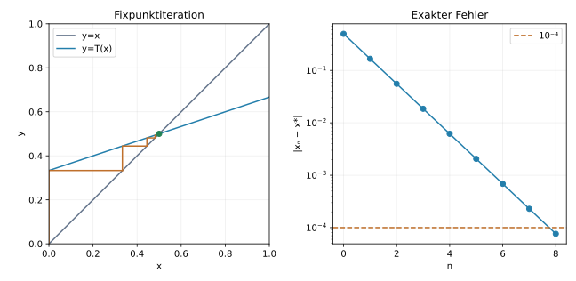

# M11-L5 – Banachräume und Fixpunktsatz {#L5}

**Kursbereich:** M11 – Analysis, lineare Algebra und Wahrscheinlichkeit vertieft

**Niveau:** Bachelor · Vertiefung und Master-Brücke

**Vorwissen:** [M2-L4](M2-L4.md); [M2-L7](M2-L7.md); [M1-L9](M1-L9.md)

**Einordnung:** Bachelor Vertiefung / Master-Brücke

## Lernziele {#S1}

Du unterscheidest normierte und vollständige Räume, beweist den Banachschen Fixpunktsatz, berechnest Fehlergrenzen und setzt das Verfahren für eine Integralgleichung ein.

## Vollständigkeit und Banachräume {#S2}

Eine Norm auf einem reellen oder komplexen Vektorraum $X$ erfüllt Definitheit, absolute Homogenität und Dreiecksungleichung. Sie induziert die Metrik $d(x,y)=\|x-y\|$. Eine Folge $(x_n)$ heißt Cauchyfolge, falls für jedes $\varepsilon>0$ ein $N$ existiert, sodass $\|x_n-x_m\|<\varepsilon$ für alle $n,m\ge N$. Ein normierter Raum heißt Banachraum, wenn jede Cauchyfolge in ihm konvergiert. Vollständigkeit betrifft also nicht nur die Abstände, sondern auch die Existenz des Grenzwerts im Raum.

Der Raum $C([0,1])$ der stetigen reellen Funktionen mit $\|f\|_\infty=\max_{t\in[0,1]}|f(t)|$ ist vollständig: Eine Cauchyfolge in dieser Norm ist punktweise Cauchy und besitzt wegen Vollständigkeit von $\mathbb R$ einen punktweisen Grenzwert $f$. Aus der einheitlichen Cauchyabschätzung folgt durch Grenzübergang in einem Index $\|f_n-f\|_\infty\to0$. Der gleichmäßige Grenzwert stetiger Funktionen ist stetig (Dreiecksungleichung mit einem festen hinreichend späten Folgenglied). Dagegen ist der Unterraum der Polynome mit dieser Norm unvollständig: Die Taylorpolynome von $e^t$ konvergieren auf $[0,1]$ gleichmäßig zu $e^t$, das kein Polynom ist. Eine abgeschlossene Teilmenge eines vollständigen metrischen Raumes ist vollständig, auch wenn sie kein Vektorraum ist.

## Fixpunktsatz und Fehlergrenzen {#S3}

Sei $(X,d)$ nichtleer und vollständig und $T:X\to X$ eine Kontraktion: Es gibt $q\in[0,1)$ mit $d(Tx,Ty)\le qd(x,y)$ für alle $x,y\in X$. Dann existiert genau ein Fixpunkt $x^*=Tx^*$. Für jeden Start $x_0\in X$ konvergiert die Iteration $x_{n+1}=Tx_n$ zu ihm.

Beweis: Wiederholtes Anwenden der Kontraktionsabschätzung gibt $d(x_{n+1},x_n)\le q^n d(x_1,x_0)$. Für $m>n$ ergibt die Dreiecksungleichung

$$d(x_m,x_n)\le\sum_{k=n}^{m-1}q^k d(x_1,x_0)\le\frac{q^n}{1-q}d(x_1,x_0).$$

Damit ist die Folge Cauchy und hat einen Grenzwert in $X$. Die Lipschitz-Stetigkeit von $T$ erlaubt den Grenzübergang in der Iteration; folglich $Tx^*=x^*$. Für zwei Fixpunkte wäre $d(x^*,y^*)\le qd(x^*,y^*)$, also müssen sie gleich sein. Grenzübergang $m\to\infty$ liefert die a-priori-Abschätzung rechts oben. Dieselbe Rechnung mit Start $x_n$ liefert die a-posteriori-Schranke $d(x_n,x^*)\le d(x_{n+1},x_n)/(1-q)$; mit dem vorherigen Schritt ist sie höchstens $q d(x_n,x_{n-1})/(1-q)$ für $n\ge1$.

## Rechenbeispiel und Gegenbeispiele {#S4}

Auf $[0,1]$ sei $T(x)=(x+1)/3$. Die Abbildung erhält das Intervall und hat $q=1/3$. Der Fixpunkt ist $1/2$. Bei Start $x_0=0$ gilt exakt $x_n=(1-3^{-n})/2$. Die a-priori-Schranke ist $3^{-n}/2$; in diesem Beispiel stimmt sie mit dem Fehler überein. Für einen Fehler von höchstens $10^{-4}$ genügen acht Schritte. Die Grafik zeigt die alternierenden vertikalen und horizontalen Schritte der Fixpunktiteration zwischen $y=T(x)$ und $y=x$ sowie die Fehlerabnahme.

Die Voraussetzungen sind wesentlich: $T(x)=x/2$ auf $(0,1)$ ist eine Kontraktion ohne Fixpunkt im Raum (nicht vollständig). Auf $\mathbb R$ hat $T(x)=x+1$ keinen Fixpunkt trotz Lipschitz-Konstante 1. Selbst punktweise strikte Abstandsverkleinerung reicht nicht: Auf $[1,\infty)$ ist $T(x)=x+1/x$ für verschiedene $x,y$ strikt abstandsverkleinernd, weil $|Tx-Ty|=|x-y||1-1/(xy)|<|x-y|$. Aber es gibt keinen gemeinsamen Faktor $q<1$ und keinen Fixpunkt.

{alt="Fixpunktiteration und geometrische Fehlerabnahme"}

## Anwendung auf Differentialgleichungen {#S5}

Auf $C([0,1/2])$ mit Supremumsnorm definiere $(Tf)(t)=1+\int_0^t f(s)\,ds$. Der Operator ist eine Selbstabbildung und $\|Tf-Tg\|_\infty\le\tfrac12\|f-g\|_\infty$. Der Fixpunktsatz liefert genau eine stetige Lösung der Integralgleichung. Wegen des Hauptsatzes ist sie differenzierbar und erfüllt $y'=y$, $y(0)=1$, also $y=e^t$. Bei Start $f_0=1$ sind die Iterierten $f_n(t)=\sum_{k=0}^n t^k/k!$. Das folgt durch Induktion und gliedweises Integrieren der endlichen Summe. Da $\|f_1-f_0\|_\infty=1/2$, gilt $\|f_n-e^t\|_\infty\le2^{-n}$. Die tatsächliche Taylorrestschranke ist deutlich besser. Für allgemeine Picard-Operatoren benötigt man unter anderem eine geeignete invariante Funktionsmenge und eine Lipschitz-Bedingung in der Zustandsvariable; ein beliebiger Zeithorizont ist nicht automatisch eine Kontraktion.

## Selbstkontrolle {#S6}

### Aufgaben

1. Bestimme Fixpunkt und Kontraktionsfaktor von $T(x)=0{,}4x+3$ auf $\mathbb R$.
2. Für $q=1/2$, $d(x_1,x_0)=2$: Wie viele Schritte garantiert die a-priori-Schranke für einen Fehler höchstens $0{,}01$?
3. Warum darf man bei $(0,1)$ und $T(x)=x/2$ nicht den Fixpunktsatz verwenden?
4. Bestimme $f_2(t)$ für den Integraloperator aus S5.
5. Leite aus $d(x,Tx)\le\delta$ eine garantierte Distanz zu $x^*$ ab.

::: {.lc-solutions data-lc-section="S6"}
1. $x^*=5$, $q=0{,}4$.
2. $4\cdot2^{-n}\le0{,}01$; $n=9$ genügt, $n=8$ nicht.
3. Der Raum ist unvollständig; der Grenzwert 0 liegt außerhalb.
4. $1+t+t^2/2$.
5. $d(x,x^*)\le d(x,Tx)+q d(x,x^*)$, daher höchstens $\delta/(1-q)$.
:::

## Quellen {#S7}

- [University of Toronto, MAT267, Tutorial 6](https://www.math.utoronto.ca/almut/MAT267/Tutorial-6A.pdf) · p. 1: assumptions, uniqueness, existence, geometric error estimate; PDF text only · Zuletzt abgerufen: 2026-11-24 · Inhaltlich geprüft: 2026-11-24
