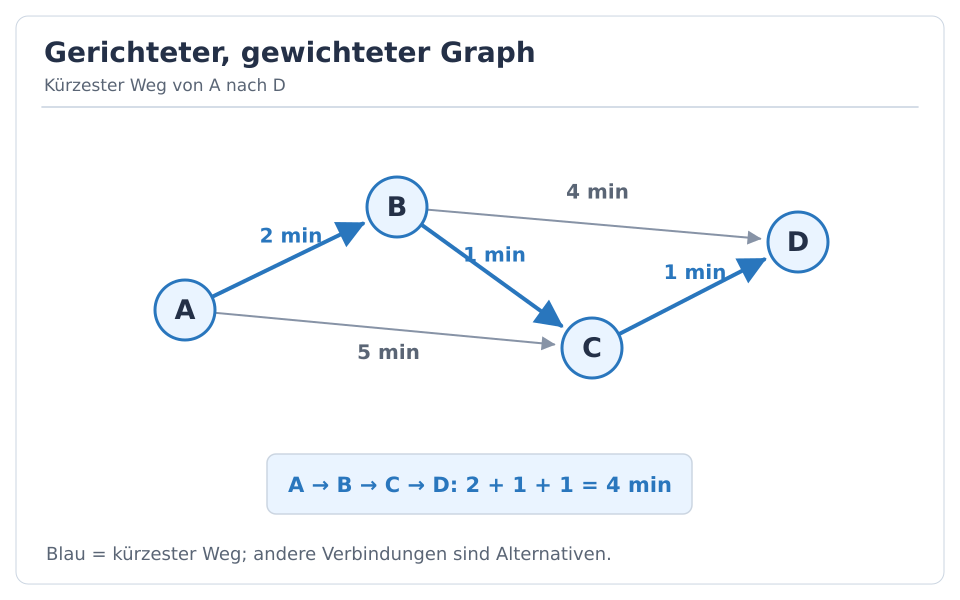

# M2-L1 – Diskrete Mathematik, Graphentheorie und Kombinatorik {#L1}

**Kursbereich:** M2 – Bachelor-Vertiefung / Master-Übergang

**Niveau:** Bachelor / Master-Brücke

**Vorwissen:** Keine festen Voraussetzungen angegeben.

**Einordnung:** Universität – weiterführende Vertiefung

## Worum geht es? {#S1}

Die Analysis untersucht Veränderungen häufig als kontinuierliche Verläufe. Die **diskrete Mathematik** beschäftigt sich dagegen mit unterscheidbaren Elementen und Strukturen: einzelnen Aufgaben, Knoten in einem Netzwerk, möglichen Wegen oder einer endlichen Menge von Entscheidungen. Die Graphentheorie macht Beziehungen zwischen solchen Elementen mathematisch greifbar. Die Kombinatorik untersucht, wie viele Konfigurationen möglich sind. Das bildet eine direkte Brücke zwischen Mathematik, Datenstrukturen und Algorithmen.

## Grundidee und Anschauung {#S2}

Ein Graph ist zunächst keine gezeichnete Funktionskurve. In diesem Zusammenhang ist er eine Menge von **Knoten** und **Kanten**: Knoten stehen für Objekte oder Zustände; Kanten für Verbindungen, Abhängigkeiten oder mögliche Übergänge. Ein gerichteter Graph unterscheidet „von A nach B“ von „von B nach A“. Ein gewichteter Graph versieht Kanten beispielsweise mit Fahrzeiten, Kosten oder Entfernungen. Gewichte benötigen eine klar festgelegte Einheit beziehungsweise Bedeutung.

Auf einem solchen Modell können wir fragen: Welche Verbindung ist am kürzesten? Sind zwei Knoten überhaupt verbunden? Enthält das System einen Kreis von Abhängigkeiten? Welche Arbeitsschritte dürfen parallel stattfinden? Wie viele Alternativen hat ein Planungsalgorithmus?

## Neue Zeichen vor der ersten Formel {#S3}

  Zeichen                              Aussprache                                              Bedeutung hier                                        Anderer möglicher Gebrauch
  ------------------------------------ ------------------------------------------------------- ----------------------------------------------------- ----------------------------------------------------
  $G$                                  „groß Ge“                                               Graph als gesamtes Netzwerk                           G kann sonst eine Funktion oder Gruppe sein
  $V$                                  „groß Vau“                                              Menge der Knoten (*vertices*)                         Vektorraum (M1-L5) oder Volumen (Schule M1-L5)
  $E$                                  „groß E“                                                Menge der Kanten (*edges*)                            Erwartungswert-Schreibweise E\[X\] (M1-L7)
  $G=(V,E)$                            „Ge ist das geordnete Paar Vau, E“                      Graph wird durch Knoten- und Kantenmenge festgelegt   Runde Klammern auch bei Koordinaten
  $\{A,B\}$                            „Menge mit A und B“                                     ungeordnete Zweiermenge, etwa ungerichtete Kante      Allgemeine Mengenschreibweise
  $(A,B)$                              „geordnetes Paar A, B“                                  gerichtete Kante von A nach B                         Koordinaten- oder Funktionsargument
  $w(A,B)$                             „Gewicht von A nach B“                                  Kantenkosten für diesen Übergang                      w als beliebige Funktion
  $d(s,z)$                             „De von ess und zett“                                   kürzeste Weglänge vom Start s zum Ziel z              d kann Differential kennzeichnen
  $A_{ij}$                             „A mit Index i und j“                                   Matrixeintrag in Zeile i, Spalte j                    A als beliebige Matrix (M1-L5)
  $\lvert V\rvert$ / $\lvert E\rvert$  „Anzahl der Elemente von V / E“                         Kardinalität der Knoten-/Kantenmenge                  Senkrechte Striche auch als Betrag
  $n!$                                 „enn Fakultät“                                          Produkt der natürlichen Zahlen von 1 bis n            Ausrufezeichen in Programmiersprachen als Negation
  $C(n,k)$                             „enn über ka“ / „Kombinationen von enn und ka“          Auswahl von k Objekten aus n ohne Reihenfolge         C sonst Konstante
  $O(\lvert V\rvert+\lvert E\rvert)$   „groß O von Anzahl der Knoten plus Anzahl der Kanten“   Größenordnung einer Algorithmuslaufzeit               O-Notation auch für numerische Fehler (M1-L8)
  $F(n)$                               „eff von enn“                                           Anzahl zulässiger Schrittreihenfolgen bei n Stufen    F kann auch eine allgemeine Funktion sein

## Ein Graph als mathematische Datenstruktur {#S4}

$$
G=(V,E)
$$

**Laut gelesen:** „Der Graph Ge besteht aus der Knotenmenge Vau und der Kantenmenge E.“ Für einen **ungerichteten einfachen Graphen** können Kanten ungeordnete Zweiermengen sein, für einen gerichteten Graphen geordnete Paare. Bei mehrfachen Kanten oder zusätzlichen Attributen braucht die formale Definition weitere Angaben.

Eine Software kann diesen Graphen auf mehrere Arten speichern:

- **Adjazenzliste:** Zu jedem Knoten werden seine Nachbarn und bei Bedarf deren Kantengewichte aufgelistet. Für große, dünn verbundene Netzwerke oft platzsparend.
- **Adjazenzmatrix:** Eine quadratische Tabelle mit Eintrag $A_{ij}$ für die Verbindung von Knoten i nach Knoten j. In einem einfachen ungewichteten Graphen bedeutet beispielsweise $A_{ij}=1$, dass die Kante existiert; $0$ bedeutet, dass sie fehlt.
- **Kantenliste:** Eine Liste der Verbindungen, gegebenenfalls mit Start, Ziel und Gewicht.

In einem Graphen mit $\lvert V\rvert$ Knoten hat die Adjazenzmatrix $\lvert V\rvert\cdot\lvert V\rvert$ Einträge. Eine Adjazenzliste kann für dünn besetzte Graphen wesentlich weniger Speicher benötigen. Die konkrete Datenstruktur beeinflusst die Rechenkosten von Suchverfahren.

## Vollständig erklärtes Mini-Beispiel: kürzester Weg {#S5}

Ein kleiner gerichteter Graph modelliert vier Stationen A, B, C und D. Die Zahl an jeder Verbindung ist ihre **nichtnegative** Bearbeitungszeit in Minuten:

Die blau markierten Kanten bilden den kürzesten Weg A → B → C → D.

Formel, Skizze oder Rechenschema · Originalnotation

    A --2--> B --1--> C --1--> D
     \       \
      5       4
       \       \
        v       v
        C       D

Die Kanten sind ausdrücklich: A→B mit Gewicht 2, A→C mit 5, B→C mit 1, B→D mit 4 und C→D mit 1. Die Skizze ist eine Lesehilfe; die Kantenliste legt das Modell eindeutig fest.

Vom Start A zum Ziel D gibt es beispielsweise folgende Wege:

  Weg             Summe der Gewichte   Zeit
  --------------- -------------------- ---------------
  A → C → D       $5+1$                6 Minuten
  A → B → D       $2+4$                6 Minuten
  A → B → C → D   $2+1+1$              **4 Minuten**

Der beste Weg in diesem Modell ist A → B → C → D mit 4 Minuten. Er hat **drei Kanten**. Ein Weg mit **nur zwei Kanten**, etwa A → C → D, benötigt dagegen **sechs Minuten**: Der kantenärmste Weg ist bei unterschiedlichen Gewichten nicht zwingend der zeitlich kürzeste. $d(A,D)=4$ ist die mathematische Kurzschreibweise für die Länge dieses kürzesten Weges. **Gesprochen:** „Die kürzeste Entfernung von A nach D beträgt vier.“ Hier ist das Wort Entfernung als Summe von **Zeiten**, nicht von Metern, definiert.

Der Algorithmus von **Dijkstra** kann solche kürzesten Wege in gerichteten oder ungerichteten gewichteten Graphen berechnen, **wenn alle betrachteten Kantengewichte nichtnegativ sind**. Negative Kantengewichte erfordern unter Umständen ein anderes Verfahren. Beispielsweise bilden $A\to B$ mit Kosten 2, $A\to C$ mit Kosten 5 und $C\to B$ mit Kosten −4 einen Graphen **ohne negativen Kreis**. Der günstigste Weg A→C→B kostet $5-4=1$, obwohl der direkte Weg A→B Kosten 2 hat. Der übliche Dijkstra-Algorithmus mit endgültiger Festlegung bereits untersuchter Knoten ist für solche negativen Gewichte nicht zuverlässig; unter geeigneten Bedingungen kann stattdessen Bellman–Ford verwendet werden. Existiert ein vom Start erreichbarer negativer Kreis, von dem aus das Ziel erreichbar ist, kann die Wegkostensumme durch Wiederholung beliebig sinken; dann gibt es keinen endlichen kürzesten **Weg als Kantenzug** mit Wiederholungen. Die bloße Zahl von Verbindungen zählt der Algorithmus für dieses Beispiel nicht als Kosten; entscheidend sind die Gewichte.

## Tiefensuche, Breitensuche und Abhängigkeitsgraphen {#S6}

Die **Breitensuche** (*BFS, breadth-first search*) untersucht zuerst die Knoten in einem Schritt Entfernung, danach in zwei Schritten usw. In einem ungewichteten Graphen liefert sie einen Weg mit möglichst **wenigen Kanten**, nicht automatisch den Weg mit den geringsten beliebigen Kosten. Bei Adjazenzlisten benötigt eine vollständige BFS im üblichen Modell Zeit der Größenordnung $O(\lvert V\rvert+\lvert E\rvert)$; bei einer vollständig durchsuchten **Adjazenzmatrix** kann das Durchgehen aller möglichen Nachbarn hingegen $O({\lvert V\rvert}^{2})$ Zeit erfordern.

**Laut gelesen:** „Die Laufzeitordnung hängt linear von der Anzahl der Knoten plus der Anzahl der Kanten ab.“ Das große $O$ bezeichnet eine asymptotische obere Schranke bis auf konstante Faktoren; es ist keine genaue Laufzeit in Sekunden.

Die **Tiefensuche** (*DFS*) verfolgt einen Pfad möglichst weit und kehrt dann zurück. Sie eignet sich beispielsweise zur Zusammenhangsprüfung, zum Erkennen von Zyklen und als Baustein vieler Graphalgorithmen.

Für Projektabläufe verwendet man häufig einen **gerichteten azyklischen Graphen**, kurz **DAG**. „Azyklisch“ bedeutet: Man kann den gerichteten Abhängigkeiten nicht folgen und wieder am Ausgangspunkt landen. Eine **topologische Sortierung** ordnet alle Schritte so, dass jede Voraussetzung vor dem von ihr abhängigen Schritt steht. Ist ein gerichteter Zyklus vorhanden, gibt es für dessen Abhängigkeiten keine solche vollständige Reihenfolge. **Beispiel:** Gelten A→B, A→C, B→D und C→D als zwingende Abhängigkeiten, dann sind `A, B, C, D` und `A, C, B, D` beide zulässige topologische Reihenfolgen. `B, A, C, D` ist keine, weil B vor seiner Voraussetzung A steht. Ein DAG ist jedoch noch kein fertiger Zeitplan: Für die tatsächliche Dauer spielen Ressourcen, Laufzeiten und Parallelität eine Rolle.

## Kombinatorik: wie viele Möglichkeiten gibt es? {#S7}

Die Produktregel der Kombinatorik besagt: Haben wir bei einem ersten Schritt drei unabhängige Auswahlmöglichkeiten und danach jeweils vier Möglichkeiten, entstehen insgesamt $3\cdot4=12$ verschiedene Folgen von Entscheidungen. „Unabhängig“ meint hier, dass jede der vier zweiten Möglichkeiten nach jeder der drei ersten Entscheidungen verfügbar ist; es ist nicht die stochastische Unabhängigkeit von Ereignissen.

Wenn wir aus fünf **verschiedenen** Gegenständen zwei auswählen und die Reihenfolge nicht zählt, gibt es:

$$
C(5,2)=\frac{5!}{2!\cdot3!}=10
$$

**Laut gelesen:** „Fünf über zwei ist fünf Fakultät geteilt durch zwei Fakultät mal drei Fakultät; das ergibt zehn.“ $5!$ bedeutet $5\cdot4\cdot3\cdot2\cdot1=120$, $2!=2$ und $3!=6$; daher $\frac{120}{2\cdot6}=10$. Vereinbarungsgemäß ist auch **$0!=1$**, damit die Formel für $k=0$ und $k=n$ gilt.

Allgemein gilt für ganze Zahlen $0\leq k\leq n$:

$$
C(n,k)=\frac{n!}{k!\cdot(n-k)!}
$$

**Laut gelesen:** „Die Anzahl der Auswahlen von ka aus enn ist enn Fakultät geteilt durch ka Fakultät mal enn minus ka Fakultät.“ Die Formel zählt Kombinationen **ohne Wiederholung und ohne Beachtung der Reihenfolge**. Für Anordnungen oder Wiederholungen gelten andere Formeln: Wählen wir aus fünf verschiedenen Gegenständen zwei **in Reihenfolge ohne Zurücklegen**, sind es $5\cdot4=20$ Möglichkeiten statt zehn. Für zwei aufeinanderfolgende Ziehungen **mit Zurücklegen** und fünf Möglichkeiten bei jeder Ziehung entstehen $5\cdot5=25$ geordnete Ergebnisse. Der wichtige Zusammenhang zur Stochastik besteht darin, dass Kombinatorik die Anzahl von Ergebnissen zählen hilft, diese Anzahl allein aber noch **keine Wahrscheinlichkeit** festlegt (siehe Schulmathematik M2-L15).

## Zustandsräume und dynamische Programmierung {#S8}

Ein KI-Agent kann ein Problem als Zustandsgraph darstellen: Jeder Knoten ist eine zulässige Konfiguration; eine Kante steht für eine zulässige Aktion. Eine Suche kann dann planen, wie vom Anfangszustand zum Zielzustand gelangt wird. Schon wenige Entscheidungen pro Schritt können allerdings zu einer großen Zahl möglicher Zustandsfolgen führen – dieses Wachstum nennt man häufig **kombinatorische Explosion**.

**Dynamische Programmierung** spart Berechnungen, wenn sich Teilprobleme wiederholen und ihre optimalen Lösungen sinnvoll zusammengesetzt werden können. Statt denselben Teilzustand immer neu zu berechnen, werden die zugehörigen Ergebnisse gespeichert oder tabellarisch verarbeitet. **Mini-Beispiel:** Eine Treppe mit vier Stufen darf jeweils um eine oder zwei Stufen betreten werden. Die Anzahl $F(n)$ verschiedener **Reihenfolgen von Ein- und Zweierschritten** erfüllt $F(n)=F(n-1)+F(n-2)$, weil der letzte Schritt entweder eine oder zwei Stufen lang ist. Mit $F(0)=1$ (leere Folge) und $F(1)=1$ ergibt sich $F(2)=2$, $F(3)=3$, $F(4)=5$. Ein Speicher für frühere Werte vermeidet wiederholte Teilrechnungen. Nicht jeder Graph lässt sich durch simples Zwischenspeichern effizient optimieren; die Problemstruktur ist entscheidend.

## Wofür nützlich? {#S9}

- **Software und Agenten:** Abhängigkeiten zwischen Aufgaben, Paketverwaltung, Build-Systeme, Workflows und Zustandsübergänge.
- **Netzwerke:** Routing, Erreichbarkeit und Lastpfade in Computernetzen oder Lieferketten.
- **KI:** Suchbäume, Wissensgraphen, Graph Neural Networks und Pfadplanung.
- **Robotik:** Kartengraphen und diskrete Bewegungsplanung; reale Geometrie und Hindernisfreiheit müssen zusätzlich berücksichtigt werden.

## Annahmen, Grenzen und typische Fehlinterpretationen {#S10}

- Ein Graph ist nur so vollständig wie die darin erfassten Knoten, Kanten, Richtungen und Kosten. Eine mathematisch kürzeste Route muss in der Realität nicht die beste sein.
- BFS minimiert in der Standardform **Kantenzahl**, nicht allgemein gewichtete Kosten. Dijkstra setzt nichtnegative Kantengewichte voraus.
- Topologische Sortierung setzt einen **gerichteten azyklischen** Graphen voraus; sie löst nicht automatisch Ressourcenplanung und Terminierung.
- Kombinatorische Formeln hängen davon ab, ob Reihenfolge, Wiederholung und Unterscheidbarkeit eine Rolle spielen.
- Eine schnelle asymptotische Laufzeit garantiert bei sehr großen Eingaben, ungünstigen Konstanten oder Speicherproblemen keine praktisch schnelle Ausführung.

## Verbindung zur nächsten Einheit {#S11}

M2-L2 führt von möglichen Wegen und Konfigurationen zur **Optimierung unter Nebenbedingungen**. Wir fragen nicht nur, welche Lösungen existieren, sondern welche davon nach einem zuvor definierten Ziel am günstigsten ist.

## Quellen {#S12}

In dieser Lektion sind keine Einzelquellen gesondert verzeichnet.
