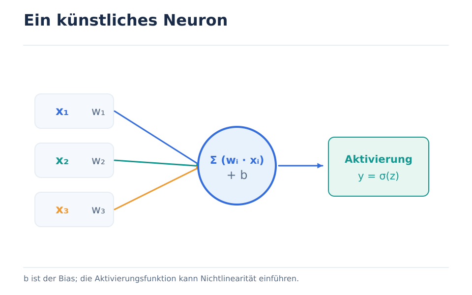

# M2-L11 – Mathematische Grundlagen von KI und neuronalen Netzen {#L11}

**Kursbereich:** M2 – Bachelor-Vertiefung / Master-Übergang

**Niveau:** Bachelor / Master-Brücke

**Vorwissen:** Keine festen Voraussetzungen angegeben.

**Einordnung:** Universität – anwendungsorientierte Vertiefung

## Worum geht es? {#S1}

Ein neuronales Netz ist kein magischer mathematischer Sonderfall. Es verbindet viele einfache Rechenoperationen zu einer großen Funktion mit einstellbaren Parametern. Beim Training verändert ein Optimierungsverfahren diese Parameter so, dass die Vorhersagen für die Trainingsdaten zu einer festgelegten Zielgröße besser passen. Dafür braucht man lineare Algebra, Ableitungen, Wahrscheinlichkeiten und numerische Mathematik. Diese Lektion erklärt die Formelsprache solcher Modelle anhand eines kleinen, vollständig durchschaubaren Beispiels, ohne die ganze Bandbreite moderner KI-Architekturen auf eine einzige Formel zu reduzieren.

Verbindungen: Schule M2-L4 (Kettenregel), M1-L4 (Gradient), M1-L5/M1-L6 (Matrizen), M1-L7 (Wahrscheinlichkeiten), M1-L8 (Numerik), M2-L2 (Optimierung) und M2-L10 (Kreuzentropie).

## Grundidee und Anschauung {#S2}

Stell dir eine Softwarefunktion vor, die aus mehreren Eingangszahlen eine Vorhersage erzeugt. Einige Zahlen innerhalb dieser Funktion sind Stellschrauben. Solange diese Stellschrauben unverändert bleiben, liefert die Funktion bei gleichem Eingang dasselbe Ergebnis. Beim Training vergleichen wir Vorhersage und gewünschtes Ergebnis und bestimmen, in welche Richtung die Stellschrauben etwas verändert werden sollten. Ein komplexes neuronales Netz besteht aus vielen solcher Schritte hintereinander; **Backpropagation** ist die systematische Anwendung der Kettenregel, um die notwendigen Gradienten durch diese Rechenschritte zurückzuführen.

## Neue Zeichen vor der ersten Formel {#S3}

  Zeichen              Aussprache                           Bedeutung hier                                                                        Anderer möglicher Gebrauch
  -------------------- ------------------------------------ ------------------------------------------------------------------------------------- ------------------------------------------------
  $x$                  „iks“                                Eingabe als Zahl oder Vektor                                                          Koordinate oder Zufallsvariable
  $W$                  „we groß“                            Gewichtsmatrix mit lernbaren Zahlen                                                   W als Ereignis oder Arbeit in anderen Gebieten
  $b$                  „be“                                 Bias-Vektor, additive Verschiebung                                                    Achsenabschnitt einer Geraden
  $z$                  „zett“                               Ergebnis einer linearen Kombination                                                   komplexe Zahl in M2-L5
  $\sigma$             „Sigma klein“                        Aktivierungsfunktion; hier ein Platzhalter für eine Nichtlinearität                   Standardabweichung in M1-L7
  $y$                  „ypsilon“                            beobachteter bzw. gewünschter Zielwert                                                allgemeine Ausgabevariable
  $\hat{y}$            „ypsilon Dach“                       vom Modell vorhergesagter Wert                                                        Schätzwert allgemein
  $L$                  „ell groß“                           Verlustfunktion, misst den Trainingsfehler                                            Länge in Geometrie
  $\theta$             „Theta“                              Sammelbezeichnung der lernbaren Parameter                                             Winkel in Trigonometrie
  $\nabla_\theta L$    „Gradient von ell nach Theta“        Ableitungen des Verlusts nach allen Parametern                                        Nabla in anderen räumlichen Ableitungen
  $\eta$               „Eta“                                positive Lernrate, Schrittweite einer Aktualisierung                                  sonst allgemeiner Parameter
  `Σ`                  „großes Sigma“                       viele Summanden addieren                                                              –
  $s_{j}$, $s_{k}$     „Score Index j“, „Score Index k“     reelle Klassenscores; j steht für die betrachtete Klasse, k läuft über alle Klassen   s als Strecke in der Physik
  $p_{j}$              „pe Index j“                         Softmax-Wahrscheinlichkeit der j-ten Klasse                                           p als allgemeine Wahrscheinlichkeit
  $\exp$, $m$          „Exponentialfunktion“, „emm“         Exponentialfunktion und Maximum aller Scores                                          m als Masse in der Physik
  $n$                  „enn“                                Anzahl betrachteter Trainingsbeispiele                                                Zeitindex und Stichprobengröße
  $w$                  „we klein“                           ein einzelnes veränderliches Gewicht                                                  Geschwindigkeit oder andere Größe
  $u\cdot v$           „u Skalarprodukt fau“                Ähnlichkeit zweier Vektoren                                                           Punkt als gewöhnliche Multiplikation
  $\Vert u\Vert$       „Norm von u“                         Vektorlänge                                                                           Norm einer Funktion in M2-L7
  $\in$, $\mathbb{R}$  „ist Element von“, „reelle Zahlen“   Mengenangabe für Vektorkomponenten                                                    allgemeine Mengenlehre

## Ein neuronaler Rechenschritt {#S4}

Ein einzelner Rechenschritt aus einer sogenannten Schicht kann lauten:

{alt="Gewichtete Summe und Aktivierung eines künstlichen Neurons"}

$$
\begin{aligned}
z&=W\cdot x+b\\
\text{Ausgabe}&=\sigma(z)
\end{aligned}
$$

**Erste Formel gesprochen:** „Zett ist gleich Gewichtsmatrix we mal Eingabevektor iks plus Verschiebungsvektor be.“ Die Multiplikation ist hier eine **Matrix-Vektor-Multiplikation**, nicht die elementweise Multiplikation zweier Listen. Die zweite Formel heißt: „Die Ausgabe ist die Aktivierungsfunktion Sigma klein, angewandt auf zett.“

Beispiel für Dimensionen: Der Eingabevektor enthält drei Merkmale. Wir möchten zwei Ausgabewerte berechnen. Dann besitzt die Matrix $W$ zwei Zeilen und drei Spalten, $x$ drei Einträge und $b$ zwei Einträge. Das Ergebnis $z$ enthält genau zwei Zahlen. Ohne passende Abmessungen ist die Matrixrechnung nicht definiert.

Wenn $\sigma$ eine nichtlineare Funktion wie die **ReLU** ist – sie gibt negative Eingaben als null und positive unverändert zurück –, kann die Kombination mehrerer Schichten komplexere Zusammenhänge darstellen als eine einzige rein lineare Abbildung. Eine Folge ausschließlich linearer Schichten ohne weitere Nichtlinearitäten wäre insgesamt wieder eine lineare beziehungsweise affine Abbildung.

## Verlustfunktion: Was heißt „besser“? {#S5}

Die Güte einer Modellvorhersage braucht eine festgelegte Messregel. Für eine einfache Zahlenvorhersage eignet sich manchmal der **mittlere quadratische Fehler**:

$$
L=\frac1n\sum_{i=1}^n{(\hat y_i-y_i)}^2
$$

**Gesprochen:** „Der Verlust ell ist eins geteilt durch die Anzahl der Beispiele, mal die Summe der quadrierten Unterschiede zwischen vorhergesagtem und tatsächlichem Wert.“ $\hat{y}_{i}$ ist die i-te Vorhersage, $y_{i}$ der i-te Zielwert. Quadrate verhindern, dass positive und negative Fehler sich gegenseitig aufheben, gewichten aber große Fehler besonders stark.

Für Klassifikationen sind häufig **negative Log-Likelihood** beziehungsweise Kreuzentropie geeigneter; deren statistische Interpretation wurde in M2-L10 eingeführt. Welche Verlustfunktion sinnvoll ist, hängt vom Problem und seinen Annahmen ab. Ein niedriger Trainingsverlust bedeutet zunächst nur eine gute Übereinstimmung mit dem gewählten Trainingsziel.

## Gradient und Lernschritt {#S6}

Der Gradient einer Verlustfunktion enthält für jeden Parameter die Information, wie sich der Verlust bei einer kleinen Parameteränderung zunächst verändert. Ein einfacher Gradientenabstieg lautet:

$$
\theta_{\mathrm{neu}}=\theta_{\mathrm{alt}}-\eta\,\nabla_{\theta}L(\theta_{\mathrm{alt}})
$$

**Laut gelesen:** „Der neue Parametervektor Theta ist der alte Parametervektor minus Lernrate Eta mal dem Gradienten der Verlustfunktion, ausgewertet bei den alten Parametern.“ Das Minuszeichen bedeutet, dass man lokal in die Gegenrichtung des stärksten Anstiegs geht. Für kleine Schritte kann das den Verlust reduzieren; zu große Lernraten können ihn vergrößern oder die Berechnung instabil machen.

$\nabla_\theta L$ enthält in einem Mehrparametermodell viele **partielle Ableitungen**. Backpropagation berechnet sie durch systematische Verkettung der Ableitungsregeln aus Schulmathematik M2-L4 und M1-L4. Es ist eine Methode zur effizienten Gradientenberechnung, nicht selbst der Optimierungsalgorithmus und keine Garantie für ein globales Minimum.

## Vollständig erklärtes Mini-Beispiel: ein einziges Gewicht {#S7}

Ein Modell verwendet nur eine Eingabe $x=2$ und ein veränderliches Gewicht $w$:

$$
\begin{aligned}
\hat y&=w\cdot x\\
\text{Zielwert: }\quad y&=6\\
L(w)&={(2w-6)}^2
\end{aligned}
$$

**Gelesen:** „Die Vorhersage ist das Gewicht we mal Eingabe iks; der Zielwert ist sechs. Der Verlust als Funktion des Gewichts ist das Quadrat aus zwei mal we minus sechs.“ In diesem Beispiel gibt es genau einen Datenpunkt; deshalb ist der mittlere quadratische Fehler identisch mit dem quadratischen Einzelfehler.

Wir starten mit $w=2$. Die Vorhersage ist $\hat{y}=2\cdot 2=4$, der Fehler $4-6=-2$ und der Verlust $L(2)=4$.

Nun brauchen wir die **Ableitung des Verlusts nach dem Gewicht**. Mithilfe der Kettenregel erhalten wir:

$$
\frac{\mathrm{d}L}{\mathrm{d}w}=2(2w-6)\cdot2=4(2w-6)
$$

**Gesprochen:** „Die Ableitung von ell nach we ist zwei mal Klammer zwei we minus sechs mal zwei; vereinfacht vier mal Klammer zwei we minus sechs.“ Bei $w=2$ ist sie $-8$. Das negative Vorzeichen verrät: Erhöhen wir $w$ ein wenig, sinkt der Verlust zunächst.

Mit Lernrate $\eta =0{,}1$ ergibt der Gradientenabstieg:

$$
\begin{aligned}
w_{\mathrm{neu}}&=2-0{,}1\cdot(-8)=2{,}8\\
\hat y_{\mathrm{neu}}&=2{,}8\cdot2=5{,}6\\
L_{\mathrm{neu}}&={(5{,}6-6)}^2=0{,}16
\end{aligned}
$$

**Vollständig gelesen:** „Das neue Gewicht ist zwei minus null Komma eins mal minus acht, also zwei Komma acht. Die neue Vorhersage ist fünf Komma sechs. Der neue quadratische Fehler beträgt null Komma eins sechs.“ Ein Lernschritt hat den Verlust von $4$ auf $0{,}16$ verringert. **Warum die Lernrate wichtig ist:** Für genau diese quadratische Funktion beträgt die Ableitung $\frac{dL}{dw}=8(w-3)$. Dadurch verändert ein Lernschritt den Abstand zum Optimum nach der exakten Regel:

$$
w_{\mathrm{neu}}-3=(1-8\eta)(w_{\mathrm{alt}}-3)
$$

**Laut gelesen:** „Neuer Abstand zum Optimum gleich eins minus achtmal Lernrate, mal alter Abstand.“ Für einen Startwert ungleich $3$ wird der Abstand in jedem Schritt kleiner, wenn $|1-8\eta | < 1$, also **$0<\eta<\frac{1}{4}$**. Beispielsweise liefert $\eta =0{,}3$ statt einer Verbesserung vom Start $w=2$ zunächst $w_{\mathrm{neu}}=4{,}4$ und $L_{\mathrm{neu}}=7{,}84$ – der Fehler wächst. Diese strenge Grenze gilt **für dieses einzelne quadratische Beispiel**, nicht allgemein für neuronale Netze.

Die genaue optimale Lösung wäre hier $w=3$, denn dann stimmt die Vorhersage $6$ mit dem Zielwert überein. In großen neuronalen Netzen ist die Situation komplizierter: viele Parameter, zahlreiche Datenpunkte und oftmals keine konvexe Verlustlandschaft.

## Embeddings und Vektorähnlichkeit {#S8}

Ein **Embedding** ist eine numerische Vektordarstellung eines Objekts, beispielsweise eines Textabschnitts oder Bildes. Die Werte werden häufig so gelernt, dass für ein bestimmtes Trainingsziel ähnliche Objekte in geeigneter Weise nahe beieinanderliegen. Eine weit verbreitete Messgröße ist die **Kosinus-Ähnlichkeit**:

$$
\operatorname{cos\_sim}(u,v)=\frac{u\cdot v}{\lVert u\rVert\,\lVert v\rVert}
$$

**Gesprochen:** „Die Kosinus-Ähnlichkeit der Vektoren u und fau ist ihr Skalarprodukt geteilt durch das Produkt ihrer Längen.“ Das Skalarprodukt wurde in Schulmathematik M2-L11 erklärt. Bei reellen Vektoren zeigt ein Wert nahe $1$, dass die Richtungen ähnlich sind; $0$ bedeutet rechtwinklig; $-1$ bedeutet entgegengesetzte Richtung. Die Formel ist nur definiert, wenn beide Vektoren eine **von null verschiedene Länge** besitzen. Kosinus-Ähnlichkeit ist keine verlässliche Aussage über Wahrheit, moralische Bewertung oder logische Folgerichtigkeit von Texten.

In einer lokalen Suche oder in einem KI-Agentensystem lassen sich Embeddings für den Vergleich von Dokumenten nutzen. Allerdings hängt die Aussagekraft von der Qualität des Modells, der Datenvorverarbeitung und der tatsächlichen Suchaufgabe ab.

## Wahrscheinlichkeiten, Softmax und numerische Stabilität {#S9}

Viele Klassifikatoren geben für mehrere Klassen Wahrscheinlichkeitswerte aus. Dafür werden oft zunächst beliebige reelle **Scores** erzeugt und anschließend durch eine Softmax-Funktion in positive Werte umgewandelt, deren Summe eins beträgt. Das heißt nicht automatisch, dass diese Wahrscheinlichkeiten in der Realität gut kalibriert sind.

**Lesbare Softmax-Formel:** Wir nennen die Zahl für die Klasse mit Index $j$ einen Score $s_{j}$. $\exp$ ist die Exponentialfunktion, und `Σ` summiert über alle Klassenindizes $k$. Die Wahrscheinlichkeit dieser Klasse lautet:

$$
p_j=\frac{\exp(s_j)}{\sum_k\exp(s_k)}
$$

Bei zwei gleich hohen Scores erhält jede Klasse $\frac{1}{2}$; für Scores $1000$ und $1000$ wäre eine direkte Gleitkommaberechnung der Exponentialwerte jedoch riskant. Numerisch muss man aufpassen: Eine direkte Exponentialfunktion mit sehr großem Score kann überlaufen. Für eine stabile Softmax-Berechnung zieht man üblicherweise von allen Scores den größten Score ab, **bevor** man exponentiert. Weil dieselbe Konstante in Zähler und Nenner eingeht, ändern sich die mathematischen Wahrscheinlichkeiten dadurch nicht. Mit $m$ als größtem Score lautet die rechnerisch stabilere, aber mathematisch identische Form:

$$
p_j=\frac{\exp(s_j-m)}{\sum_k\exp(s_k-m)}
$$

Für die beiden Scores $1000$ und $1000$ ist $m=1000$; beide Exponentialwerte werden zu $\exp (0)=1$, sodass $p_1=p_2=\frac{1}{2}$ herauskommt. Das verhindert Überläufe durch große positive Scores, löst aber nicht alle denkbaren numerischen Probleme. Diese Verbindung von Algebra und Gleitkomma-Numerik folgt aus M1-L8.

## Wofür nützlich? {#S10}

Die Formeln helfen, Trainingskurven und Fehlermeldungen bei lokalen KI-Modellen einzuordnen. Bei der Entwicklung eigener Inferenz- oder Agentenwerkzeuge erklären sie den Aufbau von Embeddings, Ähnlichkeitssuche und einfachen Lernverfahren. Das Verständnis der Matrixdimensionen und Gradienten erleichtert die Analyse von neuronalen Netzarchitekturen. Die Numerik erklärt schließlich, warum identische mathematische Modelle abhängig von Datentyp und Implementierung abweichende Ergebnisse liefern können.

## Annahmen und Grenzen {#S11}

Ein Lernalgorithmus optimiert eine **definierte mathematische Zielgröße**, nicht automatisch Korrektheit oder Verlässlichkeit in der realen Anwendung. Trainingsdaten können Verzerrungen enthalten; bei veränderten Eingaben kann das Modell scheitern. Überanpassung (*Overfitting*) bedeutet, dass ein Modell Trainingsdaten gut verarbeitet, aber auf neuen Daten schlecht verallgemeinert. Deshalb braucht die Beurteilung eines Modells geeignete, vom Training getrennte Prüfbeispiele; auch ein gutes Testergebnis ist nur für die angenommene Datenverteilung aussagekräftig. Gradientenabstieg garantiert bei nichtkonvexen Problemen keine globale Lösung. Zudem stellt diese Lektion die Grundidee gewöhnlicher differenzierbarer Netze dar; moderne Architekturen können weitere Komponenten und Trainingsziele enthalten.

## Verbindung zur nächsten Einheit {#S12}

M2-L12 überträgt Matrizen, Ableitungen, Optimierung und Unsicherheit auf Robotik: Bewegungsmodelle, Drehungen, Zustandsabschätzung und Regelung.

## Fachliche Weiterführungsquelle (optional, online; nicht zum Offline-Lesen nötig) {#S13}

Stanford University, *CS231n – Optimization: Stochastic Gradient Descent* und zugehörige Kapitel zur Backpropagation: [https://cs231n.github.io/optimization-1/](https://cs231n.github.io/optimization-1/) (eingesehen 04.11.2026).

## Quellen {#S14}

Im Lehrtext genannte externe Fachquellen und weiterführende Links:

- [https://cs231n.github.io/optimization-1/](https://cs231n.github.io/optimization-1/)
