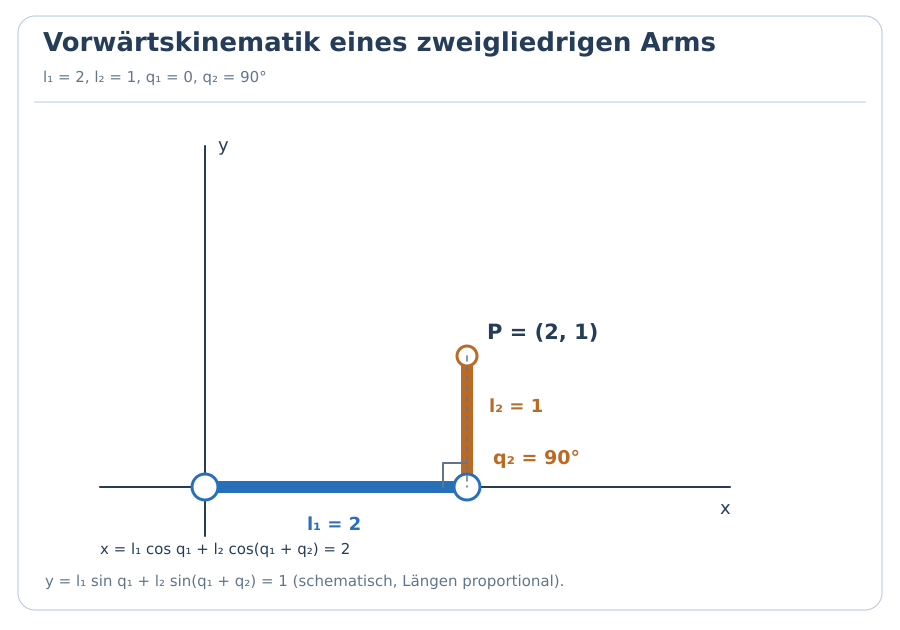

# M2-L12 – Robotik-Mathematik: Kinematik, Quaternionen und Regelung {#L12}

**Kursbereich:** M2 – Bachelor-Vertiefung / Master-Übergang

**Niveau:** Bachelor / Master-Brücke

**Vorwissen:** Keine festen Voraussetzungen angegeben.

**Einordnung:** Universität – anwendungsorientierte Vertiefung

## Worum geht es? {#S1}

Ein Roboter muss nicht nur ein Ziel kennen. Er muss zunächst seine eigene Stellung mathematisch beschreiben, die Bewegung seiner Gelenke auf die Position eines Werkzeugs übertragen, Sensormessungen mit Unsicherheit auswerten und eine Bewegung fortlaufend korrigieren. Dabei greifen Geometrie, lineare Algebra, Differentialgleichungen, Wahrscheinlichkeit und Algorithmik ineinander. Diese Lektion führt von einem kleinen ebenen Roboterarm bis zur räumlichen Orientierung mit Quaternionen. Die Beispiele sind bewusst berechenbar und stellen **keine** fertige sicherheitskritische Robotersteuerung dar.

Verbindungen: Schule M2-L11–Schule M2-L14 (Vektoren und Rotationen), M1-L4 (partielle Ableitungen), M1-L5/M1-L6 (Matrizen), M1-L7 (Wahrscheinlichkeiten), M1-L9 (Dynamik), M2-L1 (Graphen), M2-L2 (Optimierung) und M2-L11 (KI-Modelle).

## Grundidee und Anschauung {#S2}

**Kinematik** beschreibt, wo sich ein Bauteil aufgrund der Gelenkstellungen befindet, ohne zunächst nach den verursachenden Kräften zu fragen. **Dynamik** untersucht zusätzlich Massen, Trägheit und Kräfte. **Regelung** vergleicht einen gewünschten Zustand mit Messwerten und passt Stellgrößen an. **Zustandsschätzung** versucht aus unvollkommenen Messungen auf den tatsächlichen Zustand zu schließen. **Bewegungsplanung** wählt eine zulässige Folge von Zuständen, bevor und während ein Roboter sie ausführt.

Ein und dieselbe Handposition kann zu verschiedenen Gelenkstellungen gehören. Ebenso kann eine Kamera denselben Gegenstand aus unterschiedlichen Koordinatensystemen beschreiben. Gute Robotik-Mathematik beginnt daher damit, die Bedeutung jeder Größe und ihr Bezugssystem festzuhalten.

## Neue Zeichen und ihre Lesart vor den Formeln {#S3}

  Zeichen                       Gesprochen                                  Bedeutung in dieser Lektion                                                    Andere mögliche Verwendung
  ----------------------------- ------------------------------------------- ------------------------------------------------------------------------------ ------------------------------------------------------------------
  $q_{1}$, $q_{2}$              „ku eins, ku zwei“                          Winkel zweier Drehgelenke, im Bogenmaß                                         $q$ bezeichnet später auch ein Quaternion
  $l_{1}$, $l_{2}$              „ell eins, ell zwei“                        Längen zweier starrer Armglieder, etwa in Metern                               $l$ kann sonst Länge eines Weges sein
  $p=(x,y)$                     „pe als Koordinatenpaar iks, ypsilon“       Werkzeugposition in der Ebene                                                  $p$ bezeichnet in M2-L10 auch eine Wahrscheinlichkeit
  $\sin$, $\cos$                „Sinus“, „Kosinus“                          Winkelfunktionen, Winkel hier im Bogenmaß                                      keine anderen Funktionen trotz ähnlicher Abkürzungen
  $\pi$                         „Pi“                                        Kreiszahl; halbe Umdrehung ist $\pi\,\mathrm{rad}$                             –
  $R(\theta )$                  „Rotationsmatrix er von Theta“              Drehung im ebenen Koordinatensystem                                            $R$ kann auch Messfehlervarianz sein
  $R^{\mathrm{T}}$              „er transponiert“                           Zeilen und Spalten von R vertauscht                                            Transponieren allgemein in M1-L5
  $I$                           „Einheitsmatrix i“                          Matrix, die Vektoren unverändert lässt                                         Informationsgehalt in M2-L10
  $T$                           „Transformationsmatrix te“                  Lagewechsel zwischen räumlichen Koordinatensystemen                            Zeit oder Temperatur in anderen Lektionen
  $J(q)$                        „Jacobi-Matrix jott von ku“                 lokale Änderung der Werkzeugposition durch Gelenkwinkel                        $J$ kann eine Zielfunktion sein
  $\dot{q}$, $\dot{p}$          „ku Punkt“, „pe Punkt“                      zeitliche Ableitung der Gelenkstellung bzw. Position                           Punkt ist hier kein Skalarprodukt
  $\det$                        „Determinante“                              prüft hier lokale Invertierbarkeit der Jacobi-Matrix                           Volumenskalierung in Schule M2-L14/M1-L6
  $\operatorname{atan2}(y,x)$   „Arcustangens zwei von ypsilon, iks“        Winkel unter Beachtung des Quadranten, sofern nicht beide Eingaben null sind   nicht identisch mit einfachem $\arctan\!\left(\frac{y}{x}\right)$
  $Q=(w,a,b,c)$                 „Quaternion groß ku mit vier Komponenten“   räumliche Drehung als Einheitquaternion                                        $q_{1}$ ist zuvor ein Gelenkwinkel
  $\Vert Q\Vert$                „Norm von ku“                               Länge des vierdimensionalen Quaternion-Vektors                                 Vektornormen in M1-L5/M2-L7
  $e$, $u$, $K_{p}$             „e“, „u“, „ka Index pe“                     Regelfehler, Stellgröße, Proportionalverstärkung                               $e$ ist auch Eulersche Zahl, $u$ eine Funktion
  $\hat{x}^{-}$, $\hat{x}^{+}$  „iks Dach minus / plus“                     Zustandsschätzung vor / nach neuer Messung                                     Minus und Plus sind hier Zustandskennzeichnungen
  $P^{-}$, $P^{+}$, $R_{m}$     „pe minus / plus, er Index em“              Schätzfehlervarianz vor / nach Messung sowie Messfehlervarianz                 P als Wahrscheinlichkeit; R als Rotationsmatrix
  $K$                           „Kalman-Verstärkung ka“                     Anteil der Messwertkorrektur                                                   Steifigkeit oder andere Konstante
  $z$                           „zett“                                      aktueller gemessener Wert                                                      Eingabe einer Netzzelle in M2-L11
  `*`                           „Quaternion-Produkt“                        Verknüpfung zweier Rotationen, nicht punktweise Multiplikation                 gewöhnliches Produkt in Softwaretexten

Alle folgenden Berechnungen nennen ausdrücklich die Maßeinheiten oder die dimensionslose Bedeutung. Winkelfunktionen verwenden Radiant als Rechenmaß.

## Zwei Gelenke bewegen einen Punkt: Vorwärtskinematik {#S4}

Stell dir einen Roboterarm in der Ebene vor. Sein erstes starres Glied ist $l_{1}=2 \,\mathrm{m}$ lang, das zweite $l_{2}=1 \,\mathrm{m}$. Der erste Gelenkwinkel $q_{1}$ wird von der positiven x-Richtung aus gemessen. Der zweite Winkel $q_{2}$ beschreibt die **relative Drehung** des zweiten Glieds gegenüber dem ersten. Der absolute Winkel des zweiten Glieds ist daher $q_{1}+q_{2}$.

Vorwärtskinematik mit $q_1=0$ und $q_2=90^{\text{°}}$ ergibt den Werkzeugpunkt (2,1).

Die Position des Werkzeugpunkts lautet:

$$
\begin{aligned}
x&=l_1\cos(q_1)+l_2\cos(q_1+q_2)\\
y&=l_1\sin(q_1)+l_2\sin(q_1+q_2)
\end{aligned}
$$

**Erste Formel vollständig gelesen:** „Die horizontale Position ist die Länge des ersten Glieds mal Kosinus seines Winkels, plus die Länge des zweiten Glieds mal Kosinus der Summe beider Gelenkwinkel.“ **Zweite Formel vollständig gelesen:** „Die vertikale Position ist die Länge des ersten Glieds mal Sinus seines Winkels, plus die Länge des zweiten Glieds mal Sinus der Summe beider Winkel.“ Beide Ergebnisse haben die Einheit Meter. Wir addieren die x- und y-Anteile zweier gerichteter Strecken.

**Vollständig gerechnetes Mini-Beispiel:** Das erste Glied zeigt nach rechts ($q_{1}=0$), das zweite steht dazu im rechten Winkel nach oben ($q_2=\frac{\pi}{2}$). Dann gilt:

$$
\begin{aligned}
x&=2\cdot\cos(0)+1\cdot\cos(\pi/2)=2\cdot1+1\cdot0=2\,\mathrm{m}\\
y&=2\cdot\sin(0)+1\cdot\sin(\pi/2)=2\cdot0+1\cdot1=1\,\mathrm{m}\\
p&=(2\,\mathrm{m},1\,\mathrm{m})
\end{aligned}
$$

**Gesprochen:** „Der Werkzeugpunkt befindet sich zwei Meter rechts und einen Meter oberhalb des Ursprungs.“ Die Position ergibt sich allein aus der Geometrie; Reibung, Motorbelastung und Trägheit kommen in dieser Beschreibung noch nicht vor.

## Umgekehrter Weg: Inverse Kinematik und Mehrdeutigkeit {#S5}

Die **inverse Kinematik** stellt die Gegenfrage: Welche Gelenkwinkel erreichen eine gewünschte Position? Für diesen ebenen Zweigelenkarm lässt sich zuerst der Kosinus des zweiten Gelenkwinkels bestimmen:

$$
\cos(q_2)=\frac{x^2+y^2-l_1^2-l_2^2}{2l_1l_2}
$$

**Gelesen:** „Der Kosinus des zweiten Winkels ist die Summe der Quadrate beider Zielkoordinaten minus die beiden quadrierten Armlängen, geteilt durch zweimal das Produkt beider Armlängen.“ Das folgt aus dem Kosinussatz. Der Ausdruck rechts muss zwischen minus eins und plus eins liegen; andernfalls ist das Ziel mit diesen beiden starren Gliedern unerreichbar. Dieselbe **Reichweitenbedingung** kann man direkt aus der Entfernung des Zielpunkts vom Ursprung lesen:

$$
\lvert l_1-l_2\rvert\leq\sqrt{x^2+y^2}\leq l_1+l_2
$$

**Gesprochen:** „Der Betrag der Differenz beider Armlängen ist höchstens die Entfernung zum Ziel; diese Entfernung ist höchstens ihre Summe.“ Hier bedeutet `|...|` den nichtnegativen Betrag und $\sqrt{x^2+y^2}$ die Entfernung des Ziels vom ersten Gelenk. Bei $l_{1}=2 \,\mathrm{m}$, $l_{2}=1 \,\mathrm{m}$ sind ohne Hindernisse und bei frei drehbaren Gelenken somit genau radiale Zielentfernungen zwischen **1 m und 3 m** erreichbar. Gelenkgrenzen und Kollisionen können den tatsächlich erreichbaren Bereich einschränken.

Setzen wir den schon bekannten Zielpunkt $(2 \,\mathrm{m},1 \,\mathrm{m})$ ein:

$$
\begin{aligned}
\cos(q_2)&=\frac{2^2+1^2-2^2-1^2}{2\cdot2\cdot1}\\
&=\frac{4+1-4-1}{4}\\
&=0
\end{aligned}
$$

Daher sind grundsätzlich die beiden Winkel $q_2=+\frac{\pi}{2}$ und $q_2=-\frac{\pi}{2}$ möglich. Für die zweite Wahl ist eine andere erste Gelenkstellung nötig: $q_{1}\approx 0{,}9273\,\mathrm{rad}$, also ungefähr $53{,}13^{\text{°}}$. Denn bei $q_2=-\frac{\pi}{2}$ ergeben die beiden Gleichungen nach Einsetzen ebenfalls $x=2 \,\mathrm{m}$ und $y=1 \,\mathrm{m}$. Zwei verschiedene Armhaltungen können denselben Werkzeugpunkt erreichen: oft „Ellbogen oben“ und „Ellbogen unten“ genannt.

Welche Haltung tatsächlich zulässig ist, entscheiden zusätzliche Bedingungen wie Gelenkanschläge, Kollisionen, maximale Drehmomente und die aktuelle Ausgangsposition. Eine mathematische Lösung ist deshalb noch keine sichere Roboterbewegung.

## Lokale Bewegung: die Jacobi-Matrix {#S6}

Bis hierhin haben wir Positionen berechnet. Für Geschwindigkeiten fragen wir: Wie verändert sich der Werkzeugpunkt bei einer **kleinen Änderung** der Winkel? Wir leiten die x- und y-Gleichungen nach den Gelenkwinkeln ab. Die resultierende Jacobi-Matrix lautet:

$$
\begin{aligned}
J(q)&=\begin{bmatrix}
-l_1\sin(q_1)-l_2\sin(q_1+q_2)&-l_2\sin(q_1+q_2)\\
 l_1\cos(q_1)+l_2\cos(q_1+q_2)& l_2\cos(q_1+q_2)
\end{bmatrix}\\
\dot p&=J(q)\cdot\dot q
\end{aligned}
$$

**Gesprochen:** „Die Werkzeuggeschwindigkeit ist die Jacobi-Matrix der aktuellen Gelenkstellung mal dem Vektor der Gelenkwinkelgeschwindigkeiten.“ Eine Spalte beschreibt jeweils, wie sich der Werkzeugpunkt infolge des zugehörigen Gelenks bewegt. Für Rotationsgelenke hat eine Jacobi-Spalte hier die Einheit Meter je Radiant; multipliziert mit Radiant je Sekunde entsteht Meter je Sekunde.

Für die Position $q_{1}=0$, $q_2=\frac{\pi}{2}$, $l_{1}=2$, $l_{2}=1$ vereinfacht sich die Matrix zu:

$$
\begin{aligned}
J&=\begin{bmatrix}-1&-1\\2&0\end{bmatrix}
\end{aligned}
$$

Wenn nur das zweite Gelenk mit $0{,}1\,\mathrm{rad/s}$ dreht, also $\dot{q}=(0;0{,}1)\,\mathrm{rad/s}$, dann folgt:

$$
\begin{aligned}
\dot p&=\begin{bmatrix}-1&-1\\2&0\end{bmatrix}
 \cdot\begin{bmatrix}0\\0{,}1\end{bmatrix}
 =\begin{bmatrix}-0{,}1\\0\end{bmatrix}\mathrm{m}/\mathrm{s}
\end{aligned}
$$

**Gelesen:** „Der Werkzeugpunkt bewegt sich in diesem Augenblick mit null Komma eins Meter pro Sekunde nach links und hat zunächst keine vertikale Geschwindigkeit.“ Das beschreibt die **momentane**, nicht die über eine längere Zeit unverändert bleibende Geschwindigkeit.

Die Determinante dieser zweidimensionalen Jacobi-Matrix ist allgemein $\det  J = l_{1}\cdot l_{2}\cdot \sin (q_{2})$. **Gesprochen:** „Determinante jott gleich Produkt beider Gliedlängen mal Sinus des zweiten Gelenkwinkels.“ Wenn $q_{2}=0$ oder $q_{2}=\pi$, steht der Arm gestreckt oder zurückgefaltet und die Determinante wird null. Dann sind bestimmte momentane Werkzeugbewegungen aus der aktuellen Haltung nicht unabhängig erreichbar: eine **kinematische Singularität**. Die lokale Umkehrung der Matrix ist dort nicht möglich, obwohl der Arm mechanisch weiter existiert.

### Singularität: Eine Lage ist nicht immer lokal umkehrbar {#abschnitt-7}

Die Jacobi-Matrix setzt Gelenkgeschwindigkeiten in die momentane Werkzeuggeschwindigkeit um. Umgekehrt kann man Gelenkgeschwindigkeiten aus einer vorgegebenen Werkzeuggeschwindigkeit nur dann **eindeutig** berechnen, wenn die quadratische Matrix in dieser Konfiguration invertierbar ist. Für den beschriebenen Zweigelenkarm gilt durch Ausmultiplizieren der Determinante:

$$
\det J(q)=l_1l_2\sin(q_2)
$$

**Gelesen:** „Die Determinante der Jacobi-Matrix ist das Produkt beider Gliedlängen und des Sinus des zweiten Gelenkwinkels.“ Die Einheit ist Quadratmeter, wenn Winkel in Radiant als dimensionslose Rechengröße behandelt werden. Für positive Gliedlängen ist $\det  J=0$ genau dann, wenn $q_{2}$ ein ganzzahliges Vielfaches von $\pi$ ist. Die Glieder sind dann gestreckt oder zusammengefaltet; das nennt man eine **kinematische Singularität**.

**Nachgerechneter Grenzfall:** Bei $q_{1}=0$, $q_{2}=0$, $l_{1}=2 \,\mathrm{m}$, $l_{2}=1 \,\mathrm{m}$ steht der Arm vollständig nach rechts. Dann ergibt die Formel aus Abschnitt 3:

$$
\begin{aligned}
J&=\begin{bmatrix}0&0\\3&1\end{bmatrix}\\
\det J&=0\cdot1-0\cdot3=0
\end{aligned}
$$

Beide Gelenkgeschwindigkeiten erzeugen an diesem Punkt zunächst nur eine **vertikale** Werkzeuggeschwindigkeit; eine von null verschiedene horizontale Geschwindigkeit ist dort in erster Ordnung nicht erzeugbar. Das bedeutet nicht, dass der Arm niemals seine horizontale Position ändern kann, sondern nur, dass die lokale lineare Umkehrung scheitert. Für $q_2=\frac{\pi}{2}$ aus Abschnitt 3 dagegen ist $\det  J=2 \,\mathrm{m}^{2}$ und die Matrix lokal invertierbar. Allgemein können Gelenkgrenzen und weitere Freiheitsgrade die reale Umsetzbarkeit zusätzlich verändern.

## Koordinatensysteme und Rotationsmatrizen {#S7}

Ein Sensor misst möglicherweise in seinem eigenen Koordinatensystem, während die Steuerung eine Weltkarte verwendet. Wir unterscheiden daher konsequent **Koordinaten einer geometrischen Größe** von der Größe selbst. Für eine ebene Drehung um einen Winkel $\theta$ verwenden wir:

$$
\begin{aligned}
R(\theta)&=\begin{bmatrix}\cos(\theta)&-\sin(\theta)\\\sin(\theta)&\cos(\theta)\end{bmatrix}\\
p_{\mathrm{welt}}&=R(\theta)\cdot p_{\mathrm{lokal}}+t
\end{aligned}
$$

**Erste Formel gesprochen:** „Die zweidimensionale Rotationsmatrix besteht aus Kosinus und Sinus des Winkels in einer bestimmten Vorzeichenanordnung.“ Die zweite Formel heißt: „Die Weltkoordinaten des Punktes sind seine gedrehten lokalen Koordinaten plus dem Verschiebungsvektor te.“ $t$ hat die Einheit Meter; Rotation und Translation erfüllen unterschiedliche Aufgaben.

Für $\theta=\frac{\pi}{2}$, $p_{\mathrm{lokal}}=(1;0)\,\mathrm{m}$ und $t=(2;3)\,\mathrm{m}$ ist:

$$
\begin{aligned}
R(\pi/2)&=\begin{bmatrix}0&-1\\1&0\end{bmatrix}\\
R(\pi/2)\cdot(1;0)\,\mathrm{m}&=(0;1)\,\mathrm{m}\\
p_{\mathrm{welt}}&=(0;1)\,\mathrm{m}+(2;3)\,\mathrm{m}=(2;4)\,\mathrm{m}
\end{aligned}
$$

**Gelesen:** „Ein lokaler Punkt einen Meter nach rechts wird um neunzig Grad gedreht und danach um zwei Meter nach rechts und drei Meter nach oben verschoben; er liegt schließlich bei zwei und vier Metern.“ Reine Rotationsmatrizen erfüllen $R^{\mathrm{T}}R=I$ und in drei Dimensionen $\det (R)=+1$. Die erste Bedingung erhält Längen und Winkel, die zweite unterscheidet eine eigentliche Drehung von einer Spiegelung.

In 3D fasst man Drehung und Verschiebung häufig in einer **homogenen $4\times4$-Transformationsmatrix** zusammen:

$$
\begin{aligned}
T&=\begin{bmatrix}R_{3\times3}&t_{3\times1}\\0\quad0\quad0&1\end{bmatrix}
\end{aligned}
$$

**Gesprochen:** „Die Transformationsmatrix te enthält links oben eine drei-mal-drei-Rotationsmatrix und rechts einen drei-dimensionalen Verschiebungsvektor. Die letzte Zeile enthält drei Nullen und eine Eins.“ Ein Punkt erhält dazu eine vierte homogene Koordinate $1$, eine Richtung eine $0$. Das erlaubt, mehrere Koordinatenwechsel durch Matrixmultiplikation zu verketten. Die **Multiplikationsreihenfolge** ist entscheidend; eine Rotation vor einer Verschiebung ist im Allgemeinen nicht dasselbe wie die umgekehrte Reihenfolge.

## Quaternionen: räumliche Orientierung ohne drei Winkelketten {#S8}

In drei Dimensionen lassen sich Drehungen auch durch **Einheitsquaternionen** darstellen. Ein Quaternion besteht aus vier reellen Zahlen, wird für reine Rotationen auf Norm eins gebracht und beschreibt eine Achse zusammen mit einem Drehwinkel. Wir wählen hier die Konvention $Q=(w,a,b,c)$: zuerst die skalare Komponente $w$, danach die drei Vektorkomponenten $a,b,c$.

Sei $\theta$ der Drehwinkel und $(u_{x},u_{y},u_z)$ ein **Einheitsvektor** entlang der Rotationsachse. Dann gilt:

$$
\begin{aligned}
Q&=\begin{pmatrix}\cos(\theta/2)\\u_x\cdot\sin(\theta/2)\\u_y\cdot\sin(\theta/2)\\u_z\cdot\sin(\theta/2)\end{pmatrix}\\
\lVert Q\rVert^2&=w^2+a^2+b^2+c^2=1
\end{aligned}
$$

**Erste Formel gesprochen:** „Das Rotationsquaternion hat als erste Komponente den Kosinus des halben Drehwinkels. Die drei weiteren Komponenten sind die Achsenanteile, jeweils multipliziert mit dem Sinus des halben Drehwinkels.“ Die zweite Aussage heißt: „Die Summe der Quadrate seiner vier Komponenten ist eins.“ Ein halber Winkel taucht auf, weil die Quaternion-Darstellung eine besondere algebraische Abbildung auf dreidimensionale Drehungen ist; es ist kein halb so großer physikalischer Drehwinkel.

**Zweite kontrollierbare Drehung:** Eine Drehung um $90^\circ=\frac{\pi}{2}$ um die positive z-Achse hat bei der hier vereinbarten skalaren-ersten Konvention das Quaternion $Q=\left(\frac{\sqrt{2}}{2},0,0,\frac{\sqrt{2}}{2}\right)$. Die dazugehörige Rotationsmatrix sendet den Vektor $(1,0,0)$ auf $(0,1,0)$; sein Betrag bleibt eins. Ohne Angabe der Rotationsrichtung, Quaternionkonvention und der Frage „lokal nach global oder umgekehrt?“ wäre das Vorzeichen der resultierenden Koordinate nicht eindeutig beschrieben.

**Mini-Beispiel:** Wir drehen um $180^\circ=\pi\,\mathrm{rad}$ um die positive z-Achse $(0,0,1)$. Dann ist $\cos\!\left(\frac{\pi}{2}\right)=0$, $\sin\!\left(\frac{\pi}{2}\right)=1$, also $Q=(0,0,0,1)$. Die Drehung sendet $(1,0,0)$ auf $(-1,0,0)$. Auch $-Q=(0,0,0,-1)$ beschreibt **dieselbe räumliche Rotation**: Quaternionen $Q$ und $-Q$ sind für Rotationen gleichwertige Darstellungen. Das Quaternion-Produkt `*` verknüpft Drehungen in einer festgelegten Reihenfolge und ist im Allgemeinen **nicht kommutativ**: $Q_{1}\ast Q_{2}$ und $Q_{2}\ast Q_{1}$ müssen nicht dieselbe Orientierung ergeben.

Gegenüber einer Darstellung durch drei Eulerwinkel können Quaternionen manche Singularitäten der **Parametrisierung** vermeiden und sind für Orientierungsinterpolation beliebt. Sie beseitigen jedoch keine echten kinematischen Singularitäten des Roboters; auch die Auswahl von Achsen- und Rahmenkonventionen bleibt wichtig.

## Regelung: Ziel, Messwert und Stellgröße {#S9}

Eine Steuerung gibt eine vorgeplante Aktion aus. Eine **Regelung** berücksichtigt regelmäßig eine Rückmeldung. Für einen einfachen Proportionalregler (P-Regler) setzen wir:

$$
\begin{aligned}
e&=\text{soll}-\text{ist}\\
u&=K_p\cdot e
\end{aligned}
$$

**Gelesen:** „Der Regelfehler ist Sollwert minus Istwert. Die Stellgröße u ist die Proportionalverstärkung ka Index pe mal diesem Fehler.“ Die Einheit von $K_{p}$ muss zur gewünschten Stellgröße passen: Wird beispielsweise ein Winkel in Radiant korrigiert und ein Drehmoment in Newtonmetern ausgegeben, hat die Verstärkung die Einheit Newtonmeter je Radiant.

**Rechenbeispiel:** Ein Gelenk soll $1{,}5\,\mathrm{rad}$ erreichen, der gemessene Istwinkel ist $1{,}2\,\mathrm{rad}$. Somit ist $e=0{,}3\,\mathrm{rad}$. Bei $K_{p}=2\,\mathrm{N\cdot m/rad}$ ergibt sich $u=0{,}6\,\mathrm{N\cdot m}$. Das ist zunächst nur die **angeforderte** Stellgröße. Ob das Gelenk dadurch in der gewünschten Weise reagiert, hängt von der Dynamik ab; ein Motor kann begrenzt sein und eine Last kann stören.

Ein PID-Regler ergänzt oft ein zeitliches Integral des Fehlers und dessen zeitliche Ableitung. Das kann stationäre Abweichungen verringern und Bewegungen dämpfen, erfordert aber Abstimmung und unter Umständen Schutz vor Integrator-Aufwicklung bei Sättigung. Messrauschen, Totzeit, fehlende Sicherheitsgrenzen und ein falsch modelliertes Vorzeichen können eine reale Regelung gefährlich machen. Deshalb ist die einfache Gleichung ausdrücklich **keine** vollständige Einsatzanleitung für physische Roboter.

## Kalman-Filter: Schätzen mit unsicheren Messungen {#S10}

Eine Kamera kann bei jeder Messung leicht andere Koordinaten liefern. Ein Kalman-Filter kombiniert eine **Modellvorhersage** mit einer **neuen Messung** und berücksichtigt deren angenommene Unsicherheit. Ein vollständiger mehrdimensionaler Filter arbeitet mit Matrizen und Kovarianzen. Die Grundidee wird schon an einem einzigen skalaren Zustand deutlich.

Nehmen wir an, der vorhergesagte Ort ist $\hat{x}^{-}=10 \,\mathrm{m}$, die Varianz dieses Vorhersagefehlers ist $P^{-}=4 \,\mathrm{m}^{2}$. Ein Sensor meldet $z=12 \,\mathrm{m}$ mit Messfehlervarianz $R_{m}=1 \,\mathrm{m}^{2}$. Im einfachen Fall unabhängiger, unverzerrter Fehler und einer direkten Messung des Zustands lautet die Korrektur:

$$
\begin{aligned}
K&=\frac{P^-}{P^-+R_m}\\
\hat x^+&=\hat x^-+K\cdot(z-\hat x^-)\\
P^+&=(1-K)\cdot P^-
\end{aligned}
$$

**Erste Formel gesprochen:** „Die Kalman-Verstärkung ka ist die vorhergesagte Fehlervarianz geteilt durch die Summe aus Vorhersage- und Messfehlervarianz.“ **Zweite Formel:** „Die verbesserte Schätzung ist die alte Schätzung plus Kalman-Verstärkung mal Abweichung zwischen Messwert und alter Schätzung.“ **Dritte Formel:** „Die korrigierte Fehlervarianz ist eins minus Kalman-Verstärkung mal der vorherigen Fehlervarianz.“ Die Größe $K$ ist in diesem Spezialfall dimensionslos.

Einsetzen ergibt:

$$
\begin{aligned}
K&=\frac{4}{4+1}=0{,}8\\
\hat x^+&=10\,\mathrm{m}+0{,}8\cdot(12-10)\,\mathrm{m}=11{,}6\,\mathrm{m}\\
P^+&=(1-0{,}8)\cdot4\,\mathrm{m}^2=0{,}8\,\mathrm{m}^2
\end{aligned}
$$

**Gesprochen:** „Weil die Messung im Modell die kleinere Unsicherheit hat, zieht sie die Schätzung deutlich in Richtung zwölf Meter; das Ergebnis ist elf Komma sechs Meter.“ Die geschätzte Unsicherheit wird dabei kleiner. **Wichtig:** $P$ ist eine **Varianz** (Quadratmeter), nicht eine direkte Meter-Fehlerspanne. Das Modell nimmt korrekt spezifizierte Unsicherheiten und geeignete Fehlerannahmen an. Für eine exakte posterior-Gauß-Verteilung braucht man unter anderem das lineare gaußsche Modell; ohne entsprechende Voraussetzungen darf man die Zahl nicht als absolute Garantie ausgeben. Ein realer Filter benötigt darüber hinaus die **Vorhersage über die Zeit**, gewöhnlich mit einem dynamischen Modell.

## Bewegungsplanung ist mehr als ein geometrischer Strich {#S11}

Für die Planung kann man freie Konfigurationen eines Roboters als Punkte und zulässige Übergänge als Kanten eines Graphen darstellen. M2-L1 erklärt kürzeste Wege und Suchverfahren. Der Algorithmus **A\\**\* berücksichtigt neben den bisher angefallenen Wegkosten eine Heuristik für die verbleibenden Kosten. Ist diese Heuristik in einem üblichen endlichen Suchgraphen passend gewählt, etwa **zulässig** (niemals höher als die tatsächlich noch erforderlichen Kosten), kann die Suche einen kostenoptimalen Pfad finden. Die genaue Optimalitätszusage hängt zusätzlich von der Suchvariante und ihrer Behandlung wiederholter Zustände ab.

Bei einem Roboter ist die kürzeste Gerade im Arbeitsraum nicht immer erreichbar. Ein Arm muss vielleicht um ein Hindernis herum, ein Fahrzeug kann nicht seitwärts fahren, ein Gelenk kann keine unbegrenzten Winkel annehmen. Bewegungsplanung berücksichtigt deshalb den **Konfigurationsraum** und gegebenenfalls Geschwindigkeiten, Beschleunigungen, Mindestabstände und zeitlich bewegte Hindernisse. Ein rechnerisch kollisionsfreier Pfad kann bei unsicheren Sensordaten oder einer gestörten Regelung trotzdem unsicher sein.

## Was hier bewusst nicht gleichgesetzt wird {#S12}

- **Koordinatensystem versus reale Lage:** Dieselbe Pose hat unterschiedliche Zahlen in verschiedenen Referenzrahmen. Eine Matrix ohne Rahmenangabe ist mehrdeutig.
- **Kinematik versus Dynamik:** Eine erreichbare Endposition sagt noch nichts darüber, welche Motorleistung und welche Zeit benötigt werden.
- **Quaternion versus Gelenkwinkel:** Einheitsquaternionen beschreiben Orientierungen; sie sind nicht automatisch die Stellgrößen einzelner Gelenke.
- **Schätzung versus Messung:** Ein Filter kombiniert Annahmen und Daten. Verzerrte Sensoren oder falsche Kovarianzen können auch einen schön aussehenden Schätzwert systematisch falsch machen.
- **Optimalität versus Sicherheit:** Der mathematisch kürzeste Pfad ist nicht zwangsläufig der robusteste oder der sicherste.
- **Simulation versus Einsatz:** Eine offline nachvollzogene Modellrechnung genügt nicht zur Validierung physischer Maschinen.

## Wofür nützlich? {#S13}

Dieselben Werkzeuge werden für Industrieroboter, mobile Navigation, autonome Sensorplattformen, Bildverarbeitung und virtuelle 3D-Szenen eingesetzt. Transformationen verbinden Kamerakoordinaten mit Weltkoordinaten, Jacobi-Matrizen beschreiben Bewegungsrichtungen, Regler setzen Ziele in korrigierte Stellgrößen um und Zustandsschätzer verbinden unsichere Beobachtungen. In KI-gestützter Robotik können lernende Modelle einzelne Bausteine unterstützen; die physikalischen Grenzen und Sicherheitsanforderungen verschwinden dadurch nicht.

## Annahmen und Grenzen {#S14}

Die meisten Rechenbeispiele verwenden starre Glieder, ideale Gelenke, hinreichend genaue Winkelmessungen und einen festen ebenen oder kartesischen Bezugsrahmen. Mechanische Elastizität, Kollisionen, nichtlineare Reibung, Sensorzeitstempel und Steuerlatenz sind nicht modelliert. Bei Quaternionen müssen Normierung, Achsenorientierung und Multiplikationskonvention zusammenpassen. Beim Kalman-Beispiel handelt es sich um eine **skalare Messwertkorrektur**, nicht um einen vollständigen Navigationsfilter. Für reale Systeme sind zusätzliche fachliche und sicherheitstechnische Prüfungen erforderlich.

## Verbindung zur nächsten Lektion {#S15}

Eine Robotersteuerung basiert auf Algorithmen. Aber sind **alle** präzise formulierten Probleme mit einem Algorithmus lösbar? M2-L13 untersucht die mathematische Logik, formale Beweise, Berechenbarkeit und die grundsätzlichen Grenzen automatischer Verfahren. So endet die Themenlandkarte nicht mit einer neuen Formel, sondern mit der Frage, was Mathematik und Computer überhaupt leisten können.

## Quellen {#S16}

In dieser Lektion sind keine Einzelquellen gesondert verzeichnet.
