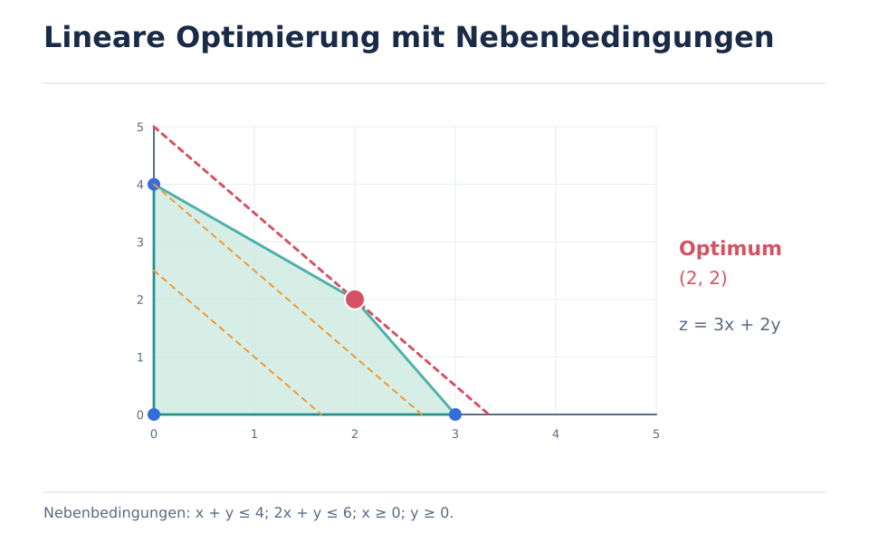

# M2-L2 – Optimierung und Operations Research {#L2}

**Kursbereich:** M2 – Bachelor-Vertiefung / Master-Übergang

**Niveau:** Bachelor / Master-Brücke

**Vorwissen:** Keine festen Voraussetzungen angegeben.

**Einordnung:** Universität – weiterführende Vertiefung

## Worum geht es? {#S1}

In vielen technischen Problemen gibt es nicht nur eine richtige Lösung, sondern eine große Auswahl zulässiger Lösungen. Welche Aufgaben sollen zuerst laufen, wenn Rechenzeit knapp ist? Wie verteilen wir Ressourcen auf mehrere KI-Agenten? Wie planen wir Lieferwege, Schichten oder Speicherbelegung? Die **Optimierung** sucht unter klar formulierten Voraussetzungen nach der besten zulässigen Entscheidung. **Operations Research** verbindet solche mathematischen Modelle mit Algorithmen für Planung, Zuordnung und Betrieb.

## Grundidee und Anschauung {#S2}

Jedes Optimierungsmodell benötigt mindestens drei Bausteine: **Entscheidungsvariablen** (was dürfen wir verändern?), eine **Zielfunktion** (was bedeutet „gut“?) und **Nebenbedingungen** (was ist überhaupt erlaubt?). Dazu kommen häufig die Frage, ob Werte ganzzahlig sein müssen, und die Unsicherheit über zukünftige Entwicklungen.

Eine mathematisch beste Lösung ist nur relativ zum gewählten Modell optimal. Wenn die Zielfunktion die Energiekosten betrachtet, aber die Zuverlässigkeit ignoriert, kann die errechnete optimale Lösung technisch ungeeignet sein. Deshalb beginnt gute Optimierung mit dem Modell, nicht mit dem Algorithmus.

## Neue Zeichen vor der ersten Formel {#S3}

  Zeichen                  Aussprache                           Bedeutung hier                                       Anderer möglicher Gebrauch
  ------------------------ ------------------------------------ ---------------------------------------------------- -------------------------------------------
  $x$, $y$                 „iks“, „ypsilon“                     nichtnegative Entscheidungsgrößen                    Koordinaten oder Funktionswerte
  $z$                      „zett“                               numerischer Wert der Zielfunktion                    dritte Koordinate
  $\max$ / $\min$          „maximiere“ / „minimiere“            suche größten / kleinsten zulässigen Zielwert        Maximum/Minimum einer Zahlenliste
  $\leq$ / $\geq$          „kleiner gleich“ / „größer gleich“   obere / untere Grenze einer Nebenbedingung           Ordnungsrelation allgemein
  $x^{\ast}$               „iks Stern“                          optimale Entscheidung                                exakte Nullstelle oder Referenzwert (M1-L8)
  $\operatorname{argmax}$  „Argument des Maximums“              die Eingabe, bei der das Maximum angenommen wird     analog $\operatorname{argmin}$ für Minimum
  $\mathbb{Z}$             „Menge der ganzen Zahlen“            Ganzzahligkeitsbedingung                             Zahlensystem aus Schule M1-L1
  $\Sigma$                 „Sigma-Summe“                        Zusammenfassung vieler Kosten- oder Nutzenbeiträge   andere Summationsbereiche
  $a_{ij}$                 „a mit Index i und j“                Koeffizient für Ressource i und Entscheidung j       Matrixeintrag
  $b_i$                    „be mit Index i“                     verfügbare Menge der Ressource i                     beliebiger Parameter
  $\alpha$                 „Alpha“                              positive Schrittweite eines Optimierungsverfahrens   Winkel, Signifikanzniveau
  $f^{\prime}(x)$          „eff Strich von iks“                 Ableitung einer Zielfunktion                         Änderungsrate aus Schule M2-L3
  $\nabla f$               „Nabla eff“                          Gradient einer mehrdimensionalen Zielfunktion        andere Nabla-Operatoren

## Zielfunktion und Nebenbedingungen {#S4}

Stell dir einen Dienst vor, der zwei Arten von Rechenaufträgen ausführt. Auftragstyp X bringt drei Nutzenpunkte, Typ Y zwei Nutzenpunkte. Die Zahlen $x$ und $y$ geben an, wie viele Einheiten beider Auftragstypen wir ausführen möchten. Im ersten Modell dürfen sie auch nichtganzzahlige Werte annehmen – beispielsweise wenn eine Einheit einen teilbaren Arbeitsblock darstellt.

{alt="Zulässiger Polygonbereich und Optimierung einer linearen Zielfunktion"}

Unsere Zielfunktion lautet:

$$
\text{maximiere }z=3x+2y
$$

**Laut gelesen:** „Maximiere den Nutzen zett, der sich aus drei mal iks plus zwei mal ypsilon zusammensetzt.“ Die Nutzenpunkte sind hier frei gewählte, **untereinander vergleichbare** Modellwerte.

Die Ressourcen sind begrenzt:

$$
\begin{aligned}
x+y&\leq4\\
2x+y&\leq6\\
x&\geq0,\quad y\geq0
\end{aligned}
$$

**Laut gelesen:** „Iks plus ypsilon darf höchstens vier sein. Zwei mal iks plus ypsilon darf höchstens sechs sein. Beide Mengen dürfen nicht negativ werden.“ Die erste Ungleichung beschreibt eine gemeinsame Kapazität; die zweite eine weitere Ressource, die Typ X doppelt so stark beansprucht.

Alle Punkte, die **jede** Nebenbedingung einhalten, bilden den *zulässigen Bereich*. Punkte außerhalb können zwar hohe Nutzenwerte haben, sind aber keine gültigen Lösungen.

## Vollständig erklärtes Mini-Beispiel: beste Ressourcenverteilung {#S5}

Die Gleichungen der beiden Kapazitätsgrenzen schneiden sich bei $x=2$ und $y=2$, denn $2+2=4$ und $2\cdot2+2=6$. Der Nutzen beträgt dann $z=3\cdot2+2\cdot2=10$ Punkte.

Zum Vergleich betrachten wir die Eckpunkte des zulässigen Bereichs:

  Zulässiger Eckpunkt $(x,y)$   Nutzen $3x+2y$
  ----------------------------- ----------------
  (0,0)                         0
  (0,4)                         8
  (2,2)                         **10**
  (3,0)                         9

Für diese **lineare** Zielfunktion auf diesem nichtleeren, beschränkten polygonalen zulässigen Bereich kann ein Maximum an einem Eckpunkt gefunden werden. Durch den Vergleich der vier Eckpunkte erhalten wir die optimale Entscheidung $(x^{\ast},y^{\ast})=(2,2)$ mit zehn Nutzenpunkten.

**Unabhängiger Optimalitätsnachweis:** Wir addieren die beiden Ressourcenbedingungen. Aus $x+y\leq4$ und $2x+y\leq6$ folgt

$$
z=3x+2y=(x+y)+(2x+y)\leq4+6=10
$$

**Laut gelesen:** „Der Nutzen ist die Summe der beiden begrenzten Ressourcenausdrücke, also höchstens zehn.“ Weil $(2,2)$ **beide Grenzen genau ausschöpft**, erreicht dieser Punkt die obere Schranke. Damit ist das globale Maximum $z^{\ast}=10$ bewiesen, ohne nur aus der Skizze darauf zu schließen. In diesem Beispiel ist die Lösung sogar eindeutig: Für $z=10$ müssen beide addierten Ungleichungen Gleichheiten sein; deren einziges gemeinsames Lösungspaar ist $(2,2)$.

**Laut gelesen:** „Iks Stern ist zwei, ypsilon Stern ist zwei: Diese zulässige Kombination erzielt den größten Modellnutzen zehn.“ Es gibt hier keine bessere Zwischenlösung; der Grund liegt in der Linearität des Modells. Das Verfahren ist nicht ohne weiteres auf jede nichtlineare oder unbeschränkte Aufgabe übertragbar.

## Lineare und ganzzahlige Optimierung {#S6}

Ein **lineares Programm** (*LP*) verwendet eine lineare Zielfunktion und lineare Gleichungen oder Ungleichungen als Nebenbedingungen. Bei vielen größeren linearen Programmen kommen spezialisierte Verfahren wie Simplex oder Interior-Point-Methoden zum Einsatz. Die Aufgabenstellungen können sehr groß sein; die Handrechnung des kleinen Beispiels ist kein allgemeiner Solver.

Müssen Entscheidungen in ganzen Stückzahlen getroffen werden, entsteht eine **ganzzahlige Optimierung** (*Integer Programming*). Eine teilweise ganzzahlige Aufgabe heißt oft *Mixed-Integer Linear Programming* (MILP), wenn das Modell ansonsten linear ist.

**Mini-Vergleich:** Eine Ressource reicht für höchstens fünf Zeiteinheiten, ein vollständiger Auftrag benötigt zwei Einheiten. Bei teilbarem Auftrag wäre $x\leq2{,}5$ erlaubt; bei **ganzen, unteilbaren Aufträgen** ist höchstens $x=2$ zulässig. Einfaches Runden einer kontinuierlichen Lösung kann Nebenbedingungen verletzen oder eine schlechtere Lösung erzeugen. Ganzzahligkeit verändert die Mathematik wesentlich.

Bei schwierigen kombinatorischen Problemen können exakte Verfahren wie *Branch-and-Bound* die Suche strukturieren. Heuristiken finden oft schnell gute, aber nicht zwingend optimale Lösungen. Eine überprüfbare Qualitätsgarantie ist von einer bloß plausiblen Lösung zu unterscheiden.

## Nichtlineare Optimierung und Gradientenverfahren {#S7}

Wenn Ziel oder Bedingungen nichtlinear sind, können sich mehrere lokale Optima ergeben. Ein **lokales Minimum** ist in seiner unmittelbaren Umgebung besser als benachbarte Lösungen; ein **globales Minimum** ist im gesamten zulässigen Bereich am besten.

Wir betrachten als einfaches eindimensionales Beispiel die Funktion $f(x)=\left(x-3\right)^{2}$. Ihre Ableitung lautet $f^{\prime}(x)=2(x-3)$. Sie wird bei $x=3$ null, und weil ein Quadrat niemals negativ ist, liegt dort auch das globale Minimum mit Wert null.

Eine schrittweise Suche kann die Ableitung verwenden. Dazu wählen wir die positive Schrittweite $\alpha$ (Alpha) und den aktuellen Näherungswert $x_n$:

$$
x_{n+1}=x_n-\alpha\cdot f\prime(x_n)
$$

**Laut gelesen:** „Die nächste Entscheidung iks mit Index enn plus eins ist die bisherige Entscheidung minus Alpha mal der Ableitung an dieser Stelle.“ Die Subtraktion wirkt in Richtung sinkender Funktionswerte, wenn die Schrittweite geeignet ist. Beginnen wir bei $x_0=0$ und $\alpha=0{,}25$, dann ist $f^{\prime}(0)=-6$; der nächste Wert wird $x_1=0-0{,}25\cdot(-6)=1{,}5$. Der Abstand zum Minimum bei drei ist kleiner geworden. Im zweiten Schritt folgt $x_2=1{,}5-0{,}25\cdot(-3)=2{,}25$.

Hier lässt sich die Konvergenz **genau** prüfen: Da $f^{\prime}(x)=2(x-3)$ gilt, folgt

$$
x_{n+1}-3=(1-2\alpha)(x_n-3)
$$

**Laut gelesen:** „Der neue Abstand zum Optimum ist der alte Abstand mal eins minus zwei Alpha.“ Für jeden Anfangswert konvergiert dieser spezielle Algorithmus genau dann zum Minimum, wenn $\lvert1-2\alpha\rvert<1$, also **$0<\alpha<1$**, oder wenn man bereits im Minimum startet. Bei $\alpha=1$ wird ein nichtverschwindender Fehler stets mit Vorzeichenwechsel wiederholt; bei $\alpha>1$ wächst sein Betrag. Die Schranke gilt **nur** für die hier betrachtete quadratische Funktion mit der angegebenen Skalierung, nicht als allgemeine Lernratenregel für beliebige Optimierungsprobleme.

Für Funktionen mehrerer Variablen wird die Ableitung durch den **Gradienten** ersetzt. So funktioniert im Grundprinzip ein großer Teil der Optimierung beim Training neuronaler Netze. Aber die geeignete Schrittweite, die Gestalt der Zielfunktion und die Nebenbedingungen sind entscheidend. Gradientenabstieg liefert **nicht** allgemein die globale Lösung eines nichtkonvexen Problems. Bei Nebenbedingungen kann schon ein gewöhnlicher Gradientenschritt den zulässigen Bereich verlassen; dann braucht man geeignete **beschränkte oder projizierte Optimierungsverfahren**. Auch bei konvexen Problemen hängt die Konvergenz von weiteren Voraussetzungen ab.

## Scheduling, diskrete Entscheidungen und mehrere Ziele {#S8}

Beim **Scheduling** planen wir, wann welche Aufgaben auf welchen Maschinen oder Agenten ausgeführt werden. Abhängigkeiten können als gerichteter Graph modelliert werden (M2-L1); Ressourcen dürfen zu keinem Zeitpunkt überbucht sein. Mögliche Ziele sind geringe Fertigstellungszeit, geringer Energieverbrauch oder hohe Termintreue.

Diese Ziele können miteinander in Konflikt stehen. Um mehrere Ziele zu kombinieren, müssen wir Prioritäten oder Gewichtungen angeben – oder statt einer einzigen optimalen Lösung eine Menge von **Pareto-optimalen** Varianten betrachten. Präzise bedeutet **Pareto-optimal**: Es gibt keine andere **zulässige** Variante, die in **allen** betrachteten Zielen mindestens so gut und in **mindestens einem** Ziel strikt besser ist (je nach Zielrichtung nach Maximieren oder Minimieren geordnet). Eine Verbesserung eines Ziels auf Kosten eines anderen widerspricht der Pareto-Optimalität nicht. Diese Definition setzt voraus, dass die betrachteten Ziele und ihre Vergleichsrichtungen festgelegt sind.

Das Schlagwort „optimal“ bedeutet deshalb niemals automatisch „praktisch ausgewogen“. Ein numerisch guter Plan kann beispielsweise Robustheit, Fairness oder Bedienbarkeit außer Acht lassen.

## Wofür nützlich? {#S9}

- **KI-Agenten und Jobqueues:** Zuweisen von Aufgaben bei begrenzten GPU-, CPU-, Speicher- und Zeitbudgets.
- **Software-Infrastruktur:** Kapazitätsplanung, Verteilung von Speicher, Last und Daten zwischen Systemen.
- **Robotik und Logistik:** Routen, Auftragsreihenfolgen, Maschinenbelegung und Bewegungsoptimierung.
- **KI-Training:** Gradientenmethoden zur Anpassung von Modellparametern bei einer definierten Verlustfunktion.

## Annahmen, Grenzen und typische Fehlinterpretationen {#S10}

- Eine Zielfunktion bildet nur **die Kriterien ab, die wir ausdrücklich hineinschreiben**. Nicht modellierte Anforderungen können verletzt werden.
- Lineare Modelle setzen eine passende Näherung voraus; reale Kosten enthalten oft Fixkosten, Schwellen und Wechselwirkungen.
- LP und ganzzahlige Optimierung sind nicht dasselbe. Eine gerundete LP-Lösung ist nicht automatisch zulässig oder optimal.
- Optimierung bei unbekannten Daten benötigt Szenarien, robuste oder stochastische Modelle; exakte Zahlen suggerieren sonst falsche Sicherheit.
- Ein schneller heuristischer Plan ist nicht gleichbedeutend mit einem bewiesenen Optimum. Eine Stationaritätsbedingung wie $f^{\prime}(x)=0$ reicht allein ebenfalls nicht als Nachweis eines globalen Extremums. Auch statistische oder numerische Solver-Aussagen müssen korrekt interpretiert werden.

## Verbindung zur nächsten Einheit {#S11}

M2-L3 behandelt **abstrakte Algebra**. Dort wechseln wir von der Suche nach optimalen Entscheidungen zu den Strukturen, die erlaubte Operationen und Symmetrien besitzen: Gruppen, Ringe und Körper.

## Quellen (extern) {#S12}

Keine externen Quellen angegeben.
