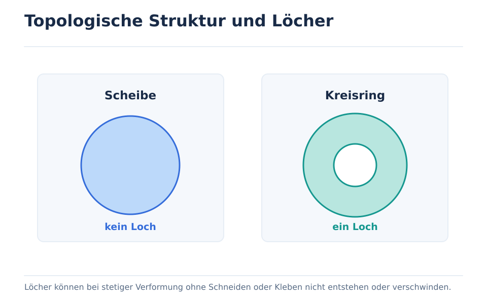

# M2-L4 – Topologie und abstrakte Räume {#L4}

**Kursbereich:** M2 – Bachelor-Vertiefung / Master-Übergang

**Niveau:** Bachelor / Master-Brücke

**Vorwissen:** Keine festen Voraussetzungen angegeben.

**Einordnung:** Universität – weiterführende Vertiefung

## Worum geht es? {#S1}

In der Geometrie messen wir Längen, Winkel und Abstände. Die **Topologie** stellt eine andere Frage: Welche Punkte liegen im Sinne einer bestimmten Raumstruktur in der Nähe voneinander? Wie kann man Stetigkeit verstehen, ohne zwingend mit Zahlenabständen zu rechnen? Wann hängt ein Raum zusammen, und welche Eigenschaften bleiben bei einer kontinuierlichen Verformung erhalten? Die Antworten beruhen auf einem überraschend sparsamen Begriff: einer Sammlung sogenannter **offener Mengen**.

Topologie bedeutet nicht einfach „Geometrie mit verbogenen Figuren“. Sie schafft eine allgemeine Sprache für Nähe, Stetigkeit, Grenzverhalten und Zusammenhang – auch für Räume, deren „Punkte“ Funktionen oder andere mathematische Objekte sind.

## Grundidee und Anschauung {#S2}

Stell dir eine gezeichnete Linie vor, die ohne Absetzen des Stifts verformt wird. Ihre Länge kann sich ändern, und gerade Abschnitte können krumm werden. Trotzdem bleibt sie als zusammenhängendes Stück erkennbar. Ähnlich kann ein kreisförmiger Gummiring verformt werden, ohne seinen grundlegenden Charakter als geschlossene Schleife zu verlieren.

Topologie vergleicht nicht primär genaue Maße, sondern solche **strukturellen Eigenschaften**. Ein mathematischer Raum muss dabei nicht aussehen wie ein Zimmer: Er kann aus Datenpunkten, Funktionen, Zuständen oder abstrakten Elementen bestehen.

## Neue Zeichen vor der ersten Formel {#S3}

  Zeichen        Aussprache                        Bedeutung hier                                         Anderer möglicher Gebrauch
  -------------- --------------------------------- ------------------------------------------------------ --------------------------------------------------
  $X$            „großes iks“                      gesamte Punktmenge eines Raums                         Unbekannte oder Zufallsvariable
  $\mathcal{T}$  „kalligrafisches te“              Sammlung der als offen festgelegten Teilmengen von X   allgemeine Familie von Mengen
  $\varnothing$  „leere Menge“                     Menge ohne Elemente                                    Mengenlehre allgemein
  $\subseteq$    „ist Teilmenge von oder gleich“   Zugehörigkeit einer Menge zur Raumstruktur             allgemeine Mengenrelation
  $\in$          „ist Element von“                 Zugehörigkeit zu einer Sammlung                        Mengenlehre allgemein
  $\cup$         „Vereinigung“                     Elemente aus mindestens einer Teilmenge                Ereignisvereinigung in der Stochastik
  $\cap$         „Schnittmenge“                    Elemente, die in allen genannten Mengen liegen         Ereignisschnitt in der Stochastik
  $U$, $V$       „u“, „fau“                        ausgewählte offene Mengen                              Spannung oder Volumen in anderen Kontexten
  $(a,b)$        „offenes Intervall von a bis b“   alle reellen Zahlen strikt zwischen a und b            geordnetes Paar in anderer Schreibweise
  $f^{-1}(U)$    „Urbild von U unter f“            alle Eingaben, deren Funktionswert in U liegt          $f^{-1}$ kann auch eine Umkehrfunktion bezeichnen
  $\to$          „bildet ab auf“                   Zuordnung zwischen Räumen                              Grenzübergang oder Richtungsangabe
  $\mathbb{R}$   „reelle Zahlen“                   gewöhnliche Zahlengerade                               Zahlbereich aus Schule M1-L1

**Wichtig:** Die Schreibweise $f^{-1}(U)$ setzt **keine** umkehrbare Funktion voraus. Sie meint das *Urbild einer Menge*: Wir sammeln alle Eingaben, die im betrachteten Ausgabebereich landen.

## Offene Mengen: Nähe ohne feste Millimeterangabe {#S4}

Auf der reellen Zahlengeraden ist beispielsweise das Intervall $(0,1)$ offen. Jeder enthaltene Punkt hat nach links und rechts noch ein kleines Stück Platz innerhalb des Intervalls. Die Randpunkte null und eins gehören nicht dazu.

Die leere Menge und die gesamte Zahlengerade gelten ebenfalls als offen. Dass die gesamte Zahlengerade offen ist, bedeutet nicht, sie sei „unbegrenzt“ im Alltagssinn. Es ist eine Eigenschaft der mathematisch definierten Nähebeziehung.

In einem allgemeinen Raum wird **nicht** erst ein Abstand festgelegt. Man bestimmt stattdessen, welche Teilmengen offen heißen sollen. Diese offenen Mengen müssen bestimmte Regeln erfüllen. Damit erhalten wir eine **Topologie**.

Die mathematische Kurzschreibweise für einen topologischen Raum lautet:

$$
\begin{aligned}
&(X,\mathcal T)
\end{aligned}
$$

**Gesprochen:** „Das Paar aus der Menge iks und der Topologie kalligrafisches te.“ $X$ bezeichnet sämtliche Punkte, $\mathcal{T}$ die Sammlung der offenen Teilmengen.

Die drei Axiome einer Topologie sind:

1.  Die leere Menge $\varnothing$ und die gesamte Menge $X$ gehören zu $\mathcal{T}$.
2.  Die Vereinigung **beliebig vieler** Mengen aus $\mathcal{T}$ gehört wieder zu $\mathcal{T}$.
3.  Die Schnittmenge **endlich vieler** Mengen aus $\mathcal{T}$ gehört wieder zu $\mathcal{T}$.

Gerade die Unterscheidung zwischen *beliebigen Vereinigungen* und *endlichen Schnitten* ist wichtig. Ein unendlicher Schnitt offener Mengen muss nicht wieder offen sein. Beispiel auf der reellen Zahlengeraden: Die offenen Intervalle von $-\frac{1}{n}$ bis $\frac{1}{n}$ für $n=1,2,3,\ldots$ werden immer schmaler. Ihr gemeinsamer Schnitt besteht nur aus $\{0\}$ – diese Einpunktmenge ist in der üblichen Topologie von $\mathbb{R}$ nicht offen.

„Beliebig viele“ schließt auch die leere Familie von Mengen ein; ebenso sind Schnitte über die leere Familie zugelassen. Nach Konvention ergibt die leere Vereinigung $\varnothing$ und der leere Schnitt den gesamten Raum $X$.

## Vollständig erklärtes Mini-Beispiel: Ein Raum mit zwei Punkten {#S5}

Nehmen wir einen Raum mit den beiden Punkten $a$ und $b$:

$$
\begin{aligned}
X&=\{a,b\}\\
\mathcal T&=\{\varnothing,\{a\},\{a,b\}\}
\end{aligned}
$$

**Gesprochen:** „Der Raum iks besteht aus a und b. Die Topologie enthält die leere Menge, die Einpunktmenge mit a und die gesamte Menge mit a und b.“ Die äußeren geschweiften Klammern fassen **Mengen als Elemente** einer Sammlung zusammen.

Wir prüfen die drei Topologiebedingungen: Die leere Menge und der ganze Raum kommen vor. Jede Vereinigung dieser drei Mengen ist wieder eine der drei genannten Mengen. Dasselbe gilt für jeden endlichen Schnitt. Somit ist $\mathcal{T}$ eine gültige Topologie.

Auffällig: $\{a\}$ ist offen, $\{b\}$ aber nicht. Das ist mathematisch erlaubt. Topologien müssen nicht so symmetrisch sein wie gewöhnliche metrische Räume. Unser Beispiel zeigt, dass die Axiome eine **allgemeinere Struktur** beschreiben als bloße Entfernung auf dem Zahlenstrahl. Sie heißt auch *Sierpiński-Raum*. Insbesondere stammt diese Topologie **nicht von einer gewöhnlichen Metrik** auf den zwei Punkten: In jedem metrischen Raum mit nur endlich vielen Punkten kann man jeden einzelnen Punkt durch eine ausreichend kleine offene Kugel isolieren, hier ist $\{b\}$ aber nicht offen.

Zum Vergleich: Wenn wir *jede* Teilmenge von $X$ für offen erklären, erhalten wir die **diskrete Topologie**. Wenn nur die leere Menge und $X$ selbst offen sind, sprechen wir von der **indiskreten** oder trivialen Topologie. Beide erfüllen die Axiome.

## Stetigkeit als Erhaltung offener Umgebungen {#S6}

In der Schulanalysis bedeutet Stetigkeit vereinfacht, dass kleine Änderungen der Eingabe kleine Änderungen des Ergebnisses bewirken können. Topologie formuliert dasselbe Prinzip ohne die Pflicht, einen Abstand in Metern oder Zahlen zu messen.

Eine Abbildung zwischen topologischen Räumen heißt **stetig**, wenn für jede offene Menge im *Zielraum* das dazugehörige **Urbild** im *Ausgangsraum* offen ist.

$$
\begin{aligned}
&f\colon X\to Y\\
&\text{für jedes offene }U\text{ in }Y\text{ gilt:}\\
&\qquad f^{-1}(U)\text{ ist offen in }X
\end{aligned}
$$

**Gesprochen:** „Die Funktion eff bildet Punkte des Raums iks in den Raum ypsilon ab. Für jede offene Menge u im Zielraum ist die Menge aller Eingaben, deren Bild in u liegt, im Ausgangsraum offen.“

Dieser Satz ist eine **Definition**, kein numerisches Rechenverfahren. Er verbindet die bereits aus M1-L3 bekannte Stetigkeit mit einer umfassenderen Sichtweise.

### Nachvollziehbares Beispiel mit einer gewöhnlichen Funktion {#abschnitt-7}

Betrachte die Funktion, die jede reelle Zahl quadriert, also $f(x)=x^{2}$. Im Ausgaberaum nehmen wir das offene Intervall $(1,4)$ – alle Zahlen strikt zwischen eins und vier.

Welche Eingaben werden beim Quadrieren auf einen Wert zwischen eins und vier abgebildet? Genau die Zahlen zwischen minus zwei und minus eins sowie zwischen eins und zwei:

$$
f^{-1}((1,4))=(-2,-1)\cup(1,2)
$$

**Gesprochen:** „Das Urbild des offenen Intervalls von eins bis vier ist die Vereinigung des offenen Intervalls von minus zwei bis minus eins mit dem offenen Intervall von eins bis zwei.“ Diese Vereinigungsmenge ist auf der Zahlengeraden offen. Das Beispiel illustriert, warum Urbilder und Offenheit in der Stetigkeitsdefinition zusammenpassen. Für die vollständige Stetigkeitsaussage muss die Bedingung **für alle** offenen Mengen des Zielraums gelten, nicht nur für dieses eine Intervall.

### Kleine Gegenprobe mit dem Zweipunkteraum {#abschnitt-8}

Betrachten wir die **Identitätsabbildung**: Sie schickt $a$ auf $a$ und $b$ auf $b$. Vom oben beschriebenen Zweipunkteraum in denselben Punktevorrat mit **diskreter Topologie** ist sie **nicht stetig**: Im diskreten Zielraum ist $\{b\}$ offen, ihr Urbild $\{b\}$ ist im Ausgangsraum aber nicht offen. In der umgekehrten Richtung, *vom diskreten Raum in die oben definierte Topologie*, ist die Identitätsabbildung hingegen stetig. Die Zuordnung der Punkte ist dieselbe – die **Topologien** entscheiden über Stetigkeit.

## Zusammenhang: Besteht der Raum aus einem Stück? {#S7}

Ein Raum ist **zusammenhängend**, wenn man ihn nicht in zwei disjunkte, nichtleere offene Teilmengen zerlegen kann, die zusammen den ganzen Raum ergeben. Vereinfacht: Er lässt sich topologisch nicht in zwei voneinander getrennte offene Stücke auseinandernehmen.

Das gewöhnliche geschlossene Intervall von null bis eins ist zusammenhängend. Die Vereinigung zweier voneinander getrennter Intervalle, beispielsweise von null bis eins und von drei bis vier, ist dagegen nicht zusammenhängend.

Ein in sich geschlossener Kreis ist ebenfalls zusammenhängend – obwohl sein Inneres nicht zum Kreis gehören muss, wenn wir nur die Kreislinie betrachten. **Zusammenhang** und die Frage, ob eine Figur ein **Loch** hat, sind unterschiedliche Eigenschaften.

In fortgeschrittener Topologie untersucht man solche Schleifen genauer, etwa mithilfe der *Fundamentalgruppe*. Der genaue Beweisapparat ist für diesen Überblick nicht erforderlich.

## Kompaktheit: Warum „endlich kontrollierbar“ nützlich ist {#S8}

Ein weiterer wichtiger topologischer Begriff ist **Kompaktheit**. Anschaulich bedeutet sie, dass sich eine möglicherweise unendliche Abdeckung eines Raums durch offene Teilmengen stets auf **endlich viele** Teilmengen reduzieren lässt, die den Raum noch immer vollständig überdecken.

Für Teilmengen des gewöhnlichen euklidischen Raums gilt der bekannte Satz von **Heine–Borel**: Eine Menge ist genau dann kompakt, wenn sie **abgeschlossen und beschränkt** ist.

Auf der reellen Zahlengeraden ist das Intervall $[0,1]$ kompakt; $(0,1)$ ist es nicht. **Gesprochen:** „Das Intervall von null bis eins einschließlich beider Randpunkte ist kompakt; das entsprechende offene Intervall ist nicht kompakt.“ Die eckigen Klammern bedeuten, dass die Randpunkte enthalten sind.

Warum interessiert uns das? Auf **nichtleeren kompakten Mengen** erreichen stetige reellwertige Funktionen ihr Maximum und Minimum. Damit hängt die Topologie unmittelbar mit Optimierung (Schulmathematik M2-L6, M2-L2) zusammen. Der Satz benötigt die genannten Voraussetzungen; auf beliebigen offenen oder unbeschränkten Bereichen kann ein Optimum fehlen. So hat die Funktion $f(x)=x$ auf $(0,1)$ weder ein Maximum noch ein Minimum: Ihre Werte nähern sich eins beziehungsweise null an, aber die Randpunkte gehören nicht zum Definitionsbereich.

**Grenze des Heine–Borel-Satzes:** In allgemeinen topologischen Räumen ist „kompakt“ nicht dasselbe wie „abgeschlossen und beschränkt“. Unser endlicher Zweipunkteraum ist beispielsweise kompakt. Seine Teilmenge $\{a\}$ ist ebenfalls kompakt (jede offene Überdeckung besitzt eine endliche Teilüberdeckung), jedoch **nicht abgeschlossen**: Ihr Komplement $\{b\}$ ist nicht offen. In allgemeinen topologischen Räumen folgt also aus Kompaktheit nicht immer Abgeschlossenheit.

## Homöomorphie: Gleiche topologische Struktur {#S9}

Zwei Räume heißen **homöomorph**, wenn zwischen ihnen eine bijektive (also eindeutig und vollständig zuordenbare) stetige Abbildung existiert, deren Umkehrfunktion ebenfalls stetig ist.

{alt="Topologischer Vergleich von Scheibe und Kreisring"}

Bei einer solchen „topologischen Gleichheit“ dürfen Strecken länger und Formen gekrümmt werden. Eigenschaften wie Zusammenhang und Kompaktheit bleiben erhalten. Das bekannte Bild einer Kaffeetasse und eines Donuts ist als Anschauung für Oberflächen mit einem Loch gemeint; die genaue Aussage erfordert eine präzise Wahl der betrachteten Oberflächen, nicht bloß den Anblick beliebiger dreidimensionaler Gegenstände.

**Nicht jede kontinuierliche Abbildung ist ein Homöomorphismus.** Eine Abbildung kann ganze Bereiche zu einem einzigen Punkt zusammendrücken; sie verliert dann Information und ist nicht umkehrbar.

## Was kann ich damit machen? {#S10}

- **Optimierung:** Kompaktheit und Stetigkeit liefern Bedingungen, unter denen eine optimale Lösung tatsächlich existiert.
- **Software und Datenräume:** Räume von Funktionen, Daten und Zuständen erhalten eine formale Sprache für Stabilität und Grenzverhalten; es muss nicht immer ein gewöhnlicher euklidischer Abstand sein.
- **Robotik:** Zusammenhang und das Vorhandensein getrennt liegender Bereiche sind zentrale Überlegungen bei Konfigurationsräumen und Hindernissen.
- **Geometrische Datenanalyse:** Topologische Verfahren können zusammenhängende Komponenten und stabile Schleifenstrukturen in Daten untersuchen, brauchen dafür jedoch zusätzliche Modellentscheidungen und oft einen Abstandsbegriff.

## Annahmen und häufige Missverständnisse {#S11}

- *Offen* bedeutet nicht „ohne Rand“ im Alltagssinn, sondern folgt aus einer festgelegten Topologie.
- Ein topologischer Raum braucht **keine** vorab definierte Distanz. Um numerische Entfernungen auszurechnen, ist zusätzliche Struktur notwendig.
- Ein einzelnes offenes Urbild beweist nicht Stetigkeit; das Kriterium gilt für **alle** offenen Mengen im Zielraum.
- Der Satz „kompakt gleich abgeschlossen und beschränkt“ gilt für Teilmengen endlichdimensionaler euklidischer Räume mit der üblichen Topologie, **nicht** als universelle Definition jeder Topologie.
- Bei beliebigen topologischen Räumen können sogar **endliche kompakte Mengen nicht abgeschlossen** sein; hierzu braucht man zusätzliche Trennungseigenschaften wie die Hausdorff-Eigenschaft.
- Topologische Gleichheit unterscheidet sich von geometrischer Kongruenz: Längen, Winkel und Flächen können sich ändern.

## Verbindung zur nächsten Lektion {#S12}

In M2-L5 kehren wir zu Zahlen zurück, erweitern die reelle Zahlengerade zur komplexen Ebene und untersuchen, wie Funktionen dort aussehen. Dabei verbinden sich Algebra, Geometrie und Analysis auf besonders elegante Weise.

## Optionaler Vertiefungsausblick {#S13}

Metrische Räume, Hausdorff-Eigenschaften, Basen einer Topologie, Folgen- und Netzkonvergenz, Fundamentalgruppen sowie algebraische Topologie bauen diese Begriffe systematisch aus. Dieser Kurs vermittelt zunächst die Landkarte und das Lesen der grundlegenden Definitionen.

## Quellen (extern) {#S14}

Keine externen Quellen angegeben.
