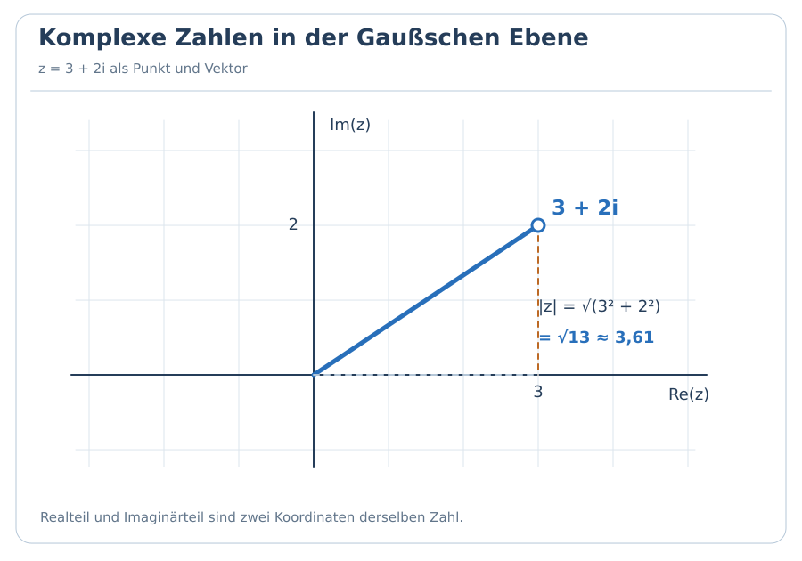

# M2-L5 – Komplexe Zahlen und komplexe Analysis {#L5}

**Kursbereich:** M2 – Bachelor-Vertiefung / Master-Übergang

**Niveau:** Bachelor / Master-Brücke

**Vorwissen:** Keine festen Voraussetzungen angegeben.

**Einordnung:** Universität – weiterführende Vertiefung

## Worum geht es? {#S1}

Auf der reellen Zahlengeraden lässt sich die Gleichung „eine Zahl zum Quadrat ergibt minus eins“ nicht lösen. Die **komplexen Zahlen** erweitern daher unser Zahlensystem um eine zusätzliche Richtung. Dadurch erhält jede komplexe Zahl zwei Komponenten, die man geometrisch als Punkt in einer Ebene darstellen kann. Multiplikation lässt sich dann zugleich als **Skalierung und Drehung** verstehen. Die **komplexe Analysis** untersucht Funktionen auf dieser Ebene – mit überraschend starken Regeln für Differenzieren, Integrieren und das Verhalten von Funktionen.

## Grundidee und Anschauung {#S2}

Stell dir einen Punkt auf einem Blatt Papier vor. Eine gewöhnliche reelle Zahl legt nur seine Position auf einer horizontalen Achse fest. Eine komplexe Zahl hat dagegen eine horizontale und eine vertikale Komponente. Bei der Addition werden die Komponenten zusammengezählt, wie bei zweidimensionalen Vektoren. Die Multiplikation ist der besondere Teil: Sie verändert im Allgemeinen **Länge und Richtung** zugleich.

{alt="Komplexe Ebene mit z = 3+2i als Pfeil vom Ursprung zum Punkt (3,2), Betrag √13."}

In der Gaußschen Ebene entspricht $z=3+2i$ dem Punkt (3,2), mit Betrag $\sqrt{13}$.

Diese Darstellung ist praktisch, weil sich Schwingungen, Phasenverschiebungen und Drehungen häufig mit komplexen Zahlen wesentlich einfacher beschreiben lassen als mit getrennten Sinus- und Kosinusrechnungen.

## Neue Zeichen vor der ersten Formel {#S3}

  Zeichen                  Aussprache                                              Bedeutung hier                                             Andere Verwendung
  ------------------------ ------------------------------------------------------- ---------------------------------------------------------- ------------------------------------------------------------
  $\mathbb{C}$             „Menge der komplexen Zahlen“                            Zahlbereich aller komplexen Zahlen                         Teilmenge-Symbol $\subset$ ist etwas anderes
  $z$                      „zett“                                                  komplexe Zahl                                              dritte Raumkoordinate in der Geometrie
  $a$, $b$                 „a“, „be“                                               reeller und imaginärer Anteil von z                        allgemeine Variablen
  $i$                      „imaginäre Einheit“                                     Zahl mit dem Quadrat −1                                    in Summen oft Index einer Folge
  $i^{2}$                  „i zum Quadrat“                                         Produkt von i mit sich selbst; definiert als −1            Potenznotation allgemein
  $\operatorname{Re}(z)$   „Realteil von z“                                        horizontale Komponente                                     $\operatorname{Re}$ ist Funktionsname, keine Multiplikation
  $\operatorname{Im}(z)$   „Imaginärteil von z“                                    reeller Koeffizient vor i                                  nicht gleich dem Summanden $bi$
  $\bar{z}$                „z quer“ oder „z konjugiert“                            komplex konjugierte Zahl                                   Überstrich kann Mittelwert kennzeichnen
  $\lvert z\rvert$         „Betrag von z“                                          Länge vom Ursprung zum Punkt z                             Betrag reeller Zahl, Mächtigkeit einer Menge
  $r$                      „er“                                                    nichtnegative Länge in Polarform                           Radius allgemein
  $\theta$                 „Theta“                                                 Winkel oder Argument einer komplexen Zahl                  Winkelbezeichnung allgemein
  $\operatorname{arg}(z)$  „Argument von z“                                        Richtung von z, nur bis auf volle Umdrehungen eindeutig    „Argument“ einer Funktion
  $e$                      „Eulersche Zahl“                                        Basis der natürlichen Exponentialfunktion                  neutrales Gruppenelement in M2-L3
  $\pi$                    „Pi“                                                    halbe Umdrehung im Bogenmaß entspricht $\pi$               Kreiszahl allgemein
  $\partial$               „partielles d“                                          partielle Ableitung nach einer reellen Koordinate          Ableitung in mehreren Variablen
  $u$, $v$                 „u“, „fau“                                              reelle Komponenten einer komplexwertigen Funktion          freie Bezeichnungen
  $t$                      „te“                                                    reeller Laufparameter eines Weges in der komplexen Ebene   Zeitvariable in Anwendungen
  $\oint$, $\mathrm{d}z$   „Integral längs eines geschlossenen Weges“, „de zett“   Wegintegral und komplexes Wegdifferential                  Integrationssymbol in anderen Kontexten

Die imaginäre Einheit $i$ ist **keine Unbekannte, die aus reellen Zahlen geraten werden muss**, sondern Teil der Definition der erweiterten Zahlenstruktur. In der Elektrotechnik wird dafür häufig $j$ verwendet, weil $i$ dort für die Stromstärke steht.

## Komplexe Zahlen als Zahlenpaare {#S4}

Die grundlegende Schreibweise lautet:

$$
z=a+bi\qquad\text{mit }a,b\in\mathbb{R}\text{ und }i^2=-1
$$

**Gesprochen:** „Zett ist gleich a plus be mal i. Dabei sind a und be reelle Zahlen und i zum Quadrat ist minus eins.“

Beispielsweise hat die Zahl $z=3+4i$ den Realteil drei und den Imaginärteil vier. In einem Koordinatensystem liegt sie beim Punkt $(3,4)$: horizontal drei Schritte, vertikal vier Schritte.

$$
\begin{aligned}
\operatorname{Re}(3+4i)&=3\\
\operatorname{Im}(3+4i)&=4
\end{aligned}
$$

**Gesprochen:** „Der Realteil von drei plus vier i ist drei. Der Imaginärteil von drei plus vier i ist vier.“ Besonders der zweite Satz ist wichtig: Der **Imaginärteil** ist die reelle Zahl vier, nicht der Term $4i$.

Zwei komplexe Zahlen sind genau dann gleich, wenn sowohl ihre Realteile als auch ihre Imaginärteile gleich sind.

## Rechnen: Addition und Multiplikation {#S5}

Addition funktioniert komponentenweise:

$$
(1+2i)+(3-i)=4+i
$$

**Gesprochen:** „Eins plus zwei i, addiert zu drei minus i, ergibt vier plus i.“ Denn die reellen Teile ergeben vier, die i-Anteile ergeben zwei minus eins, also einen i-Anteil.

Für die Multiplikation verwenden wir das aus der Schulmathematik bekannte Distributivgesetz. Die einzige Besonderheit ist die Regel $i^{2}=-1$.

$$
\begin{aligned}
(1+2i)(3-i)&=3-i+6i-2i^2\\
&=3+5i+2\\
&=5+5i
\end{aligned}
$$

**Laut gelesen:** „Das Produkt aus eins plus zwei i und drei minus i wird ausmultipliziert. Wegen i zum Quadrat gleich minus eins wird minus zwei i zum Quadrat zu plus zwei. Das Ergebnis ist fünf plus fünf i.“

**Vollständig erklärtes Mini-Beispiel:** Aus den vier Summanden entstehen zunächst $3$, $-i$, $6i$ und $-2i^{2}$. Die imaginären Summanden ergeben $5i$, und der letzte Summand wird wegen $i^{2}=-1$ zur reellen Zahl $+2$. Zusammen entstehen die reelle Fünf und die imaginäre Fünf. Das Ergebnis kann durch direktes erneutes Ausmultiplizieren überprüft werden.

## Konjugation und Betrag {#S6}

Die **komplexe Konjugation** spiegelt eine Zahl an der reellen Achse. Sie wechselt das Vorzeichen vor der imaginären Einheit:

$$
\begin{aligned}
z&=3+4i\\
\bar z&=3-4i
\end{aligned}
$$

**Gesprochen:** „Die zu drei plus vier i konjugierte Zahl ist drei minus vier i.“

Multipliziert man eine komplexe Zahl mit ihrer konjugierten Zahl, verschwindet der imaginäre Anteil. Für das Beispiel gilt:

$$
\begin{aligned}
z\cdot\bar z&=(3+4i)(3-4i)=9+16=25\\
|z|&=\sqrt{25}=5
\end{aligned}
$$

**Gesprochen:** „Zett mal zett quer ist fünfundzwanzig. Der Betrag von zett ist die Wurzel aus fünfundzwanzig, also fünf.“ Geometrisch ist dies der Satz des Pythagoras: Der Abstand des Punktes $(3,4)$ vom Ursprung beträgt fünf.

Allgemein gilt:

$$
\lvert a+bi\rvert=\sqrt{a^2+b^2}
$$

**Gesprochen:** „Der Betrag von a plus be i ist die Quadratwurzel aus a zum Quadrat plus be zum Quadrat.“

Komplexe Division kann mithilfe der Konjugation auf eine reelle Zahl im Nenner gebracht werden. So erhält man etwa:

$$
\frac1{1+i}=\frac{1-i}{2}
$$

Das ist erlaubt, weil wir Zähler und Nenner mit $1-i$ multiplizieren. Division durch die komplexe Null ist ebenso wenig definiert wie Division durch die reelle Null.

## Polarform: Länge und Drehwinkel {#S7}

Statt Real- und Imaginärteil kann man eine komplexe Zahl auch durch **Betrag** und **Richtung** beschreiben. Der Betrag $r$ ist die nichtnegative Länge, der Winkel $\theta$ (Theta) wird üblicherweise im Bogenmaß gemessen.

$$
z=r\,(\cos\theta+i\sin\theta)
$$

**Gesprochen:** „Zett ist gleich er mal Klammer Kosinus Theta plus i mal Sinus Theta.“ Die Funktionen $\cos$ und $\sin$ sind aus Schule M1-L16/Schule M1-L20 bekannt. Bei Betrag null ist keine eindeutige Richtung festgelegt.

Für $z=1+i$ gilt: Der Betrag ist $\sqrt{2}$, und die Richtung beträgt 45° oder im Bogenmaß $\frac{\pi}{4}$. So lässt sich dieselbe Zahl auch als Polarform beschreiben.

Der große Vorteil: Beim Multiplizieren komplexer Zahlen **multiplizieren sich die Beträge**, während sich die Winkel **addieren** (jeweils modulo einer vollen Umdrehung). Für zwei von null verschiedene komplexe Zahlen folgt also aus den Polarformen der Beträge $r_1$, $r_2$ und Winkel $\theta_1$, $\theta_2$: Das Produkt hat Betrag $r_1\cdot r_2$ und den Winkel $\theta_1+\theta_2$. Ist einer der Faktoren null, hat das Produkt Betrag null und keinen eindeutig bestimmten Winkel. Wenn ein Faktor eine Vierteldrehung ausführt, dreht sich die Richtung entsprechend mit. Das macht komplexe Multiplikation zu einer natürlichen Sprache für Rotationen und Schwingungen.

## Die Eulersche Formel {#S8}

In der komplexen Analysis begegnet uns eine besonders nützliche Beziehung zwischen Exponentialfunktion und Trigonometrie:

$$
e^{i\theta}=\cos\theta+i\sin\theta
$$

**Gesprochen:** „e hoch i mal Theta ist gleich Kosinus Theta plus i mal Sinus Theta.“ Die Eulersche Zahl $e$ ist dieselbe Konstante wie bei reellen Exponentialfunktionen. Hier wird die Exponentialfunktion auf komplexe Zahlen erweitert.

Für $\theta=\frac{\pi}{2}$ ergibt sich $e^{i\pi/2}=i$, also eine Vierteldrehung auf dem Einheitskreis. Für $\theta=\pi$ erhalten wir:

$$
e^{i\pi}=-1
$$

**Gesprochen:** „e hoch i mal Pi ist minus eins.“ Diese Identität zeigt, wie die imaginäre Einheit, eine volle halbe Drehung und die Exponentialfunktion zusammenhängen. Auf dem Einheitskreis entspricht das dem Punkt links vom Ursprung.

Gerade in der Signalverarbeitung lassen sich Sinus- und Kosinusschwingungen so zu einer einzigen komplexen Beschreibung zusammenfassen. Man braucht dafür nicht zu behaupten, dass gemessene Spannungen selbst „imaginär“ wären: Die komplexe Schreibweise ist ein **mathematisches Modell für Amplitude und Phase**.

## Komplexe Analysis: Differenzieren in jeder Richtung {#S9}

Bei reellen Funktionen prüfen wir die Änderung, wenn wir uns auf einer Zahlengeraden nach links oder rechts bewegen. Bei komplexen Funktionen kann sich eine Eingabe in **beliebiger Richtung der komplexen Ebene** ändern. Eine komplexe Ableitung existiert deshalb nur, wenn derselbe Grenzwert unabhängig von dieser Annäherungsrichtung entsteht.

Eine Funktion, die in einer offenen Umgebung jedes Punktes komplex differenzierbar ist, heißt dort **holomorph**. Das ist eine starke Eigenschaft: Holomorphe Funktionen besitzen lokal besonders regelmäßige Darstellungen und erfüllen weitreichende Integralsätze.

Für eine Funktion mit reellen Komponenten $u(x,y)$ und $v(x,y)$ schreiben wir:

$$
f(x+iy)=u(x,y)+i\cdot v(x,y)
$$

**Gesprochen:** „Eff von iks plus i mal ypsilon ist gleich u von iks und ypsilon plus i mal fau von iks und ypsilon.“ Dabei geben $x$ und $y$ die Koordinaten der Eingabe an, während $u$ und $v$ die reellen Ausgabekomponenten beschreiben.

Sind die partiellen Ableitungen hinreichend regulär, liefern die **Cauchy-Riemann-Gleichungen** ein Kriterium für komplexe Differenzierbarkeit:

$$
\begin{aligned}
\frac{\partial u}{\partial x}&=\frac{\partial v}{\partial y}\\
\frac{\partial u}{\partial y}&=-\frac{\partial v}{\partial x}
\end{aligned}
$$

**Gesprochen:** „Die partielle Ableitung von u nach iks ist gleich der partiellen Ableitung von fau nach ypsilon. Die partielle Ableitung von u nach ypsilon ist das Negative der partiellen Ableitung von fau nach iks.“ Partielle Ableitung heißt: Eine Koordinate wird variiert, die andere vorübergehend konstant gehalten (M1-L4).

### Mini-Beispiel: Warum Quadrieren funktioniert {#abschnitt-10}

Bei der komplexen Funktion $f(z)=z^{2}$ setzen wir $z=x+iy$. Ausmultiplizieren ergibt:

$$
\begin{aligned}
f(z)&=x^2-y^2+i(2xy)\\
u(x,y)&=x^2-y^2\\
v(x,y)&=2xy
\end{aligned}
$$

Hier gilt $\frac{\partial u}{\partial x}=2x$ und $\frac{\partial v}{\partial y}=2x$. Ebenso gilt $\frac{\partial u}{\partial y}=-2y$ und $-\frac{\partial v}{\partial x}=-2y$. Die beiden Bedingungen sind für alle reellen $x$ und $y$ erfüllt; die Ableitungen sind außerdem stetig. Damit ist $z^{2}$ auf der ganzen komplexen Ebene holomorph. Seine komplexe Ableitung ist $f^{\prime}(z)=2z$: Beim Differenzenquotienten entsteht $\frac{{(z+h)}^{2}-z^{2}}{h}=2z+h$, und für jeden komplexen Weg $h\to0$ erhält man denselben Grenzwert $2z$.

Zum Gegenbeispiel: $f(z)=\bar{z}$, also die Konjugation, ist **nirgends komplex differenzierbar**. Nähert man sich mit reellen oder rein imaginären Schritten, erhält man unterschiedliche Differenzenquotienten. Am beliebigen Ausgangspunkt $z$ ist der Quotient für einen von null verschiedenen Schritt $h$ gleich $\frac{\bar{h}}{h}$: Für reelles $h$ ergibt das $1$, für rein imaginäres $h$ dagegen $-1$. Ein richtungsunabhängiger komplexer Grenzwert kann daher nicht existieren. Das ist ein wichtiger Unterschied zwischen gewöhnlicher zweidimensionaler reeller Differenzierbarkeit und komplexer Differenzierbarkeit.

## Komplexe Integrale: ein Ausblick {#S10}

In einer vertieften Vorlesung werden Funktionen entlang von Wegen durch die komplexe Ebene integriert. Für holomorphe Funktionen gelten unter geeigneten Voraussetzungen sehr starke Aussagen, etwa eine Form des **Cauchyschen Integralsatzes**: Das Wegintegral entlang einer **einfachen, geschlossenen, stückweise glatten Kurve** verschwindet, wenn die Funktion auf einer **offenen Umgebung der Kurve und ihres gesamten Inneren** holomorph ist. Die Wahl dieser Kurven- und Gebietsbedingungen ist wesentlich. Bei allgemeinen geschlossenen Wegen oder Gebieten mit Löchern braucht die präzise Aussage zusätzliche Begriffe wie Homotopie beziehungsweise Umlaufzahl. Die Bedingung „holomorph nur **auf** der Kurve“ genügt nicht.

Bei Singularitäten (Stellen, an denen eine Funktion nicht wie gefordert definiert oder holomorph ist) muss man besonders aufpassen. So hat die Funktion $\frac{1}{z}$ bei $z=0$ eine Singularität. Das Umlaufintegral entlang des gegen den Uhrzeigersinn durchlaufenen Einheitskreises ist **nicht null**. Mit dem Weg $z(t)=e^{it}$ für $0\leq t\leq2\pi$ gilt $\mathrm{d}z=i\cdot e^{it}\,\mathrm{d}t$; damit folgt:

$$
\begin{aligned}
\oint\frac1z\,\mathrm{d}z&=\int_0^{2\pi}\frac{i\cdot e^{it}}{e^{it}}\,\mathrm{d}t\\
&=\int_0^{2\pi}i\,\mathrm{d}t=2\pi i
\end{aligned}
$$

**Gesprochen:** „Das geschlossene Wegintegral von eins durch zett ergibt nach Einsetzen des Kreiswegs das Integral der konstanten imaginären Einheit über eine volle Umdrehung, also zwei Pi i.“ Hier liegt die Singularität bei null **innerhalb** des Weges. Wer die Voraussetzung „holomorph im gesamten Inneren“ übersieht, würde den Cauchyschen Integralsatz fälschlich anwenden. Der genaue Integralkalkül folgt bei Bedarf als separate Vertiefung; hier geht es um die **Lesart und die Gültigkeitsbedingungen**, nicht um einen vollständigen Beweis.

## Wofür ist das nützlich? {#S11}

- **Audio, Funk und Signalverarbeitung:** Komplexe Amplituden und Phasen vereinfachen das Rechnen mit periodischen Signalen und Fourier-Verfahren (M2-L9).
- **Elektronik und Regelung:** Wechselstromnetzwerke und Schwingungssysteme werden häufig mit komplexen Größen beschrieben.
- **2D-Grafik und Robotik:** Multiplikation mit komplexen Zahlen von Betrag eins ermöglicht Rotationen der Ebene.
- **Mathematische Forschung und Physik:** Holomorphe Funktionen und komplexe Integrale besitzen weitreichende Eigenschaften, die viele reelle Rechenprobleme vereinfachen.

## Annahmen, Grenzen und Missverständnisse {#S12}

- Der Imaginärteil einer Zahl ist ein **reeller Koeffizient**; $\operatorname{Im}(3+4i)=4$, nicht $4i$.
- Komplexe Zahlen sind nicht wie reelle Zahlen mit einer gewöhnlichen Gesamtordnung „größer/kleiner“ vergleichbar. Der Betrag liefert eine Größe, aber keine allgemeine Ordnung des Zahlenbereichs.
- Der Winkel einer komplexen Zahl ist nicht eindeutig, sondern nur bis auf ganze Umdrehungen bestimmt; bei $z=0$ ist kein Winkel festgelegt.
- Komplexe Differenzierbarkeit ist **stärker** als Differenzierbarkeit reeller Funktionen zweier Variablen.
- Die Cauchy-Riemann-Gleichungen **an einem einzelnen Punkt** genügen nicht allgemein für komplexe Differenzierbarkeit. Als einfaches hinreichendes Kriterium: Sind die reellen Komponenten in einer offenen Umgebung stetig partiell differenzierbar und erfüllen dort beide Gleichungen, ist die Funktion in dieser Umgebung holomorph.
- Die komplexe Darstellung von Signalen ist meist ein Rechenwerkzeug; reale Messgrößen werden durch geeignete Realteile oder weitere Rücktransformationen gewonnen.

## Verbindung zur nächsten Lektion {#S13}

M2-L6 untersucht gekrümmte Räume und Flächen. Dort begegnen sich geometrische Koordinaten, Tangenten, Ableitungen und Transformationen – die Grundlagen der **Differentialgeometrie**.

## Optionaler Vertiefungsausblick {#S14}

Potenzreihen, komplexe Exponential- und Logarithmusfunktion, analytische Fortsetzung, Residuensatz und konforme Abbildungen sind zentrale weitere Themen. Die komplexe Analysis wird an Universitäten deutlich beweisorientierter behandelt, als es dieser Leseüberblick leisten soll.

## Quellen (extern) {#S15}

Keine externen Quellen angegeben.
