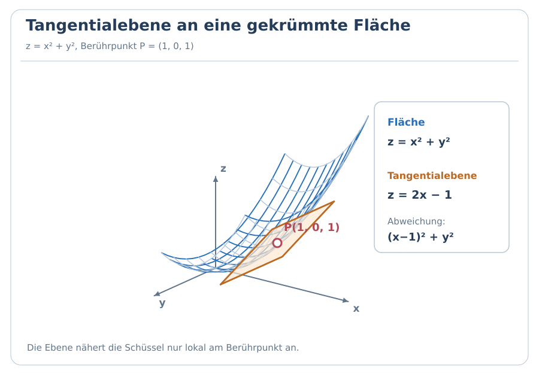

# M2-L6 – Differentialgeometrie: Gekrümmte Flächen und Räume {#L6}

**Kursbereich:** M2 – Bachelor-Vertiefung / Master-Übergang

**Niveau:** Bachelor / Master-Brücke

**Vorwissen:** Keine festen Voraussetzungen angegeben.

**Einordnung:** Universität – weiterführende Vertiefung

## Worum geht es? {#S1}

Eine gerade Linie auf einem Blatt Papier ist leicht zu beschreiben. Schwieriger wird es, wenn wir auf der Erdoberfläche von einem Ort zu einem anderen gelangen oder den Verlauf eines Roboters auf einer gekrümmten Bahn untersuchen. In solchen Situationen passen die einfachen Koordinaten und Winkel der ebenen Geometrie nicht überall unverändert. Die **Differentialgeometrie** verbindet deshalb die Geometrie mit der Analysis: Sie untersucht eine gekrümmte Figur, indem sie sehr kleine Ausschnitte und die dort möglichen Bewegungsrichtungen betrachtet. So lassen sich Längen, Tangenten, Krümmungen und kürzeste Wege auch auf gekrümmten Flächen beschreiben.

Die Lektion ist eine **Themenlandkarte**, kein Ersatz für eine vollständige Vorlesung über differenzierbare Mannigfaltigkeiten. Sie baut insbesondere auf Schule M1-L20 (Winkel und Kreis), Schule M2-L11 (Vektoren), M1-L4 (partielle Ableitungen) und M2-L4 (Topologie) auf.

## Grundidee und Anschauung {#S2}

Stell dir eine Ameise auf einer großen Kugel vor. In ihrer unmittelbaren Umgebung wirkt die Oberfläche fast eben. Sie kann dort vorwärts, rückwärts, nach links oder rechts laufen – aber nicht ohne Weiteres radial in die Kugel hinein. Die möglichen **lokalen Bewegungsrichtungen** bilden eine Ebene, die an der Kugel anliegt: die *Tangentialebene*. Gehen wir zu einem anderen Punkt, ändert sich die Ausrichtung dieser Ebene.

Eine **Mannigfaltigkeit** ist vereinfacht ein Raum, der in genügend kleinen Ausschnitten wie ein gewöhnlicher euklidischer Raum aussieht. Die Oberfläche einer Kugel ist beispielsweise lokal zweidimensional, obwohl sie sich in einem dreidimensionalen Raum befindet. Ihre Punkte kann man mit zwei lokalen Koordinaten angeben. Für die ganze Kugel funktioniert jedoch kein einziges globales Koordinatenpaar ohne Besonderheiten wie Polstellen oder überlappende Karten.

## Neue Zeichen vor der ersten Formel {#S3}

  Zeichen                          Aussprache                               Bedeutung hier                                                            Möglicher anderer Gebrauch
  -------------------------------- ---------------------------------------- ------------------------------------------------------------------------- ------------------------------------------------
  $t$                              „te“                                     Parameter, etwa die Zeit entlang einer Bahn                               beliebige Variable
  $\vec{r}(t)$                     „er von te“                              Ortsvektor einer parametrisierten Kurve                                   r auch Radius
  $\vec{r}^{\prime}(t)$            „er Strich von te“                       Ableitung des Ortsvektors nach t, der Tangenten-/Geschwindigkeitsvektor   Ableitungsnotation aus Schule M2-L3
  $\lVert\vec{v}\rVert$            „Norm von fau“                           Länge eines Vektors                                                       in höheren Räumen auch andere Normen
  $\int$ und $\mathrm{d}t$         „Integral“ und „Differenzial te“         kontinuierliches Aufsummieren entlang des Parameters t                    aus Schule M2-L7–Schule M2-L9
  $a$, $b$                         „a“, „be“                                Start- und Endwert des Kurvenparameters                                   beliebige Konstanten
  `√`                              „Quadratwurzel“                          nichtnegative Wurzel                                                      bereits aus Schule M1-L7
  $f(x,y)$                         „eff von iks und ypsilon“                Höhe über einer Ebene                                                     allgemeine Funktion zweier Variablen
  $\frac{\partial f}{\partial x}$  „partielle Ableitung von eff nach iks“   Änderung in x-Richtung bei festem y                                       aus M1-L4
  $\approx$                        „ist ungefähr gleich“                    lineare Näherung in der Nähe eines Punktes                                numerische Näherung
  $R$                              „großes er“                              Kugelradius                                                               auch Menge der reellen Zahlen als $\mathbb{R}$
  $L$                              „ell“                                    Bogenlänge einer Kurve                                                    lineare Größe oder Operator in anderer Lektion
  $K$                              „ka“                                     Gaußsche Krümmung einer Fläche                                            Variable in anderen Kontexten
  $z$                              „zett“                                   Höhenkoordinate einer Fläche                                              Zielwert in M2-L2
  $x_0$, $y_0$                     „iks null“, „ypsilon null“               feste Koordinaten eines Berührpunkts                                      Index null allgemein
  $\pi$                            „Pi“                                     Kreiszahl                                                                 aus der Kreisgeometrie
  $\theta$                         „Theta“                                  Winkel, hier im Bogenmaß                                                  auch allgemeiner Parameter
  $\varphi$                        „Phi“                                    kleinerer Mittelpunktswinkel zwischen zwei Kugelpunkten                   anderer Winkel oder Parameter

## Kurven: Eine Bahn aus winzigen Tangenten zusammensetzen {#S4}

Eine glatte Bahn kann durch ihren Ortsvektor $\vec{r}(t)$ beschrieben werden. Für jeden Parameterwert $t$ liefert die Funktion einen Punkt der Bahn. Die Ableitung $\vec{r}^{\prime}(t)$ beschreibt, in welche Richtung und mit welcher Geschwindigkeit der Punkt bei verändertem $t$ weiterwandert. Wenn wir die Länge dieses Geschwindigkeitsvektors über alle Parameterwerte aufsummieren, erhalten wir die **Bogenlänge**:

$$
L=\int_a^b\lVert\vec{r}'(t)\rVert\,\mathrm{d}t
$$

**Gesprochen:** „Die Länge ell ist das Integral von a bis be über die Norm von er Strich von te, bezogen auf te.“ In Alltagssprache: Wir addieren die auf der Kurve in unendlich vielen kleinen Schritten zurückgelegten Wegstücke. $a$ und $b$ bestimmen, welcher Kurvenabschnitt gemessen wird. Voraussetzung ist insbesondere, dass die Bahn auf dem Intervall hinreichend glatt, etwa stückweise stetig differenzierbar, ist.

### Mini-Beispiel: Ein Viertelkreis {#abschnitt-5}

Bei einer Bewegung auf einem Kreis mit Radius zwei Metern beträgt die Bogenlänge für eine Vierteldrehung:

$$
\begin{aligned}
L&=R\cdot\theta\\
R&=2\,\mathrm{m}\\
\theta&=\frac{\pi}{2}\quad(90^{\text{°}})\\
L&=2\,\mathrm{m}\cdot\frac{\pi}{2}=\pi\,\mathrm{m}\approx3{,}14\,\mathrm{m}
\end{aligned}
$$

**Gesprochen:** „Bogenlänge gleich Radius mal Winkel im Bogenmaß. Bei Radius zwei Metern und Winkel Pi halbe sind das Pi Meter.“ Auf einer geraden Sehne zwischen denselben Endpunkten wären es nur $2\sqrt{2}\,\mathrm{m}\approx2{,}83\,\mathrm{m}$. Der Weg entlang der Kreisbahn ist also länger als die direkte Verbindung durch die Ebene. Welche Strecke zulässig ist, hängt vom Bewegungsraum ab.

**Kontrollrechnung aus der Kurvenformel:** Parametrisiere denselben Viertelkreis mit $\vec{r}(t)=(2\cos t,2\sin t)$ für $0\leq t\leq\frac{\pi}{2}$, wobei die Koordinaten in Metern angegeben sind. Dann ist $\vec{r}^{\prime}(t)=(-2\sin t,2\cos t)$ und seine Norm wegen $\sin^{2}t+\cos^{2}t=1$ konstant $2\,\mathrm{m}$ pro Einheit des dimensionslosen Winkelparameters. Daher ergibt das Bogenlängenintegral $L=\int_0^{\pi/2}2\,\mathrm{d}t=\pi\,\mathrm{m}$. Eine andere zulässige Parametrisierung derselben Kurve ändert die Länge nicht.

## Tangentialebene: Die beste lokale Näherung {#S5}

Eine gekrümmte Oberfläche kann in der Nähe eines bestimmten Punktes oft durch eine Ebene angenähert werden. Wenn die Fläche als Höhe $z=f(x,y)$ dargestellt ist, geben die partiellen Ableitungen die örtlichen Steigungen an.

Tangentialebene an $z=x^2+y^2$: Am Punkt $P(1,0,1)$ stimmt die lokale Steigung mit $z=2x-1$ überein; der Fehler ist ${(x-1)}^2+y^2$.

Am Beispiel der schüsselförmigen Oberfläche:

$$
f(x,y)=x^2+y^2
$$

**Gesprochen:** „Eff von iks und ypsilon ist iks zum Quadrat plus ypsilon zum Quadrat.“ Der Punkt mit den Koordinaten $x=1$, $y=0$ hat die Höhe $z=1$.

Die partielle Ableitung nach $x$ beträgt dort $2$, nach $y$ beträgt sie $0$. Darum lautet die Tangentialebene an diesem Punkt:

$$
\begin{aligned}
z&=1+2\cdot(x-1)+0\cdot(y-0)\\
&=2x-1
\end{aligned}
$$

**Gesprochen:** „Die angenäherte Höhe zett ist eins plus zwei mal iks minus eins plus null mal ypsilon minus null; vereinfacht ist das zwei iks minus eins.“ Wichtig ist die geometrische Aussage: Direkt bei $(1,0,1)$ verläuft die Ebene wie die gekrümmte Oberfläche in erster Näherung. Weiter entfernt wird die Abweichung größer. Die Tangentialebene ist **eine lokale Näherung**, keine exakte Beschreibung der ganzen Schüssel.

**Exakte Fehlerprobe:** Für die Schüssel ist $f(x,y)-(2x-1)={(x-1)}^{2}+y^{2}$. Am Berührpunkt ist der Fehler null, und bei einem kleinen Schritt $x=1{,}1$, $y=0$ beträgt er $0{,}01$. Das zeigt den *quadratischen* Fehler der linearen Näherung in diesem Beispiel. Bei der Herleitung wird Differenzierbarkeit am betrachteten Punkt vorausgesetzt; bloße Existenz beider partieller Ableitungen allein garantiert nicht bei jeder Funktion eine passende lineare Approximation.

Die allgemeine Schreibweise an einem Punkt $(x_0,y_0)$ lautet:

$$
\begin{aligned}
z&\approx f(x_0,y_0)+\frac{\partial f}{\partial x}(x_0,y_0)\cdot(x-x_0)\\
&\qquad+\frac{\partial f}{\partial y}(x_0,y_0)\cdot(y-y_0)
\end{aligned}
$$

Hier liest man $x_0$ als „iks null“, also die feste x-Koordinate des Bezugspunktes, entsprechend $y_0$. Die Kurzform besagt: *Höhe am Bezugspunkt plus lokale Steigung mal kleine Veränderung in jeder Koordinatenrichtung.* Dies ist dieselbe lineare Idee, die bei der numerischen Optimierung und dem Gradientenverfahren auftritt (M1-L4, M2-L2).

## Krümmung und der Unterschied zwischen innen und außen {#S6}

Eine gerade Linie biegt sich nicht; ein Kreis biegt sich ständig. Seine **Krümmung** ist bei einem Kreis konstant und beträgt $\frac{1}{R}$, also „eins durch den Radius“. Ein kleiner Kreis ist stark gekrümmt, ein großer Kreis schwächer. Bei einer allgemeinen Kurve kann sich die Krümmung von Punkt zu Punkt ändern.

Bei Flächen unterscheidet man außerdem Krümmung, die von der **Einbettung in einen umgebenden Raum** abhängt, von Eigenschaften, die Bewohner der Fläche allein durch Messungen auf der Fläche feststellen können. Ein zylindrisches Blatt Papier ist im Raum gebogen; dennoch kann man ein kleines Rechteck daraus ohne Dehnung flach ausrollen. Die Kugeloberfläche lässt sich dagegen nicht verzerrungsfrei auf die Ebene ausbreiten.

Die **Gaußsche Krümmung** fasst einen Teil dieses inneren geometrischen Unterschieds. Auf der gewöhnlichen Kugel mit Radius $R$ gilt:

$$
K=\frac{1}{R^2}
$$

**Gesprochen:** „Die Gaußsche Krümmung ka ist eins durch er zum Quadrat.“ Für einen positiven Kugelradius $R=2\,\mathrm{m}$ erhält man $K=\frac{1}{{(2\,\mathrm{m})}^{2}}=0{,}25\,\mathrm{m}^{-2}$ („null Komma zwei fünf pro Quadratmeter“). Die Einheit einer Gaußschen Krümmung ist also **inverse Fläche**. Auf einer ebenen Fläche ist diese Krümmung null. Dabei beschreibt $K$ die Gaußsche Krümmung, **nicht** die lokale Temperatur oder die Anzahl der Dimensionen. Auf allgemeinen Flächen kann $K$ positiv, null oder negativ sein. Diese Aussage ist mehr als ein optischer Eindruck: Die Krümmung lässt sich aus inneren Längenmessungen gewinnen.

## Geodäten: Was ist die kürzeste zulässige Route? {#S7}

Eine **Geodäte** ist anschaulich eine Kurve, die lokal möglichst „gerade“ verläuft, obwohl der zugrunde liegende Raum gekrümmt sein kann. Auf der Ebene sind Geraden geodätisch. Auf einer Kugel sind Großkreise – beispielsweise der Äquator – Beispiele für Geodäten. Ein **kürzester Weg** zwischen zwei nicht gegenüberliegenden Kugelpunkten liegt auf einem kürzeren Großkreisbogen.

Wichtig: Eine Geodäte muss **nicht global die kürzeste Strecke** zwischen beliebig weit entfernten Punkten sein. Zwischen antipodischen Punkten einer Kugel gibt es sogar unendlich viele gleich lange kürzeste Großkreisbögen. Die Behauptung „Geodäte = immer global kürzester Weg“ wäre falsch.

**Mini-Beispiel: Distanz auf einer Kugel.** Beträgt der kleinere Mittelpunktswinkel zwischen zwei Punkten $\varphi$ im Bereich $0\leq\varphi\leq\pi$, so ist auf der idealen Kugeloberfläche ihre kürzeste Weglänge $d=R\cdot\varphi$. Bei $R=2\,\mathrm{m}$ und $\varphi=\frac{\pi}{2}$ ergibt das $d=\pi\,\mathrm{m}$. Ein längerer Großkreisbogen ist ebenfalls geodätisch, aber nicht global kürzest: Für denselben Punktabstand wäre der Weg in Gegenrichtung $3\pi\,\mathrm{m}$. Kugeloberflächen-Distanz ($\pi\,\mathrm{m}$) und die dreidimensionale Sehnenlänge ($2\sqrt{2}\,\mathrm{m}$) sind verschiedene Größen.

In einer weiterführenden Theorie beschreibt eine **Metrik** die Längen- und Winkelmessung auf dem Raum. Sie ist nicht zwingend dieselbe wie eine Metrik im topologischen Sinn von M2-L4, wo das Wort einen Abstand zwischen Punkten bezeichnet. Hier meint man meist ein *metrisches Tensorfeld*, das lokalen Tangentenvektoren Längen und Winkel zuordnet. Die detaillierte Tensor- und Indexschreibweise bleibt eine optionale Vertiefung.

## Wofür ist das nützlich? {#S8}

- **Robotik und Bewegungsplanung:** Ein Roboterarm besitzt zulässige Gelenkstellungen, die gemeinsam einen gekrümmten *Konfigurationsraum* bilden können. Der kürzeste mathematische Pfad ist nicht automatisch kollisionsfrei oder energetisch optimal.
- **Navigation und Geodäsie:** Auf großen Entfernungen werden Wege auf der Erdoberfläche mit Kugel- beziehungsweise genaueren Erdmodellen gerechnet; eine flache Karte verzerrt dabei Abstände oder Winkel.
- **3D-Grafik und CAD:** Tangenten und Normalen helfen bei Oberflächenbeleuchtung, lokalen Koordinatensystemen und Formbearbeitung.
- **Optimierung und KI:** Werden Parameter durch zusätzliche geometrische Bedingungen eingeschränkt, spricht man etwa von Optimierung auf Mannigfaltigkeiten; die Richtung zulässiger Änderungen liegt dann lokal im Tangentialraum.

## Annahmen, Grenzen und typische Fehlinterpretationen {#S9}

- „Lokal wie eine Ebene“ heißt nicht, dass eine gekrümmte Fläche **überall dieselbe** Koordinatenkarte besitzt.
- Eine Tangentialebene approximiert eine glatte Fläche **nahe einem Punkt**, nicht im gesamten Raum. An Ecken kann eine eindeutige Tangentialebene fehlen.
- Eine Geodäte ist eine lokal gerade Bahn; globale Kürze und physikalische Optimalität müssen getrennt geprüft werden.
- Die Formel $K=\frac{1}{R^{2}}$ gilt für die gewöhnliche Kugeloberfläche mit festem Radius, **nicht für beliebige gekrümmte Räume**. Ein Zylinder hat intrinsisch $K=0$, obwohl er in einem dreidimensionalen Raum sichtbar gebogen ist.
- Differentialgeometrische Modelle setzen für viele Aussagen ausreichende Glattheit voraus. Ein Polygonnetz aus der 3D-Grafik ist nicht automatisch eine glatte Mannigfaltigkeit.

## Verbindung zur nächsten Lektion {#S10}

M2-L7 verallgemeinert nun die Idee eines Raumes in eine andere Richtung: Seine „Punkte“ können ganze Funktionen sein. Außerdem lernen wir, wie Maße und Integrale über wesentlich kompliziertere Mengen definiert werden.

## Optionaler Vertiefungsausblick {#S11}

Differenzierbare Karten, Atlas, Tangential- und Kotangentialräume, Riemannsche Metriken, Christoffel-Symbole, Geodätengleichungen, Paralleltransport und Krümmungstensoren sind typische Themen einer vertieften Differentialgeometrievorlesung. Sie setzen umfangreichere Analysis und lineare Algebra voraus.

## Quellen {#S12}

In dieser Lektion sind keine Einzelquellen gesondert verzeichnet.
