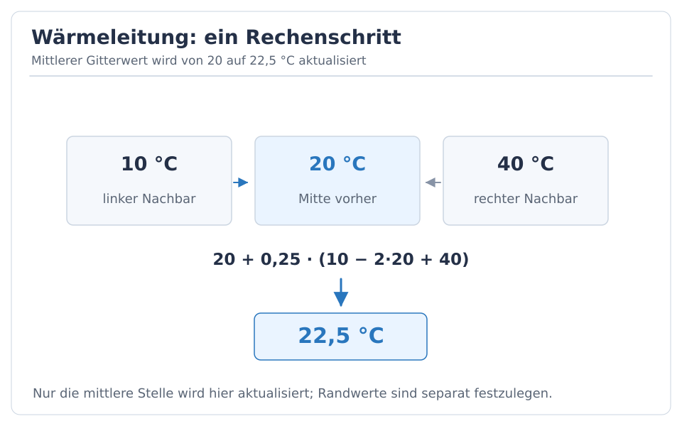

# M2-L8 – Partielle Differentialgleichungen: Wärme, Wellen und räumliche Prozesse {#L8}

**Kursbereich:** M2 – Bachelor-Vertiefung / Master-Übergang

**Niveau:** Bachelor / Master-Brücke

**Vorwissen:** Keine festen Voraussetzungen angegeben.

**Einordnung:** Universität – weiterführende Vertiefung

## Worum geht es? {#S1}

Eine gewöhnliche Differentialgleichung beschreibt beispielsweise, wie sich **eine Temperatur im Laufe der Zeit** ändert. Aber eine Metallstange besitzt gleichzeitig viele Stellen, und jede Stelle kann eine andere Temperatur haben. Wärme verteilt sich deshalb **über Ort und Zeit**. Ähnlich verhält es sich mit einer schwingenden Saite, der Ausbreitung von Schall oder einer Flüssigkeitsströmung. **Partielle Differentialgleichungen** (kurz: PDE, vom englischen *partial differential equation*) verbinden die Veränderungen in verschiedenen Raumrichtungen mit der zeitlichen Entwicklung.

Diese Lektion baut auf M1-L4 (partielle Ableitungen), M1-L9 (gewöhnliche Differentialgleichungen), M2-L6 (räumliche Geometrie) und M2-L7 (Funktionenräume) auf. Wir lernen die grundlegende Symbolsprache und drei typische Modellklassen kennen – nicht das vollständige Beweissystem der PDE-Theorie.

## Grundidee und Anschauung {#S2}

Stell dir eine lange dünne Metallstange vor. Links ist sie kühl, rechts warm. Im Inneren wird Wärme von wärmeren zu kälteren Nachbarbereichen übertragen. Die Temperatur an einer festen Stelle kann sich ändern, obwohl niemand diese Stelle direkt berührt. Entscheidend ist vielmehr, wie die Temperatur **in der Umgebung verteilt** ist.

Eine PDE fragt daher nicht nur „Wie schnell ändert sich der Wert?“ wie in M1-L9, sondern zusätzlich: „Wie beeinflussen die räumlichen Unterschiede die Änderung?“ Ein räumliches Temperaturfeld, ein Schallfeld oder ein Druckfeld wird als Funktion **mehrerer Eingabegrößen** beschrieben.

## Neue Zeichen vor der ersten Formel {#S3}

  Zeichen                                 Aussprache                                        Bedeutung hier                                              Anderer möglicher Gebrauch
  --------------------------------------- ------------------------------------------------- ----------------------------------------------------------- -------------------------------------------------------
  $u(x,t)$                                „u von iks und te“                                Temperatur oder andere Zustandsgröße am Ort x zur Zeit t    u als allgemeine Variable
  $x$                                     „iks“                                             Position auf einer eindimensionalen Stange                  unbekannte Zahl
  $y$                                     „ypsilon“                                         zweite Ortskoordinate bei einem ebenen Feld                 andere Variable
  $r$                                     „er“                                              dimensionsloser Zeitfaktor im numerischen Gitterschritt     Radius in M2-L6
  $t$                                     „te“                                              Zeit                                                        allgemeiner Parameter
  $\partial$                              „partielles de“                                   Ableitung nach einer Variablen bei Festhalten der anderen   aus M1-L4
  $\frac{\partial u}{\partial t}$         „partielle Ableitung von u nach te“               zeitliche Änderungsrate                                     andere Zustandsvariablen analog
  $\frac{\partial^{2}u}{\partial x^{2}}$  „zweite partielle Ableitung von u nach iks“       räumliche Krümmung des Temperaturverlaufs                   zweite Ableitungen in anderen Kontexten
  $\alpha$                                „Alpha“                                           Wärmeleit-Diffusivität (Temperaturausgleich)                in M2-L2 Schrittweite
  $c$                                     „ce“                                              Ausbreitungsgeschwindigkeit einer Welle                     beliebige Konstante
  $\Delta x$, $\Delta t$                  „Delta iks“, „Delta te“                           endliche Abstands- und Zeitschritte eines Rechengitters     Änderung allgemein
  $i$, $n$                                „Index i“, „Index enn“                            Orts- und Zeitindex eines diskreten Gitters                 i in M2-L5 imaginäre Einheit
  $u_i^n$                                 „u Index i hoch enn“                              numerischer Wert am Ort i zum Zeitschritt n                 hochgestelltes n ist hier ein **Index**, keine Potenz
  $\nabla^{2}u$                           „Nabla Quadrat u“ oder „Laplace-Operator auf u“   Summe der zweiten räumlichen Ableitungen                    nicht das Quadrat einer Zahl
  $k$, $\omega$                           „ka“, „Omega“                                     Wellenzahl und Kreisfrequenz eines Schwingungsbeispiels     allgemeine Modellparameter
  $\lambda$                               „Lambda“                                          Wellenlänge im Schwingungsbeispiel                          Eigenwert oder andere Variable

## Wärmeleitung: Änderungen durch Nachbarschaft {#S4}

Die **eindimensionale Wärmeleitungsgleichung** kann bei konstanten Materialeigenschaften so geschrieben werden:

$$
\frac{\partial u}{\partial t}=\alpha\frac{\partial^2u}{\partial x^2}
$$

**Gesprochen:** „Die partielle Ableitung von u nach der Zeit te ist gleich Alpha mal der zweiten partiellen Ableitung von u nach dem Ort iks.“ In Alltagssprache: Die Temperaturänderung hängt davon ab, wie stark sich der räumliche Temperaturverlauf an diesem Ort **krümmt**.

Wenn die Temperatur an einer Stelle tiefer ist als in ihrer direkten Umgebung, ist der Temperaturverlauf dort nach oben gekrümmt: Die Stelle erwärmt sich. Bei einem lokalen Temperaturberg ist die Krümmung nach unten gerichtet: Die Stelle kühlt sich ab.

$\alpha$ ist eine **positive** Materialgröße mit der Einheit Fläche pro Zeit, etwa Quadratmeter pro Sekunde. Sie wird *thermische Diffusivität* genannt. Eine größere Diffusivität bedeutet in diesem Modell einen rascheren räumlichen Temperaturausgleich. Das Modell setzt eine dünne Stange, geeignete Randbedingungen, konstante Materialeigenschaften und keine inneren Wärmequellen voraus; andernfalls entstehen zusätzliche Terme.

## Anfangswerte und Randwerte: Eine Gleichung allein genügt nicht {#S5}

Die Wärmegleichung beschreibt eine *Regel*, aber noch keinen eindeutigen Temperaturverlauf. Wir müssen zusätzlich wissen, **wie warm die Stange zu Beginn war** und was an den **Rändern** geschieht.

Eine Anfangsbedingung könnte besagen, dass die Temperatur am Anfang an jedem Ort bekannt ist. An den Enden kann beispielsweise eine feste Temperatur vorgegeben sein (*Dirichlet-Randbedingung*) oder ein vorgegebener Wärmestrom (*Neumann-Randbedingung*). Ein isoliertes Ende entspricht in einem einfachen Modell einem verschwindenden Wärmefluss.

**Mini-Beispiel der Bedeutung:** Zwei Stangen aus demselben Material gehorchen derselben Wärmeleitungsgleichung. Wenn eine Stange anfangs überall heiß und die andere nur an einem Ende heiß ist, entwickeln sie sich unterschiedlich. Auch eine an den Enden aktiv gekühlte Stange verhält sich anders als eine isolierte. Erst **Gleichung, Anfangswerte und Randbedingungen zusammen** definieren das konkrete Modell.

## Wellen: Ausbreitung statt bloßem Ausgleich {#S6}

Die Wärmegleichung glättet Temperaturunterschiede. Eine gespannte Saite oder eine Schallwelle kann dagegen **schwingen** und ihre Bewegung über den Raum weitergeben. Ein einfaches Modell ist die eindimensionale Wellengleichung:

$$
\frac{\partial^2u}{\partial t^2}=c^2\frac{\partial^2u}{\partial x^2}
$$

**Gesprochen:** „Die zweite partielle Ableitung von u nach der Zeit te ist gleich ce zum Quadrat mal der zweiten partiellen Ableitung von u nach dem Ort iks.“ Die zweite zeitliche Ableitung entspricht bei einer Auslenkung einer Beschleunigung; $c$ ist die Ausbreitungsgeschwindigkeit.

Bei einer idealisierten schwingenden Saite beschreibt $u(x,t)$ die Auslenkung. Für eine konkrete Lösung benötigt man typischerweise sowohl die **anfängliche Auslenkung** als auch die **anfängliche Geschwindigkeit** der Saite, dazu geeignete Randbedingungen.

**Überprüfbares Wellenbeispiel:** Eine wandernde Sinuswelle $u(x,t)=\sin(kx-\omega t)$ erfüllt die Wellengleichung, wenn $\omega^{2}=c^{2}k^{2}$. Denn $\frac{\partial^{2}u}{\partial t^{2}}=-\omega^{2}\sin(kx-\omega t)$ und $\frac{\partial^{2}u}{\partial x^{2}}=-k^{2}\sin(kx-\omega t)$. Bei einer Welle mit Wellenlänge $\lambda>0$ ist die Wellenzahl $k=\frac{2\pi}{\lambda}$. Für $k>0$, $\omega>0$ folgt die Geschwindigkeit $c=\frac{\omega}{k}$. Diese Rechnung betrifft eine ideale Welle ohne Randreflexionen oder Dämpfung.

Wärme- und Wellengleichung besitzen sehr unterschiedliche Lösungsverhalten. Eine Schwingung kann Informationen über eine Strecke transportieren, während Wärmeverteilung in diesem idealisierten Modell zum Ausgleich neigt. In realen Materialien können zusätzlich Dämpfung, Reibung, ungleichmäßige Eigenschaften oder nichtlineare Effekte auftreten.

## Stationärer Zustand: Die Laplace-Gleichung {#S7}

Manchmal interessiert uns nicht der zeitliche Übergang, sondern nur ein Gleichgewichtszustand. Wenn die Temperatur **zeitlich konstant** geworden ist und im Gebiet keine Wärmequellen liegen, verschwindet die zeitliche Änderungsrate der Wärmegleichung.

In einer Ebene mit zwei Ortsrichtungen entsteht die **Laplace-Gleichung**:

$$
\frac{\partial^2u}{\partial x^2}+\frac{\partial^2u}{\partial y^2}=0
$$

**Gesprochen:** „Die zweite partielle Ableitung von u nach iks plus die zweite partielle Ableitung nach ypsilon ist gleich null.“ Hier ist $y$ („ypsilon“) die zweite Ortskoordinate, nicht eine Ausgabefunktion. Die Summe dieser beiden zweiten Ableitungen heißt *Laplace-Operator*, oft mit $\nabla^{2}u$ abgekürzt.

Bei Wärmeleitung ist dies ein Modell für eine stationäre räumliche Temperaturverteilung. Die gleiche mathematische Grundform taucht mit anderen physikalischen Bedeutungen auch bei Potentialfeldern auf. Um eine bestimmte Lösung zu erhalten, benötigt man wiederum Randbedingungen.

## Wie ein Computer eine PDE näherungsweise löst {#S8}

Für die meisten interessanten Geometrien und Randbedingungen existiert keine einfache geschlossene Formel. Computer ersetzen deshalb kontinuierliche Räume durch **Gitterpunkte** und kontinuierliche Zeit durch **kleine Zeitschritte**.

Wir konzentrieren uns auf die innere Stelle eines gleichmäßig unterteilten Stabes. Die räumliche zweite Ableitung lässt sich näherungsweise durch die Nachbarwerte ausdrücken:

$$
\frac{\partial^2u}{\partial x^2}\approx\frac{u_{\mathrm{links}}-2u_{\mathrm{Mitte}}+u_{\mathrm{rechts}}}{{(\Delta x)}^2}
$$

**Gesprochen:** „Die zweite räumliche Ableitung ist ungefähr linker Wert minus zweimal mittlerer Wert plus rechter Wert, geteilt durch das Quadrat des räumlichen Gitterabstands.“ Diese zentrale Differenzenformel approximiert bei viermal stetig differenzierbaren Funktionen die zweite Ableitung mit einem räumlichen Fehler der Ordnung ${(\Delta x)}^{2}$, solange wir uns im Inneren eines gleichmäßigen Gitters befinden. An Rändern müssen die vorgegebenen Randbedingungen gesondert berücksichtigt werden.

Mit dem **expliziten Euler-Verfahren** (M1-L9) wird aus der Wärmegleichung eine Vorschrift für den nächsten Zeitwert:

$$
\begin{aligned}
u_{\mathrm{neu}}&=u_{\mathrm{Mitte}}+r\cdot(u_{\mathrm{links}}-2\cdot u_{\mathrm{Mitte}}+u_{\mathrm{rechts}})\\
r&=\frac{\alpha\cdot\Delta t}{{(\Delta x)}^2}
\end{aligned}
$$

**Gesprochen:** „Der neue Temperaturwert ist der bisherige Mittelwert der betrachteten Stelle plus er mal der diskreten räumlichen Krümmung.“ Hier ist $r$ nur der **dimensionslose Rechenfaktor** aus Materialwert, Zeitschritt und räumlichem Gitterabstand; er ist nicht der Radius aus M2-L6.

### Vollständig erklärtes Mini-Beispiel: Ein Simulationsschritt {#abschnitt-9}

Drei benachbarte Gitterstellen besitzen momentan die Werte $10\,{}^{\text{°}}\mathrm{C}$, $20\,{}^{\text{°}}\mathrm{C}$ und $40\,{}^{\text{°}}\mathrm{C}$. Wir betrachten ausschließlich die mittlere Stelle. Nehmen wir einen Gitterabstand von **einem Zentimeter**, einen Zeitschritt von **einer Sekunde** und eine thermische Diffusivität von **0,25 Quadratzentimetern pro Sekunde**. Daraus ergibt sich $r=0{,}25$.

{alt="Drei benachbarte Gitterstellen 10, 20 und 40 Grad Celsius. Mit r gleich 0,25 steigt der mittlere Wert nach einem expliziten Wärmeleitungsschritt auf 22,5 Grad Celsius."}

Ein einzelner expliziter Rechenschritt des eindimensionalen Wärmeleitungsmodells.

$$
\begin{aligned}
u_{\mathrm{neu}}&=20+0{,}25\cdot(10-2\cdot20+40)\\
&=20+0{,}25\cdot10\\
&=22{,}5\,{}^{\text{°}}\mathrm{C}
\end{aligned}
$$

**Gesprochen:** „Neuer Wert gleich zwanzig plus null Komma fünfundzwanzig mal zehn minus vierzig plus vierzig, also zweiundzwanzig Komma fünf Grad Celsius.“ Der warme rechte Nachbar zieht den mittleren Temperaturwert in dieser Modellrechnung etwas nach oben. Das Ergebnis gilt **nur für diesen Gitterpunkt und genau einen Rechenschritt**; die beiden Randwerte müssen im vollständigen Modell ebenfalls durch ihre Gleichungen oder Randbedingungen bestimmt werden.

### Warum die Schrittweite wichtig ist {#abschnitt-10}

Für die einfache **eindimensionale** Wärmegleichung mit konstantem $\alpha$, gleichmäßigem Gitter und diesem expliziten Euler-Schema lautet eine grundlegende Stabilitätsbedingung:

$$
0<r\leq\frac12
$$

**Gesprochen:** „Er ist größer als null und höchstens ein Halb.“ Die Stabilitätsgrenze lässt sich hier direkt an den Gewichten erkennen:

$$
u_{\mathrm{neu}}=r\,u_{\mathrm{links}}+(1-2r)\,u_{\mathrm{Mitte}}+r\,u_{\mathrm{rechts}}
$$

Für $0\leq r\leq\frac12$ sind alle drei Gewichte nichtnegativ und ihre Summe ist eins. Der neue Wert liegt daher zwischen Minimum und Maximum der drei bisherigen Werte: eine diskrete Form des Wärmeausgleichs. Bei $r=\frac34$ wird der mittlere Koeffizient $1-2r=-\frac12$ negativ. So liefert $u_{\mathrm{links}}=0$, $u_{\mathrm{Mitte}}=1$, $u_{\mathrm{rechts}}=0$ den neuen Wert $-0{,}5$, außerhalb der bisherigen Spanne von null bis eins. Für die alternierende Gitterstörung ändert sich die Amplitude sogar pro Zeitschritt um den Faktor $1-4r=-2$; ihr Betrag verdoppelt sich. Das erklärt eine Instabilität für solche Moden und das konkrete Schema.

Wird der Zeitschritt zu groß, kann die numerische Lösung unphysikalisch schwanken oder anwachsen, obwohl die echte Wärmeleitung ausgleichend wirkt. Die Bedingung ist **kein universelles Gesetz für jede PDE**: In mehreren Raumdimensionen und bei anderen numerischen Verfahren ändern sich die Stabilitätsanforderungen. Stabilität allein garantiert außerdem keine ausreichende Genauigkeit. Für einen **zweidimensionalen** gleichmäßig gerasterten Fall mit demselben Raumabstand in beiden Richtungen und explizitem Euler-Verfahren gilt beispielsweise die strengere Grenze $\frac{\alpha\Delta t}{{(\Delta x)}^{2}}\leq\frac14$ (konstantes $\alpha$, Standard-Fünfpunktestencil).

## Wofür ist das nützlich? {#S9}

- **Technische Simulation:** Wärmeverteilung in Elektronik, Gebäuden oder Bauteilen, Wellen in elastischen Materialien und Flüssigkeitsströmungen lassen sich mit geeigneten PDE-Modellen beschreiben.
- **Audio und Bildverarbeitung:** Wellengleichungen modellieren Schwingungen; diffusionartige Verfahren können Bilder glätten, wobei Details verloren gehen können.
- **Robotik:** Physikalische Felder, deformierbare Materialien und Strömungen können eine Rolle bei Planung und Simulation spielen.
- **Numerische Software und KI:** Finite-Differenzen-, Finite-Elemente- und Spektralverfahren lösen räumliche Modelle näherungsweise; neuronale Netze können unter besonderen Voraussetzungen solche Näherungen ergänzen, ersetzen aber keine Prüfung der physikalischen Modellgüte.

## Annahmen, Grenzen und typische Fehlinterpretationen {#S10}

- PDE ist **eine Klasse von Gleichungen**, nicht ein einzelner Algorithmus. Wärme-, Wellen- und Strömungsgleichungen haben unterschiedliche Lösungsregeln.
- Ohne Anfangs- und Randbedingungen ist ein konkretes Anfangs-/Randwertproblem normalerweise nicht ausreichend festgelegt.
- Eine numerische Lösung ist eine **Näherung**. Ergebnisqualität hängt von Gitter, Zeitschritt, Randbehandlung, Rundung und Modellannahmen ab.
- Die explizite Stabilitätsbedingung $r\leq\frac12$ gilt für die einfache eindimensionale Diskretisierung unter den oben genannten Voraussetzungen; sie ist nicht auf beliebige Gleichungen oder numerische Verfahren übertragbar. Bei großen Zeitschritten können sogar Werte außerhalb der bisherigen Temperaturspanne entstehen.
- Bei Ecken, Sprüngen und komplizierten Gebieten müssen Ableitungen und Lösungen unter Umständen in einem **schwächeren Sinn** interpretiert werden. Hier knüpft die Funktionalanalysis von M2-L7 an.
- Eine mathematisch plausible Gleichung beweist nicht, dass sie die reale Physik mit der erforderlichen Genauigkeit trifft. Materialparameter und Messdaten müssen zum Modell passen.

## Verbindung zur nächsten Lektion {#S11}

M2-L9 untersucht **Fourier-Analysis und Signalverarbeitung**. Das ist keine zufällige Nachbarschaft: Viele lineare Wärme- und Wellenmodelle lassen sich mithilfe von Sinus-, Kosinus- oder Fourier-Darstellungen besonders verständlich untersuchen.

## Optionaler Vertiefungsausblick {#S12}

Schwache Lösungen, Sobolev-Räume, Variationsformulierungen, Finite-Elemente-Verfahren, Erhaltungsgleichungen und nichtlineare PDEs wie Navier-Stokes gehören zum weiterführenden Fachgebiet. Die aktuelle Lektion vermittelt ihre grundlegende Problemstellung und Formelsprache, nicht die volle mathematische Theorie.

## Quellen {#S13}

In dieser Lektion sind keine Einzelquellen gesondert verzeichnet.
