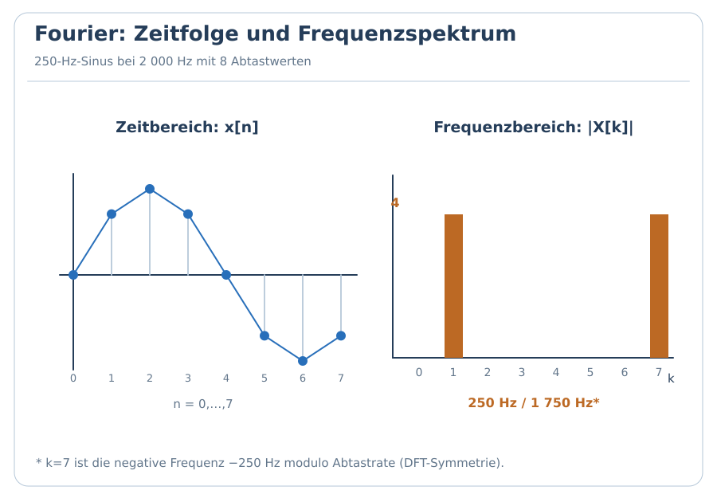

# M2-L9 – Fourier-Analysis und Signalverarbeitung {#L9}

**Kursbereich:** M2 – Bachelor-Vertiefung / Master-Übergang

**Niveau:** Bachelor / Master-Brücke

**Vorwissen:** Keine festen Voraussetzungen angegeben.

**Einordnung:** Universität – weiterführende Vertiefung

## Worum geht es? {#S1}

Ein Schallsignal sieht in einer Zeitdarstellung oft wie eine unübersichtliche Wellenlinie aus. Trotzdem können darin mehrere unterscheidbare Töne stecken. Die Fourier-Analysis betrachtet dasselbe Signal aus einer anderen Perspektive: nicht nur **welcher Wert wann**, sondern **welche Frequenzen mit welchen Stärken und Phasen** beteiligt sind. Das ist eine andere Beschreibung derselben Information und die Grundlage vieler Filter-, Kompressions- und Analyseverfahren. Wir lernen die wichtigsten Zeichen und die diskrete Berechnung kennen, ohne den gesamten mathematischen Beweisapparat vorwegzunehmen.

Diese Lektion baut auf Schule M1-L20 (Sinus und Periode), M2-L5 (komplexe Zahlen) sowie M1-L8 (numerische Berechnungen) auf.

## Grundidee und Anschauung {#S2}

Denk an ein Musikstück mit einem tiefen und einem hohen Ton. Im zeitlichen Verlauf überlagern sich ihre Schwingungen. Ein Frequenzspektrum stellt stattdessen die Anteile der beteiligten Schwingungen nebeneinander. So wird aus einer langen, scheinbar unübersichtlichen Folge von Messpunkten eine Art **Inhaltsverzeichnis der Frequenzen**.

Eine reine Sinusschwingung besitzt genau eine Frequenz. Ein kurzes Klickgeräusch verteilt seine Energie dagegen auf viele Frequenzen. Mit der Fourier-Analyse lässt sich erkennen, welche Frequenzbereiche ein Messsignal enthält – nicht automatisch, was die Ursache des Signals ist.

## Neue Zeichen vor der ersten Formel {#S3}

  Zeichen         Aussprache                        Bedeutung hier                                                                 Anderer möglicher Gebrauch
  --------------- --------------------------------- ------------------------------------------------------------------------------ -------------------------------------------------
  $x(t)$          „iks von te“                      Signalwert zur Zeit $t$                                                        Ort einer Bewegung in anderen Modellen
  $A$             „a“                               Amplitude, die maximale Auslenkung einer reinen Sinusschwingung                Ereignismenge in der Stochastik
  $f$             „eff“                             Frequenz in Hertz, Schwingungen pro Sekunde                                    Funktionsname in früheren Lektionen
  $t$             „te“                              Zeit in Sekunden                                                               allgemeiner Parameter
  $\varphi$       „Phi“                             Phasenwinkel, Verschiebung der Schwingung                                      freier Parameter in anderen Gebieten
  $\sin$, $\cos$  „Sinus“, „Kosinus“                periodische trigonometrische Funktionen; Kosinus für die Aliasing-Gegenprobe   –
  $\pi$           „Pi“                              Kreiszahl, ungefähr 3,14159                                                    –
  $T$             „te groß“                         Periodendauer in Sekunden                                                      Temperatur in physikalischen Modellen
  $f_{s}$         „eff Index es“                    Abtastrate, Anzahl Messwerte pro Sekunde                                       Index $s$ in anderen Zusammenhängen
  $x[n]$          „iks Index enn“                   n-ter gespeicherter Abtastwert                                                 eckige Klammern auch für Listen oder Intervalle
  $N$             „enn groß“                        Anzahl Werte eines betrachteten Signalblocks                                   Anzahl Versuche in Statistik
  $n$, $k$        „enn“, „ka“                       Messwert- bzw. Frequenzindex; beginnen hier mit null                           beliebige Zählvariablen
  `Σ`             „großes Sigma“, Summenzeichen     viele Summanden addieren                                                       –
  $X[k]$          „iks groß, Index ka“              komplexer Fourier-Koeffizient für Frequenzindex $k$                            Menge X in der Mengenlehre
  $e$             „Eulersche Zahl“                  Basis der Exponentialfunktion                                                  neutrales Gruppenelement in M2-L3
  $i$             „i“                               imaginäre Einheit mit $i^{2} = -1$                                             Schleifenindex in Programmen
  $|X[k]|$        „Betrag von iks groß, Index ka“   Stärke des komplexen Koeffizienten                                             Betrag oder Mächtigkeit einer Menge
  `FFT`           „eff eff te“                      schneller Rechenalgorithmus für die diskrete Fourier-Transformation            keine neue mathematische Transformation

## Frequenz, Periode und Phase {#S4}

Für eine einfache Sinusschwingung gilt:

$$
\begin{aligned}
x(t)&=A\cdot\sin(2\pi\cdot f\cdot t+\varphi)\\
T&=\frac1f\quad\text{(für }f>0\text{)}
\end{aligned}
$$

**Laut gelesen, erste Formel:** „Der Signalwert iks zur Zeit te ist gleich Amplitude a mal dem Sinus aus zwei Pi mal Frequenz eff mal Zeit te plus Phi.“ Das Innere des Sinus beschreibt den fortschreitenden Winkel der Schwingung. $\varphi$ verschiebt den zeitlichen Startpunkt, $A$ verändert die Höhe der Welle und $f$ die Anzahl der Wellen pro Sekunde.

**Zweite Formel gesprochen:** „Die Periodendauer te groß ist eins geteilt durch die Frequenz eff.“ Bei 250 Hertz dauert eine Schwingung $\frac{1}{250}$ Sekunden, also $0{,}004$ Sekunden oder vier Millisekunden. Das gilt für die reine periodische Schwingung mit $f > 0$.

Ein kompliziertes Signal lässt sich unter geeigneten Voraussetzungen als Überlagerung solcher sinusförmigen Schwingungen darstellen. **Fourier-Reihe** heißt das insbesondere bei periodischen Signalen; **Fourier-Transformation** wird für allgemeinere nichtperiodische Signale verwendet. Die genauen Voraussetzungen und die mathematische Bedeutung des „Integrals über alle Frequenzen“ sind Teil vertiefter Analysis.

## Vom kontinuierlichen zum digitalen Signal {#S5}

Ein Computer erhält gewöhnlich nicht jeden denkbaren Zeitpunkt, sondern eine Folge diskreter Messwerte. Bei einer Abtastrate von $2\,000$ Hertz entstehen $2\,000$ Werte pro Sekunde. In dieser Lektion nummerieren wir sie mit $n = 0, 1, 2, \ldots$.

Die entsprechenden Abtastzeitpunkte lauten:

$$
\begin{aligned}
t_n&=\frac{n}{f_s}\\
x[n]&=x(t_n)
\end{aligned}
$$

**Gesprochen:** „Der n-te Abtastzeitpunkt ist n geteilt durch die Abtastrate. Der gespeicherte Wert mit Index n ist der Signalwert an diesem Zeitpunkt.“ $t_{n}$ bedeutet ein Zeitpunkt mit Index n, nicht $t$ hoch n.

Beim **Abtasten** geht Information möglicherweise unwiederbringlich verloren. Für ein ideal bandbegrenztes Signal muss die Abtastrate zur eindeutigen Rekonstruktion **größer als das Doppelte seiner höchsten enthaltenen Frequenz** sein. In der Praxis sind außerdem geeignete Vorfilter und reale Messbedingungen entscheidend. Das zugehörige Stichwort lautet *Nyquist-Shannon-Abtasttheorem*. Die Bandbegrenzung und eine idealisierte Rekonstruktion sind entscheidend: Die Kurzregel $f_{s} > 2\cdot f_{\max}$ ist keine Garantie für jedes beliebige, rauschende oder zeitlich begrenzte Messsignal.

**Konkrete Aliasing-Gegenprobe:** Wir messen eine Kosinusschwingung mit $250\,\mathrm{Hz}$ bei $2\,000$ Messwerten pro Sekunde. Eine zweite Kosinusschwingung mit $1\,750\,\mathrm{Hz}$ liefert **an jedem ganzzahligen Abtastindex n dieselben Werte**, obwohl die kontinuierlichen Töne verschieden sind:

$$
\cos\left(\frac{2\pi\cdot250\cdot n}{2000}\right)=\cos\left(\frac{2\pi\cdot1750\cdot n}{2000}\right)\qquad\text{für }n\in\mathbb{Z}
$$

**Lesart:** Beim Abtasten kann die höhere Frequenz $1\,750\,\mathrm{Hz}$ wie $250\,\mathrm{Hz}$ aussehen. Denn $\frac{1\,750}{2\,000}=1-\frac{250}{2\,000}$, und der Kosinus bleibt bei einer ganzzahligen Umdrehung und Vorzeichenumkehr des Winkels gleich. Die Nyquist-Frequenz beträgt hier $1\,000\,\mathrm{Hz}$. Das Beispiel führt weder eine neue physikalische Ursache noch ein neues Signal aus den Messdaten her, sondern macht die Mehrdeutigkeit ausdrücklich sichtbar.

## Die diskrete Fourier-Transformation (DFT) {#S6}

Bei einer gespeicherten Folge von $N$ Werten fasst die diskrete Fourier-Transformation (DFT) den Anteil einzelner Frequenzklassen zusammen. Die zentrale Formel lautet:

$$
X[k]=\sum_{n=0}^{N-1}x[n]\,e^{-2\pi i k n/N}
$$

**Vollständig gesprochen:** „Der Fourier-Koeffizient iks groß mit Index ka ist die Summe über alle Messwertindizes enn von null bis enn groß minus eins. Jeder Messwert iks mit Index enn wird mit einer komplexen Drehung multipliziert. Der Drehwinkel hängt von ka, enn und der Blocklänge enn groß ab.“

`Σ` ist das Summenzeichen; unten steht der erste Index, oben der letzte. Der Ausdruck `e^(...)` ist die komplexe Exponentialfunktion aus M2-L5. Das Minuszeichen im Exponenten gehört zur hier verwendeten **Vorwärtstransformations-Konvention**. Andere Normierungskonventionen sind möglich. $X[k]$ ist im Allgemeinen **komplex** und enthält sowohl einen Betrag als auch eine Phase; sein Betrag allein ist noch keine allgemein normierte physikalische Signalamplitude.

Ein DFT-Index entspricht der Frequenz

$$
f_k=\frac{k\,f_s}{N}
$$

**Gesprochen:** „Die Frequenz zum Index ka ist ka mal Abtastrate geteilt durch die Anzahl der Messwerte.“ Die Frequenzabstände sind $\frac{f_s}{N}$. Bei einem reellen Signal stehen die oberen DFT-Indizes für negative Frequenzen in zyklischer Schreibweise; man darf sie nicht unbesehen als zusätzliche unabhängige positive Töne interpretieren.

## Vollständig erklärtes Mini-Beispiel: ein digitaler Ton {#S7}

Ein reiner Ton mit $f = 250\,\mathrm{Hz}$ und $A = 1$ wird mit $f_{s} = 2\,000\,\mathrm{Hz}$ abgetastet. Für einen Block mit $N = 8$ ergeben sich die Abtastwerte:

{alt="Acht Sinus-Abtastwerte mit Frequenz 250 Hz bei 2 000 Hz Abtastrate und die Beträge ihrer Fourier-Transformation. Nur die DFT-Bins 1 und 7 sind ungleich null, jeweils Betrag 4."}

DFT-Beispiel: Eine 250-Hz-Schwingung erscheint bei $k=1$ und gespiegelt bei $k=7$.

  Messindex $n$   Zeitpunkt in Millisekunden   Signalwert $x[n]$ (gerundet)
  --------------- ---------------------------- ------------------------------
  0               0,0                          0,000
  1               0,5                          0,707
  2               1,0                          1,000
  3               1,5                          0,707
  4               2,0                          0,000
  5               2,5                          −0,707
  6               3,0                          −1,000
  7               3,5                          −0,707

Der nächste Abtastzeitpunkt nach diesen acht Werten liegt wieder am Beginn einer neuen Periode. Die gesamte Beobachtungsdauer des Blocks beträgt $\frac{8}{2\,000}=0{,}004$ Sekunden. Daraus folgt ein DFT-Abstand von $\frac{2\,000}{8}=250\,\mathrm{Hz}$. Der Ton liegt genau auf dem ersten positiven Frequenzrasterpunkt, also $k = 1$.

Mit der obigen DFT-Konvention ergibt sich für die **exakten**, ungerundeten Sinuswerte $X[1] = -4i$ und der symmetrische Koeffizient $X[7] = +4i$; die übrigen Koeffizienten sind null bis auf numerische Rundungsreste. Für diesen reinen reellen Sinus ist die Amplitude aus dem positiven Koeffizienten $\frac{2\cdot|X[1]|}{N}=\frac{2\cdot4}{8}=1$ zurückgewinnbar. **Diese einfache Amplitudenformel** braucht unter anderem den hier passenden Frequenzrasterpunkt und darf nicht unverändert auf beliebige Signale angewandt werden.

Das Beispiel zeigt: Eine zeitliche Acht-Punkte-Folge besitzt eine andere Darstellung als ein Paar komplexer Frequenzanteile mit symmetrischen Indizes. Kein Ton wurde neu erschaffen; die Information wurde umgeschrieben.

## FFT, Filter, Fenster und Zeit-Frequenz-Kompromiss {#S8}

Die **Fast Fourier Transform (FFT)** ist keine andere mathematische Größe als die DFT, sondern eine Familie effizienter Algorithmen, die dieselben DFT-Koeffizienten bis auf Rundungsfehler berechnen. Bei passenden Blocklängen benötigt eine klassische FFT ungefähr $N\cdot \log_2(N)$ statt $N^{2}$ Operationen in der Größenordnung. $\log_2$ bezeichnet den Logarithmus zur Basis zwei; die genaue Laufzeit hängt von Implementierung und Blocklänge ab.

Ein Filter kann Frequenzanteile abschwächen oder verstärken. Bei einem linearen zeitinvarianten Filter hängt das Ausgangsspektrum mit dem Eingangsspektrum und der Frequenzantwort zusammen. Das heißt **nicht**, dass ein Filter jede Störung sauber vom Nutzsignal trennen kann: Überlappen die Frequenzen, bleiben Grenzen.

Eine endliche Messung schneidet den Zeitverlauf ab. Liegt eine Schwingung nicht genau auf den DFT-Rasterpunkten, kann ihre Energie in benachbarte Frequenzstellen „auslaufen“: **Spektralleckage**. Eine Fensterfunktion kann dieses Verhalten verändern, ist aber ein Kompromiss zwischen Nebenkeulen und Frequenzauflösung. **Nullauffüllen (Zero-Padding)** ergänzt rechnerisch weitere Frequenzrasterpunkte, verfeinert aber nicht die tatsächliche Trennschärfe, die durch die vorhandene Messdauer begrenzt bleibt. Kurze Fenster erkennen schnelle zeitliche Wechsel, lange Fenster trennen nahe Frequenzen besser. Für ein zeitlich wechselndes Signal nutzt man deshalb häufig kurze überlappende Fourier-Fenster (*Kurzzeit-Fourier-Transformation, STFT*).

## Wofür nützlich? {#S9}

Bei Audio lassen sich Tonhöhen, Störgeräusche und zeitliche Frequenzmuster untersuchen. Bei Bildern führt die zweidimensionale Fourier-Transformation zu räumlichen Frequenzen, also zu Größenordnungen von Mustern und Kanten. In der Robotik helfen Frequenzanalysen, Vibrationen und periodische Sensormuster zu erkennen; in Software dienen FFT-Verfahren zur effizienten Faltung und zum Filtern langer Signale. Auch viele KI-Modelle benutzen spektrale Merkmale statt nur Rohdaten.

## Annahmen und Grenzen {#S10}

Die Fourier-Zerlegung ist eine mathematische Darstellung, **keine automatische Bedeutungs- oder Ursachenerkennung**. Die DFT behandelt den untersuchten endlichen Werteblock mathematisch so, als werde er periodisch fortgesetzt; daraus können Rand- und Leckageeffekte entstehen. Digitale FFT-Ergebnisse hängen von Abtastrate, Messdauer, Fenster, DFT-Konvention und numerischer Genauigkeit ab. Oberhalb der Nyquist-Grenze können Frequenzen als andere Frequenzen erscheinen (*Aliasing*). Die Auswertung eines kurzen stationären Blocks eignet sich nicht ohne Weiteres für stark wechselnde Signale; dafür sind Zeit-Frequenz-Verfahren notwendig.

## Verbindung zur nächsten Einheit {#S11}

M2-L10 betrachtet die Information in digitalen Symbolfolgen: Wie viele Bits benötigt man mindestens, wie komprimiert man Daten und wie lassen sich Übertragungsfehler erkennen oder korrigieren?

## Fachliche Weiterführungsquelle (optional, online; nicht zum Offline-Lesen nötig) {#S12}

MIT OpenCourseWare, *Discrete-Time Signal Processing*, Vorlesungen zur DFT, FFT und Spektralanalyse: [https://www.ocw.mit.edu/courses/6-341-discrete-time-signal-processing-fall-2005/pages/lecture-notes/](https://www.ocw.mit.edu/courses/6-341-discrete-time-signal-processing-fall-2005/pages/lecture-notes/) (eingesehen 04.11.2026).

## Quellen (extern) {#S13}

- [MIT OpenCourseWare – Discrete-Time Signal Processing, Lecture Notes](https://www.ocw.mit.edu/courses/6-341-discrete-time-signal-processing-fall-2005/pages/lecture-notes/) · Thematischer Bezug zur Lektion: S8: FFT, Filter, Fenster und Zeit-Frequenz-Kompromiss (Übersichts-/Metadatenseite) · Zuletzt abgerufen: 2026-11-22
