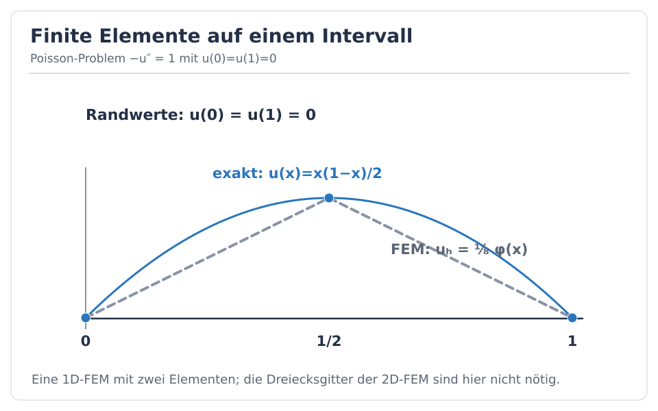

# M3-L3 – Master: Schwache Lösungen, Sobolev-Räume und Finite Elemente {#L3}

**Kursbereich:** M3 – Masterorientierte Vertiefungen

**Niveau:** Masterorientierung

**Vorwissen:** Keine festen Voraussetzungen angegeben.

**Einordnung:** Master-orientierte Vertiefung nach M1-L3, M1-L4, M1-L8, M2-L7, M2-L8 und M3-L2

## Worum geht es? {#S1}

Wärmeleitung, elastische Körper und viele technische Modelle werden durch partielle Differentialgleichungen beschrieben. Aber ihre Lösungen sind nicht immer so glatt, dass alle verlangten Ableitungen im klassischen Sinn existieren. Eine **schwache Formulierung** verschiebt einen Teil der Ableitungen durch Integration auf geeignete Testfunktionen. Dadurch werden Lösungen in größeren Funktionenräumen möglich und die Grundlage der **Finite-Elemente-Methode** geschaffen. Das ist eine der wichtigsten Brücken zwischen theoretischer Analysis und berechenbaren Simulationen.

## Grundidee und Anschauung {#S2}

Angenommen, ein Stab wird auf eine konstante Weise belastet und an seinen beiden Enden festgehalten. Ein einfaches eindimensionales Modell führt auf eine Differentialgleichung zweiter Ordnung. Die klassische Lösung muss zweimal differenzierbar sein. Wenn das Material oder die Belastung Unstetigkeiten besitzen, möchten wir die Gleichung dennoch sinnvoll ausdrücken. Statt an jedem Punkt zwei Ableitungen zu fordern, verlangen wir eine **Integralidentität für alle passenden Testfunktionen**.

## Neue Zeichen – zuerst lesen {#S3}

  Zeichen                  Laut gelesen                      Bedeutung hier                                                                 Nicht verwechseln mit
  ------------------------ --------------------------------- ------------------------------------------------------------------------------ --------------------------------------
  $u(x)$                   „u von x“                         gesuchte Lösung, z. B. Auslenkung                                              Eingangssignal in M2-L12
  $u'$, $u''$              „erste, zweite Ableitung von u“   räumliche Änderung und deren Änderung                                          Zeitableitung; Kontext angeben
  $v(x)$                   „ve von x“                        Testfunktion, mit der wir die Gleichung vergleichen                            einem Geschwindigkeitssymbol
  $\int_0^1$               „Integral von null bis eins“      Summe über das gesamte Stabintervall                                           einem Einzelpunktwert
  $H^{1}(0,1)$             „ha eins von null bis eins“       Funktionen mit quadratintegrierbarer Funktion und erster schwacher Ableitung   Hilbertraum H als Name
  $H_{0}^{1}(0,1)$         „ha null eins“                    Funktionen in $H^1$ mit Nullrandwerten im Spursinn                             der Nullhypothese $H_0$
  $u'_{\mathrm{schwach}}$  „schwache Ableitung“              Ableitung über Integrationsidentität festgelegt                                zwingend einer punktweisen Ableitung
  $a(u,v)$                 „a von u und v“                   bilineare Form der schwachen Gleichung                                         Fläche A
  $F(v)$                   „eff von ve“                      lineare rechte Seite als Funktional                                            Stammfunktion
  $J(u)$                   „jott von u“                      Energie, deren Minimum wir suchen                                              Jacobi-Matrix J
  $\varphi$                „Phi“                             einfache Form- oder Hutfunktion im Rechengitter                                einem Winkel
  $c$                      „zeh“                             Koeffizient der numerischen Näherung                                           Lichtgeschwindigkeit

Eine **schwache Ableitung** wird dadurch definiert, wie die Funktion unter dem Integral mit glatten Testfunktionen zusammenwirkt. Für $u\in L^{1}$ ist w eine schwache erste Ableitung, wenn für jede glatte Testfunktion $\varphi$ mit kompaktem Träger im Intervall gilt:

$$
\int u(x)\,\varphi'(x)\,\mathrm{d}x=-\int w(x)\,\varphi(x)\,\mathrm{d}x
$$

Gesprochen: „Das Integral von u mal der Ableitung von Phi ist minus das Integral der schwachen Ableitung w mal Phi.“ Die Randterme verschwinden, weil die Testfunktion an beiden Intervallrändern (und in deren Umgebung) null wird. Genauer nimmt man zunächst glatte Testfunktionen mit kompaktem Träger; der Übergang zum Raum $H_{0}^{1}$ erfolgt über Dichtheit und Stetigkeit. Bei klassisch differenzierbarem u stimmt w mit der gewöhnlichen Ableitung überein.

## Vom klassischen Randwertproblem zur schwachen Form {#S4}

Unser Modell ist:

$$
\begin{aligned}
-u''(x)&=1\quad\text{für }0<x<1\\
u(0)&=0,\quad u(1)=0
\end{aligned}
$$

Gesprochen: „Die negative zweite Ableitung der unbekannten Funktion u ist im offenen Intervall eins; an beiden Enden ist u null.“ Dies ist ein ideales eindimensionales Poisson-Problem. Die Belastung ist konstant und alle Längen sind hier dimensionslos; in einem physikalischen Stab müssten Materialparameter und Einheiten ergänzt werden.

Wir multiplizieren die Differentialgleichung mit einer Testfunktion v, die an beiden Enden null ist, und integrieren:

$$
\int_0^1(-u''(x))\,v(x)\,\mathrm{d}x=\int_0^1v(x)\,\mathrm{d}x
$$

Durch **partielle Integration** verschieben wir eine Ableitung von u auf v. Allgemein gilt $\int  u''v = [u'v] - \int u'v'$. Wegen $v(0)=v(1)=0$ verschwindet der Randterm. Daher erhalten wir:

$$
\int_0^1u'(x)\,v'(x)\,\mathrm{d}x=\int_0^1v(x)\,\mathrm{d}x
$$

Gesprochen: „Das Integral aus der ersten Ableitung von u mal der ersten Ableitung von v ist gleich dem Integral von v.“ **Dies ist die schwache Form.** Wir suchen u im Raum $H_{0}^{1}(0,1)$ und verlangen die Gleichheit für **jede** Testfunktion v aus demselben Raum. Es handelt sich nicht um eine einzelne Prüfgleichung, sondern um eine unendliche Familie von Identitäten.

## Die exakte Lösung und eine unabhängige Kontrolle {#S5}

Wir lösen das klassische Beispiel zunächst direkt. Aus $u''(x)=-1$ folgt nach zweimaligem Integrieren:

$$
\begin{aligned}
u'(x)&=-x+C_1\\
u(x)&=-\frac{x^2}{2}+C_1x+C_2
\end{aligned}
$$

Die Randbedingung bei null liefert $C_{2}=0$. Die Randbedingung bei eins liefert $-\frac12+C_1=0$, also $C_1=\frac12$. Damit ist:

$$
\begin{aligned}
u(x)&=\frac{x(1-x)}{2}\\
u'(x)&=\frac12-x\\
u''(x)&=-1
\end{aligned}
$$

Gesprochen: „Die Lösung ist x mal eins minus x, geteilt durch zwei.“ Sie ist glatt und erfüllt die klassische Gleichung einschließlich der Randbedingungen.

**Kontrolle der schwachen Gleichung:** Wähle als Beispiel-Testfunktion $v(x)=x(1-x)$. Dann ist $v'(x)=1-2x$. Wir berechnen die linke Seite:

$$
\begin{aligned}
\int_0^1u'v'\,\mathrm{d}x
&=\int_0^1\left(\frac12-x\right)(1-2x)\,\mathrm{d}x\\
&=\int_0^1\left(\frac12-2x+2x^2\right)\mathrm{d}x\\
&=\frac12-1+\frac23\\
&=\frac16
\end{aligned}
$$

Die rechte Seite lautet:

$$
\int_0^1v(x)\,\mathrm{d}x=\int_0^1(x-x^2)\,\mathrm{d}x=\frac12-\frac13=\frac16
$$

Beide Seiten stimmen überein. Das kontrolliert die Formel an **einer** Testfunktion; die Gültigkeit für alle Testfunktionen folgt aus der Herleitung durch partielle Integration. Ein einzelnes Zahlenbeispiel allein wäre dafür kein Beweis.

## Warum Sobolev-Räume gebraucht werden {#S6}

Ein Element von $H^{1}(0,1)$ besitzt eine quadratintegrierbare Funktion und eine quadratintegrierbare **schwache** erste Ableitung. Die Norm kombiniert beide Teile:

$$
\lVert u\rVert_{H^1}^2=\int_0^1\lvert u(x)\rvert^2\,\mathrm{d}x+\int_0^1\lvert u'(x)\rvert^2\,\mathrm{d}x
$$

Gesprochen: „Das Quadrat der ha-eins-Norm ist das Integral des Betragsquadrats von u plus das Integral des Betragsquadrats seiner schwachen Ableitung.“ $H_{0}^{1}$ ergänzt die Nullrandbedingung im präzisen Sinn der Spuroperation. Der größere Raum enthält auch nicht überall klassisch differenzierbare Funktionen.

Die schwache Gleichung hat die Form $a(u,v)=F(v)$ mit:

$$
\begin{aligned}
a(u,v)&=\int_0^1u'(x)v'(x)\,\mathrm{d}x\\
F(v)&=\int_0^1v(x)\,\mathrm{d}x
\end{aligned}
$$

Gesprochen: „a ist die bilineare Form, F die lineare Belastungsgröße.“ **Lax-Milgram** sichert für geeignete Hilberträume die eindeutige Lösbarkeit, wenn a beschränkt und koerziv ist und F stetig linear. Für unseren Raum liefert die Poincaré-Ungleichung die Koerzivität der Ableitungsform bezüglich der $H^1$-Norm; die rechte Seite ist stetig. Diese Voraussetzungen müssen bei anderen Randbedingungen oder Vorzeichen geprüft werden; man darf nicht jede Differentialgleichung pauschal für eindeutig lösbar erklären.

## Energieblick: Gleichung als Minimierungsproblem {#S7}

Die gleiche Lösung minimiert im passenden Funktionenraum die Energie:

$$
J(w)=\frac12\int_0^1\lvert w'(x)\rvert^2\,\mathrm{d}x-\int_0^1w(x)\,\mathrm{d}x
$$

Gesprochen: „J von w ist die halbe integrierte quadratische Steigung minus der integrierte Lastbeitrag.“ Der erste Teil bestraft starke Verformungsgradienten, der zweite begünstigt eine Auslenkung in Lastrichtung. Eine kleine Variation $w=u+\varepsilon v$ führt bei einem Minimum zur Bedingung $a(u,v)=F(v)$. Der Zusammenhang erklärt die enge Verbindung zwischen PDEs, Optimierung und Materialmechanik.

## Vollständiges Mini-Beispiel: ein Finite-Elemente-Schritt {#S8}

Die **Finite-Elemente-Methode (FEM)** ersetzt den unendlichdimensionalen Suchraum durch einen endlichdimensionalen Raum aus einfachen Funktionen. Wir zerlegen $[0,1]$ in die Teilintervalle $\left[0,\frac12\right]$ und $\left[\frac12,1\right]$. Es gibt einen inneren Knoten bei $x=\frac12$. Die sogenannte **Hutfunktion $\varphi$** ist dort eins, an den beiden Endpunkten null und dazwischen jeweils linear:

{alt="Eindimensionales Finite-Elemente-Netz mit den Knoten null, ein Halb, eins, der exakten Parabellösung und einer linearen Hutfunktions-Näherung."}

1D-FEM: Zwei Elemente approximieren die exakte Lösung stückweise linear.

$$
\begin{aligned}
\varphi(x)&=\begin{cases}2x&\text{für }0\le x\le\tfrac12\\2(1-x)&\text{für }\tfrac12\le x\le1\end{cases}
\end{aligned}
$$

Gesprochen: „Phi steigt von null bis zur Mitte linear auf eins und fällt anschließend wieder auf null.“ Ihre Ableitung ist auf der linken Hälfte 2 und auf der rechten −2. Wir suchen eine Näherung $u_h(x)=c\varphi (x)$; $c$ ist der unbekannte Wert am inneren Knoten. In der schwachen Gleichung setzen wir die Testfunktion ebenfalls gleich $\varphi$:

$$
c\int_0^1{(\varphi'(x))}^2\,\mathrm{d}x=\int_0^1\varphi(x)\,\mathrm{d}x
$$

Die linke Steifigkeitszahl beträgt $4\cdot\left(\frac12\right)+4\cdot\left(\frac12\right)=4$. Das rechte Integral ist die Fläche unter einem Dreieck mit Grundlinie eins und Höhe eins, also $\frac12$. Somit:

$$
\begin{aligned}
4c&=\frac12\\
c&=\frac18=0{,}125
\end{aligned}
$$

**Interpretation:** Die numerische Näherung am Knoten in der Mitte ist 0,125. Tatsächlich liefert die exakte Lösung $u\left(\frac12\right)=\frac{\frac12\cdot\frac12}{2}=\frac18$. Für dieses kleine Sonderbeispiel trifft die lineare FEM den genauen Knotenwert, obwohl die exakte Lösung **zwischen den Knoten quadratisch** verläuft und die stückweise lineare FEM dort nicht mit ihr übereinstimmt. Ein passender Knotenwert bedeutet also keine exakte globale Lösung.

### Wie groß ist der Fehler trotz exaktem Knotenwert? {#abschnitt-9}

Die exakte Lösung ist $u(x)=\frac{x(1-x)}2$. Unsere FEM-Näherung lautet $u_h=\left(\frac18\right)\varphi$. Links vom Mittelpunkt ergibt dies $u_h(x)=\frac{x}{4}$, rechts entsprechend $\frac{1-x}{4}$. Die Ableitungen unterscheiden sich auf der linken Hälfte:

$$
\begin{aligned}
u'(x)&=\frac12-x\\
u_h'(x)&=\frac14\\
{(u-u_h)}'(x)&=\frac14-x\quad\text{für }0<x<\frac12\text{.}
\end{aligned}
$$

Rechts ist der Fehler symmetrisch. Daher folgt für das **Quadrat der Ableitungsfehlernorm**:

$$
\begin{aligned}
\int_0^1|u'-u_h'|^2\,\mathrm{d}x
&=2\cdot\int_0^{1/2}\left(\frac14-x\right)^2\mathrm{d}x\\
&=\frac1{48}\text{.}
\end{aligned}
$$

**Gelesen:** „Der mittlere quadratische Ableitungsfehler über beide Hälften ist eins durch achtundvierzig.“ Die Norm selbst ist $\frac{1}{\sqrt{48}}$; sie ist **nicht null**, obwohl der FEM-Knotenwert mit dem exakten Wert übereinstimmt. Die gewöhnliche Ableitung der Hutfunktion springt am Mittelpunkt; trotzdem besitzt sie eine schwache Ableitung und gehört zu $H_{0}^{1}$. Die Wahl eines solchen Ansatzraums ist gerade der Nutzen der schwachen Formulierung.

Die Rechnung misst nur den Fehler **dieses idealisierten Gitters**. Sie ersetzt keine allgemeine Fehlerabschätzung für andere Differentialgleichungen, Netze oder Dimensionen.

## Fehler, Gitterwahl und höhere Dimensionen {#S9}

Für reale Berechnungen müssen wir nicht nur die lineare Algebra lösen, sondern auch Diskretisierungsfehler, Randbedingungen, Gitterqualität und Kondition untersuchen. In zwei und drei Raumdimensionen bestehen die Elemente oft aus Dreiecken beziehungsweise Tetraedern. Die lokalen Formfunktionen werden zu einer globalen **Steifigkeitsmatrix** zusammengesetzt. Ein sehr feines Gitter kann die Genauigkeit verbessern, aber auch Speicherbedarf und numerische Fehler verschärfen. Die Konvergenz von FEM-Näherungen verlangt Voraussetzungen zur Lösungsregularität und zur Güte des diskreten Raums.

## Wofür nützlich? {#S10}

- **Technik und Robotik:** elastische Bauteile, mechanische Belastungen und thermische Modelle simulieren.
- **Bildverarbeitung:** räumliche Glättungs- und Rekonstruktionsmodelle mit Differentialoperatoren formulieren.
- **Numerische KI-Systeme:** differentiierbare Simulationen und physikalisch motivierte Modellverluste verstehen.

## Annahmen und Grenzen {#S11}

Die Modellgleichung ist linear, stationär, eindimensional, besitzt konstante Last und homogene Dirichlet-Randbedingungen. Lax-Milgram wurde **als Satz unter seinen Bedingungen** genannt, nicht allgemein bewiesen. Nichtlineare PDEs, zeitliche Entwicklung, gemischte Randbedingungen oder inkompressible Strömung verlangen zusätzliche Räume und Verfahren. Die Mini-FEM ist didaktisch gewählt und keine ausgereifte Industrie-Simulation.

## Verbindung zum nächsten Master-Themengebiet {#S12}

M3-L4 führt von deterministischer Dynamik zu **stochastischen Prozessen**: Was ändert sich, wenn nicht nur die Anfangswerte, sondern die zeitliche Entwicklung selbst Zufall enthält? M3-L7 vertieft numerische Verfahren für große Gleichungssysteme. M3-L11 verbindet inverse Probleme mit Regularisierung.

## Quellen {#S13}

In dieser Lektion sind keine Einzelquellen gesondert verzeichnet.
