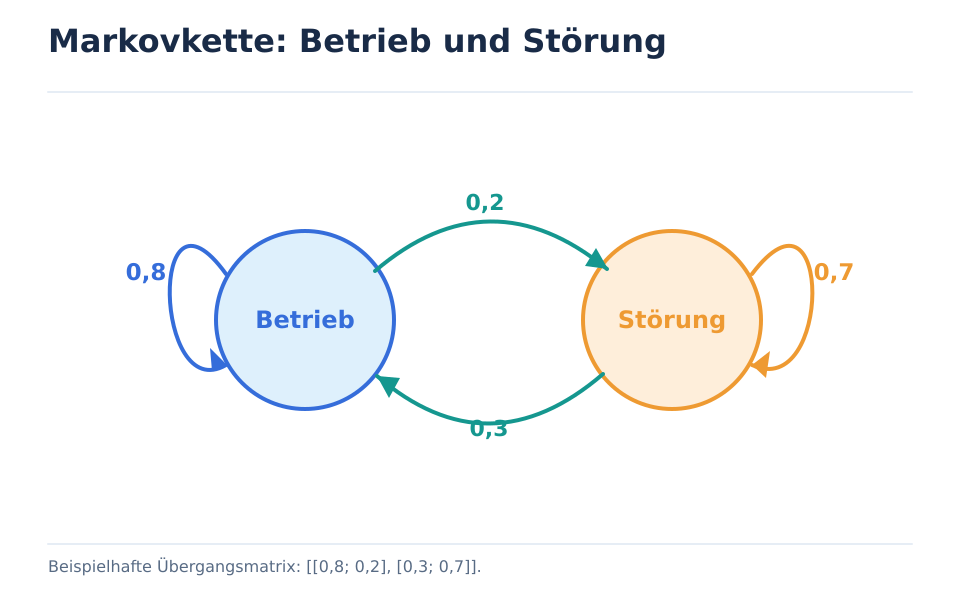

# M3-L4 – Master: Stochastische Prozesse und Markovmodelle {#L4}

**Kursbereich:** M3 – Masterorientierte Vertiefungen

**Niveau:** Masterorientierung

**Vorwissen:** Keine festen Voraussetzungen angegeben.

**Einordnung:** Master-orientierte Vertiefung nach M1-L7, M1-L9 und M3-L1

## Worum geht es? {#S1}

In M1-L7 stand oft **eine** Zufallsvariable im Mittelpunkt: ein Messwert, eine Klassifikation oder eine Wartezeit. Hier verfolgen wir ein System über viele Zeitpunkte. Sein Zustand verändert sich zufällig, aber nicht zwangsläufig regellos. Ein **stochastischer Prozess** ist eine Familie von Zufallsvariablen, die durch die Zeit oder einen anderen Index miteinander verbunden sind. Die **Markov-Eigenschaft** erlaubt eine besonders klare Modellierung: Für die Prognose des nächsten Zustands reicht der gegenwärtige Zustand aus, sofern das Modell tatsächlich korrekt gewählt ist.

## Grundidee und Anschauung {#S2}

Ein technisches Gerät ist entweder betriebsbereit oder gestört. Ein betriebsbereites Gerät kann bis zum nächsten Beobachtungszeitpunkt ausfallen; ein gestörtes kann repariert werden. Wir suchen nicht bloß die Ausfallwahrscheinlichkeit eines Einzelereignisses, sondern die Entwicklung der Zustandswahrscheinlichkeiten über viele Schritte. Danach fragen wir: Gibt es eine langfristige Verteilung, zu der das System zurückkehrt? Wie schnell nähert es sich ihr? Und was ändert sich, wenn die Zeit kontinuierlich statt in einzelnen Schritten verstreicht?

## Neue Zeichen – zuerst lesen {#S3}

  Zeichen                Laut gelesen                                       Bedeutung hier                                              Nicht verwechseln mit
  ---------------------- -------------------------------------------------- ----------------------------------------------------------- ------------------------------------------------
  $X_{n}$                „iks Index enn“                                    zufälliger Zustand zum Zeitpunkt n                          einer festen Zahl x
  $n\in \mathbb{N}_{0}$  „enn aus natürlichen Zahlen einschließlich null“   diskrete Zeitschritte 0, 1, 2, …                            kontinuierlicher Zeit t
  $P(A\mid B)$           „Wahrscheinlichkeit von A unter B“                 bedingte Wahrscheinlichkeit                                 einem kausalen Einfluss von B auf A
  $p_{ij}$               „pe Index i jott“                                  Übergang von Zustand i nach Zustand j                       p als unbekannter Bernoulli-Parameter in M3-L5
  $P$ als Matrix         „Übergangsmatrix pe“                               alle Übergangswahrscheinlichkeiten                          P als Ereigniswahrscheinlichkeit
  $p_{n}$                „pe Index enn“                                     Zeilenvektor der Zustandswahrscheinlichkeiten               einzelne Übergangszahl $p_{ij}$
  $P^n$                  „pe hoch enn“                                      n-fache Anwendung derselben Übergänge                       komponentenweise Potenz
  $\pi$                  „Pi klein“                                         stationäre Wahrscheinlichkeitsverteilung                    Kreiszahl $\pi$
  `∑`                    „Summe über“                                       Addition aller möglichen Zwischenzustände                   Integral über einen kontinuierlichen Raum
  $K(x,A)$               „Übergangskern K von x und A“                      Übergangswahrscheinlichkeit vom Zustand x in eine Menge A   einem Matrixeintrag bei endlichem Zustandsraum
  $Q$                    „Generator ku“                                     Änderungsraten einer kontinuierlichen Markovkette           einer Wahrscheinlichkeitsmatrix
  $\lambda$              „Lambda“                                           Ereignisrate eines Poissonprozesses                         Eigenwert in M1-L6/M3-L2
  $N(t)$                 „enn von te“                                       Anzahl von Ereignissen bis zur Zeit t                       feste Stichprobengröße n
  $\exp (-z)$            „Exponentialfunktion von minus z“                  exponentieller Abfall                                       die negative Zahl −z selbst

**Lesekonvention:** Wahrscheinlichkeitsvektoren stehen hier **als Zeilenvektoren**. Deshalb bedeutet $p_{n}P$ den Zustand nach einem weiteren Schritt. In anderen Büchern stehen Wahrscheinlichkeiten als Spaltenvektoren; dann muss die Matrix passend transponiert werden.

## Was ein stochastischer Prozess ist {#S4}

Ein Prozess $X_{0}, X_{1}, X_{2}, \ldots$ beschreibt zu jedem ganzzahligen Zeitpunkt eine Zufallsvariable. Die verschiedenen Zufallsvariablen sind gemeinsam auf **einem** Wahrscheinlichkeitsraum definiert und dürfen abhängig sein. Dass die einzelnen Zustände dieselben möglichen Werte besitzen, bedeutet nicht, dass sie dieselbe Verteilung haben.

Die Markov-Eigenschaft wird für alle Zustandsfolgen mit positiver Bedingungswahrscheinlichkeit so geschrieben:

$$
\begin{aligned}
P(X_{n+1}=j\mid X_n=i,X_{n-1}=i_{n-1},\ldots,X_0=i_0)
&=P(X_{n+1}=j\mid X_n=i)\text{.}
\end{aligned}
$$

Gesprochen: „Wenn wir den gegenwärtigen Zustand kennen, liefert die früher beobachtete Zustandsfolge **keine zusätzliche Information** für den nächsten Schritt.“ Das bedeutet weder, dass Vergangenheit und Zukunft generell unabhängig sind, noch, dass der gegenwärtige Zustand alle Informationen der wirklichen Welt enthält. **Ob die Markov-Eigenschaft gilt, ist eine Modellannahme.** Ein Gerät mit Verschleiß könnte zusätzlich sein Alter benötigen; dann wäre die Zweizustandsbeschreibung zu grob. Erweitert man den Zustand um relevante Größen, kann ein brauchbares Markovmodell entstehen.

Eine **zeitlich homogene** Markovkette verwendet für jeden Schritt dieselben Übergangswahrscheinlichkeiten $p_{ij}$. Homogenität ist eine weitere, eigenständige Annahme.

## Vollständiges Rechenbeispiel: Betrieb und Störung {#S5}

Wir nennen die Zustände $B$ = betriebsbereit und $S$ = gestört. Pro Tag gelten folgende modellierte Chancen:

{alt="Markovdiagramm mit zwei Zuständen und Übergangswahrscheinlichkeiten"}

- Ein betriebsbereites Gerät bleibt mit Wahrscheinlichkeit **0,8** betriebsbereit und wird mit **0,2** gestört.
- Ein gestörtes Gerät wird mit Wahrscheinlichkeit **0,3** repariert und bleibt mit **0,7** gestört.

Die **Zeilen** der Übergangsmatrix geben den Ausgangszustand an, die **Spalten** den Folgezustand. In der Reihenfolge $(B,S)$ lautet sie:

$$
\begin{aligned}
P&=\begin{bmatrix}0{,}8&0{,}2\\0{,}3&0{,}7\end{bmatrix}\\
&\text{Zeilen: von B, von S}\\
&\text{Spalten: nach B, nach S}
\end{aligned}
$$

Jede Zeile summiert sich zu eins, und alle Einträge sind nichtnegativ. Genau das muss für eine stochastische Übergangsmatrix in dieser Konvention gelten. Beginnt das Gerät sicher betriebsbereit, ist der Anfangsvektor $p_{0}=(1,0)$.

$$
\begin{aligned}
p_1&=p_0P=(1,0)P=(0{,}8;0{,}2)\\
p_2&=p_1P\\
&=(0{,}8\cdot0{,}8+0{,}2\cdot0{,}3\,;\,0{,}8\cdot0{,}2+0{,}2\cdot0{,}7)\\
&=(0{,}70;0{,}30)
\end{aligned}
$$

Gesprochen: „Nach einem Tag beträgt die modellierte Wahrscheinlichkeit für Betriebsbereitschaft 80 Prozent. Nach zwei Tagen sind es 70 Prozent, weil das Gerät in der Zwischenzeit sowohl betriebsbereit geblieben als auch nach einer Störung repariert worden sein kann.“ Das ist ein **Erwartungsmodell** für einen zufälligen Gerätezustand, keine Garantie für den Verlauf eines konkreten Geräts.

### Die Chapman-Kolmogorov-Idee {#abschnitt-6}

Bei unveränderter Übergangsmatrix ist die Wahrscheinlichkeit, in zwei Schritten von i nach j zu gelangen, die Summe der möglichen Zwischenwege:

$$
\begin{aligned}
(P^2)_{ij}&=\sum_k p_{ik}\cdot p_{kj}\\
p_n&=p_0 P^n
\end{aligned}
$$

Gesprochen: „Für jeden möglichen Zwischenzustand k multiplizieren wir die beiden aufeinanderfolgenden Übergangschancen und addieren die Ergebnisse.“ In unserer Matrix ist die erste Zeile von $P^{2}$ gleich $(0{,}70;0{,}30)$, wie oben direkt berechnet.

## Stationäre Verteilung und Langzeitverhalten {#S6}

Eine Wahrscheinlichkeitsverteilung $\pi$ heißt **stationär**, wenn sich ihre Verteilung durch einen Schritt nicht ändert:

$$
\pi P=\pi\qquad\text{und}\qquad\pi_B+\pi_S=1\text{.}
$$

Wir setzen $\pi =(a,1-a)$. Die Wahrscheinlichkeit für Betriebsbereitschaft nach einem Schritt ist dann $0{,}8a+0{,}3(1-a)$. Stationarität verlangt:

$$
\begin{aligned}
a&=0{,}8a+0{,}3(1-a)\\
a&=0{,}5a+0{,}3\\
0{,}5a&=0{,}3\\
a&=0{,}6\\
\pi&=(0{,}6;0{,}4)\text{.}
\end{aligned}
$$

**Alltagssatz:** „Im Gleichgewicht des Modells entfallen langfristig 60 Prozent Wahrscheinlichkeit auf betriebsbereit und 40 Prozent auf gestört.“ Für diese konkrete Kette ist die stationäre Verteilung eindeutig: Beide Zustände können einander erreichen (**irreduzibel**), und Selbstübergänge verhindern einen starren Wechselrhythmus (**aperiodisch**).

Genauer erhält man für einen anfänglich sicher betriebsbereiten Zustand:

$$
P(X_n=B)=0{,}6+0{,}4\cdot{(0{,}5)}^n\text{.}
$$

Gesprochen: „Die Wahrscheinlichkeit besteht aus dem Grenzwert 0,6 und einer anfänglichen Abweichung von 0,4, die in jedem Schritt halbiert wird.“ Zum Test: Bei $n=1$ ergibt sich $0{,}8$, bei $n=2$ ergibt sich $0{,}7$. Für sehr große n verschwindet der zweite Term. Das erklärt hier sowohl **Mischung** als auch die Geschwindigkeit der Annäherung.

**Achtung:** Nicht jede endliche Markovkette besitzt eine **eindeutige** stationäre Verteilung, und nicht jede Zustandsverteilung nähert sich einer stationären Verteilung an. Beispiel: Bei einem erzwungenen Wechsel $B\to S\to B\to \ldots$ ist $(0{,}5;0{,}5)$ zwar stationär, aber ein sicherer Anfangszustand wechselt für immer zwischen $(1,0)$ und $(0,1)$. Stationär und konvergent sind unterschiedliche Eigenschaften.

Für irreduzible endliche Ketten existiert eine eindeutige stationäre Verteilung; für Konvergenz der Zeitschritt-Verteilungen zum Gleichgewicht braucht man außerdem Aperiodizität. Die Aussage über langfristige **Zeitanteile** ist davon zu unterscheiden.

### Stationäre Verteilung ist nicht dasselbe wie Zeitmittel oder Verteilungskonvergenz {#abschnitt-8}

Für unsere Matrix beträgt die Wahrscheinlichkeit der Betriebsbereitschaft aus dem sicheren Start B nach drei Tagen

$$
P(X_3=B)=0{,}6+0{,}4\cdot{(0{,}5)}^3=0{,}65\text{.}
$$

Dagegen beschreibt $\pi _B=0{,}6$ die **stationäre** Chance. Wegen Irreduzibilität und Aperiodizität nähern sich in *diesem* Beispiel die Zustandsverteilungen der stationären Verteilung. Bei der periodisch wechselnden Zweizustandskette alternieren die **Verteilungen** dagegen dauerhaft. Trotzdem beträgt dort auf einem langen einzelnen Pfad der Zeitanteil beider Zustände ungefähr $\frac12$ (bei abwechselndem Wechsel sogar exakt bis auf einen Restschritt).

Für eine **endliche irreduzible** Markovkette liefert der Ergodensatz fast sichere Konvergenz der empirischen Besuchsanteile zur stationären Verteilung; dafür ist Aperiodizität **nicht** nötig. Für die Konvergenz der **Zustandsverteilung zum jeweiligen Zeitpunkt** braucht man im endlichen irreduziblen Fall hingegen Aperiodizität. Damit sind drei Aussagen sauber getrennt: *stationär sein*, *Verteilung im Grenzwert erreichen* und *Zeitanteile entlang einer Trajektorie*.

## Kontinuierliche Zustandsräume und Übergangskerne {#S7}

Bei endlichen Zuständen reicht eine Tabelle. Wenn $X_{n}$ eine kontinuierliche Position oder Sensorschätzung ist, fragen wir nach der Wahrscheinlichkeit, dass der nächste Wert in einer **Menge** A liegt. Ein Übergangskern schreibt das als $K(x,A)$. Für jedes feste x ist $A\mapsto K(x,A)$ eine Wahrscheinlichkeitsverteilung; für jede messbare Menge A hängt $K(x,A)$ in geeigneter messbarer Weise von x ab.

Die Matrixformel wird dadurch zu einer integrierten Übergangsformel:

$$
K^2(x,A)=\int K(y,A)\,K(x,\mathrm{d}y)\text{.}
$$

Gesprochen: „Wir betrachten jeden möglichen Zwischenzustand y, gewichten die Chance, von x zu y zu gelangen, und anschließend die Chance, von y nach A zu gelangen.“ Diese Notation verwendet das in M3-L1 erläuterte Integral bezüglich eines Maßes. Die Formel ist eine Erweiterung der endlichen Summe über Zwischenzustände, keine andere Rechenidee.

## Wenn die Zeit kontinuierlich läuft {#S8}

Nun kann ein Gerät **jederzeit** ausfallen oder repariert werden. Wir setzen für ein einfaches Zweizustandsmodell konstante Übergangsraten $\alpha =0{,}2$ pro Stunde (B nach S) und $\beta =0{,}3$ pro Stunde (S nach B) an. Eine **Rate** ist keine Wahrscheinlichkeit für eine ganze Stunde; nur für sehr kurze Zeitspannen Δt ist die Übergangswahrscheinlichkeit näherungsweise Rate mal Δt.

Der sogenannte Generator hat Zeilensummen null:

$$
\begin{aligned}
Q&=\begin{bmatrix}-\alpha&\alpha\\\beta&-\beta\end{bmatrix},
\quad\text{Spaltenfolge: B, S}
\end{aligned}
$$

Mit $b(t)=P(X(t)=B)$ und $1-b(t)=P(X(t)=S)$ gilt:

$$
\begin{aligned}
b'(t)&=-\alpha b(t)+\beta(1-b(t))\\
&=\beta-(\alpha+\beta)b(t)\text{.}
\end{aligned}
$$

Gesprochen: „Die Wahrscheinlichkeit für Betriebsbereitschaft verliert Masse durch Ausfälle und gewinnt Masse durch Reparaturen.“ Diese gewöhnliche Differentialgleichung ist ein Spezialfall einer **Vorwärtsgleichung** für kontinuierliche Markovketten. Bei Anfangsbedingung $b(0)=1$ folgt:

$$
\begin{aligned}
b(t)&=\frac{\beta}{\alpha+\beta}+
\left(1-\frac{\beta}{\alpha+\beta}\right)\exp(-(\alpha+\beta)t)\\
&=0{,}6+0{,}4\exp(-0{,}5t)\text{.}
\end{aligned}
$$

Bei $t=2$ Stunden ergibt sich näherungsweise $0{,}6+0{,}4\cdot 0{,}3679=0{,}7472$. Eine Stunde im kontinuierlichen Modell ist nicht derselbe Übergangsschritt wie ein Tag im vorherigen diskreten Beispiel; die numerisch gleich gewählten Raten und Wahrscheinlichkeiten dürfen deshalb **nicht** verwechselt werden.

**Exakter Unterschied zwischen Rate und Übergangschance:** Beginnen wir sicher in B, dann ist die Wahrscheinlichkeit, nach genau einer Stunde in S zu sein:

$$
\begin{aligned}
P(X(1)=S\mid X(0)=B)&=\frac{\alpha}{\alpha+\beta}\cdot
\bigl(1-\exp(-(\alpha+\beta)\cdot1)\bigr)\\
&=0{,}4\cdot(1-\exp(-0{,}5))\\
&\approx0{,}1574\text{.}
\end{aligned}
$$

Obwohl die **Ausfallrate** $\alpha=0{,}2\ \text{pro Stunde}$ ist, liegt die Wahrscheinlichkeit für Zustand S nach einer Stunde also bei rund **15,74 Prozent**, nicht pauschal bei 20 Prozent: Eine zwischenzeitliche Reparatur ist mitberücksichtigt. Die Näherung $\alpha \cdot \Delta t$ ist nur für kurze Intervalle $\Delta t$ brauchbar.

## Zählprozesse: Poisson als zweites Zeitmodell {#S9}

Ein **Poissonprozess** zählt zufällige Ereignisse mit konstanter Rate $\lambda >0$. Er beginnt bei null, hat unabhängige Zuwächse auf disjunkten Zeitintervallen, und die Ereigniszahl im Zeitabschnitt der Länge t ist poissonverteilt:

$$
P(N(t)=k)=\exp(-\lambda t)\cdot\frac{{(\lambda t)}^k}{k!}
$$

Hier ist $k$ die ganzzahlige Ereigniszahl, $k!$ ihre Fakultät, $t\ge 0$ die Zeit und $\lambda$ die durchschnittliche Ereigniszahl pro Zeiteinheit. Gesprochen: „Die Wahrscheinlichkeit für genau k Ereignisse setzt sich aus einem Exponentialfaktor, der k-ten Potenz der erwarteten Ereigniszahl und der Fakultät im Nenner zusammen.“

**Rechenbeispiel:** Für $\lambda =2$ Ereignisse pro Stunde und $t=1$ Stunde ist die erwartete Zahl $\lambda t=2$:

$$
\begin{aligned}
P(N(1)=0)&=\exp(-2)\approx0{,}1353\\
P(N(1)\ge1)&=1-\exp(-2)\approx0{,}8647\text{.}
\end{aligned}
$$

**Rechenkontrolle:** Für dieses Poissonmodell gilt außerdem $E[N(t)]=\operatorname{Var}(N(t))=\lambda t$. Bei $\lambda=2/\mathrm{h}$ und $t=1\,\mathrm{h}$ sind sowohl Erwartungswert als auch Varianz der Ereigniszahl gleich 2; die Standardabweichung ist $\sqrt{2}$ Ereignisse. Dies sind Eigenschaften des Poissonmodells, keine allgemeinen Gesetze für reale Ankunftsprozesse.

Der Prozess ist bezüglich seines aktuellen Zählerstands Markovsch. Die Wartezeit bis zum nächsten Ereignis ist exponentialverteilt und besitzt die **Gedächtnislosigkeit**. Beides hängt von den speziellen Poisson-Annahmen ab; reale Ereignisströme mit Häufungen oder Tagesrhythmen erfüllen diese oft nicht.

## Verdeckte Zustände und Entscheidungen {#S10}

Ein Roboter kennt seinen wahren Zustand selten exakt. Beim **Hidden-Markov-Modell** (HMM) ist der verborgene Zustand Markovsch, die Sensorbeobachtung wird aber zusätzlich stochastisch aus dem Zustand erzeugt. Die Beobachtung allein ist im Allgemeinen **keine** Markovkette. In einem **Markov-Entscheidungsprozess** (MDP) beeinflusst eine gewählte Aktion die Übergangswahrscheinlichkeit; das ist eine andere Modellklasse als eine feste Markovkette.

Diese Unterscheidung ist für KI-Agenten entscheidend: Eine Vorhersage ohne Handlungswahl, eine Zustandsschätzung aus Sensoren und eine optimale Aktionsplanung beantworten drei verschiedene Fragen.

## Wofür nützlich? {#S11}

- **Zuverlässigkeit und Wartung:** Zustandswechsel und langfristige Verfügbarkeit modellieren.
- **Robotik und autonome Systeme:** unsichere Bewegungs- und Sensormodelle strukturiert beschreiben.
- **KI und Sequenzmodelle:** HMMs, Markov-Entscheidungsprozesse und Zustandsübergänge verstehen.
- **Netzwerke und Warteschlangen:** Ankunftsereignisse und zeitliche Lastspitzen modellieren.

## Annahmen und Grenzen {#S12}

Markov-Eigenschaft, Zeit-Homogenität, Unabhängigkeit von Zuwächsen und konstante Raten sind **prüfbedürftige Annahmen**, keine universellen Fakten. Stationarität bedeutet weder automatisch ein individuelles Zeitmittel noch kausale Erklärung. Eine Übergangsmatrix ist nur so gut wie ihre geschätzten Wahrscheinlichkeiten und die gewählte Zustandsdefinition. In kontinuierlichen und unendlichen Zustandsräumen sind zusätzlich Messbarkeit, Existenz, Ergodizität und Integrabilität relevant.

## Verbindung zur nächsten Lektion {#S13}

M3-L5 fragt, wie wir unbekannte Modellparameter aus Daten schätzen und mit Unsicherheit versehen. Unser Ausfallparameter könnte beispielsweise nicht „bekannt“, sondern aus beobachteten Übergängen zu **schätzen** sein. Später verbindet M3-L12 diese Modelle mit nichtlinearer Regelung und Entscheidungen.

## Merksätze {#S14}

Eine Markovkette ist ein Modell von **bedingten Übergängen**. Eine stationäre Verteilung bleibt unter einer Anwendung der Übergänge erhalten. Eindeutigkeit, Annäherung und tatsächliche Zeitanteile sind gesonderte Aussagen mit eigenen Voraussetzungen. Die Wahl des Zustands ist ebenso wichtig wie die Übergangszahlen.

## Quellen (extern) {#S15}

Keine externen Quellen angegeben.
