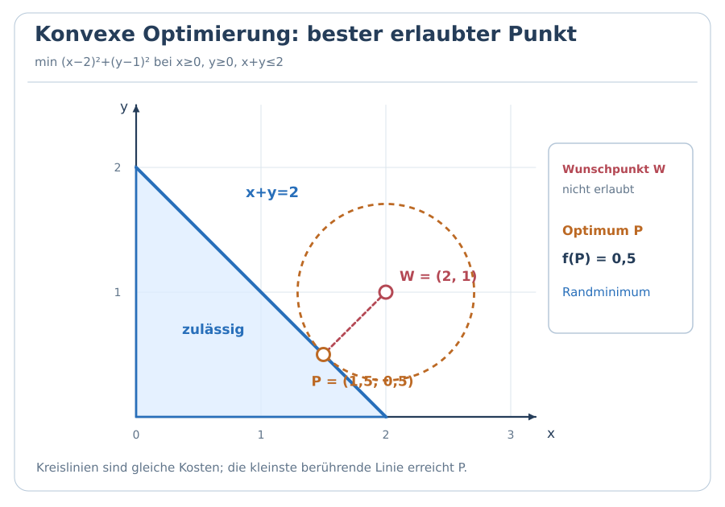

# M3-L6 – Master: Konvexe Optimierung, Dualität und KKT-Bedingungen {#L6}

**Kursbereich:** M3 – Masterorientierte Vertiefungen

**Niveau:** Masterorientierung

**Vorwissen:** Keine festen Voraussetzungen angegeben.

**Einordnung:** Master-orientierte Vertiefung nach M2-L2, M1-L4 und M1-L5

## Worum geht es? {#S1}

In M2-L2 haben wir Kostenfunktionen und Nebenbedingungen als Entscheidungsprobleme formuliert. Manche Optimierungsprobleme sind leicht zu lösen, weil ihre Form verhindert, dass ein lokales Minimum an einer ungünstigen Stelle hängen bleibt. Diese besondere Klasse heißt **konvexe Optimierung**. Sie verbindet geometrische Eigenschaften von Mengen und Funktionen mit Ableitungen, Beweisen und effizienten numerischen Verfahren. Die **Dualität** liefert Schranken auf den bestmöglichen Zielwert. Die **Karush-Kuhn-Tucker-Bedingungen**, kurz **KKT**, helfen dabei, Lösungen mit Nebenbedingungen mathematisch zu charakterisieren.

## Grundidee und Anschauung {#S2}

Stell dir vor, wir möchten die Abweichung eines Roboters von einer Zielposition minimieren, müssen aber räumliche oder technische Grenzen einhalten. Der beste uneingeschränkte Punkt ist möglicherweise verboten. Dann liegt die beste erlaubte Lösung häufig am **Rand** des zulässigen Bereichs. Der Gradient zeigt, in welche Richtung sich die Kosten lokal erhöhen. Eine aktive Nebenbedingung verhindert jedoch bestimmte Bewegungen. Am Optimum stehen Zielgradient und Randnormalen auf besondere Weise im Gleichgewicht.

Die entscheidende Frage lautet: **Welche Voraussetzungen machen aus einer lokalen Optimalitätsbedingung tatsächlich einen globalen Beleg?**

## Neue Zeichen – zuerst lesen {#S3}

  Zeichen                         Laut gelesen                                 Bedeutung hier                                                 Nicht verwechseln mit
  ------------------------------- -------------------------------------------- -------------------------------------------------------------- ----------------------------------------
  $x\in \mathbb{R}^d$             „iks aus dem d-dimensionalen reellen Raum“   Entscheidungsvektor mit d Komponenten                          Ortsvektor in Schule M2-L11
  $C$                             „zulässige Menge zeh“                        Menge aller erlaubten Entscheidungen                           Konditionszahl in M1-L8
  $f(x)$                          „Zielfunktion eff von iks“                   zu minimierende Kosten oder Fehler                             Dichtefunktion in M3-L5
  $\min$                          „Minimum“                                    kleinster erreichter Funktionswert                             ein bloßes Infimum ohne Minimierer
  $\inf$                          „Infimum“                                    größte untere Schranke, muss nicht angenommen werden           Minimum
  $t\in [0{,}1]$                  „te zwischen null und eins“                  Gewicht einer konvexen Mischung                                Zeitvariable in M1-L9
  $g_{i}(x)\le 0$                 „Nebenbedingung ge Index i höchstens null“   erlaubte Ungleichung                                           Gleichungsnebenbedingung
  $Ax=b$                          „a mal iks gleich be“                        affine Gleichungsbedingungen                                   Produkt einzelner Skalare
  $\nabla f(x)$                   „Gradient von eff bei iks“                   Vektor erster partieller Ableitungen                           räumlicher Ortsvektor
  $\nabla ^{2}f(x)$               „Hesse-Matrix von eff“                       Matrix zweiter partieller Ableitungen                          Matrixquadrat
  $\lambda _{i}\ge 0$             „Lambda Index i nichtnegativ“                Multiplikator einer Ungleichungsbedingung                      Ereignisrate in M3-L4
  $\nu$                           „Ny“                                         Multiplikator einer Gleichungsbedingung                        Häufigkeit als Buchstabe n
  $\mathcal{L}(x,\lambda ,\nu )$  „Lagrangefunktion“                           Zielfunktion plus gewichtete Bedingungen                       Likelihood L in M3-L5
  $q(\lambda ,\nu )$              „duale Funktion“                             untere Schranke auf den primalen Optimalwert                   Übergangsgenerator Q in M3-L4
  `∑`                             „Summe“                                      Addition über Nebenbedingungen                                 Produktzeichen `∏`
  `⊤`                             „transponiert“                               hier $A^{\top}\nu$ als rückwirkender Gleichungsmultiplikator   eine neue Matrixoperation
  $\succeq 0$                     „positiv semidefinit“                        quadratische Form ist nie negativ                              strikt positiv definit
  ${\Vert x\Vert}_2^2$            „quadrierte euklidische Norm“                Summe der Quadrate aller Komponenten                           Quadrat einer einzelnen Koordinate
  $B$                             „be“                                         verfügbare Gesamtressource im parametrisierten Motorbeispiel   Zufallsvariable oder Matrix
  $v(B)$                          „ve von be“                                  kleinster erreichbarer Zielfunktionswert beim Budget B         Zielfunktion an einem beliebigen Punkt

## Konvexe Mengen: Verbindungsstrecken bleiben erlaubt {#S4}

Eine Menge C ist **konvex**, wenn die Verbindung von zwei beliebigen Punkten aus C vollständig in C liegt. Formal gilt für alle Punkte x,y aus C und jedes Gewicht $t\in [0{,}1]$:

$$
\begin{aligned}
&(1-t)x+ty\in C\text{.}
\end{aligned}
$$

Gesprochen: „Jeder Punkt auf der Strecke zwischen zwei erlaubten Entscheidungen ist wiederum erlaubt.“ Eine Kreisscheibe, ein Würfel und ein durch lineare Ungleichungen beschriebener Bereich sind konvex. Eine ringförmige Fläche mit Loch ist es im Allgemeinen nicht: Eine Verbindungsstrecke kann durch das verbotene Loch führen.

Ein häufiges technisches Beispiel ist ein **Leistungsbudget**: $x\ge 0$, $y\ge 0$ und $x+y\le 2$. Der Bereich ist ein Dreieck einschließlich Rand. Er bleibt unter jeder gewichteten Mischung zweier erlaubter Einstellungen zulässig.

## Konvexe Funktionen: keine versteckten tiefen Täler {#S5}

Eine Funktion f auf einer konvexen Menge heißt **konvex**, wenn der Funktionswert auf einer Verbindungsstrecke höchstens der gerade interpolierte Wert an den Endpunkten ist:

$$
f((1-t)x+ty)\leq(1-t)f(x)+tf(y)\text{.}
$$

Gesprochen: „Die Funktion liegt auf jeder Strecke zwischen zwei Eingaben nicht über der verbindenden Höhe der Endwerte.“ Das ist eine **globale** geometrische Bedingung. Ein quadratischer Fehler $f(x)={(x-3)}^2$ ist konvex; die Funktion $f(x)=-x^{2}$ ist dagegen konkav, also nicht konvex.

Für eine differenzierbare konvexe Funktion auf einem offenen konvexen Bereich gilt die **Stützebenen-Ungleichung**:

$$
f(y)\geq f(x)+\nabla f(x)\cdot(y-x)\text{.}
$$

Gesprochen: „Am Punkt x liegt die Tangentialebene unterhalb der gesamten konvexen Funktion.“ Daher kann ein innerer Punkt mit $\nabla f(x)=0$ nur dann auftreten, wenn f dort ein **globales Minimum** erreicht.

Bei einer zweimal stetig differenzierbaren Funktion auf einem offenen konvexen Bereich ist Konvexität äquivalent dazu, dass ihre **Hesse-Matrix** überall positiv semidefinit ist:

$$
z^{\mathrm{T}}\nabla^2 f(x)\,z\geq0\qquad\text{für alle Richtungsvektoren }z\text{.}
$$

Gesprochen: „Die zweite Krümmung entlang jeder möglichen Richtung darf nicht negativ sein.“ Positive **Definitheit** der Hesse-Matrix ist eine stärkere, hinreichende Bedingung für strenge Konvexität; sie ist nicht notwendig. Eine strikt konvexe Funktion hat **höchstens einen** globalen Minimierer, falls ein solcher existiert. Existenz wird nicht allein durch Konvexität garantiert.

## Das allgemeine konvexe Optimierungsproblem {#S6}

Wir minimieren f unter Ungleichungen $g_{i}(x)\le 0$ und einer affinen Gleichung $Ax=b$. Bei einer **konvexen Optimierungsaufgabe** sind f und alle $g_i$ konvex, die Gleichheitsbedingungen affin und der Definitionsbereich konvex. Die Menge C muss nicht von Anfang an separat gegeben sein: Sie ergibt sich aus diesen Bedingungen.

$$
\begin{aligned}
\text{minimiere}\quad&f(x)\\
\text{unter}\quad&g_i(x)\le0\quad\text{für }i=1,\ldots,m\\
&Ax=b\text{.}
\end{aligned}
$$

Gesprochen: „Wir suchen unter allen Entscheidungen, die sämtliche Grenzen erfüllen, einen möglichst kleinen Zielwert.“ Bei konvexen Aufgaben ist jeder **lokale** Minimierer zugleich **globaler** Minimierer. Dieses Versprechen gilt nicht für allgemeine neuronale Netze oder beliebige Robotikprobleme: Deren Zielfunktionen sind oft nichtkonvex.

## Vollständig gelöstes Randproblem: Warum der Multiplikator erscheint {#S7}

Wir möchten eine nichtnegative reale Größe x so klein wie möglich halten, müssen aber mindestens zwei Einheiten bereitstellen. Als Kostenfunktion wählen wir $f(x)=x^{2}$. Die Bedingung $x\ge 2$ schreiben wir KKT-kompatibel als $g(x)=2-x\le 0$.

$$
\begin{aligned}
\text{minimiere}\quad&x^2\\
\text{unter}\quad&2-x\le0\text{.}
\end{aligned}
$$

Ohne Nebenbedingung wäre $x=0$ am besten, aber das ist verboten. Unter allen erlaubten $x\ge 2$ ist **$x=2$** der beste Wert, mit Kosten $f(2)=4$.

Um dieses Ergebnis formal zu charakterisieren, führen wir einen **nichtnegativen Lagrange-Multiplikator** $\lambda$ ein und bilden:

$$
\mathcal{L}(x,\lambda)=x^2+\lambda(2-x)\qquad\text{mit }\lambda\geq0\text{.}
$$

Gesprochen: „Die Lagrangefunktion enthält die ursprünglichen Kosten und einen mit Lambda gewichteten Ausdruck für die verletzbare Grenze.“ Die stationäre Bedingung zur x-Variablen lautet:

$$
\frac{\partial\mathcal{L}}{\partial x}=2x-\lambda=0\text{.}
$$

Am Kandidaten $x=2$ folgt $\lambda =4$. Jetzt überprüfen wir alle vier KKT-Punkte im Spezialfall:

1.  **Primal zulässig:** $2-2=0\le 0$ – $x=2$ erfüllt die Grenze.
2.  **Dual zulässig:** $\lambda =4\ge 0$ – der Ungleichungsmultiplikator ist nichtnegativ.
3.  **Stationarität:** $2x-\lambda =4-4=0$ – das Gradienten-Gleichgewicht stimmt.
4.  **Komplementäre Schlupfbedingung:** $\lambda \cdot g(x)=4\cdot 0=0$ – eine positive Strafgewichtung gehört hier zu einer aktiven Grenze.

Weil f und g konvex sind, ist das gefundene KKT-Paar ein **globaler Optimalitätsnachweis**. Die Ungleichung allein sagt noch nicht, wie viel die Mindestanforderung kostet; genau diese Sensitivität illustriert $\lambda$.

## Lagrange-Dualität ohne Zauberformel {#S8}

Für jede feste Zahl $\lambda \ge 0$ betrachten wir den kleinsten Wert der Lagrangefunktion, wenn x vorerst frei gewählt werden darf:

$$
q(\lambda)=\inf_{x\in\mathbb{R}}\left[x^2+\lambda(2-x)\right]\text{.}
$$

Gesprochen: „q von Lambda ist eine für diese Wahl von Lambda berechnete untere Schranke auf den bestmöglichen Kostenwert.“ **Erst durch Maximierung über alle zulässigen Multiplikatoren** suchen wir die beste solche Schranke. Wir formen quadratisch um oder setzen die x-Ableitung null:

$$
\begin{aligned}
2x-\lambda&=0\implies x=\frac\lambda2\text{.}\\
q(\lambda)&=\left(\frac\lambda2\right)^2+\lambda\left(2-\frac\lambda2\right)\\
&=2\lambda-\frac{\lambda^2}{4}\text{.}
\end{aligned}
$$

Die **duale Aufgabe** maximiert diese untere Schranke über $\lambda \ge 0$:

$$
\begin{aligned}
\text{maximiere}\quad q(\lambda)&=2\lambda-\frac{\lambda^2}{4}\quad\text{für }\lambda\ge0\text{.}\\
q'(\lambda)&=2-\frac\lambda2=0\implies\lambda^*=4\text{.}\\
q(4)&=8-4=4\text{.}
\end{aligned}
$$

Gesprochen: „Der beste duale Multiplikator ist vier, und die beste berechnete untere Schranke ist ebenfalls vier.“ Der **primale** optimale Wert war vier. Es gibt also in diesem Beispiel **keine Dualitätslücke**.

Die allgemeine **schwache Dualität** besagt bei einer Minimierungsaufgabe mit richtig gewählten Vorzeichen: Jeder dual zulässige Wert liegt höchstens beim primalen optimalen Wert. Das ist eine nachprüfbare **untere Schranke**, selbst wenn wir noch keine optimale Entscheidung kennen.

**Wann gilt starke Dualität?** Für konvexe Probleme ist die sogenannte **Slater-Bedingung** eine verbreitete hinreichende Voraussetzung: Vereinfacht müssen die Ungleichungen an mindestens einem Punkt strikt erfüllbar sein, während die affinen Gleichungen erfüllt bleiben; präzise Varianten berücksichtigen relative Inneres und Definitionsbereiche. In unserem Beispiel erfüllt $x=3$ die Ungleichung strikt ($2-3<0$). Damit lässt sich starke Dualität hier begründen, und bei geeignet erreichbaren Optima gelten KKT als notwendige und hinreichende Bedingungen. **Ohne passende Regularitätsannahme darf man notwendige KKT-Bedingungen oder starke Dualität nicht pauschal behaupten.**

## Ein zweidimensionales Ressourcenbeispiel {#S9}

Zwei Motoren sollen nahe an ihrer Wunschleistung $(2,1)$ betrieben werden. Zusammen dürfen sie jedoch höchstens zwei Einheiten Leistung benötigen. Beide Einstellungen sollen nichtnegativ sein. Wir minimieren:

Konvexe Optimierung: Wunschpunkt (2,1) außerhalb der zulässigen Menge; Randminimum bei (1,5;0,5) mit Kosten 0,5.

$$
\begin{aligned}
f(x,y)&={(x-2)}^2+{(y-1)}^2\\
\text{unter}\quad&x\ge0,\quad y\ge0,\quad x+y\le2\text{.}
\end{aligned}
$$

Die Wunschwerte $(2,1)$ sind verboten, weil ihre Summe drei beträgt. Das geometrisch nächste erlaubte Paar muss auf der Budgetgrenze liegen. Wir setzen zunächst $x+y=2$, also $y=2-x$:

$$
\begin{aligned}
f(x,2-x)&={(x-2)}^2+{(1-x)}^2\\
&=2x^2-6x+5\text{.}\\
f'(x)&=4x-6=0\implies x=1{,}5\text{.}\\
y&=2-1{,}5=0{,}5\text{.}\\
f(1{,}5;0{,}5)&={(-0{,}5)}^2+{(-0{,}5)}^2=0{,}5\text{.}
\end{aligned}
$$

Gesprochen: „Wir teilen die gesamte Ressource auf 1,5 und 0,5. Beide Motoren verzichten um 0,5 auf ihren Wunschwert; die gesamten quadratischen Abweichungskosten betragen 0,5.“ Beide Einstellungen sind positiv und erfüllen die Grenze mit Gleichheit.

Mit dem Multiplikator $\lambda$ für die Budgetgrenze $x+y-2\le 0$ lauten die stationären Gleichungen, weil die Nichtnegativitätsgrenzen hier inaktiv sind:

$$
\begin{aligned}
2(x-2)+\lambda&=0\\
2(y-1)+\lambda&=0\text{.}
\end{aligned}
$$

Bei $(x,y)=(1{,}5;0{,}5)$ sind beide Gleichungen mit $\lambda =1$ erfüllt. Das zeigt die Bedeutung des **Schattenpreises**: Eine kleine Änderung der verfügbaren Gesamtleistung hat lokal einen Einfluss auf den optimalen Zielfunktionswert, der durch $\lambda$ beschrieben wird. Welche Einheit und welches Vorzeichen dabei verwendet werden, hängt von der konkreten Parametrisierung der Budgetgrenze ab.

Zur vollständigen KKT-Gegenprobe gehören auch die beiden Ungleichungen $-x\le 0$ und $-y\le 0$: Weil x und y hier strikt positiv sind, dürfen ihre Multiplikatoren null sein. Für die Budgetgrenze verwenden wir $\lambda =1$. Dann gelten primal zulässige Variablen, nichtnegative Multiplikatoren, die beiden Stationsgleichungen und die komplementäre Schlupfbedingung $1\cdot (1{,}5+0{,}5-2)=0$. Außerdem liegt mit $(0{,}5;0{,}5)$ ein strikt zulässiger Punkt für **alle drei** Ungleichungen vor. Die streng konvexe quadratische Zielfunktion besitzt daher an $(1{,}5;0{,}5)$ ihr **eindeutiges globales Minimum**.

**Schattenpreis nachgerechnet:** Ersetzen wir das feste Budget 2 durch ein veränderliches Budget $B$ nahe bei 2, erhalten wir für $1<B<3$ weiterhin eine aktive Budgetgrenze und positive Motorleistungen:

$$
\begin{aligned}
x^*(B)&=\frac{B+1}{2},\quad y^*(B)=\frac{B-1}{2}\\
v(B)&=\frac{{(3-B)}^2}{2},\quad v'(B)=B-3\text{.}\\
\text{Bei }B=2:\quad v(2)&=0{,}5\quad\text{und}\quad v'(2)=-1=-\lambda\text{.}
\end{aligned}
$$

Gesprochen: „Erhöht sich das Budget geringfügig, sinken die minimalen quadratischen Abweichungskosten zunächst um ungefähr eine Einheit pro zusätzlicher Budgeteinheit.“ Das Minuszeichen folgt aus der hier verwendeten Nebenbedingung $x+y-B\le 0$; bei anders notierten Bedingungen ändern sich Vorzeichen und Bedeutung des Multiplikators. Dass der optimale Punkt gerade am Rand liegt, ist eine Konsequenz der konkreten Zahlen – kein allgemeiner Zwang bei konvexen Problemen.

## Numerische Verfahren und KI-Bezug {#S10}

Bei hochdimensionalen Problemen lässt sich die Lösung oft nicht von Hand bestimmen. **Projizierter Gradientenabstieg** kombiniert einen Schritt in Richtung sinkender Zielfunktion mit der Rückprojektion auf die zulässige Menge C. In Textnotation:

$$
x_{\mathrm{neu}}=\operatorname{Proj}_C\left(x_{\mathrm{alt}}-\eta\cdot\nabla f(x_{\mathrm{alt}})\right)\text{.}
$$

$\operatorname{Proj}_C$ bezeichnet den euklidisch nächstgelegenen Punkt in der abgeschlossenen nichtleeren konvexen Menge C; $\eta >0$ heißt Schrittweite. Gesprochen: „Wir bewegen uns ein Stück entgegen dem Gradienten und bringen das Ergebnis durch Projektion wieder in den zulässigen Bereich.“ **Mini-Beispiel:** Für $f(x)=x^{2}$, $C=[2,\infty )$, den Startwert $x_{\mathrm{alt}}=3$ und die Schrittweite $\eta=\frac12$ ist der rohe Gradientenschritt $3-\left(\frac12\right)\cdot6=0$. Die Projektion auf $C$ bringt uns zu $x_{\mathrm{neu}}=2$, dem tatsächlichen Minimum unter dieser Nebenbedingung. Das Beispiel zeigt eine einzelne gültige Projektion, nicht die Konvergenzgarantie für beliebige Schrittweiten.

Konvergenzaussagen hängen von Schrittweite, Glattheit und Konvexität ab. Für nichtglatte Probleme, etwa mit Beträgen, sind **Subgradienten** oder **proximale Verfahren** wichtige Erweiterungen.

Konvexe Optimierung ist grundlegend für lineare Regression, Lasso- und Ridge-Varianten, Support-Vector-Machines und viele Steuerungsunterprobleme. Ein tiefes neuronales Netz als Ganzes besitzt normalerweise keine konvexe Verlustlandschaft; die hier bewiesene globale Optimalitätslogik überträgt sich deshalb nicht automatisch auf jedes KI-Training.

## KKT als Geometrie – und als Gültigkeitsfrage {#S11}

Die KKT-Stationarität sagt in Worten: „Am optimalen Punkt ist der negative Zielgradient durch die Gradienten der aktiven Bedingungen ausgeglichen.“ Komplementärer Schlupf bedeutet: „Eine strikt **inaktive** Ungleichung besitzt im KKT-Paar den Multiplikator null.“ Die Umkehrung gilt nicht immer: Eine aktive Bedingung kann ebenfalls Multiplikator null besitzen.

Bei einem **konvexen, differenzierbaren Problem** mit affinen Gleichheiten sind korrekt erfüllte KKT-Bedingungen **hinreichend** für globales Optimum. Ihre **Notwendigkeit** erfordert im Allgemeinen eine geeignete Nebenbedingungsqualifikation, etwa eine passende Slater-Bedingung. **Gegenbeispiel zur Notwendigkeit ohne Regularität:** Wir minimieren $f(x)=x$ unter der konvexen Bedingung $g(x)=x^{2}\le 0$. Die einzige zulässige Entscheidung ist $x=0$, also zwangsläufig global optimal. Doch $f'(0)=1$ und $g'(0)=0$; die KKT-Stationarität $1+\lambda \cdot 0=0$ ist für kein $\lambda \ge 0$ erfüllbar. Es gibt keinen strikt zulässigen Punkt für diese Ungleichung. Damit ist sichtbar: Selbst bei einer konvexen Zielfunktion und konvexen Nebenbedingung ist **die Notwendigkeit von KKT ohne passende Nebenbedingungsqualifikation nicht gesichert**.

Für **nichtkonvexe** Probleme können KKT-Punkte lediglich Kandidaten und sogar Sattelpunkte sein. Nichtdifferenzierbare Funktionen oder nicht abgeschlossene Bereiche verlangen weitere Theorie.

## Wofür nützlich? {#S12}

- **Robotersteuerung:** zulässige Stellgrößen, Geschwindigkeiten und begrenzte Aktorleistung koordinieren.
- **KI und maschinelles Lernen:** konvexe Teilprobleme, lineare Modelle und regulierte Parameteranpassung zuverlässig lösen.
- **Betriebsplanung:** Personal-, Energie- und Rechenbudgets unter Nebenbedingungen verteilen.
- **Numerische Software:** optimale Werte durch Dualität mit mathematisch nachvollziehbaren Schranken kontrollieren.

## Annahmen und Grenzen {#S13}

KKT ist keine universelle Lösungsformel. Die mathematische Form der Zielfunktion, die Konvexität jeder Ungleichung, die Richtung der Nebenbedingungen und die affine Struktur der Gleichheiten müssen stimmen. Das Vorzeichen von Multiplikatoren hängt von der Konvention „minimiere bei $g\le0$“ ab. Existenz des Minimums, Nebenbedingungsqualifikationen und numerische Konvergenz sind **separate** Fragen. Das reine Erreichen niedriger Kosten beweist noch keine globale Optimalität.

## Verbindung zur nächsten Lektion {#S14}

M3-L7 beschäftigt sich mit numerischer linearer Algebra: großen Matrixsystemen, Singulärwertzerlegung und Krylov-Verfahren. Viele numerische Optimierer lösen in jedem Schritt solche linearen Teilprobleme. M3-L11 greift später Dualität, Regularisierung und Modellunsicherheit bei inversen Problemen auf.

## Merksätze {#S15}

**Konvexität** macht lokale Optima unter geeigneten Bedingungen global. **Dualität** erzeugt kontrollierbare Schranken und kann Optimierung aus einer zweiten Perspektive erklären. **KKT** verbindet Stationarität, Zulässigkeit und aktive Grenzen; seine Notwendigkeit und starke Dualität hängen von zusätzlichen Voraussetzungen ab. Eine richtige Modellformulierung ist mindestens so wichtig wie der anschließende Optimierungsalgorithmus.

## Quellen {#S16}

In dieser Lektion sind keine Einzelquellen gesondert verzeichnet.
