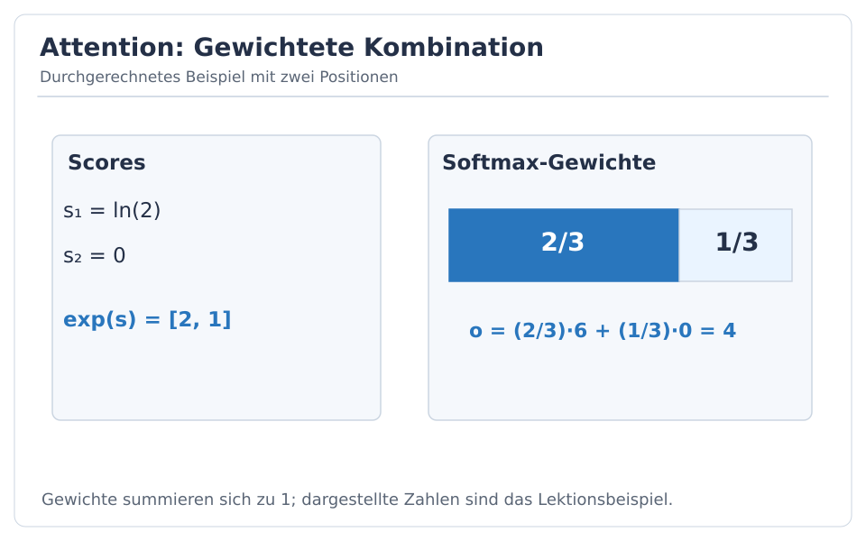

# M4-L1 – Wahlpflicht: Transformer-Mathematik, Attention und Sprachmodelle {#L1}

**Kursbereich:** M4 – Studienwahl: KI, Informatik und Spezialgebiete

**Niveau:** Studium (Wahl / Spezialisierung)

**Vorwissen:** [M1-L5](M1-L5.md) (Matrizen), [M1-L7](M1-L7.md) (Wahrscheinlichkeiten), [M2-L10](M2-L10.md) (Informationstheorie), [M2-L11](M2-L11.md) (neuronale Netze), gegebenenfalls [M3-L6](M3-L6.md) (Optimierung)

**Einordnung:** Vertiefungs-/Wahlpflichtangebot, fortgeschrittener Bachelor bis Master.

## Worum geht es? {#S1}

Ein Sprachmodell verarbeitet Zeichenfolgen nicht direkt als Sätze, sondern über diskrete Einheiten, sogenannte Tokens, die es in Zahlenvektoren übersetzt. Ein Transformer kann unterschiedliche Stellen einer Folge miteinander in Beziehung setzen. Kernstück ist ein gewichtetes Zusammenführen von Informationen: **Attention**. Die mathematischen Grundlagen sind Matrixmultiplikation, Skalarprodukt, Normierung und differenzierbare Optimierung. Die Lektion klärt, was dabei tatsächlich berechnet wird – und weshalb daraus weder automatische Wahrheit noch ein menschliches Sprachverständnis folgt.

## Grundidee und Anschauung {#S2}

In „Die Bank steht am Fluss“ trägt das Wort „Fluss“ dazu bei, welche Bedeutung von „Bank“ in der Verarbeitung plausibel wird. Technisch wird das nicht durch ein fest eingebautes Wörterbuch entschieden. Ein Modell bildet Vektoren und lernt, welche Positionen für andere Positionen stärker gewichtet werden. Die Aufmerksamkeit ist ein **Rechenmechanismus für gewichtete Information**, keine Garantie für grammatische Korrektheit oder faktische Verlässlichkeit.

## Neue Zeichen – vor den Formeln lesen {#S3}

  Zeichen                   Laut gelesen            Bedeutung hier                                                            Abgrenzung
  ------------------------- ----------------------- ------------------------------------------------------------------------- --------------------------------------------
  $x_{i}$                   „iks mit Index i“       Vektordarstellung des Tokens an Position i                                kein ursprüngliches Wort
  $q_{i}$                   „ku mit Index i“        Query-Vektor einer Position: welche Information wird gesucht?             keine Suchanfrage im Browser
  $k_{j}$                   „ka mit Index j“        Key-Vektor einer Position: woran kann sie erkannt werden?                 kein Verschlüsselungsschlüssel
  $v_{j}$                   „vau mit Index j“       Value-Vektor: Information, die kombiniert wird                            kein Wahrheitswert
  `·`                       „Skalarprodukt“         misst in diesem Rechenschritt eine bilineare Ähnlichkeit                  nicht automatisch Kosinusähnlichkeit
  $d_{k}$                   „de mit Index ka“       Zahl der Komponenten eines Key-/Query-Vektors                             Länge der Tokenfolge
  $s_{ij}$                  „es i j“                normierter Vergleichswert von Query i mit Key j                           noch keine Wahrscheinlichkeit
  $\exp$                    „Exponentialfunktion“   macht reelle Vergleichswerte positiv                                      keine Prozentrechnung
  $\alpha _{ij}$            „Alpha i j“             Attention-Gewicht zwischen den Positionen i und j                         nicht kausaler Einfluss
  `Σ`                       „Summe“                 addiert Beiträge aller erlaubten Positionen                               Integral über stetige Zeit
  $\operatorname{softmax}$  „Softmax“               wandelt endlich viele Zahlen in positive, zu eins summierte Gewichte um   keine allgemeine statistische Kalibrierung
  $Q,K,V$                   „Ku, Ka, Vau“           Matrizen sämtlicher Queries, Keys und Values                              andere Bedeutung von Q/K/V in M3-L12
  `⊤`                       „transponiert“          vertauscht Zeilen und Spalten                                             Matrixinverse
  $n$                       „en“                    Anzahl der betrachteten Tokenpositionen                                   Zahl der Trainingsbeispiele

## Von Tokens zu Vektoren {#S4}

Ein Tokenizer zerlegt Text in Einheiten; ein Token ist weder immer ein Wort noch immer ein einzelnes Zeichen. Jedem Tokenindex wird zunächst ein gelernter Zahlenvektor zugeordnet, das **Embedding**. Zusätzlich braucht das Modell Information über Reihenfolge und Position, weil Attention ohne solche Information die Positionen nicht von allein als Satzfolge versteht.

Für eine Eingabe mit n Positionen entsteht eine Matrix X: In jeder Zeile steht ein Embedding. Aus X werden mittels gelernter Matrizen drei neue Darstellungen erzeugt:

$$
Q=XW_Q,\qquad K=XW_K,\qquad V=XW_V\text{.}
$$

Gesprochen: „Die Query-Matrix ist die Eingabematrix mal einer trainierten Query-Gewichtsmatrix; analog entstehen Key- und Value-Matrix.“ Die Teilmatrizen $W_Q$, $W_K$ und $W_V$ sind Parameter, die das Modell während des Trainings verändert. Wie viele Spalten sie besitzen, ist eine Architekturentscheidung.

## Scaled Dot-Product Attention {#S5}

Für die Position i und die betrachtete Position j bildet der Transformer zunächst:

$$
s_{ij}=\frac{q_i\cdot k_j}{\sqrt{d_k}}\text{.}
$$

Gesprochen: „Vergleiche Query i und Key j durch das Skalarprodukt und teile durch die Quadratwurzel der Key-Dimension.“ Der Skalierungsfaktor hilft, die Größenordnung der Vergleichswerte bei vielen Vektorkomponenten zu kontrollieren. Er ist keine universelle Garantie gegen numerische Probleme.

Die Werte einer Query werden mit Softmax in Gewichte umgerechnet:

$$
\alpha_{ij}=\frac{\exp(s_{ij})}{\sum_m\exp(s_{im})}\text{.}
$$

Gesprochen: „Exponentiere den Wert für j und teile ihn durch die Summe der exponentierten Werte aller Positionen m, die diese Query beachten darf.“ Für **nicht maskierte, endlich bewertete und zulässige** Positionen folgt $\alpha _{ij} > 0$; über alle zulässigen Positionen gilt $\sum_j\alpha_{ij}=1$. Beim **kausalen Maskieren** in autoregressiven Sprachmodellen dürfen Positionen nur zulässige, im Generationsschritt bereits vorhandene Kontextpositionen beachten. Die Softmax wird daher nur über erlaubte Positionen normiert; verbotene Positionen haben **Gewicht null**, nicht ein strikt positives Gewicht. Voraussetzung ist, dass mindestens eine Position zugelassen wird.

Der Ausgabevektor entsteht durch Gewichtung der Values:

$$
o_i=\sum_j\alpha_{ij}v_j\text{.}
$$

Gesprochen: „Addiere die Value-Vektoren; jeder wird mit seinem Attention-Gewicht multipliziert.“ Das Ergebnis ist eine **gewichtete Vektormischung**, nicht einfach das ausgewählte Token mit dem höchsten Wert.

## Vollständig durchgerechnetes Zwei-Positionen-Beispiel {#S6}

Wir benutzen absichtlich nur **eine Komponente** pro Query und Key: $d_{k} = 1$; daher ist $\sqrt{d_k}=1$. Die Query ist $q = \ln (2)$ (natürlicher Logarithmus von zwei). Zwei Keys sind $k_{1} = 1$ und $k_{2} = 0$. Ihre Values sind $v_{1} = 6$ und $v_{2} = 0$.

{alt="Zwei Attention Scores ln zwei und null führen zu den Softmax Gewichten zwei Drittel und ein Drittel und der Ausgabe vier."}

Normierte Aufmerksamkeit: $\frac23\cdot6+\frac13\cdot0=4$.

$$
\begin{aligned}
s_1&=\frac{q\cdot k_1}{1}=\ln(2),\\
s_2&=\frac{q\cdot k_2}{1}=0\text{.}\\
\exp(s_1)&=2,\quad\exp(s_2)=1,\\
\alpha_1&=\frac2{2+1}=\frac23,\\
\alpha_2&=\frac1{2+1}=\frac13\text{.}\\
o&=\frac23\cdot6+\frac13\cdot0=4\text{.}
\end{aligned}
$$

Gesprochen: „Die erste Position erhält zwei Drittel des Gewichts, die zweite ein Drittel. Die gewichtete Summe der übermittelten Werte ist vier.“ Hier sind Werte eindimensional; in echten Modellen sind sie üblicherweise Vektoren mit vielen Komponenten. Die Zahlen sind didaktisch gewählt, nicht von einem realen Sprachmodell abgelesen.

In Matrixschreibweise lautet derselbe Mechanismus für viele Positionen:

$$
\operatorname{Attention}(Q,K,V)=\operatorname{softmax}\left(\frac{QK^{\mathrm{T}}}{\sqrt{d_k}}\right)V\text{.}
$$

Dabei wirkt die Softmax **zeilenweise** auf die Vergleichswerte; eventuelle Masken werden vor der Softmax berücksichtigt. Die Dimensionen müssen zusammenpassen: Q und K verwenden dieselbe Vergleichsdimension, die Zeilenzahl von K und V stimmt überein.

### Gegenprobe: Kausale Maske verändert die normierte Mischung {#abschnitt-7}

Nehmen wir bei einer einzelnen Query **drei** Keys mit Vergleichswerten $s=(\ln (2), 0, \ln (3))$ und eindimensionalen Values $v=(6,0,100)$ an. Ohne Maske sind die Exponentialwerte $(2,1,3)$; die Summe ist 6. Der Ausgabevektor wäre deshalb:

$$
\begin{aligned}
\alpha_{\mathrm{ohne}}&=\left(\frac26,\frac16,\frac36\right),\\
o_{\mathrm{ohne}}&=\frac26\cdot6+\frac16\cdot0+\frac36\cdot100=52\text{.}
\end{aligned}
$$

Wenn die dritte Position für die betrachtete Query **in der Zukunft** liegt, darf sie bei autoregressiver kausaler Self-Attention nicht berücksichtigt werden. Das bedeutet: Der dritte Score wird vor der Softmax ausgeschlossen, formal etwa durch eine Maskierung mit $-\infty$. Die übrigen Gewichte werden **neu** normiert:

$$
\begin{aligned}
\alpha_{\mathrm{maskiert}}&=\left(\frac2{2+1},\frac1{2+1},0\right)
=\left(\frac23,\frac13,0\right),\\
o_{\mathrm{maskiert}}&=\frac23\cdot6+\frac13\cdot0+0\cdot100=4\text{.}
\end{aligned}
$$

Gesprochen: „Die Zukunftsposition erhält nicht nur ein kleineres Gewicht, sondern exakt null; die erlaubten Positionen teilen sich die gesamte Gewichtssumme neu.“ Ein Maskenwert $-\infty$ ist eine ideale mathematische Schreibweise; konkrete Implementierungen brauchen ein korrektes Maskenverfahren und mindestens eine erlaubte Position je Query.

### Numerische Gegenprobe: Softmax ohne Überlauf berechnen {#abschnitt-8}

Softmax ist unverändert, wenn man von **allen zulässigen Scores denselben Wert** abzieht. Für den Maximalwert $m=\max (s_j)$ gilt:

$$
\alpha_j=\frac{\exp(s_j-m)}{\sum_{\ell}\exp(s_{\ell}-m)}\text{.}
$$

So vermeidet man unnötig große Exponentialwerte. Ein Beispiel mit Scores $s=(1000,999)$:

$$
\begin{aligned}
m&=1000,\\
\exp(s-m)&=(\exp(0),\exp(-1))=\left(1,\frac1e\right),\\
\alpha&=\left(\frac e{e+1},\frac1{e+1}\right)\approx(0{,}731059;0{,}268941)\text{.}
\end{aligned}
$$

Gesprochen: „Anstatt exponentiell riesige Zahlen zu bilden, rechnen wir dieselbe Verteilung mit null und minus eins aus.“ Dies ist eine wesentliche praktische Maßnahme für numerisch stabile Attention, aber keine vollständige Garantie gegen Rundungs-, Maskierungs- oder Trainingsprobleme.

## Multi-Head-Attention, Restverbindungen und Training {#S7}

Statt nur einer Attention-Abbildung berechnet ein Transformer häufig mehrere **Heads** mit getrennten trainierten Projektionen. Die Ergebnisse werden zusammengeführt und erneut linear transformiert. Unterschiedliche Heads *können* unterschiedliche Beziehungen lernen; eine feste linguistische Bedeutung jedes einzelnen Heads ist nicht garantiert. Weitere Bestandteile sind unter anderem Feedforward-Schichten, Normalisierung und **Residualverbindungen** (Addition der Eingangsinformation zu einer weiterverarbeiteten Darstellung).

Beim Training wird eine Verlustfunktion optimiert; in der Sprachmodellierung beispielsweise die negative Log-Wahrscheinlichkeit des nächsten Tokens. Aus den Ableitungen der Verlustfunktion werden Parameteränderungen ermittelt. Das Modell erzeugt dabei eine Verteilung über mögliche nächste Tokens, aber nicht automatisch eine geprüfte Aussage über die Welt. Auch eine statistisch plausible Antwort kann sachlich falsch sein.

## Rechenkosten, lange Kontexte und Gültigkeitsgrenzen {#S8}

Bei dichter Attention enthält die Vergleichsmatrix für n Positionen ungefähr $n^{2}$ Einträge. Verdoppelt man n, vervierfacht sich diese Zahl im einfachen Modell. Das beschreibt **die klassische dichte Attention**, nicht sämtliche modernen Varianten: sparsame oder blockweise Attention, speicheroptimierte Implementierungen und andere Architekturen verändern tatsächlichen Speicherbedarf und Laufzeit.

Attention-Gewichte sind **nicht zuverlässig als Ursache einer Modellentscheidung interpretierbar**. Außerdem begrenzen Tokenisierung, Kontextlänge, Trainingsdaten, numerische Genauigkeit und die Zielsetzung des Trainings die Aussagekraft. Die Zahl der Modellparameter allein sagt weder Wahrheit noch Zuverlässigkeit voraus.

## Wofür nützlich? {#S9}

Die Formeln machen verständlich, weshalb Textgenerierung, Bild-/Text-Verarbeitung, Vektorsuche und manche multimodalen KI-Systeme große Matrixmultiplikationen benötigen. Sie helfen auch, Konzepte wie Promptkontext, kausale Maskierung, Modellquantisierung und Rechenkosten langer Eingaben einzuordnen. Für eine Implementierung kommen zusätzliche Themen hinzu: sichere Ausführung, Tokenizer-Konventionen, Training, Speicherlayout und Evaluationsmethodik.

## Verbindung zur nächsten Speziallektion {#S10}

M4-L1 beschreibt gelernte statistische Beziehungen. **M4-L2 fragt ausdrücklich, wann sich aus solchen Zusammenhängen überhaupt Ursache und Wirkung ableiten lassen.** M2-L11 bleibt die Grundlage neuronaler Netze; M4-L1 ersetzt sie nicht.

## Quellen {#S11}

In dieser Lektion sind keine Einzelquellen gesondert verzeichnet.
