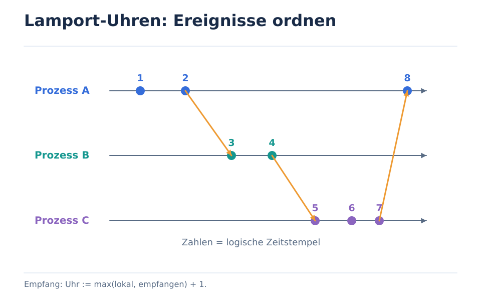

# M4-L10 – Wahlpflicht: Verteilte Systeme, logische Uhren und Konsens {#L10}

**Kursbereich:** M4 – Studienwahl: KI, Informatik und Spezialgebiete

**Niveau:** Studium (Wahl / Spezialisierung)

**Vorwissen:** [M2-L1](M2-L1.md) · [M2-L13](M2-L13.md) · [M1-L7](M1-L7.md) · [M4-L4](M4-L4.md)

**Einordnung:** Wahlpflichtmodul Systeminformatik, fortgeschrittener Bachelor bis Master. Vorwissen: M2-L1 (Graphen), M2-L13 (Algorithmen und Logik), M1-L7 (Wahrscheinlichkeitsgrundlagen), M4-L4 (Spezifikationen und Invarianten)

## Worum geht es? {#S1}

Wenn ein Dienst auf mehreren Rechnern läuft, gibt es keine einzige zentrale Uhr, und Nachrichten treffen mit veränderlichen Verzögerungen ein. Ein Rechner kann ausfallen, während andere weiterarbeiten. Trotzdem sollen Datenbankeinträge, Maschinenzustände oder Aufgabenlisten verständlich und möglichst zuverlässig erscheinen. Die dazugehörige Mathematik beschreibt **Ereignisreihenfolgen, Mehrheiten, Konsistenzregeln und Konfliktauflösung**. Im Unterschied zu reiner Parallelprogrammierung müssen wir ausdrücklich berücksichtigen, dass andere Rechner oder das Netzwerk nicht erreichbar sein können.

## Grundidee: Ein Zeitstempel ist nicht die ganze Wirklichkeit {#S2}

Stelle dir zwei Rechner A und B vor. A reserviert einen Roboterarm; B liest kurz danach die Belegung, aber die Nachricht ist noch nicht angekommen. Aus Sicht von B kann der Arm frei aussehen. Für die korrekte Entscheidung genügt deshalb nicht die lokale Rechnerzeit: Wir benötigen eine Regel, **welche Ereignisse voneinander abhängen** und **wann ein gemeinsam akzeptierter Zustand verbindlich ist**.

Drei verschiedene Ziele müssen getrennt bleiben:

- **Safety (Sicherheit einer Protokolleigenschaft):** Es werden niemals zwei widersprüchliche Ergebnisse als gültig festgelegt, sofern die Modellannahmen gelten.
- **Liveness (Fortschritt):** Unter passenden Zusatzannahmen erreicht das System irgendwann wieder eine Entscheidung.
- **Availability (Verfügbarkeit):** Ein zulässiger Clientwunsch erhält innerhalb der verwendeten Definition eine erfolgreiche Antwort. Hohe Verfügbarkeit ist nicht dasselbe wie ein jederzeit linear konsistenter Zustand.

## Neue Zeichen und Begriffe – zuerst die Lesehilfe {#S3}

  Zeichen / Begriff          So liest man es                             Bedeutung in dieser Lektion                     Nicht verwechseln mit
  -------------------------- ------------------------------------------- ----------------------------------------------- ------------------------------------------------
  $A$, $B$, $P$, $Q$         „Rechner A“, „Prozess P“                    voneinander getrennte Prozesse oder Server      Zahlenvariablen aus der Algebra
  $a \to  b$                 „Ereignis a geschieht kausal vor b“         *Happened-before*-Relation                      gewöhnlicher Vergleich physischer Uhrzeiten
  $a \Vert  b$               „a und b sind nebenläufig“                  keine Kausalrichtung ist bekannt                zwingend gleichzeitig stattfindende Ereignisse
  $C(a)$                     „logischer Zeitstempel des Ereignisses a“   Lamport-Zähler am Ereignis                      Uhrzeit in Sekunden
  $\max (x,y)$               „das größere von x und y“                   Auswahl des größeren Zählerwerts                Summe
  $N$                        „enn“                                       Anzahl der abstimmenden Server                  Stichprobengröße einer Statistik
  $f$                        „eff“                                       angenommene Zahl ausgefallener Server           Funktion $f(x)$
  $\lfloor x\rfloor$         „abrunden von x“                            größte ganze Zahl, die nicht größer als x ist   Runden zur nächstgelegenen Zahl
  $q$                        „ku“                                        erforderliche Mehrheit an Stimmen               Abfragevektor in M4-L1
  `term`                     „Term“                                      Raft-Wahlperiode mit steigender Nummer          algebraischer Term
  `log`                      „Protokolleintragsfolge“                    geordnete Sammlung replizierter Befehle         natürlicher Logarithmus
  $s=(s_{1},\ldots ,s_{n})$  „Zustandsvektor s“                          Komponenten des replizierten Zählerzustands     Ort im dreidimensionalen Raum
  $\max (s,t)$               „komponentenweises Maximum“                 Zusammenführen zweier Zählerzustände            Summieren der Zählwerte
  `Σ`                        „Sigma, Summe“                              Addition aller Zustandskomponenten              Symbol für einen beliebigen Prozess
  $V(a)$                     „Vektoruhr am Ereignis a“                   Zählerstand je beobachtetem Prozess             eine physikalisch synchronisierte Uhr

Die Schreibweise $a \to  b$ bedeutet in M4-L10 *kausale Ereignisordnung*, nicht automatisch eine Netzwerkverbindung. $a \Vert  b$ bedeutet **keine bekannte Reihenfolge**; beide Ereignisse können in der tatsächlichen Welt zu verschiedenen Zeitpunkten stattgefunden haben.

## Kausale Reihenfolge und Lamport-Uhren {#S4}

Die Relation „a geschieht vor b“ wird durch drei Regeln aufgebaut:

{alt="Drei Prozesse mit Nachrichten und konsistenten Lamport-Zeitstempeln"}

1.  Zwei Ereignisse desselben Prozesses folgen dessen eigener Ausführungsreihenfolge.
2.  Das **Senden** einer Nachricht liegt kausal vor ihrem **Empfang**.
3.  Wenn a vor b und b vor c liegt, dann liegt a auch vor c; das nennt man *Transitivität*.

Eine **logische Lamport-Uhr** ist ein monoton steigender Ganzzahlzähler. Für das folgende Beispiel definieren wir diese konkrete Konvention: Vor jedem lokalen Ereignis oder Sendeereignis wird der Zähler um eins erhöht. Beim Empfang einer Nachricht mit Zeitstempel m wird der neue lokale Zähler auf $\max(C_{\mathrm{lokal}},m)+1$ gesetzt.

$$
C_{\mathrm{neu}}=\max(C_{\mathrm{alt}},m)+1
$$

**Gesprochen:** „Der neue logische Zeitstempel ist um eins größer als der größere Wert aus dem alten eigenen Zähler und dem empfangenen Zähler.“ Dies ist eine Ordnungsregel, keine physikalische Zeitmessung.

### Vollständig gerechnetes Beispiel: Nachricht von P nach Q {#abschnitt-5}

Beide Zähler beginnen bei null.

1.  Auf Rechner P passiert ein lokales Ereignis. P setzt seinen Zähler auf $1$.
2.  P sendet eine Nachricht. Vor dem Senden erhöht P auf $2$; die Nachricht trägt den Wert $m=2$.
3.  Rechner Q hat unterdessen ein eigenes lokales Ereignis durchgeführt und steht bei $1$.
4.  Q empfängt die Nachricht. Er berechnet $\max (1,2)+1=3$. Das Empfangsereignis bekommt also Zeitstempel $3$.
5.  Q verarbeitet anschließend intern die Nachricht weiter. Das nächste Ereignis erhält $4$.

Die Sendung liegt kausal vor dem Empfang, und die Zähler bestätigen $2 < 3$. Der Umkehrschluss gilt **nicht**: Aus $C(a) < C(b)$ allein folgt **nicht**, dass a b verursacht oder beeinflusst hat. Zwei unabhängige Rechner können zufällig die Werte 2 und 5 tragen und trotzdem kausal unverknüpft sein. Zur Erkennung von Nebenläufigkeit eignen sich beispielsweise **Vektoruhren**, deren mehrere Komponenten zusätzlich die beobachtete Vorgeschichte festhalten.

### Kontrollbeispiel: Nebenläufigkeit mit Vektoruhren erkennen {#abschnitt-6}

Bei genau zwei Prozessen P und Q führe jede Vektoruhr zwei Komponenten $(\mathrm{Z\ddot ahler}_P,\mathrm{Z\ddot ahler}_Q)$. Jeder Prozess erhöht vor einem eigenen Ereignis seine Komponente. Beim Empfang einer Nachricht bildet Q zunächst das **komponentenweise Maximum** mit dem gesendeten Vektor und erhöht dann seine eigene Komponente.

Formel, Skizze oder Rechenschema · Originalnotation

    P hat nach einem lokalen Ereignis und einem Sendeereignis a: V(a) = (2,0)
    Q hat nach einem unabhängigen Ereignis: V(b) = (0,1)
    Vergleich: (2,0) ≰ (0,1) und (0,1) ≰ (2,0)
    Daher sind a und b nach der beobachteten Ordnung nebenläufig.

    Das Sendeereignis a überträgt den Stand (2,0) an Q.
    Q empfängt nach dem Ereignis b:
    max[(0,1),(2,0)] = (2,1)
    Empfangsereignis bei Q: (2,2)

Die beiden ursprünglichen Vektoren sind **nicht komponentenweise vergleichbar**; der Empfangsvektor $(2,2)$ enthält dagegen beide Vorgeschichten. Anders als ein einzelner Lamport-Zähler kann die Vektoruhr in diesem Modell die Nebenläufigkeit unterscheiden. Diese Aussage setzt voraus, dass jede relevante Prozesskomponente korrekt fortgeführt und mitübertragen wird; bei dynamischer Mitgliedschaft sind zusätzliche Regeln nötig.

## Mehrheiten: Wie viele Stimmen werden benötigt? {#S5}

Ein einfacher Mehrheitsschwellenwert bei $N$ stimmberechtigten Servern lautet:

$$
q=\left\lfloor\frac N2\right\rfloor+1
$$

**Gesprochen:** „Teile die Serverzahl durch zwei, runde ab und addiere eins.“ Für $N=5$ lautet die Rechnung $\left\lfloor\frac52\right\rfloor+1=2+1=3$. Jede Menge von drei Servern überschneidet sich mit jeder anderen solchen Dreiermehrheit in **mindestens einem** Server: Denn zwei disjunkte Dreiergruppen würden mindestens sechs verschiedene Server benötigen. Diese Überlappung ist eine wichtige Bautechnik von Konsensprotokollen, aber **noch kein vollständiger Sicherheitsbeweis**. Allgemeiner gilt für zwei Teilmengen $Q_{1},Q_{2}$ mit jeweils mindestens $q$ Mitgliedern aus $N$ Servern: $|Q_{1}\cap Q_{2}| \ge  2q-N$ (sofern die rechte Seite positiv ist). Für $N=5$, $q=3$ erhält man mindestens $1$; für $N=4$, $q=3$ mindestens $2$ gemeinsame Server. Auch das allein garantiert noch nicht die Raft-spezifischen Wahl-, Log- und Commit-Eigenschaften.

Bei höchstens $f$ **Crash-Ausfällen** genügt für eine Mehrheitsentscheidung ein Verbund aus $2f+1$ abstimmenden Servern, um unter günstigen Netzwerkbedingungen noch $f+1$ erreichbare Server zu haben. Für $f=2$ erhält man $N=5$, die Mehrheit ist $3$. Die Aussage gilt **nicht unverändert** für böswillig manipulierende (*byzantinische*) Teilnehmer, willkürlich gestörte Netzwerke oder beliebige Konsistenzanforderungen.

### Durchgerechnete Netzwerkteilung {#abschnitt-8}

Fünf Raft-Replikate liegen in zwei Gruppen: links A und B, rechts C, D und E. Durch eine Störung können die Gruppen nicht miteinander kommunizieren. Die linke Seite verfügt über **2 von 5 Stimmen**, die rechte über **3 von 5**. Eine neue Führung darf nur durch eine ordnungsgemäße Raft-Wahl mit Mehrheit entstehen; die Dreiergruppe kann dafür grundsätzlich genügend Stimmen besitzen, die Zweiergruppe nicht. Ein früherer Anführer links darf **nicht einfach neue Einträge verbindlich machen**, nur weil er früher einmal gewählt wurde.

Diese Rechenidee erklärt die Mehrheitsbarriere. Ob eine Wahl gelingt und welche Logeinträge übernommen oder verworfen werden, hängt außerdem von **Wahlperioden, Aktualität der Logs, Nachrichtenverzögerungen und den vollständigen Raft-Regeln** ab.

## Replizierte Zustandsautomaten und Raft {#S6}

Eine replizierte Zustandsmaschine führt denselben geordneten Befehlsstrom auf mehreren Servern aus. Unter der Annahme **deterministischer Übergänge** und identischer Startzustände führen dieselben verbindlich beschlossenen Eingaben zum selben Zustand. Ein Bank- oder Buchungssystem muss deshalb nicht nur Daten kopieren, sondern besonders **die Reihenfolge der Änderungen** sicherstellen.

Raft trennt dafür drei Problemgruppen:

- **Führungswahl:** Ein Server wird für eine Wahlperiode (*term*) zum Leader, wenn er die erforderlichen Stimmen unter den Protokollbedingungen erhält.
- **Log-Replikation:** Der Leader verteilt Einträge in einer geordneten Folge. Einträge werden nach den Commit-Regeln verbindlich, nicht durch bloßes Ankommen bei irgendeinem Server.
- **Sicherheitsregeln:** Frühere verbindliche Einträge dürfen durch spätere Führungswahlen nicht stillschweigend widersprüchlich überschrieben werden. Hierzu gehören beispielsweise die Prüfung ausreichend aktueller Logs und die Raft-spezifische Commit-Regel für Einträge der aktuellen Wahlperiode.

Konsens ist **kein Beweis, dass jeder Auftrag erfüllt wird**: Bei fehlender Mehrheit kann die sichere Reaktion sein, eine Schreiboperation vorläufig nicht zu bestätigen.

## Konsistenzmodelle: Was darf ein Client beobachten? {#S7}

**Linearisierbarkeit:** Eine abgeschlossene Operation soll so wirken, als hätte sie zu einem einzigen Zeitpunkt zwischen Anfrage und Antwort stattgefunden; zeitliche Reihenfolge nicht überlappender Operationen bleibt erhalten. Das ist stärker als die bloße Übereinstimmung aller Replikate „irgendwann später“. **Wichtig bei Raft-Lesezugriffen:** Auch ein Server, der sich noch für den Leader hält, kann nach einer Netzwerkteilung veraltet sein. Eine linearisierbare Leseantwort erfordert deshalb eine geeignete Prüfung aktueller Führung und des angewendeten Commit-Standes, beispielsweise über ein Quorum-basiertes Read-Index-Verfahren oder ein korrekt abgesichertes Lease-Modell. Aus „Leader“ allein folgt keine aktuelle Lesegarantie.

**Eventual Consistency:** Wenn keine weiteren Aktualisierungen stattfinden und ausreichend Kommunikation wieder möglich wird, können Replikate schließlich denselben Zustand erreichen. Ohne weitere Konfliktregeln kann dieser Zustand bei konkurrierenden Änderungen unerwartet ausfallen.

**Die CAP-Aussage richtig lesen:** Wenn eine Netzwerkteilung verhindert, dass zwei Seiten zuverlässig Nachrichten austauschen, kann ein System nicht zugleich alle Anfragen erfolgreich behandeln **und** für jede Anfrage eine linearisierbare Sicht garantieren. Sie bedeutet nicht, dass jedes System grundsätzlich genau zwei von drei frei wählbaren Eigenschaften „bekommt“. Latenz, Fehlermodell und verwendete Konsistenzdefinition sind entscheidend.

## Alternative ohne zentralen Konsens: monoton wachsende CRDT-Zähler {#S8}

Für manche Datentypen kann man voneinander getrennte Änderungen **konfliktfrei zusammenführen**, ohne jede einzelne Änderung vorher abzustimmen. Ein sogenannter *Grow-only Counter (G-Counter)* besteht aus einer Komponente je Replikat. Jedes Replikat darf **nur seine eigene** Komponente erhöhen. Der angezeigte Gesamtwert ist die Summe der Komponenten. Beim Zusammenführen nimmt man **für jede Komponente den größeren Stand**, nicht die Summe beider Gesamtwerte.

$$
\begin{aligned}
\operatorname{merge}(s,t)_i&=\max(s_i,t_i)\\
\operatorname{value}(s)&=\sum_i s_i
\end{aligned}
$$

**Gesprochen:** „Die i-te Komponente des vereinten Zustands ist das Maximum der i-ten Komponenten beider Kopien; der Zählerwert ergibt sich aus der Summe aller Komponenten.“

### Durchgerechnetes Beispiel {#abschnitt-12}

Die Replikate A, B und C besitzen je eine eigene Zählerkomponente. Ein Netzwerkknoten kennt den Zustand $s=(4,1,0)$; ein anderer kennt $t=(3,1,2)$. Die zweite Kopie hat A also nur bis drei gesehen, dafür aber C bis zwei.

$$
\begin{aligned}
s&=(4,1,0)\\
t&=(3,1,2)\\
\operatorname{merge}(s,t)&=(\max(4,3),\max(1,1),\max(0,2))\\
&=(4,1,2)\\
\text{Gesamtwert}&=4+1+2=7
\end{aligned}
$$

Ein erneutes Zusammenführen desselben Zustands ändert die sieben nicht. Das funktioniert, weil $\max$ pro Komponente **kommutativ, assoziativ und idempotent** ist: Reihenfolge und Doppelübertragung sind für den zusammengeführten Zählerstand unschädlich. Ein G-Counter kann jedoch **nicht direkt subtrahieren** und ersetzt keine allgemeinen Buchungstransaktionen mit globalen Invarianten wie „ein Ticket nur einmal vergeben“.

## Wiederholungen, Ausfälle und Sicherheitsgrenzen {#S9}

Ein Client sendet vielleicht eine Aufgabe, der Server führt sie aus, aber die Antwort geht verloren. Nach einem erneuten Senden droht eine doppelte Ausführung. Deshalb brauchen Systeme *idempotente* Operationen oder stabile Auftragskennungen mit geeigneter Duplikaterkennung. Eine Netzwerkzustellung mit „mindestens einmal“ ist nicht dasselbe wie ein **durchgängig genau einmal erreichter Geschäftseffekt**.

Aus einer lokalen Stoppuhr kann ein Rechner bei Nachrichtenverlust und unbeschränkt langen Verzögerungen nicht sicher erkennen, ob die Gegenstelle abgestürzt oder nur langsam ist. Reale Konsensprotokolle stützen ihre Fortschrittseigenschaften daher auf **zusätzliche Zeit-, Erreichbarkeits- und Ausfallannahmen**. Sicherheit und Fortschritt müssen separat begründet werden.

## Wofür ist das nützlich? {#S10}

Verteilte Datenbanken und KI-Dienste verteilen Anfragen auf Rechner; replizierte Konfigurationsdaten benötigen konsistente Entscheidungen. Sensornetze und Roboterflotten müssen auch bei Funklöchern wissen, ob eine Entscheidung lokal vorläufig ist oder von der gesamten Gruppe bestätigt wurde. CRDTs können dagegen verteilte, monotone Messwertzähler abgleichen, sobald wieder Verbindung besteht.

## Annahmen und Grenzen {#S11}

- Das Mehrheitsbeispiel betrachtet **Crash-Ausfälle** und eine feste Gruppe, nicht beliebige feindliche Server oder fehlerhafte Administratorentscheidungen.
- Die Regeln der Lamport-Uhr erlauben keine exakte physikalische Zeitmessung; bei Uhrensynchronisation sind zusätzliche Methoden nötig.
- Das G-Counter-Beispiel verlangt einen identifizierbaren Schreiber je Komponente und monotone lokale Zuwächse. Es garantiert keine beliebige transaktionale Konsistenz.
- Raft ist ein **konkretes** Konsensprotokoll, kein Synonym für jede Form verteilter Koordination; für Sicherheit und Verfügbarkeit im Einzelfall müssen alle Implementierungsregeln berücksichtigt werden.
- Eine Netzwerkpartition kann sichere Operationen verzögern oder verhindern. Eine mathematische Mehrheit ersetzt keine Betriebsüberwachung, Sicherheitsgrenzen oder Datensicherung.

## Verbindungen und Weiterführung {#S12}

**M2-L1** liefert die Graphensprache, **M2-L13** Algorithmen und Berechenbarkeit, **M4-L4** Programmbeweise. **M4-L7** beschreibt Datenschutz beim verteilten Lernen – dieser Datenschutz folgt nicht aus Raft oder Replikation. Bei **M4-L11** geht es um zeitlich verzögerte Sensordaten aus mehreren Quellen; dort ist die Unterscheidung von Ereigniszeit und Nachrichtenreihenfolge besonders wichtig. **M4-L12** nutzt replizierbare Suchindizes, die eigene Konsistenz- und Aktualisierungsfragen erzeugen.

## Quellen {#S13}

**Dokumentierter Quellenstand:** 04.11.2026

- Leslie Lamport (1978): *Time, Clocks, and the Ordering of Events in a Distributed System*. [https://www.microsoft.com/en-us/research/publication/time-clocks-ordering-events-distributed-system/](https://www.microsoft.com/en-us/research/publication/time-clocks-ordering-events-distributed-system/)
- Diego Ongaro und John Ousterhout (2014): *In Search of an Understandable Consensus Algorithm* (Extended Version). [https://raft.github.io/raft.pdf](https://raft.github.io/raft.pdf)

Die oben verwendeten Zahlen und Zustände sind **eigenständig konstruierte Lernbeispiele**, keine Ergebnisse aus den genannten Publikationen. Zum Lesen dieser Lektion werden keine externen Quellen geladen.
