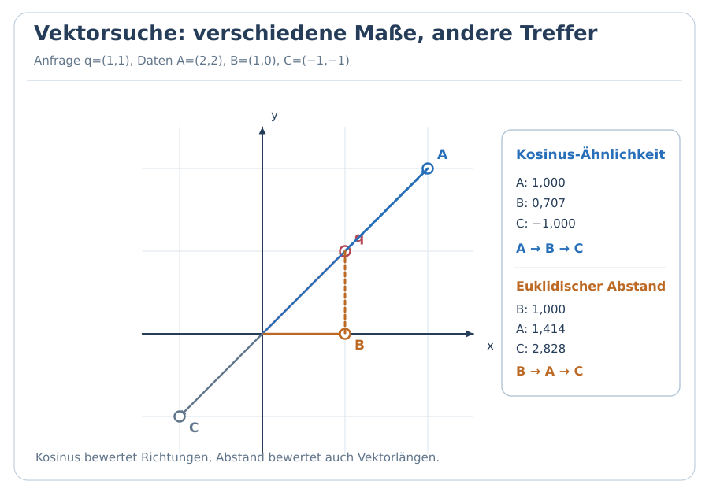

# M4-L12 – Wahlpflicht: Vektorsuche, Datenbankindizes und Approximate Nearest Neighbors {#L12}

**Kursbereich:** M4 – Studienwahl: KI, Informatik und Spezialgebiete

**Niveau:** Studium (Wahl / Spezialisierung)

**Vorwissen:** [M2-L11 – Schulmathematik](https://monowlith-com.github.io/learning-courses/index.html?course=school_mathematics&module=M2&lesson=L11&syslang=de&doclang=de&theme=light) (Skalarprodukt, Winkel), [M1-L5](M1-L5.md)–[M1-L8](M1-L8.md) (Vektoren, Matrizen und numerische Verfahren), [M2-L1](M2-L1.md) (Graphen), [M2-L11](M2-L11.md) (Embeddings), [M4-L1](M4-L1.md) (Sprachmodelle) und [M4-L3](M4-L3.md) (Graph-Modelle)

**Einordnung:** Wahlpflichtmodul KI-Infrastruktur, fortgeschrittener Bachelor bis Master.

## Worum geht es? {#S1}

Ein KI-System soll aus sehr vielen Textpassagen, Bildern oder Messreihen die passendsten Einträge finden. Ein modernes Verfahren wandelt solche Daten in **Zahlenvektoren** um. Danach sucht es diejenigen gespeicherten Vektoren, die der Anfrage nach einem gewählten **Ähnlichkeitsmaß** am nächsten liegen. Bei Millionen Einträgen kann ein direkter Vergleich mit allen Vektoren teuer werden. Deshalb entstehen spezielle **Datenbankindizes**, die oft deutlich schneller passende Kandidaten finden, aber mitunter einen tatsächlich nächsten Vektor übersehen. Die Mathematik hilft, diesen Tausch zwischen **Trefferqualität, Laufzeit und Speicherbedarf** zu verstehen.

## Grundidee: Ähnlichkeit ist eine Entscheidung des Modells {#S2}

Ein Sprachmodell oder ein gesonderter Encoder erzeugt aus einem Textabschnitt einen Vektor. Dieser wird *Embedding* genannt. Zwei ähnliche Texte können bei einem passenden Modell Vektoren in ähnlicher Richtung bekommen. Das ist eine **gelernte, messbare Repräsentation**, keine Garantie, dass beide Texte dasselbe bedeuten, wahr sind oder dieselbe rechtliche Aussage enthalten.

Bei einer Suche sind daher zwei Schritte streng zu unterscheiden:

1.  **Repräsentieren:** Text, Bild oder Datenobjekt wird auf einen Vektor abgebildet.
2.  **Vergleichen und abrufen:** Eine Distanz oder ein Ähnlichkeitswert ordnet gespeicherte Vektoren relativ zur Anfrage.

Wenn die Repräsentation schlecht gewählt ist, kann selbst der mathematisch genaueste Nachbarschaftsalgorithmus keine inhaltlich guten Treffer herbeizaubern.

## Neue Zeichen – vor den Formeln {#S3}

  Zeichen / Begriff                 Laut gelesen                           Bedeutung hier                                                      Nicht verwechseln mit
  --------------------------------- -------------------------------------- ------------------------------------------------------------------- ------------------------------------------------
  $q$                               „ku, Anfragevektor“                    Vektor der gesuchten Anfrage                                        Q-Wert aus M4-L6 oder Attention-Q aus M4-L1
  $x_{i}$                           „iks Index i“                          gespeicherter Vektor i                                              räumliche Position oder Zustand in M4-L11
  $d$                               „de“                                   Anzahl der Komponenten eines Vektors                                Abstandssymbol, wenn $d(x,y)$ geschrieben wird
  $i$, $j$                          „Index i und Index j“                  i nummeriert gespeicherte Vektoren, j deren einzelne Komponenten    Zeitvariable
  $N$                               „enn“                                  Anzahl gespeicherter Vektoren                                       Serverzahl in M4-L10
  $k$                               „ka“                                   Zahl der gewünschten Nachbarn                                       Kalman-Gewinn K in M4-L11
  $\Vert x\Vert _{2}$               „Zwei-Norm von iks“                    euklidische Länge von x                                             Betrag eines Skalaren
  $x\cdot y$                        „iks Skalarprodukt ypsilon“            Summe komponentenweiser Produkte                                    logisches Und
  $\operatorname{sim}_{\cos}(q,x)$  „Kosinus-Ähnlichkeit von ku und iks“   Richtungsgleichheit nach Normierung                                 Wahrscheinlichkeitskalibrierung
  $\operatorname{dist}_2(q,x)$      „euklidischer Abstand von ku zu iks“   Länge des Differenzvektors                                          gleiche Richtung bei verschiedener Länge
  $\operatorname*{arg\,min}$        „Argument des kleinsten Werts“         Index eines Eintrags mit minimalem Abstand                          Zahlenwert des Minimums selbst
  `top-k`                           „die ersten ka Treffer“                k bestbewertete Suchergebnisse                                      sämtliche relevanten Einträge
  `ANN`                             „Approximate Nearest Neighbors“        näherungsweise nächste Nachbarn                                     exakte k-NN-Suche
  `HNSW`                            „Hierarchical Navigable Small World“   navigierbarer mehrstufiger Nachbarschaftsgraph                      garantiert exakte Suche
  `IVF`                             „Inverted File Index“                  gruppenbasierter Vektorindex                                        Wort-Invertindex in gewöhnlicher Volltextsuche
  `PQ`                              „Product Quantization“                 komprimierte Darstellung von Teilvektoren                           Wahrscheinlichkeitsmaß
  `Recall@k`                        „Recall bei ka“                        Anteil exakter Top-k-Nachbarn, die näherungsweise gefunden wurden   semantische Richtigkeit aller Antworten
  `p95`                             „95. Perzentil“                        Wert, unter dem 95 % beobachteter Antwortzeiten liegen              garantierte Maximaldauer
  `GiB`                             „Gibibyte“                             $2^{30}\,\text{Bytes}$                                              dezimales Gigabyte: $10^9\,\text{Bytes}$

**Sprachliche Stolperfalle:** In manchen Fachtexten heißt die Anzahl der Vektoren $n$ statt $N$, oder $d$ bezeichnet eine Distanzfunktion. Hier gelten durchgehend die Definitionen der Tabelle. Eine Kosinus-Ähnlichkeit ist **keine Wahrscheinlichkeit**.

## Drei verschiedene Ähnlichkeitsmaße {#S4}

Für zwei nichtverschwindende reelle Vektoren q und x ist die **Kosinus-Ähnlichkeit**:

$$
\operatorname{sim\_cos}(q,x)=\frac{q\cdot x}{\lVert q\rVert_2\cdot\lVert x\rVert_2}
$$

**In Worten:** Teile das Skalarprodukt beider Vektoren durch das Produkt ihrer Längen. Ein Wert von eins bedeutet gleiche Richtung, minus eins entgegengesetzte Richtung, und null bedeutet bei nichtverschwindenden Vektoren einen rechten Winkel. Das Vorzeichen und der Wertebereich gelten hier für **reelle** Vektoren mit euklidischem Skalarprodukt.

Der **euklidische Abstand** ist dagegen:

$$
\operatorname{dist}_2(q,x)=\lVert q-x\rVert_2=\sqrt{\sum_j{(q_j-x_j)}^2}
$$

**In Worten:** Ziehe jede Komponente von x von der entsprechenden Komponente der Anfrage ab, quadriere die Unterschiede, addiere und ziehe die Quadratwurzel. Anders als die Kosinus-Ähnlichkeit berücksichtigt dieser Abstand auch die **Länge** eines Vektors.

Das **Skalarprodukt** selbst kann ebenfalls als Rangwert dienen, etwa wenn ein Modell gerade darauf trainiert wurde. Es bevorzugt aber bei ähnlichen Richtungen häufig Vektoren mit größerer Norm. Für die Wahl der Metrik ist deshalb das Trainingsziel des jeweiligen Embedding-Modells relevant.

### Vollständig gerechnetes Beispiel: Kosinus und Abstand ordnen anders {#abschnitt-5}

Die Anfrage ist $q=(1,1)$. Drei gespeicherte Vektoren sind $A=(2,2)$, $B=(1,0)$ und $C=(-1,-1)$.

Dasselbe Vektorbeispiel ergibt verschiedene Rankings: Kosinus A–B–C, euklidischer Abstand B–A–C.

**Schritt 1: Längen und Skalarprodukte.**

$$
\begin{aligned}
\lVert q\rVert_2&=\sqrt{1^2+1^2}=\sqrt2\\
\lVert A\rVert_2&=\sqrt{2^2+2^2}=\sqrt8=2\sqrt2\\
\lVert B\rVert_2&=1\\
\lVert C\rVert_2&=\sqrt2\\
q\cdot A&=1\cdot2+1\cdot2=4\\
q\cdot B&=1\cdot1+1\cdot0=1\\
q\cdot C&=1\cdot(-1)+1\cdot(-1)=-2
\end{aligned}
$$

**Schritt 2: Kosinus-Ähnlichkeiten.**

$$
\begin{aligned}
\operatorname{sim}_{\cos}(q,A)&=\frac4{\sqrt2\cdot2\sqrt2}=\frac44=1\\
\operatorname{sim}_{\cos}(q,B)&=\frac1{\sqrt2\cdot1}=\frac1{\sqrt2}\approx0{,}7071\\
\operatorname{sim}_{\cos}(q,C)&=\frac{-2}{\sqrt2\cdot\sqrt2}=-1
\end{aligned}
$$

Die **Kosinus-Rangfolge** ist also `A vor B vor C`.

**Schritt 3: Euklidische Abstände.**

$$
\begin{aligned}
\operatorname{dist}_2(q,A)&=\sqrt{{(1-2)}^2+{(1-2)}^2}=\sqrt2\approx1{,}4142\\
\operatorname{dist}_2(q,B)&=\sqrt{{(1-1)}^2+{(1-0)}^2}=1\\
\operatorname{dist}_2(q,C)&=\sqrt{{(1+1)}^2+{(1+1)}^2}=\sqrt8\approx2{,}8284
\end{aligned}
$$

Der **Abstands-Rang** lautet dagegen `B vor A vor C`. Beide Rankings sind mathematisch korrekt – sie beantworten **verschiedene Fragen**. Bei **normierten** Vektoren mit Länge eins gilt die nützliche Beziehung:

$$
\lVert q-x\rVert_2^2=2-2\cdot\operatorname{sim\_cos}(q,x),\quad\text{falls }\lVert q\rVert_2=\lVert x\rVert_2=1\text{.}
$$

**Gesprochen:** „Bei Einheitsvektoren ist der quadrierte euklidische Abstand gleich zwei minus zweimal die Kosinus-Ähnlichkeit.“ Nur **unter dieser Normierungsannahme** liefern die beiden Maße deshalb dieselbe Reihenfolge.

## Exakte k-Nachbarsuche {#S5}

Für jede Anfrage kann man den Abstand zu **allen $N$ Vektoren** berechnen, anschließend sortieren und die $k$ besten nehmen. Für d-dimensionale Vektoren verlangt ein naiver Durchlauf ungefähr $N\cdot d$ arithmetische Komponentenoperationen für die Distanzberechnung, abgesehen von den Auswahlkosten. Dieser lineare Vollscan ist einfach, gut überprüfbar und kann bei kleinen Datenbeständen oder sehr effizienter Hardware sinnvoll sein.

**Exakte Suche** heißt: Die tatsächlichen besten $k$ nach dem **festgelegten mathematischen Maß** werden gefunden, sofern die implementierten numerischen Vergleiche und Filter korrekt sind. Bei einem **Zugriffs- oder Metadatenfilter** ist die Referenzmenge ausdrücklich nur die Menge **zulässiger** Einträge; das Ergebnis muss die besten k **innerhalb dieser Menge** liefern. Ein korrektes Suchranking darf unzulässige Treffer nicht zuerst abrufen und erst dann so wegfiltern, dass berechtigte Top-k-Treffer fehlen. Exakte metrische Suche bedeutet **nicht**, dass die gefundenen Vektoren im normalen Sprachsinn am relevantesten sind.

### Gegenprobe: Warum Zugriffsfilter vor der Top-k-Auswahl zählen {#abschnitt-7}

Betrachten wir eine eindimensionale Anfrage $q=0$ und drei Datenpunkte; das Maß ist der euklidische Abstand $|q-x|$. Gesucht wird **ein** Treffer ($k=1$), der nur aus zugelassenen Einträgen stammen darf:

  Eintrag   Position x   Abstand zu q   Berechtigt?
  --------- ------------ -------------- -------------
  A         0            0              nein
  B         1            1              ja
  C         2            2              ja

Formel, Skizze oder Rechenschema · Originalnotation

    Ungefiltertes top-1: A  → nach Berechtigungsfilter: keine Treffer
    Korrektes gefiltertes top-1 über {B,C}: B mit Abstand 1

Das Beispiel beweist nicht, dass ein bestimmter Indexfilter immer falsch arbeitet. Es zeigt: Eine Abfrage, die **zuerst eine zu kleine unberechtigte Kandidatenmenge bildet** und anschließend verbotene Einträge entfernt, kann trotz vorhandener berechtigter Treffer eine leere Antwort zurückgeben. Ein korrektes System muss Zugriffsrechte durchsetzen **und** das Ranking bezogen auf die zulässige Referenzmenge auswerten. Bei ANN-Filtern kann dafür je nach Implementierung ein anderes Such- oder Nachfilterverfahren nötig sein.

## Approximate Nearest Neighbors (ANN): Geschwindigkeit gegen garantierte Vollständigkeit {#S6}

Bei ANN-Indizes wird nur ein Teil des Suchraums gründlich untersucht. Das spart häufig Arbeit, kann aber einen mathematisch näheren Vektor übersehen. Zwei wichtige Familien sind:

- **HNSW:** Verbindet Vektoren als Nachbarschaftsgraphen auf mehreren Ebenen. Die Suche beginnt grob in einer oberen Schicht und navigiert in tiefere Schichten. Ein guter Suchparameter kann den Recall steigern, muss aber meist mit mehr Arbeit bezahlt werden. Die Methode besitzt keine universelle Zusage, **immer** die exakten k Nachbarn zu liefern.
- **IVF und Product Quantization:** Ein Clustering teilt den Raum in Suchgruppen auf. Nur ausgewählte Gruppen werden untersucht; Quantisierung kann Vektoren durch kurze Codes darstellen. Das spart Speicher und Distanzberechnungen, führt aber Näherungsfehler ein. Ob IVF, PQ und ihre Kombination geeignet sind, hängt von Datenstruktur und Suchanforderungen ab.

Ein Index ist **kein mathematisch magischer Ersatz** für die Vektorbedeutung. Bei geänderten Embeddings muss die Datenbank auf die neue Repräsentation abgestimmt oder neu indiziert werden. Metadatenfilter, Löschungen, Aktualisierungen und Datenzugriffsrechte verändern die praktische Suchqualität ebenfalls.

## Recall@k: Wie viele echte Nachbarn wurden gefunden? {#S7}

Zur Prüfung bauen wir für ein Testset oft zunächst eine **exakte Referenzsuche**. Verglichen wird dabei nicht mit einer subjektiven Antwortnote, sondern mit den k mathematisch nächstgelegenen Datenpunkten nach derselben Distanzdefinition.

$$
\operatorname{Recall@k}=\frac{\lvert\mathrm{ANN\_top\_k}\cap\mathrm{exakt\_top\_k}\rvert}{k}
$$

**Gesprochen:** „Zähle, wie viele Einträge in beiden Top-k-Mengen vorkommen, und teile durch k.“ Dieses Maß setzt eindeutige Einträge und einen definierten Umgang mit Abstandsgleichständen voraus.

### Vollständig gerechnetes Beispiel: ein Treffer fehlt {#abschnitt-10}

Zur Anfrage aus dem vorigen Beispiel sind nach **Kosinus-Rangfolge** die exakten Top-2 $A$ und $B$. Angenommen, ein näherungsweiser Index liefert versehentlich $B$ und $C$.

$$
\begin{aligned}
\mathrm{exakt\_top\_2}&=\{A,B\}\\
\mathrm{ANN\_top\_2}&=\{B,C\}\\
\text{Schnittmenge}&=\{B\}\\
\text{Recall@2}&=\frac12=0{,}5=50\,\%
\end{aligned}
$$

Die ANN-Suche hat in diesem einen Test **nur die Hälfte** der zwei exakt besten Vektoren gefunden. Das besagt weder, ob $B$ für eine reale Frage die richtige Antwort liefert, noch wie schnell die Suche war. Für einen belastbaren Benchmark werden viele Anfragen, Datenverteilungen, Filter und Indexkonfigurationen getestet; wichtig sind beispielsweise Mittelwert, **p95-Latenz**, Speicher, Durchsatz und Aktualisierungskosten.

### Bei gleichen Distanzen ist die Referenz nicht automatisch eindeutig {#abschnitt-11}

Der Quotient $\frac{|\mathrm{ANN}_{\mathrm{top}\,k}\cap\mathrm{exakt}_{\mathrm{top}\,k}|}{k}$ braucht eine eindeutig definierte exakte Referenz. Haben Datenpunkte **identische Distanz**, können mehrere korrekte Top-k-Mengen existieren. Beispiel: $q=0$, $A=-1$, $B=1$, $k=1$; beide Punkte haben Distanz $1$.

Wählt die Referenz willkürlich $A$, der ANN-Index aber $B$, erscheint der einfache Mengen-Recall als $0$, **obwohl B ebenso nah ist**. Ein Benchmark muss daher Gleichstände deterministisch auflösen, beispielsweise über eine feste ID-Sortierung, oder ein geeignetes tie-bewusstes Qualitätsmaß verwenden. Die Konvention muss für exakte Suche und ANN-Vergleich identisch dokumentiert werden.

## Wie viel Speicher kostet eine Vektordatenbank? {#S8}

Nehmen wir als Beispiel eine Million Vektoren mit je 768 Dimensionen. Wenn jede Komponente als 32-Bit-Fließkommazahl gespeichert wird, benötigt sie $4\,\text{Bytes}$. Der reine Zahlenbereich beträgt:

$$
\begin{aligned}
N&=1\,000\,000\quad\text{Vektoren}\\
d&=768\quad\text{Werte pro Vektor}\\
\text{Speicher}&=N\cdot d\cdot4\,\text{Bytes}\\
&=1\,000\,000\cdot768\cdot4\,\text{Bytes}\\
&=3\,072\,000\,000\,\text{Bytes}\\
&=3{,}072\,\mathrm{GB}\quad\text{(dezimale Gigabyte)}\\
&\approx2{,}861\,\mathrm{GiB}\quad\text{(Gibibyte)}
\end{aligned}
$$

Die **tatsächliche Datenbank** benötigt zusätzlich IDs, Dokumente oder Referenzen, Metadaten, Indexgraphen, Zuordnungen und Verwaltungsdaten. Eine ideale Codierung mit genau **einem Byte pro Komponente** hätte für die reinen Vektorcodes $768\,000\,000\,\text{Bytes}$, aber Quantisierungsfehler und weiteren Overhead. Product Quantization kann ganz anders codieren; die Ein-Byte-Rechnung ist nur ein **einfaches Speichervergleichsmodell**, kein automatisch gültiges PQ-Ergebnis.

## Der gesamte Retrieval-Ablauf bei KI {#S9}

Ein KI-System mit dokumentengestützter Generierung (*Retrieval-Augmented Generation*, RAG) kann so arbeiten:

1.  **Dokumente aufbereiten:** Texte werden in sinnvolle, eindeutig identifizierte Abschnitte geteilt. Rechte und Quellenangaben bleiben zuordenbar.
2.  **Embeddings berechnen:** Jeder Abschnitt wird durch einen geeigneten Encoder in einen Vektor übersetzt.
3.  **Index aufbauen:** Vektoren und Metadaten erhalten einen Suchindex (gegebenenfalls ANN).
4.  **Anfrage abbilden:** Der Suchtext wird mit einem kompatiblen Encoder eingebettet.
5.  **Kandidaten suchen und filtern:** Die Datenbank liefert passende und **berechtigte** Dokumente. Zugriffsrechte dürfen nicht durch ANN- oder Filtervereinfachungen umgangen werden.
6.  **Gegebenenfalls neu ordnen:** Ein stärkeres Modell bewertet die Kandidaten in Bezug auf die Originalanfrage. Diese Stufe heißt *Reranking*.
7.  **Antwort erzeugen und belegen:** Das Sprachmodell darf Quellen nur für tatsächlich belegte Aussagen anführen. Eine hohe Vektorähnlichkeit allein ist **kein Beleg für Wahrheit**.

Retrievalqualität und Antwortqualität sollten **getrennt** gemessen werden. Ein perfekter Recall beim Index sagt nichts darüber aus, ob die Antwort korrekt zusammengefasst ist. Umgekehrt kann ein Sprachmodell überzeugend formulieren, obwohl die Suche entscheidende Gegenbelege nicht geliefert hat.

## Hochdimensionale Räume und praktische Fallstricke {#S10}

In hohen Dimensionen werden Distanzunterschiede für bestimmte Datenverteilungen weniger aussagekräftig; dies ist **keine universelle Behauptung**, dass Vektorsuche in hohen Dimensionen grundsätzlich unmöglich sei. Tatsächliche Qualität hängt von Training, Verteilung, Normierung, Maß, Intrinsik der Daten und Indexaufbau ab.

- **Normierung:** Für Kosinus-Suche dürfen Nullvektoren nicht durch ihre Norm geteilt werden. Einheitsnormierung beeinflusst Skalarprodukt und euklidische Distanz.
- **Filter:** Wenn nach Kundenzugehörigkeit oder Aktualität gefiltert wird, kann ein unpassendes Filter-/Indexverfahren relevante Treffer verlieren oder Laufzeiten erhöhen.
- **Zugriffsrechte:** Mandantenisolation und Löschanforderungen sind Sicherheitsanforderungen. Ein gespeicherter Vektor kann selbst noch sensible Rückschlüsse zulassen.
- **Änderungen:** Ein neuer Encoder kann den geometrischen Raum verändern; Werte aus verschiedenen Modellversionen sind nicht ohne Prüfung vergleichbar.
- **Benchmarks:** Ein Index kann im Mittel schnell sein und trotzdem problematische Extremfälle haben. Bewertet werden sollten insbesondere p95/p99 und Rückrufquote nach Filterung.
- **Vergleichsmaß:** Recall@k misst die Übereinstimmung mit **exakter metrischer Suche**, nicht mit menschlich beurteilter semantischer Relevanz.

## Wofür nützlich? {#S11}

Vektorsuche unterstützt lokale Wissensbibliotheken, Bild- und Audiosuche, Code-Recherche, Empfehlungsverfahren, die Suche nach ähnlichen Sensormustern und Sprachmodell-Retrieval. Für **M4-L11** können Ähnlichkeitsindizes das Finden von Kandidaten für visuelle Landmarken beschleunigen; die **geometrische und probabilistische Prüfung** der Zuordnung bleibt trotzdem erforderlich. Für **M4-L1** und **M2-L11** schließt die Lektion die Lücke zwischen einem ausgebildeten Embedding-Modell und seiner verlässlichen Nutzung in einem Datenbanksystem.

## Annahmen und Grenzen {#S12}

- Ein Embedding modelliert Ähnlichkeit nur gemäß Daten, Training und gewähltem Distanzmaß. Es ist kein allgemeiner Wahrheits-, Sicherheits- oder Identitätsbeweis.
- ANN-Verfahren können mathematisch bessere Kandidaten übersehen. Indexnamen wie HNSW oder IVF liefern allein **keine garantierte Latenz oder Recall-Quote**.
- Alle Speicherzahlen beziehen sich auf explizit genannte Typen und beinhalten **keinen** vollständigen Speicherbedarf einer Datenbank.
- Die Gleichheit von Kosinus- und euklidischer Rangfolge gilt in der oben verwendeten Form **nur bei einheitsnormierten Vektoren**.
- Ein RAG-System braucht zusätzliche Quellenkritik, Zugriffskontrolle, Datenaktualität und End-to-End-Tests. Ein korrektes Suchergebnis verhindert keine Halluzinationen.

## Verbindungen und Abschluss der F-Reihe {#S13}

**Schulmathematik M2-L11** erläutert das Skalarprodukt; **M1-L5** lineare Algebra; **M1-L8** numerische Grenzen; **M2-L11** Embeddings; **M4-L1** die Verarbeitung von Sprache; **M4-L3** die Graphmodelle. **M4-L10** zeigt, wie verteilte Knoten Daten und Indizes konsistent halten können; **M4-L11** erläutert die Prüfung geometrischer Kandidaten. Mit M4-L12 endet die erste Reihe der Wahllektionen zu KI- und Informatikthemen. Die zusätzlichen Fachanwendungen M4-L13 (Architektur und Bauwesen) und M4-L14 (Luft- und Raumfahrt) können unabhängig davon als Wahlthemen gelesen werden. Sie sind keine amtlichen Hochschulpflichtmodule.

## Quellen {#S14}

**Dokumentierter Quellenstand:** 04.11.2026

- Yu. A. Malkov und D. A. Yashunin: *Efficient and Robust Approximate Nearest Neighbor Search Using Hierarchical Navigable Small World Graphs*. IEEE TPAMI 42(4), 2020; DOI 10.1109/TPAMI.2018.2889473. [https://doi.org/10.1109/TPAMI.2018.2889473](https://doi.org/10.1109/TPAMI.2018.2889473)
- Jeff Johnson, Matthijs Douze und Hervé Jégou: *Billion-scale similarity search with GPUs* (2017). [https://arxiv.org/abs/1702.08734](https://arxiv.org/abs/1702.08734)

Die Rechnungen sind **eigenständige didaktische Beispiele** und keine Messwerte aus den Veröffentlichungen. Zur Offline-Nutzung werden die Webseiten nicht geladen.
