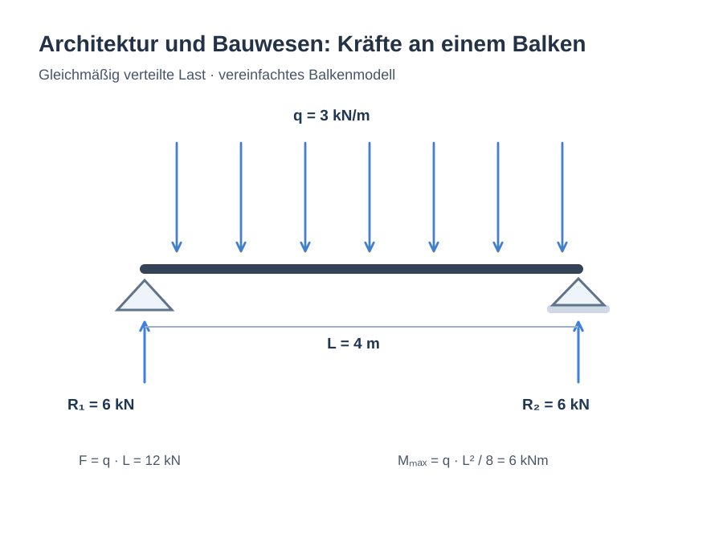

# M4-L13 – Mathematik für Architektur, Baukonstruktion und Ingenieurwesen {#L13}

**Kursbereich:** M4 – Studienwahl: KI, Informatik und Spezialgebiete

**Niveau:** Nicht angegeben

**Vorwissen:** Keine festen Voraussetzungen angegeben.

**Einordnung:** Wahl- und Anwendungsgebiet für angehende Architektur- und Bauingenieurstudierende; kein vollständiger Statik- oder Bauphysikkurs und keine bauaufsichtlich verwendbare Berechnungsgrundlage.

**Leitfrage:** Wie wird aus einer Zeichnung eine räumliche Idee, aus einem Bauteil ein mechanisches Modell und aus einem Entwurf eine begründbare Größenabschätzung?

Architektur verbindet räumliche Gestaltung mit technischen Randbedingungen. Ein Grundriss muss sich in ein tatsächlich gebautes Maß übersetzen lassen. Eine Decke muss Kräfte zu tragenden Elementen weiterleiten. Ein Fenster beeinflusst nicht nur den Lichteinfall, sondern auch den Wärmehaushalt. Für all das benötigen Studierende keine völlig neue Mathematik, sondern mehrere bekannte mathematische Werkzeuge in einem gemeinsamen Zusammenhang.

Die Hochschulmodule **Darstellende Geometrie und CAD**, **Grundlagen der Tragwerksplanung** und **Bauklimatik** der TU Dresden zeigen, weshalb diese Anwendungen bereits im Architekturstudium auftreten. Die folgenden Beispiele sind jedoch **eigene didaktische Modellfälle**, keine Übernahmen aus Modulbeschreibungen und keine Bemessungsvorlagen.

## Zeichnen heißt: einen Maßstab festlegen {#S1}

Ein Plan im Maßstab **1:100** verkleinert eine reale Länge um den Faktor 100. Eine vier Meter lange Wand entspricht dort vier Zentimetern. Anders ausgedrückt: Die Zahl auf dem Papier ist nicht die reale Größe; die zugehörige Einheit und der Maßstab sind Teil der Information.

  Reale Länge     Darstellung 1:100   Darstellung 1:50
  ------------- ------------------- ------------------
  4,00 m                     4,0 cm             8,0 cm
  0,80 m                     8,0 mm            16,0 mm
  0,25 m                     2,5 mm             5,0 mm

Die einfache Formel lautet **Planlänge = Reallänge / Maßstabszahl**, vorausgesetzt beide Längen werden zunächst in dieselbe Einheit umgerechnet. Wer in einer CAD-Datei in Millimetern arbeitet, muss bei Export und Druck trotzdem kontrollieren, welche Einheit das Ergebnis wirklich trägt.

**Wichtig:** Maßstäblich verkleinerte Längen ändern sich linear; Flächen ändern sich mit dem Quadrat des Faktors, Volumina mit dessen dritter Potenz. Ein Quadrat von einem Meter Seitenlänge hat in einem 1:100-Plan eine Seitenlänge von einem Zentimeter und damit nur einen Quadratzentimeter Planfläche. Man darf die Flächen nicht mit dem bloßen Längenfaktor zurückrechnen.

## Von der Grundfläche zum Raummodell {#S2}

Ein rechteckiger Raum von **$4\,\mathrm m\times6\,\mathrm m$** hat eine Grundfläche von **$24\,\mathrm m^2$**. Bei **2,8 m** lichter Höhe besitzt der idealisierte Quader ein Volumen von **$67{,}2\,\mathrm m^3$**. Das Modell hilft etwa bei einer ersten Orientierung zu Raumgrößen und Volumenströmen, erfasst aber weder Wanddicken noch schräg verlaufende Decken.

Für kompliziertere Grundrisse werden Flächen zerlegt: Ein L-förmiger Raum lässt sich als Summe zweier nicht überlappender Rechtecke oder als großes Rechteck minus Aussparung berechnen. In der darstellenden Geometrie kommt hinzu, dass ein dreidimensionales Objekt als Grundriss, Aufriss und Seitenansicht unterschiedliche Informationen liefert. Ein einziger Blickwinkel genügt nicht immer, um die räumliche Konstruktion eindeutig zu bestimmen.

## Kräfte sind Vektoren, nicht nur Zahlen {#S3}

Betrachten wir eine horizontale Balkenbrücke, die an beiden Enden gelagert ist. Eine gleichmäßig verteilte Last wird durch die **Linienlast q** in Kilonewton je Meter beschrieben. Ihre gesamte resultierende Kraft ist das Produkt aus Lastdichte und Länge.

**Eigenes Rechenbeispiel:** Ein idealisierter Balken ist **4 m** lang; auf ihn wirken über die gesamte Länge **3 kN/m** nach unten. Die resultierende Kraft beträgt:

$F=q\cdot L=3\,\mathrm{kN/m}\cdot4\,\mathrm m=12\,\mathrm{kN}$.

Bei symmetrischer Belastung und zwei idealisierten Auflagern trägt jedes **6 kN**. Das folgt aus der Bedingung, dass in einem ruhenden System die Summe aller vertikalen Kräfte null sein muss. Für eine asymmetrische Belastung bräuchte man zusätzlich das Gleichgewicht der Momente.

*Eigenständig konstruierte Lehrskizze; keine reale Tragwerksbemessung.*

## Das Biegemoment macht die innere Beanspruchung sichtbar {#S4}

Die Stützkraft ist noch nicht die ganze Geschichte. Auch innerhalb eines Bauteils müssen die angreifenden Kräfte im Gleichgewicht bleiben. Das führt beim einfach gelagerten Balken mit konstanter Linienlast zu einem maximalen Biegemoment in der Mitte:

$M_{\max}=\frac{q\cdot L^2}{8}$.

Mit den Beispielwerten ergibt sich **$M_{\max}=\frac{3\cdot4^2}{8}=6\,\mathrm{kN\,m}$**. Weil die Länge quadratisch eingeht, kann eine etwas größere Spannweite erheblich mehr Biegemoment verursachen. Verdoppelt man nur L, während q unverändert bleibt, vervierfacht sich M_max.

Die Spannung an einem idealisierten elastischen Querschnitt hängt außerdem von dessen Widerstandsmoment ab. Für einen rechteckigen Querschnitt bei Biegung um seine starke Achse gilt im vereinfachten Modell:

$W=\frac{b\cdot h^2}{6}$, $\sigma_{\max}=\frac{M_{\max}}{W}$.

Setzen wir ausschließlich zur Übung **$b=0{,}20\,\mathrm m$** und **$h=0{,}40\,\mathrm m$** an, dann ist **$W\approx0{,}00533\,\mathrm m^3$** und **$\sigma_{\max}\approx1{,}13\,\mathrm{MPa}$**. Dies ist nur ein mathematisches Anschauungsbeispiel für einen homogenen Balken unter den Modellannahmen der elementaren Biegetheorie. Es trifft **keine** Aussage über die Tragfähigkeit von Stahlbeton, Holz oder einer tatsächlichen Konstruktion. Materialverhalten, Sicherheitsbeiwerte, Schub, Durchbiegung, Anschlüsse, Stabilität und Normen sind hier nicht enthalten.

## Warum die Höhe eines Trägers so wichtig sein kann {#S5}

Im Beispiel wächst das Widerstandsmoment proportional zum Quadrat der Querschnittshöhe. Das Flächenträgheitsmoment eines Rechtecks lautet bei entsprechender Achsenwahl $I=\frac{b\cdot h^3}{12}$ und hängt sogar von der dritten Potenz der Höhe ab. Darin liegt ein wichtiges Entwurfsprinzip: Die Verteilung von Material im Raum verändert die mechanische Wirkung. Dass ein Bauteil „mehr Material“ besitzt, reicht als Beschreibung noch nicht aus – entscheidend ist auch **wo** das Material liegt.

In realen Bauwerken bestimmen außerdem Lastfälle, Querschnittsform, Eigengewicht, Verformung, Verbindungsmittel und Vorschriften die Bewertung. Ein mathematischer Schnellvergleich kann eine konstruktive Idee erklären, aber nie die fachgerechte Tragwerksplanung ersetzen.

## Architekturmathematik umfasst auch Bauphysik {#S6}

Für ein erstes Modell des stationären Wärmedurchgangs kann man die Wärmeleistung über eine homogene Gebäudefläche näherungsweise aus dem **U-Wert**, der Fläche und dem Temperaturunterschied bestimmen:

$P=U\cdot A\cdot\Delta T$.

Angenommen, eine idealisierte Fläche hat **$A=80\,\mathrm m^2$**, ihr U-Wert beträgt **$0{,}30\,\mathrm W/(\mathrm m^2\cdot\mathrm K)$** und zwischen innen und außen liegen **20 K** Temperaturunterschied. Dann ergibt die Rechnung **$P=480\,\mathrm W$**. Das bedeutet eine momentane Wärmeverlustleistung im einfachen Modell, **nicht** automatisch einen Tages- oder Jahresenergieverbrauch. Für Energiebedarf benötigt man zusätzlich die Zeitentwicklung, Lüftung, Wärmebrücken, Solargewinne, interne Wärmequellen und weitere Bedingungen.

Gerade hier wird das Zusammenspiel von Mathematik und Architektur erkennbar: Geometrie liefert Flächen, Physik liefert Modelle, und Analysis beschreibt, wie sich Größen im Laufe der Zeit ändern können.

## Vom Balkenmodell zur Simulation {#S7}

Bei komplexen Baukörpern reicht eine Formel oft nicht aus. Man kann die Struktur in viele kleinere Abschnitte zerlegen und dort Näherungslösungen berechnen. Ein wichtiges Verfahren ist die **Finite-Elemente-Methode (FEM)**, die in Mathematik M3-L3 eingeführt wurde. Im Bauwesen verbindet sie Geometrie, Materialmodelle und Randbedingungen.

Die Qualität einer FEM-Ausgabe hängt nicht nur von ihrer Rechenpräzision ab. Ein falsch gelagerter Balken kann auch mit sehr feinem Netz eine irreführende Lösung liefern. Deshalb müssen **Modellannahmen, Einheiten und Plausibilitätsprüfungen** vor einem möglichen Entwurfsentscheid stehen.

## Was gehört noch in ein echtes Architektur- oder Bauingenieurstudium? {#S8}

Dieses Kapitel ist ein Orientierungsfenster, kein Ersatz für die dortigen Veranstaltungen. Je nach Studiengang kommen beispielsweise Baustofflehre, Konstruktion, Bauklimatik, Vermessung, Bauinformatik, Brandschutz, Kostenplanung und Entwurfsstudios hinzu. Architektinnen und Architekten benötigen auch gestalterische und kommunikative Kompetenzen, die sich nicht auf eine Formel reduzieren lassen. Tragwerksplanung erfordert wiederum eigene Ingenieurkenntnisse und die Anwendung geltender Regeln.

**Weiterführender Lernweg:** Schule Mathematik [M1-L11](https://monowlith-com.github.io/learning-courses/index.html?course=school_mathematics&module=M1&lesson=L11&syslang=de&doclang=de&theme=light) (Ähnlichkeit/Maßstab), Schule [M1-L21](https://monowlith-com.github.io/learning-courses/index.html?course=school_mathematics&module=M1&lesson=L21&syslang=de&doclang=de&theme=light) (Vektoren), Schule [M2-L11](https://monowlith-com.github.io/learning-courses/index.html?course=school_mathematics&module=M2&lesson=L11&syslang=de&doclang=de&theme=light) (Skalarprodukt), Schule [M2-L12](https://monowlith-com.github.io/learning-courses/index.html?course=school_mathematics&module=M2&lesson=L12&syslang=de&doclang=de&theme=light) (Ebenen), [M1-L4](M1-L4.md) (Gradient) und [M3-L3](M3-L3.md) (Finite Elemente). Der neue Abschnitt kann als **optionale Fachanwendung** nach diesen Grundlagen gelesen werden.

## Verständnisfragen zur Selbstkontrolle {#S9}

1.  Wie groß erscheint eine 2,50 m breite Öffnung auf einem Plan 1:50? **Ergebnis:** 5,0 cm.
2.  Bei gleichem q steigt die Spannweite von 4 auf 6 m. Um welchen Faktor ändert sich das vereinfachte M_max? **Ergebnis:** ${\left(\frac64\right)}^2=2{,}25$.
3.  Welche Größe fehlt, wenn man aus 480 W einen Energieverbrauch in kWh machen möchte? **Antwort:** mindestens eine Zeitdauer; für reale Gebäude außerdem weitere dynamische Einflüsse.

## Annahmen und Grenzen {#S10}

Die Balkenformeln gelten für einen **statisch bestimmten, geraden, einfach gelagerten Balken mit konstanter Linienlast** unter den entsprechenden Voraussetzungen der elementaren Balkentheorie. Die Bauphysikformel gilt als stationäre Näherung. Normgerechte Dimensionierung, Sicherheitsnachweise und Gebäudeenergieplanung sind eigene Fachaufgaben und erfordern qualifizierte Fachleute.

## Quellen {#S11}

**Dokumentierter Quellenstand:** 10.11.2026

- [TU Dresden – Modulhandbücher Architektur und Landschaftsarchitektur](https://tu-dresden.de/bu/architektur-landschaft/studium/module): Studienbezug für darstellende Geometrie, Tragwerksplanung, Bauklimatik und Konstruktion.
- [Technische Universität München – Lehrbeispiele des Lehrstuhls für Baumechanik](https://www.cee.ed.tum.de/bm/lehre/interactive-apps/): Beispiele für Balkenbiegung und grundlegende mechanische Modelle.

*Die Quellen dienen der fachlichen Orientierung. Gliederung, Rechenwerte und Erklärungen wurden für diesen Lernkurs neu ausgearbeitet; keine Abbildung wurde übernommen.*
