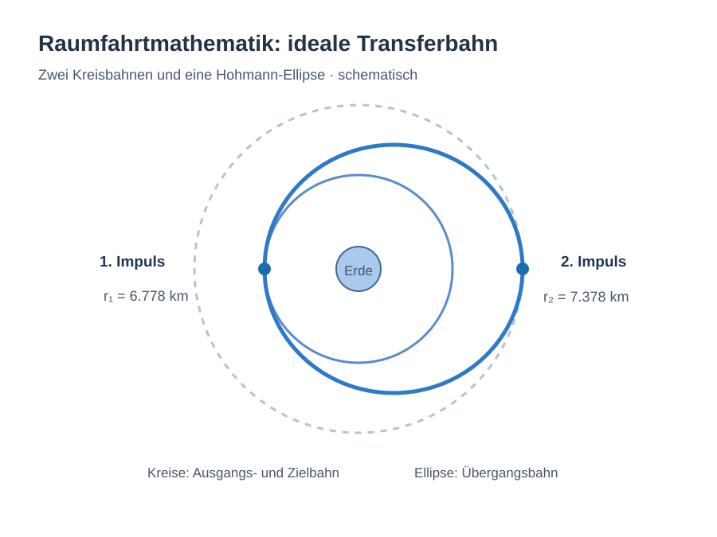

# M4-L14 – Mathematik für Luftfahrt, Raumfahrt und Navigation {#L14}

**Kursbereich:** M4 – Studienwahl: KI, Informatik und Spezialgebiete

**Niveau:** Nicht angegeben

**Vorwissen:** Keine festen Voraussetzungen angegeben.

**Einordnung:** Wahl- und Anwendungsgebiet zwischen angewandter Mathematik, Physik und Luft- und Raumfahrttechnik. Dieser Text führt in Rechenmodelle ein; er ist keine Anleitung für reale Flugführung, Navigation oder Missionsplanung .

**Leitfrage:** Warum braucht ein Flugzeug Auftrieb, warum fällt ein Satellit nicht einfach zur Erde und wieso benötigt eine Raumsonde für einen Bahnwechsel eine sorgfältige Geschwindigkeitsänderung?

Luft- und Raumfahrttechnische Aufgaben verbinden verschiedene mathematische Sprachen: Vektoren beschreiben Lage und Geschwindigkeit, Differentialgleichungen Bewegungen, Trigonometrie Winkel, Wahrscheinlichkeit die Unsicherheit von Messungen und Optimierung knappe Ressourcen wie Treibstoff.

## Geschwindigkeit ist ein Vektor {#S1}

Ein Flugzeug kann sich nach Norden bewegen, während Wind nach Osten weht. Die Geschwindigkeit gegenüber dem Boden ergibt sich als **Vektorsumme** aus der Geschwindigkeit gegenüber der Luft und der Windgeschwindigkeit. Für ein didaktisches Modell nehmen wir an:

- Fluggeschwindigkeit relativ zur Luft: **200 km/h nach Norden**.
- Wind: **30 km/h nach Osten**.

Mit einem zweidimensionalen Koordinatensystem ist der Boden-Geschwindigkeitsvektor $v=(30,200)\,\mathrm{km/h}$. Seine Länge beträgt $\sqrt{30^2+200^2}\approx202{,}2\,\mathrm{km/h}$. Die Flugrichtung gegenüber dem Boden weicht um $\arctan\left(\frac{30}{200}\right)\approx8{,}5^\circ$ nach Osten ab.

Dieses Ergebnis zeigt bereits: Eine Geschwindigkeit ohne Richtungsangabe kann bei Navigationsproblemen unvollständig sein. Das Beispiel verwendet konstante Vektoren und vernachlässigt echte Flugregelung, zeitlich veränderlichen Wind und geodätische Effekte.

## Auftrieb als Größenmodell {#S2}

Eine häufig verwendete idealisierte Auftriebsformel lautet:

$L=0{,}5\cdot\rho\cdot v^2\cdot S\cdot C_L$.

Hier bezeichnet $\rho$ die Luftdichte, $v$ die Geschwindigkeit relativ zur Luft, $S$ eine Bezugsfläche und $C_L$ einen dimensionslosen Auftriebsbeiwert. Für **$\rho=1{,}2\,\mathrm{kg/m}^3$**, **$v=50\,\mathrm{m/s}$**, **$S=10\,\mathrm m^2$** und **$C_L=0{,}8$** erhalten wir **12.000 N**.

Das ist ein Rechenbeispiel, keine Aussage über eine konkrete Maschine. Der Auftriebsbeiwert ist nicht unveränderlich, sondern hängt unter anderem von Geometrie, Anstellwinkel und Strömungsverhältnissen ab. Dass in der Formel $v^{2}$ steht, bedeutet deshalb nicht, dass sich der Auftrieb in der Realität bei Verdopplung der Geschwindigkeit unter allen Bedingungen exakt vervierfacht.

## Im Orbit ist die Gravitation nicht verschwunden {#S3}

Ein Satellit auf einer niedrigen Erdumlaufbahn bewegt sich ständig weiter, während die Erdanziehung seine Bahn krümmt. Im idealisierten Zweikörpermodell bei einer Kreisbahn liefert die Gravitation genau die erforderliche Zentripetalbeschleunigung. Daraus folgt:

$v_{\mathrm{kreis}}=\sqrt{\frac\mu r}$.

$r$ ist der Abstand vom **Erdmittelpunkt**, nicht die Flughöhe über der Erdoberfläche. $\mu$ fasst die Gravitationswirkung des Zentralkörpers zusammen.

**Eigenes Rechenbeispiel:** Wir wählen gerundet $\mu_{\mathrm{erde}}=398\,600\,\mathrm{km}^3/\mathrm{s}^2$ und einen Bahnradius von $r=6\,778\,\mathrm{km}$ (ungefähr 400 km über dem hier verwendeten Erdmodell). Dann beträgt die idealisierte Kreisbahngeschwindigkeit ungefähr **7,67 km/s**. Ein derart großer Wert verdeutlicht, weshalb Raumfahrt andere Geschwindigkeits- und Energieordnungen nutzt als gewöhnliche Fortbewegung am Boden.

Die Umlaufzeit im Kreismodell kann mit $T=2\pi\cdot\sqrt{\frac{r^3}{\mu}}$ abgeschätzt werden. Für die Beispielbahn ergibt das ungefähr **92,6 Minuten**.

*Eigenständig konstruierte Prinzipgrafik. Radien sind schematisch; keine reale Missionsplanung.*

## Die Vis-Viva-Gleichung verbindet Ort und Bahngeschwindigkeit {#S4}

Auf einer elliptischen Bahn ist ein Körper nicht überall gleich schnell. Das lässt sich unter den Annahmen des Zweikörpermodells mit der **Vis-Viva-Gleichung** beschreiben:

$v^2=\mu\cdot\left(\frac2r-\frac1a\right)$.

Dabei ist $a$ die große Halbachse der Ellipse. Befindet sich ein Raumfahrzeug näher am zentralen Körper, ist seine Bahngeschwindigkeit auf derselben gebundenen Ellipse größer als an einem weiter entfernten Punkt. Das ist kein Zufall, sondern hängt mit der Erhaltung der mechanischen Energie zusammen.

Für eine Kreisbahn gilt $a = r$; die Gleichung reduziert sich auf den zuvor verwendeten Ausdruck $v^2=\frac\mu r$.

## Ein Bahnwechsel benötigt Δv {#S5}

Ein **Hohmann-Transfer** ist im vereinfachten Fall eine elliptische Übergangsbahn zwischen zwei kreisförmigen, koplanaren Umlaufbahnen. Das Raumfahrzeug verändert idealisiert an zwei Punkten kurzzeitig seine Geschwindigkeit. Die erste Änderung bringt es von der inneren Kreisbahn auf die Ellipse; die zweite passt es an die äußere Kreisbahn an.

Für die Radien $r_1$ und $r_2$ lautet die große Halbachse der Transferellipse:

$a_t=\frac{r_1+r_2}{2}$.

Die Umlaufgeschwindigkeiten der Ausgangs- und Zielkreisbahn ergeben sich mit $\sqrt{\frac\mu{r_1}}$ und $\sqrt{\frac\mu{r_2}}$. Die Geschwindigkeiten auf der Ellipse berechnet man an beiden Berührungspunkten mit der Vis-Viva-Gleichung. Die Differenzen sind die beiden **Δv-Manöver**. Für unseren didaktischen Fall $r_1=6\,778\,\mathrm{km}$ und $r_2=7\,378\,\mathrm{km}$ kann man beide Schritte rechnerisch bestimmen. Die gesamte ideale Geschwindigkeitsänderung liegt in diesem Modell ungefähr bei **0,32 km/s**.

**Achtung:** Das ist ein stark vereinfachter Transfer für zwei Kreisbahnen derselben Ebene, keine allgemeine optimale Flugroute. Störungen, Bahnneigung, Triebwerkseigenschaften, Bahnverfolgung und reale Antriebsphasen ändern den tatsächlichen Bedarf.

## Warum die Wahl des Startzeitpunkts dazugehört {#S6}

Zwei Planeten oder Satelliten stehen beim Eintreffen eines Flugkörpers nicht mehr dort, wo sie beim Abflug waren. Daher sind **Flugzeit und relative Positionen** zentrale Größen. Die NASA beschreibt in ihren Grundlagen zur Raumfahrt, dass Transferbahnen und Begegnungsgeometrie gemeinsam geplant werden müssen. In der praktischen Missionsanalyse werden daher Bahnen vorausberechnet und geeignete Zeitfenster gesucht.

Mathematisch führt das von einfachen Keplerbahnen zur numerischen Integration von Differentialgleichungen. In einem komplexeren Gravitationsfeld oder bei kontinuierlichem Schub lässt sich der Flug nicht mehr durch eine einzige elementare Formel vollständig erfassen.

## Messfehler und Navigation {#S7}

Eine Positionsmessung ist kein absoluter Wahrheitswert. Sie kann systematische Abweichungen und zufälliges Rauschen enthalten. Stellen wir uns zwei Sensoren vor, die dieselbe Entfernung schätzen:

- Sensor A meldet **100,0 m**, mit angenommener Standardabweichung **2 m**.
- Sensor B meldet **104,0 m**, mit angenommener Standardabweichung **4 m**.

Unter der ausdrücklich vereinfachten Annahme **unabhängiger, unverzerrter, normalverteilter Messfehler** ist ein nach inverser Varianz gewichteter Mittelwert sinnvoll:

$\hat x=\frac{\frac{x_A}{\sigma_A^2}+\frac{x_B}{\sigma_B^2}}{\frac1{\sigma_A^2}+\frac1{\sigma_B^2}}$.

Für die Beispielzahlen folgt $\hat x=100{,}8\,\mathrm m$. Das Gewicht des präziseren Sensors ist größer, weil seine Varianz kleiner ist. In der echten Navigation muss man außerdem prüfen, ob Messfehler korreliert sind, ob die Verteilung passt und ob beide Sensoren überhaupt dieselbe physikalische Größe messen.

## Was mathematische Modelle leisten – und was nicht {#S8}

Ein Modell kann eine Größenordnung, eine mögliche Ursache oder eine Entwurfsalternative erklären. Es kann aber nicht mehr behaupten, als seine Annahmen zulassen. Eine rechnerisch präzise Zahl zur Satellitenbahn ist kein realer Flugplan; ein vereinfachter Auftriebswert sagt nichts über Stall, Manövriergrenzen oder strukturelle Reserven aus.

Die praktischen Spezialgebiete umfassen unter anderem Flugmechanik, Strömungsmechanik, Navigation, Regelung, Mehrkörperdynamik, numerische Optimierung und Missionsanalyse. Die Darstellung hier verbindet bewusst nur wenige zentrale Ideen.

## Lernweg und kurze Selbstkontrolle {#S9}

**Voraussetzungen:** Schule Mathematik M1-L20–Schule M1-L21 (Trigonometrie und Vektoren), Schule M2-L11–Schule M2-L14 (Vektorprodukte und Raumgeometrie), M1-L9 (Differentialgleichungen), M2-L12 (Robotik-Mathematik) und je nach Interesse M2-L9 (Fourier-Analysis).

1.  Warum muss man in der Satellitenformel den Abstand zum **Mittelpunkt** einsetzen? Weil das zentrale Gravitationsmodell sich auf den Abstand zwischen den beteiligten Massenmittelpunkten bezieht.
2.  Warum verändert ein Bahnmanöver die spätere Bahn und nicht einfach nur die momentane Position? Weil Geschwindigkeit und Ort gemeinsam den zukünftigen Bewegungszustand bestimmen.
3.  Was passiert beim invers-varianzgewichteten Mittelwert, wenn ein Sensor sehr unsicher wird? Sein Gewicht nimmt ab.

## Quellen {#S10}

**Dokumentierter Quellenstand:** 10.11.2026

- [NASA – Basics of Space Flight, Chapter 3: Gravity & Mechanics](https://science.nasa.gov/learn/basics-of-space-flight/chapter3-3/): Keplerbahnen als grundlegendes physikalisches Modell.
- [NASA – Basics of Space Flight, Chapter 4: Trajectories](https://science.nasa.gov/learn/basics-of-space-flight/chapter4-1/): verständliche Einordnung von Transferbahnen.
- [DLR – Grundlagen der Orbitmechanik, Bibliografischer Eintrag](https://elib.dlr.de/143300/): Überblick zu Raumflugmechanik und Missionsanwendungen; der eigentliche Verlagstext wurde nicht übernommen.
- [DLR – Missionsanalyse](https://www.dlr.de/de/irs/ueber-uns/abteilungen/systemanalyse-raumsegment/abteilungsaktivitaeten): Kontext für Missionsentwurf, Transferbahnen und weitere Randbedingungen.

*Die Quellen dienen der Orientierung über Fachgebiete und Gleichungen. Gliederung und Rechenbeispiele sind eigenständig erarbeitet.*
