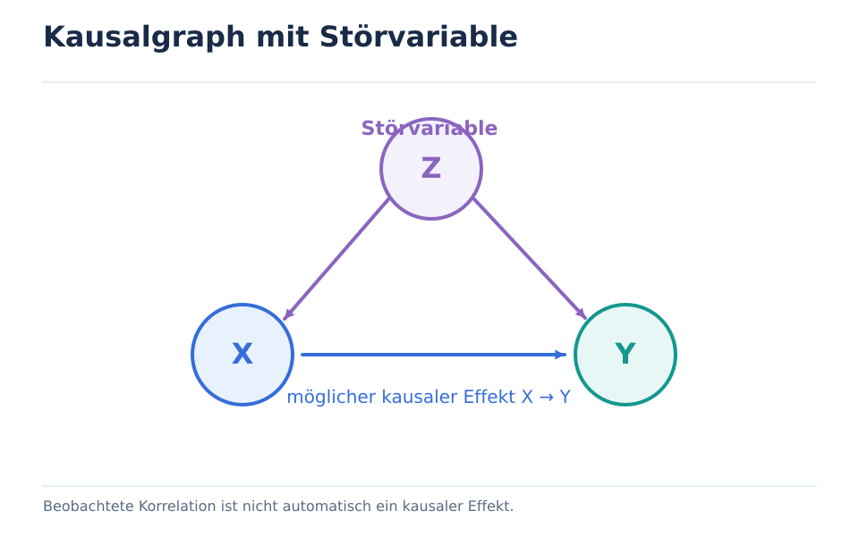

# M4-L2 – Wahlpflicht: Kausale Inferenz und probabilistische Modelle {#L2}

**Kursbereich:** M4 – Studienwahl: KI, Informatik und Spezialgebiete

**Niveau:** Studium (Wahl / Spezialisierung)

**Vorwissen:** [M2-L15 – Schulmathematik](https://monowlith-com.github.io/learning-courses/index.html?course=school_mathematics&module=M2&lesson=L15&syslang=de&doclang=de&theme=light), [M1-L7](M1-L7.md), [M3-L4](M3-L4.md), [M3-L5](M3-L5.md); [M4-L1](M4-L1.md) als KI-Bezug

**Einordnung:** Wahlpflicht-/Spezialkurs, fortgeschrittener Bachelor bis Master.

## Worum geht es? {#S1}

Statistische Daten zeigen, welche Ereignisse gemeinsam auftreten. Wer ein System gezielt verändern will, muss zusätzlich wissen, **was bei einem Eingriff passieren würde**. Eine Korrelation ist dafür nicht immer ausreichend. Kausale Inferenz verbindet Wahrscheinlichkeiten, grafische Modelle und überprüfbare Annahmen, um die Folgen möglicher Interventionen zu untersuchen. Diese Perspektive ist für Medizin, Wirtschaft, Produktentwicklung und die Steuerung autonomer Systeme wichtig.

## Grundidee und Anschauung {#S2}

Angenommen, ein Roboter arbeitet an trockenen Tagen schneller und meldet an diesen Tagen auch seltener Sensorfehler. Ein bloßer Zusammenhang zwischen schnellem Arbeiten und wenigen Fehlern beweist nicht, dass höhere Geschwindigkeit Fehler verhindert. Möglicherweise beeinflusst das Wetter beide Größen. Eine Maßnahme, die die Geschwindigkeit verändert, hat dann nicht automatisch denselben Effekt wie der Unterschied zwischen natürlich schnellen und langsamen Tagen.

Um solche Situationen zu beschreiben, verwenden wir **gerichtete azyklische Graphen** (DAGs). Ein Pfeil steht im betrachteten Kausalmodell für eine angenommene direkte Einflussrichtung; sein Vorhandensein muss fachlich begründet werden. Der Graph ist eine Modellannahme, keine Kausalität, die allein aus den Daten folgt.

## Neue Zeichen – zuerst lesen {#S3}

  Zeichen                        Laut gelesen                                               Bedeutung in dieser Lektion                              Abgrenzung
  ------------------------------ ---------------------------------------------------------- -------------------------------------------------------- -----------------------------------
  $Z$                            „Zett“                                                     beobachteter Hintergrundfaktor, etwa Einsatzumgebung     normaler Zufallswert
  $X$                            „Iks“                                                      behandelbare Größe, beispielsweise Eingriff/Behandlung   Eingabevektor aus M4-L1
  $Y$                            „Ypsilon“                                                  Ergebnisgröße, etwa Leistung                             nicht automatisch Ursache von X
  $Z \to  X$                     „Zett beeinflusst Iks“                                     gerichtete Kante im postulierten Kausalmodell            bloße zeitliche Reihenfolge
  $P(X=1)$                       „Wahrscheinlichkeit, dass X eins ist“                      Ereignischance im Beobachtungsmodell                     Interventionswahrscheinlichkeit
  $P(Y|X,Z)$                     „Y gegeben X und Z“                                        bedingte Verteilung aus Beobachtungsdaten                Intervention an X
  $E[Y]$                         „Erwartungswert von Y“                                     wahrscheinlichkeitgewichteter Mittelwert                 Stichprobenmittelwert ohne Modell
  $\operatorname{do}(X=1)$       „do: X wird auf eins gesetzt“                              ein Eingriff, der X im Modell festlegt                   Auswahl der Fälle mit $X=1$
  $E[Y|\operatorname{do}(X=1)]$  „Erwartungswert von Y nach einem Eingriff X gleich eins“   erwartetes Resultat eines Eingriffs                      $E[Y|X=1]$
  $\sum_z$                       „Summe über alle Werte von Z“                              Mittelung über Hintergrundgruppen                        Integral bei kontinuierlichem Z
  `⊥`                            „unabhängig von“                                           stochastische Unabhängigkeit                             rechtwinklig in Geometrie

## Beobachten und Eingreifen sind zwei verschiedene Fragen {#S4}

Die bedingte Erwartung

{alt="Kausalgraph mit gemeinsamer Ursache und möglichem direktem Effekt"}

$$
E[Y\mid X=1]
$$

wird gelesen: „Welchen mittleren Wert von Y beobachten wir unter den Fällen, in denen X gleich eins ist?“ Das ist eine rein beobachtende Frage.

Anders lautet die Frage:

$$
E[Y\mid\operatorname{do}(X=1)]\text{.}
$$

Gesprochen: „Welchen mittleren Wert von Y erwarten wir, wenn wir X aktiv auf eins festlegen?“ Der $\operatorname{do}$-Operator bezeichnet im Kausalmodell den Eingriff, bei dem die ursprünglichen Ursachen von X für dessen Festlegung abgetrennt werden. Diese Unterscheidung ist der Ausgangspunkt der **Interventionsrechnung**.

Ein einfaches Kausaldiagramm zeigt mögliche **Konfundierung**:

Formel, Skizze oder Rechenschema · Originalnotation

    Z → X → Y
     \      ↑
      └──────┘

Gesprochen: „Z beeinflusst X und Y; X beeinflusst außerdem Y.“ Das bedeutet: Wer X mit Y vergleicht, kann sowohl den Effekt von X als auch den Einfluss von Z erfassen. Wir brauchen zusätzliche Annahmen oder ein geeignetes Studiendesign, um die Effekte auseinanderzuhalten.

## Vollständig berechnetes Beispiel: scheinbarer Effekt und echter Eingriff {#S5}

Wir betrachten ein ausdrücklich konstruiertes Modell mit drei Größen:

- $Z$ ist entweder 0 oder 1. Beide Werte sind gleich häufig: $P(Z=1)=P(Z=0)=0{,}5$.
- Die Wahrscheinlichkeit einer Maßnahme $X=1$ hängt von Z ab: $P(X=1|Z=1)=0{,}8$ und $P(X=1|Z=0)=0{,}2$.
- Das Ergebnis sei deterministisch $Y = X + 2Z$. Damit erhöht das aktive Setzen von X auf eins den Ergebniswert bei festem Z um genau 1.

Zuerst betrachten wir nur Daten. Aus dem Satz von Bayes und der Gesamtwahrscheinlichkeit folgt:

$$
\begin{aligned}
P(X=1)&=0{,}8\cdot0{,}5+0{,}2\cdot0{,}5=0{,}5\text{.}\\
P(Z=1\mid X=1)&=\frac{0{,}8\cdot0{,}5}{0{,}5}=0{,}8\text{.}\\
P(Z=1\mid X=0)&=\frac{0{,}2\cdot0{,}5}{0{,}5}=0{,}2\text{.}
\end{aligned}
$$

Gesprochen: „Unter den Fällen mit X gleich eins sind 80 Prozent in der Gruppe Z gleich eins. Unter den Fällen mit X gleich null sind es nur 20 Prozent.“ Deshalb unterscheiden sich diese Gruppen **nicht nur in X**, sondern ebenfalls in ihrem Hintergrundfaktor Z.

Für den beobachteten Mittelwert erhalten wir:

$$
\begin{aligned}
E[Y\mid X=1]&=1+2\cdot0{,}8=2{,}6\text{.}\\
E[Y\mid X=0]&=0+2\cdot0{,}2=0{,}4\text{.}\\
\text{Beobachtete Differenz}&=2{,}6-0{,}4=2{,}2\text{.}
\end{aligned}
$$

Gesprochen: „Wer einfach die beobachteten Gruppen vergleicht, erhält einen Unterschied von 2,2 Einheiten.“ Dieser Wert **überschätzt** den kausalen Effekt von X in unserem konstruierten Modell.

Beim Eingriff bleiben die ursprünglichen Wahrscheinlichkeiten der Hintergrundgruppen hingegen unverändert. Weil $Y=X+2Z$, gilt:

$$
\begin{aligned}
E[Y\mid\operatorname{do}(X=1)]&=1+2\cdot0{,}5=2\text{.}\\
E[Y\mid\operatorname{do}(X=0)]&=0+2\cdot0{,}5=1\text{.}\\
\text{Kausaler Mittelwertseffekt}&=2-1=1\text{.}
\end{aligned}
$$

Gesprochen: „Durch eine aktive Änderung von X von null auf eins erhöht sich der mittlere Ergebniswert um eins, nicht um 2,2.“ Das Beispiel zeigt, wie dieselbe Datenlage einen anderen beobachteten als ursächlichen Unterschied ergeben kann.

## Die Adjustierungsformel {#S6}

Ist der Hintergrundfaktor Z **ausreichend zur Kontrolle aller relevanten Hintertürpfade**, im passenden Kausalmodell vor der Maßnahme vorhanden und unter allen betrachteten Bedingungen die Behandlung möglich, kann die Interventionsverteilung aus Beobachtungsdaten gewonnen werden:

$$
P(Y=y\mid\operatorname{do}(X=x))=\sum_z P(Y=y\mid X=x,Z=z)\cdot P(Z=z)\text{.}
$$

Gesprochen: „Für jede Hintergrundgruppe z betrachten wir den beobachteten Ergebnisanteil bei festem X und mitteln mit dem Anteil dieser Hintergrundgruppe in der gesamten Ausgangspopulation.“ Für kontinuierliches Z steht anstelle der Summe ein Integral.

Dafür benötigen wir insbesondere **Austauschbarkeit ohne unbeobachtete Konfundierung** unter Z, **Positivität** (für relevante Z-Gruppen muss jede verglichene Behandlung beobachtbar sein) sowie eine sinnvolle **Konsistenzannahme**: Die beobachtete Behandlung entspricht dem beschriebenen Eingriff. Die Formel gilt **nicht allein deshalb**, weil Z in den Daten vorkommt. Bei komplexeren Diagrammen ist die Wahl geeigneter Kontrollvariablen selbst Teil des Problems.

## Warum nicht jede Kontrollvariable hilfreich ist {#S7}

Ein **Collider** ist eine Variable, in die zwei Pfeile hineinlaufen:

Formel, Skizze oder Rechenschema · Originalnotation

    A → C ← B.

Auch wenn A und B zunächst unabhängig sind, kann das nach Auswahl oder Konditionierung auf C anders aussehen. Das „vorsichtshalber alle Variablen kontrollieren“ ist daher keine korrekte allgemeine Regel. Ebenso darf eine Variable, die durch die Maßnahme selbst beeinflusst wird, nicht ohne genaue Fragestellung wie ein gewöhnlicher Hintergrundfaktor behandelt werden. Für mehrere Zeitpunkte sind dynamische Kausalmodelle erforderlich.

### Gegenprobe: Ein Collider kann einen Zusammenhang erst erzeugen {#abschnitt-8}

Wir betrachten zwei **unabhängige** Münzwürfe $A$ und $B$ mit jeweils den Werten 0 und 1 und einer Wahrscheinlichkeit von $0{,}5$ für jeden Wert. Die Auswahlvariable $C$ ist genau dann 1, wenn **mindestens einer** der beiden Würfe 1 ergibt. Das ist der Collider $A \to  C \leftarrow  B$: A und B wirken auf die Auswahl, ohne sich gegenseitig zu beeinflussen.

$$
\begin{aligned}
(A,B)&=(0,0),(0,1),(1,0),(1,1),\quad\text{jeweils mit }P=\frac14\text{.}\\
C=1&\text{ gilt für }(0,1),(1,0),(1,1),\quad\text{jeweils bedingt mit }P=\frac13\text{.}\\
P(B=1\mid A=1,C=1)&=\frac{1/3}{2/3}=\frac12\text{.}\\
P(B=1\mid A=0,C=1)&=\frac{1/3}{1/3}=1\text{.}
\end{aligned}
$$

Gesprochen: „Unter den ausgewählten Fällen mit $C=1$ ist B **bei $A=0$ stets eins**, bei $A=1$ dagegen nur in der Hälfte der Fälle.“ Vor der Auswahl gilt wegen der unabhängigen Würfe $P(B=1|A=0)=P(B=1|A=1)=0{,}5$. Erst die Auswahl $C=1$ erzeugt die statistische Abhängigkeit. Sie ist **kein Beleg für eine ursächliche Wirkung** von A auf B. Das Beispiel setzt voraus, dass die Münzwürfe unabhängig und gleichverteilt sind und $C$ deterministisch wie beschrieben gebildet wird.

## Gegenfaktische Fragen und probabilistische Modelle {#S8}

Eine **gegenfaktische** Frage lautet beispielsweise: „Wie wäre das Ergebnis derselben Maschine ausgefallen, wenn wir statt $X=1$ die Maßnahme $X=0$ gewählt hätten?“ Das ist stärker als der Mittelwert über verschiedene Maschinen. Um solche Fragen zu modellieren, braucht man zusätzlich Annahmen über gemeinsame verborgene Einflüsse und strukturelle Gleichungen, nicht bloß die beobachtete gemeinsame Verteilung.

Ein bayessches Netz beschreibt durch gerichtete Kanten eine faktorisierte Wahrscheinlichkeitsverteilung. Für den einfachen Graphen Z→X, Z→Y und X→Y gilt:

$$
P(Z,X,Y)=P(Z)\cdot P(X\mid Z)\cdot P(Y\mid X,Z)\text{.}
$$

Gesprochen: „Die gemeinsame Verteilung zerfällt in die Verteilung des Hintergrundes, die Behandlung unter diesem Hintergrund und das Ergebnis unter beiden Größen.“ Ein Bayesnetz kann auch **rein probabilistisch** verstanden werden. Die Deutung der Pfeile als tatsächliche Ursachen erfordert zusätzliche strukturelle Annahmen.

### Gegenprobe: Gleiche Beobachtungsdaten, unterschiedliche Eingriffsergebnisse {#abschnitt-10}

Ein noch grundsätzlicheres Problem ist, dass dieselbe beobachtete Verteilung durch verschiedene Kausalmechanismen entstehen kann. Wir setzen eine unbeobachtete, faire binäre Zufallsvariable $U$ voraus und betrachten zwei ausdrücklich **alternative** strukturelle Modelle:

$$
\begin{aligned}
\text{Modell 1:}\quad&X:=U,\quad Y:=X\text{.}\\
\text{Modell 2:}\quad&X:=U,\quad Y:=U\text{.}
\end{aligned}
$$

In beiden Modellen gilt in den Beobachtungsdaten stets $X=Y$: Es treten nur $(0,0)$ und $(1,1)$ auf, jeweils mit Wahrscheinlichkeit $\frac12$. Ein Eingriff ersetzt jedoch die Gleichung für X, nicht die für Y:

$$
\begin{aligned}
\text{Modell 1:}\quad E[Y\mid\operatorname{do}(X=1)]&=1\text{.}\\
\text{Modell 2:}\quad E[Y\mid\operatorname{do}(X=1)]&=E[U]=\frac12\text{.}
\end{aligned}
$$

Gesprochen: „Obwohl wir exakt dieselbe gemeinsame Beobachtungsverteilung sehen, liefern die Modelle unterschiedliche Interventionserwartungen.“ Ohne zusätzliche Kausalannahmen oder Interventionsdaten kann die Beobachtungsverteilung diesen Unterschied nicht entscheiden. In diesem konstruierten Beispiel fehlt zudem innerhalb von $U$ die Überlappung beider X-Werte; eine naive Adjustierung nach U ist daher nicht zulässig.

## Wofür nützlich? {#S9}

Kausalmodelle helfen bei der Beurteilung von A/B-Tests, Diagnosealgorithmen, Empfehlungen, medizinischen Studien und technischen Eingriffen. In Robotik und KI ist wichtig, ob eine Vorhersage auch nach einer Änderung der Umgebung oder der Strategie gültig bleibt. Beobachtungsdaten allein beweisen das grundsätzlich nicht.

## Annahmen und Grenzen {#S10}

Das Beispiel ist künstlich, seine Verteilungen und Kausalstruktur sind vollständig vorgegeben. In der Praxis können nicht gemessene Faktoren, Auswahlverzerrung, Messfehler, unklare Interventionsdefinitionen und zeitliche Rückkopplung die Identifizierbarkeit verhindern. Eine mathematisch berechenbare Zahl ist nicht zwangsläufig eine belastbare Kausalschätzung. Eingriffe an Menschen oder sicherheitskritischen Geräten benötigen eigene fachliche und ethische Prüfung.

## Verbindung zur nächsten Speziallektion {#S11}

**M4-L3** betrachtet Abhängigkeiten innerhalb von Netzwerken und nutzt Graphstrukturen für maschinelles Lernen. Ein Graph in M4-L3 stellt jedoch nicht automatisch einen Kausalgraphen dar; die Bedeutungen der Kanten unterscheiden sich.

## Quellen (extern) {#S12}

Keine externen Quellen angegeben.
