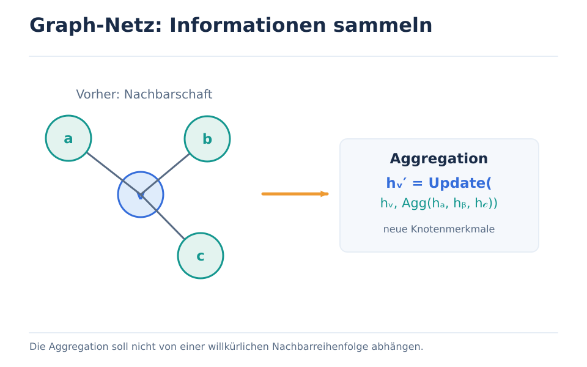

# M4-L3 – Wahlpflicht: Graph Neural Networks und spektrales Lernen {#L3}

**Kursbereich:** M4 – Studienwahl: KI, Informatik und Spezialgebiete

**Niveau:** Studium (Wahl / Spezialisierung)

**Vorwissen:** [M2-L1](M2-L1.md) (Graphentheorie), [M1-L5](M1-L5.md)/[M1-L6](M1-L6.md) (Matrizen und Eigenwerte), [M2-L11](M2-L11.md) (neuronale Netze), [M3-L7](M3-L7.md) (Numerik)

**Einordnung:** Spezialisierung zwischen fortgeschrittenem Bachelor und Master.

## Worum geht es? {#S1}

Viele Daten bestehen nicht aus einer einzigen langen Zahlenliste, sondern aus Objekten mit Beziehungen: soziale Netze, Straßen, Moleküle, Stromnetze, Software-Abhängigkeiten oder Sensorverbünde. Solche Strukturen heißen **Graphen**. Ein Graph Neural Network (GNN) berechnet zu jedem Knoten eine Darstellung, die Informationen von verbundenen Knoten aufnimmt. Die Mathematik verbindet dabei Graphentheorie, Matrixrechnung, gewichtete Summen, Symmetrie und spektrale Methoden.

## Grundidee und Anschauung {#S2}

In einem Rechnernetz besitzt jeder Server eigene Eigenschaften – etwa Auslastung und Fehlerrate. Zusätzlich hängt sein Verhalten von benachbarten Servern ab. Statt nur jeden Server isoliert zu klassifizieren, kann ein Verfahren Eigenschaften seiner Nachbarn berücksichtigen. Dabei muss es egal sein, ob die Server zufällig „A“, „B“ und „C“ oder „3“, „9“ und „12“ heißen. **Die Beziehungen sollen zählen, nicht die willkürliche Reihenfolge der Namen.**

## Neue Zeichen – vor der Verwendung erklären {#S3}

  Zeichen                Laut gelesen                          Bedeutung hier                                  Abgrenzung
  ---------------------- ------------------------------------- ----------------------------------------------- -------------------------------------------
  $G=(V,E)$              „Graph G aus Knoten V und Kanten E“   Netzwerkmodell                                  G als Funktion in anderen Lektionen
  $i,j$                  „Index i, j“                          Nummern von Knoten                              beliebige physische Koordinaten
  $N(i)$                 „Nachbarschaft von i“                 direkt mit Knoten i verbundene Knoten           gesamte Netzkomponente
  $x_{i}$                „Feature-Vektor des Knotens i“        ursprüngliche Knotenmerkmale                    eine Raumkoordinate
  $h_{i}$                „ha i“                                gelernte oder berechnete Knotenrepräsentation   Messwert ohne Transformation
  $A$                    „Adjazenzmatrix“                      $A_{ij}=1$ bei einer Verbindung, sonst 0        Matrix A aus Regelung M3-L12
  $D$                    „Gradmatrix“                          Diagonalmatrix der Knotengrade                  Ableitungsoperator
  $L=D-A$                „Laplacematrix“                       Graph-Laplacian im ungerichteten Graphen        kontinuierlicher Laplace-Operator aus M2-L8
  `Σ`                    „Summe“                               zusammengefasste Nachbarinformationen           Produkt
  $\operatorname{mean}$  „Mittelwert“                          durchschnittliche Nachbarinformation            gewichtete Summe ohne Normierung
  $\sigma$               „Sigma“                               Aktivierungsfunktion, etwa ReLU                 Standardabweichung $\sigma$ in Statistik
  $W$                    „Gewichtsmatrix“                      trainierte lineare Abbildung von Merkmalen      Menge einer Zufallsverteilung
  `⊤`                    „transponiert“                        Spalten/Zeilen einer Matrix vertauschen         Inverse
  $\lambda$              „Lambda“                              Eigenwert des Graph-Laplacians                  Regularisierungsparameter in M3-L11

## Graphen als Matrizen {#S4}

Für einen ungerichteten Graphen mit drei Knoten A, B, C und den Kanten A–B und B–C lautet die Adjazenzmatrix:

$$
\begin{aligned}
A&=\begin{bmatrix}0&1&0\\1&0&1\\0&1&0\end{bmatrix},\quad\text{Spaltenfolge: A, B, C}
\end{aligned}
$$

Gesprochen: „A ist mit B verbunden, B mit A und C, C mit B.“ Die Zahl der Nachbarn eines Knotens heißt **Grad**. Die Gradmatrix steht nur auf ihrer Diagonale: $D=\operatorname{diag}(1,2,1)$.

Zur mathematischen Beschreibung einer Verteilung von Knoteneigenschaften verwenden wir den **Graph-Laplacian**:

$$
\begin{aligned}
L&=D-A\\
&=\begin{bmatrix}1&-1&0\\-1&2&-1\\0&-1&1\end{bmatrix}\text{.}
\end{aligned}
$$

Gesprochen: „Die Laplacematrix ist Gradmatrix minus Adjazenzmatrix.“ Für ungerichtete, nichtnegativ gewichtete Graphen ist L symmetrisch und positiv semidefinit. Der konstante Vektor aus lauter Einsen erfüllt $L\cdot 1=0$ und hat den Eigenwert null. Die Anzahl der zusammenhängenden Komponenten entspricht der Dimension seines Nullraums. Bei gerichteten Graphen gelten die Aussagen in dieser Form nicht automatisch.

## Ein vollständiges Mini-Beispiel für Nachbarschaftsaggregation {#S5}

Wir vergeben jedem Knoten genau **einen** Merkmalswert:

$$
x_A=1,\qquad x_B=2,\qquad x_C=4\text{.}
$$

Unser einfaches Lernmodell bildet den Mittelwert aus dem eigenen Wert und den Werten der unmittelbar benachbarten Knoten. Es ist ein pädagogisch vereinfachtes Message-Passing-Modell **ohne trainierte Gewichte** und ohne nichtlineare Aktivierung.

$$
\begin{aligned}
h_A&=\frac{x_A+x_B}{2}=\frac{1+2}{2}=1{,}5\text{.}\\
h_B&=\frac{x_A+x_B+x_C}{3}=\frac{1+2+4}{3}=\frac73\approx2{,}333\text{.}\\
h_C&=\frac{x_B+x_C}{2}=\frac{2+4}{2}=3\text{.}
\end{aligned}
$$

Gesprochen: „Knoten A kombiniert sich mit B und erhält 1,5. Knoten B kombiniert alle drei Knoten und erhält sieben Drittel. Knoten C kombiniert B und C und erhält drei.“ Nach **einem** Schritt kennt jeder Knoten nur seine unmittelbare Umgebung. Erst mehrere aufeinanderfolgende Schritte lassen Informationen von weiter entfernten Knoten einfließen.

Eine häufige abstrakte Schreibweise lautet:

$$
h_i(\mathrm{neu})=\sigma\left(W\cdot\operatorname{mean}\left(\{h_j(\mathrm{alt}):j\in N(i)\cup\{i\}\}\right)\right)\text{.}
$$

Gesprochen: „Berechne den Mittelwert der alten Repräsentationen aller Nachbarn einschließlich des eigenen Knotens, multipliziere mit einer Gewichtsmatrix und wende eine Aktivierungsfunktion an.“ Das ist **eine mögliche** GNN-Architektur, nicht die einzig gültige. Je nach Verfahren werden Nachbarn summiert, gewichtet, nach Kantentyp unterschieden oder mit Attention zusammengeführt.

## Graphfaltung, Normierung und Eigenvektoren {#S6}

Eine verbreitete Form der Graph-Convolution auf einem ungerichteten Graphen mit eingefügten Selbstverbindungen benutzt:

$$
\begin{aligned}
\tilde A&=A+I,\\
\tilde D_{ii}&=\sum_j\tilde A_{ij},\\
H_{\mathrm{neu}}&=\sigma\!\left(\tilde D^{-1/2}\tilde A\tilde D^{-1/2}H_{\mathrm{alt}}W\right)\text{.}
\end{aligned}
$$

Gesprochen: „Wir fügen jedem Knoten eine Selbstkante hinzu, bilden die neue Gradmatrix, normieren die Adjazenzmatrix beidseitig mit inversen Quadratwurzeln der Knotengrade, multiplizieren mit Merkmals- und Gewichtsmatrix und wenden eine Aktivierung an.“ Die Formel setzt positive Knotengrade nach Einfügung der Selbstkanten voraus. Diese symmetrische Normierung ist etwas anderes als der einfache arithmetische Mittelwert aus unserem Beispiel.

Die Eigenvektoren des Laplacians beschreiben unterschiedliche Schwankungsmuster auf dem Graphen. Für die Merkmalswerte unseres Beispiels $x={(1,2,4)}^\top$ gilt:

$$
\begin{aligned}
x^\top Lx&={(x_A-x_B)}^2+{(x_B-x_C)}^2\\
&={(1-2)}^2+{(2-4)}^2\\
&=1+4=5\text{.}
\end{aligned}
$$

Gesprochen: „Die quadratische Form mit der Laplacematrix entspricht hier der Summe der quadrierten Unterschiede an beiden Kanten.“ Kleine Werte bedeuten, dass benachbarte Knoten ähnliche Merkmale haben. Diese Identität gilt in dieser Form für den **ungerichteten, einfach gewichteten** Graphen; bei gewichteten Kanten kommen Kantengewichte hinzu.

### Gegenprobe: Eigenvektoren und ihre Bedeutung im Beispielgraphen {#abschnitt-7}

Für die oben angegebene Laplacematrix des Pfadgraphen A–B–C lassen sich die Eigenwerte direkt nachrechnen. Neben dem konstanten Vektor treten zwei verschiedene Schwankungsmuster auf:

$$
\begin{aligned}
v_0&={(1,1,1)}^\top,\quad Lv_0=0\cdot v_0\text{.}\\
v_1&={(1,0,-1)}^\top,\quad Lv_1=1\cdot v_1\text{.}\\
v_3&={(1,-2,1)}^\top,\quad Lv_3=3\cdot v_3\text{.}\\
\text{Eigenwerte von }L&:\quad 0,1,3\text{.}
\end{aligned}
$$

Gesprochen: „Der konstante Vektor verändert sich entlang keiner Kante. Der zweite Vektor unterscheidet die Endpunkte; der dritte wechselt besonders stark zwischen dem mittleren Knoten und den Randknoten.“ Alle drei Vektoren sind untereinander orthogonal und bilden eine Basis von $\mathbb{R}^3$. Die Eigenwerte sind hier nicht bloß Behauptungen: Man kann jede der drei Matrix-Vektor-Multiplikationen zeilenweise nachrechnen. Bei einem anderen Graphen ändert sich das Spektrum; bei gewichteten Kanten muss die passende gewichtete Laplacematrix verwendet werden.

### Gegenprobe: Symmetrische Normierung ist kein gewöhnlicher Mittelwert {#abschnitt-8}

Beim gleichen Beispielgraphen ergibt die Addition von Selbstkanten die Grade $2,3,2$. Wir nehmen für die Graph-Convolution $W=1$, die Identitätsaktivierung und die Merkmale $x={(1,2,4)}^\top$. Für den ersten Knoten liefert die symmetrisch normierte Variante:

$$
\begin{aligned}
h_A(\mathrm{GCN})&=\frac12\cdot1+\frac1{\sqrt{2\cdot3}}\cdot2\\
&=\frac12+\frac2{\sqrt6}\approx1{,}3165\text{.}\\
h_A(\text{Mittelwert})&=\frac{1+2}{2}=1{,}5\text{.}
\end{aligned}
$$

Gesprochen: „Die symmetrische Normierung berücksichtigt die Knotengrade auf beiden Seiten einer Kante. Daher ist sie selbst bei identischem Graphen und denselben Merkmalen **nicht dieselbe Operation** wie der einfache Nachbarschaftsmittelwert.“ Die Aussage gilt hier für diese konkret definierte Schicht, nicht für alle GNN-Architekturen.

## Warum die Knotennummerierung nicht entscheiden darf {#S7}

Wird ein Graph nur umbenannt, sollten die Ausgaben dieselbe Umbenennung mitmachen. Diese Eigenschaft heißt **Permutationsequivarianz**. Bei einer Knoten-Klassifikation soll das Ergebnis für denselben Knoten nicht von dessen Platz in einer Datenbanktabelle abhängen. Bei einer einzigen Klassifikation des gesamten Graphen wird oft **Permutationsinvarianz** verlangt: Das Gesamtergebnis soll sich unter Umbenennung überhaupt nicht ändern.

Mathematisch steckt dahinter eine Permutationsmatrix P. Wenn die Knotennummerierung geändert wird, müssen sowohl die Adjazenzmatrix als auch alle Knotenmerkmale passend umgeordnet werden:

$$
A_{\mathrm{neu}}=PAP^{\mathrm{T}},\qquad X_{\mathrm{neu}}=PX\text{.}
$$

Gesprochen: „Wir vertauschen Zeilen und Spalten der Verbindungsinformation konsistent und ordnen die Merkmalszeilen ebenso um.“ Eine geeignete GNN-Schicht liefert entsprechend umnummerierte Knotenrepräsentationen. Diese Eigenschaft ist eine wichtige Architekturvoraussetzung, kein automatischer Vorteil beliebiger neuronaler Netze.

### Gegenprobe: Umnummerierung am Drei-Knoten-Graphen {#abschnitt-10}

Wir vertauschen nur die Namen der Endknoten A und C. Die Reihenfolge der Werte $x={(1,2,4)}^\top$ wird so zu $x_{\mathrm{neu}}={(4,2,1)}^\top$, und die Adjazenzmatrix wird entsprechend an Zeilen **und** Spalten permutiert. Der einfache Mittelwert aus Abschnitt 2 ergibt nun:

$$
\begin{aligned}
h_{\mathrm{alt}}&=\left(\frac32,\frac73,3\right)^\top\text{.}\\
h_{\mathrm{neu}}&=\left(3,\frac73,\frac32\right)^\top=Ph_{\mathrm{alt}}\text{.}
\end{aligned}
$$

Gesprochen: „Mit der Umnummerierung vertauschen sich genau die Ergebnispositionen der beiden Randknoten. Die rechnerischen Knotenergebnisse bleiben ihren ursprünglichen Objekten zugeordnet.“ Der Nachweis setzt eine konsistente Permutation auch der Kanten voraus; bloßes Vertauschen der Eingabezeilen ohne Anpassung von A wäre eine andere Datenstruktur. Eine globale, symmetrische Summe der Knotenausgaben wäre zusätzlich permutations**invariant**.

## Mehrere Schichten und praktische Grenzen {#S8}

Viele Aggregationsschritte können Knotenrepräsentationen immer ähnlicher machen: Das heißt **Oversmoothing**. Ein weiteres Problem ist **Oversquashing**: Sehr viel Information aus großen Netzbereichen muss durch einen kleinen Zwischenraum übertragen werden. Manche Netzwerke sind **heterophil**, sodass benachbarte Knoten gerade unterschiedliche Eigenschaften besitzen; blindes Glätten kann dann schaden.

Bei realen Daten drohen zudem fehlerhafte Kanten, zeitlich veraltete Netzwerke und **Datenleckage**: Wenn beim Modelltraining Informationen aus der späteren Testaufgabe über die Graphstruktur verfügbar werden, kann die Messung der Modellgüte irreführend sein. Der Graph und die Kanten sollten daher ebenso kritisch geprüft werden wie die Zielwerte.

## Wofür nützlich? {#S9}

Graph Neural Networks können Beziehungen zwischen Molekülatomen, Softwarekomponenten, Dokumenten, Lieferketten oder Sensoren modellieren. Spektralgraphen helfen beim Clustering, bei Glättung und der Analyse von Netzwerkstrukturen. In Robotik lassen sich etwa Beziehungen zwischen Objekten oder Gelenken modellieren. Die rechnerische Skalierung hängt stark von Graphgröße, Kantenanzahl, Batch-Verfahren und Modellarchitektur ab.

## Annahmen und Grenzen {#S10}

Der Beispielgraph ist klein, ungerichtet und besitzt gleich gewichtete Kanten. In der Praxis kann ein Graph gerichtet, dynamisch, heterogen oder probabilistisch sein. **Eine Kante beschreibt zunächst eine beobachtete oder definierte Beziehung, keine bewiesene Ursache.** Für kausale Eingriffsfragen siehe M4-L2; für Attention-Mechanismen siehe M4-L1. Der Übergang von einem mathematisch plausiblen GNN zu einem zuverlässig getesteten System verlangt eigene Validierung.

## Verbindung zu den weiteren Wahlpflichtmodulen {#S11}

M4-L4 führt formale Beweistechniken für Programme ein, M4-L6 behandelt lernende Entscheidungen und M4-L11 probabilistische Sensornetze. Diese Themen können mit Graphmodellen verbunden werden, besitzen aber andere mathematische Ziele.

## Quellen {#S12}

In dieser Lektion sind keine Einzelquellen gesondert verzeichnet.
