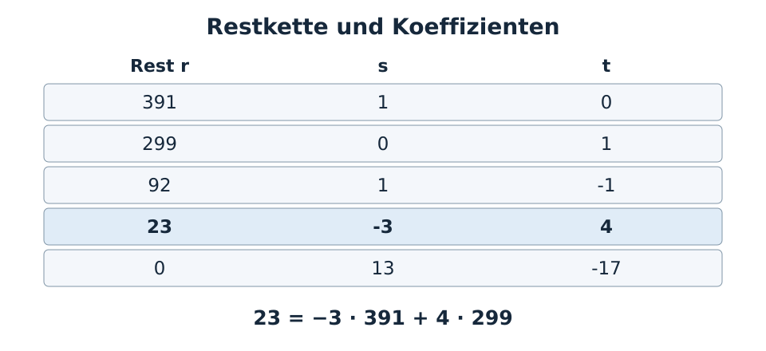

# M5-L1 – Teilbarkeit, euklidischer Algorithmus und Bézout {#L1}

**Kursbereich:** M5 – Algebra und Zahlentheorie

**Niveau:** Bachelor · Wahlpflicht-Brücke

**Vorwissen:** [M1-L1](M1-L1.md); [M2-L3](M2-L3.md)

**Einordnung:** Universitäre Vertiefung der elementaren Zahlentheorie

## Lernziele {#S1}

Du beweist die Korrektheit und Terminierung des euklidischen Algorithmus mit einer Invariante, leitest die Identität von Bézout konstruktiv ab und interpretierst den ggT als positiven Erzeuger eines Ideals in $\mathbb Z$. Du löst lineare diophantische Gleichungen vollständig und analysierst die Zahl der Restdivisionen. Die Lektion setzt die Restklassenrechnung aus M2-L3 voraus und baut die dort verwendeten Rechenregeln algebraisch aus.

## Notation und Teilbarkeit {#S2}

Es seien $a,b\in\mathbb Z$, nicht beide null. Wir schreiben $c\mid a$, wenn $a=ck$ für ein $k\in\mathbb Z$ gilt. $d=\gcd(a,b)$ bezeichnet den positiven größten gemeinsamen Teiler. Mit $a\mathbb Z+b\mathbb Z=\{sa+tb:s,t\in\mathbb Z\}$ bezeichnen wir die Menge aller ganzzahligen Linearkombinationen. Sie ist ein Ideal: Summen, additive Inverse und ganzzahlige Vielfache bleiben in der Menge. Für $b>0$ liefert die Division mit Rest eindeutig $a=qb+r$ mit $0\le r<b$.

Die Menge der gemeinsamen Teiler ändert sich beim Übergang $(a,b)\mapsto(b,a-qb)$ nicht. Noch stärker gilt $a\mathbb Z+b\mathbb Z=b\mathbb Z+(a-qb)\mathbb Z$: Die beiden neuen Erzeuger sind Kombinationen der alten, und $a=(a-qb)+qb$ zeigt die Gegenrichtung. Dies ist die zentrale Invariante.

## Algorithmus, Terminierung und Beispiel {#S3}

Zunächst werden die Beträge der Eingaben verwendet. Solange der zweite Wert positiv ist, ersetzt man beide durch den zweiten Wert und den nichtnegativen Rest. Dieser ist strikt kleiner als der bisherige zweite Wert. Eine strikt fallende Folge nichtnegativer ganzer Zahlen endet; beim letzten Paar $(d,0)$ ist das erzeugte Ideal $d\mathbb Z$. Wegen der Invariante ist $d$ der ggT der Eingaben.

$$391=1\cdot299+92,\quad299=3\cdot92+23,\quad92=4\cdot23.$$

Also ist $d=23$. Die Abbildung zeigt neben den Resten auch ihre Koeffizienten bezüglich der ursprünglichen Eingaben.

{alt="Reste 391, 299, 92, 23, 0 mit Koeffizienten; letzter positiver Rest 23."}

## Erweiterter Algorithmus und Bézout {#S4}

Schreibe die Restfolge als $r_i=s_i|a|+t_i|b|$. Starte mit $(s_0,t_0)=(1,0)$ und $(s_1,t_1)=(0,1)$. Aus $r_{i+1}=r_{i-1}-q_i r_i$ ergibt sich dieselbe Rekursion für beide Koeffizienten. Induktiv bleibt die Darstellung jedes Restes erhalten. Vorzeichenkorrekturen liefern am Ende Koeffizienten für $a,b$ selbst. Damit ist Bézout bewiesen: $d=sa+tb$. Im Beispiel gilt $23=299-3(391-299)=-3\cdot391+4\cdot299$.

Die Gleichheit $a\mathbb Z+b\mathbb Z=d\mathbb Z$ erklärt auch die universelle Eigenschaft: Jeder gemeinsame Teiler teilt $d$, und $d$ teilt beide Eingaben. Alternativ lässt sich $d$ als kleinstes positives Element des Ideals beweisen: Die Restdivision eines Idealelements durch dieses Minimum liefert wieder ein Idealelement; ein positiver Rest wäre ein Widerspruch.

Die folgende Implementierung hält zwei aufeinanderfolgende Reste und ihre Koeffizienten. Die Eingabe $(0,0)$ wird gemäß unserer Konvention ausgeschlossen.

```python
def egcd(a, b):
    if a == b == 0:
        raise ValueError("undefined gcd for this convention")
    r, q = abs(a), abs(b)
    s, u, t, v = 1, 0, 0, 1
    while q:
        k = r // q
        r, q = q, r - k*q
        s, u = u, s - k*u
        t, v = v, t - k*v
    return r, s*(-1 if a < 0 else 1), t*(-1 if b < 0 else 1)

assert egcd(391, 299) == (23, -3, 4)
```

## Diophantische Gleichungen und Inverse {#S5}

Die Gleichung $ax+by=c$ mit ganzen Unbekannten ist genau dann lösbar, wenn $d\mid c$. Notwendigkeit folgt aus der Teilbarkeit beider Summanden durch $d$, Hinreichendheit aus der Multiplikation der Bézout-Darstellung mit $c/d$. Für $a,b\ne0$ und eine spezielle Lösung $(x_0,y_0)$ sind alle Lösungen

$$x=x_0+(b/d)k,\qquad y=y_0-(a/d)k,\qquad k\in\mathbb Z.$$

Beweis: Subtrahiere zwei Lösungen, teile durch $d$ und benutze, dass $a/d$ und $b/d$ teilerfremd sind. Aus $(a/d)(x-x_0)=-(b/d)(y-y_0)$ folgt $b/d\mid(x-x_0)$ (Bézout mit den beiden gekürzten Koeffizienten beweist diese Kürzungsregel). Einsetzen liefert die angegebene Form. Ist einer der Koeffizienten null, entscheidet die Teilbarkeit durch den anderen; die ungebundene Variable bleibt frei.

Für $391x+299y=46$ liefert $(-6,8)$ eine Lösung, und die Parameterform lautet $x=-6+13k$, $y=8-17k$. Für ein Inverses von $a$ modulo $m\ge2$ muss und genügt $\gcd(a,m)=1$: Die Gleichung $ax+my=1$ ist dann lösbar. Beispiel: $17\cdot(-7)+120=1$, also ist $113$ das Inverse von $17$ modulo $120$.

## Aufwand und Grenzen {#S6}

Für positive Reste $u>v$ gilt nach höchstens zwei Restdivisionen: Der neue positive Rest ist kleiner als $u/2$. Ist $v\le u/2$, so ist der nächste Rest kleiner als $v$; andernfalls ist der Quotient eins und $u-v<u/2$. Daraus folgt eine logarithmische Schranke $O(\log(\max(|a|,|b|)+1))$ für die Anzahl der Divisionen (ein möglicher anfänglicher Tausch kostet höchstens einen Schritt). Das ist keine Aussage über konstante Bitkosten einer Division großer Ganzzahlen. Aufeinanderfolgende Fibonacci-Zahlen benötigen besonders viele Schritte, weil ihre Reste wieder Fibonacci-Zahlen sind. Für $a,b$ mit einem Nullwert endet der Algorithmus sofort oder nach einer Division. Der Beweis benutzt die Division mit Rest in $\mathbb Z$; er lässt sich nicht ungeprüft auf beliebige Ringe übertragen.

## Selbstkontrolle {#S7}

### Aufgaben

1. Berechne den ggT von 414 und 162 und gib Bézout-Koeffizienten an.
2. Beweise, dass jeder gemeinsame Teiler von $a,b$ auch jede ganzzahlige Linearkombination teilt.
3. Löse $21x+15y=6$ vollständig.
4. Entscheide die Lösbarkeit von $21x+15y=5$.
5. Bestimme das Inverse von 23 modulo 60 und prüfe es.

::: {.lc-solutions data-lc-section="S7"}
1. $414=2\cdot162+90$, $162=90+72$, $90=72+18$, $72=4\cdot18$. Rückwärts $18=90-72=2\cdot90-162=2\cdot414-5\cdot162$.
2. Ist $c\mid a,b$, so gibt es $u,v$ mit $a=cu,b=cv$. Dann ist $sa+tb=c(su+tv)$ und daher durch $c$ teilbar.
3. $6=21-15$. Alle Lösungen: $x=1+5k$, $y=-1-7k$, $k\in\mathbb Z$.
4. Nein: $\gcd(21,15)=3$ teilt 5 nicht.
5. $60=2\cdot23+14$, $23=14+9$, $14=9+5$, $9=5+4$, $5=4+1$. Rückwärts $1=5-4=2\cdot5-9=2\cdot14-3\cdot9=5\cdot14-3\cdot23=5\cdot60-13\cdot23$. Inverses 47; $23\cdot47=1081=18\cdot60+1$.
:::

## Quellen {#S8}

- [Bruce Ikenaga – The Extended Euclidean Algorithm (Millersville University)](https://sites.millersville.edu/bikenaga/number-theory/extended-euclidean-algorithm/extended-euclidean-algorithm.html) · algorithm and theorem, lines 2–48 · Zuletzt abgerufen: 2026-11-24 · Inhaltlich geprüft: 2026-11-24
