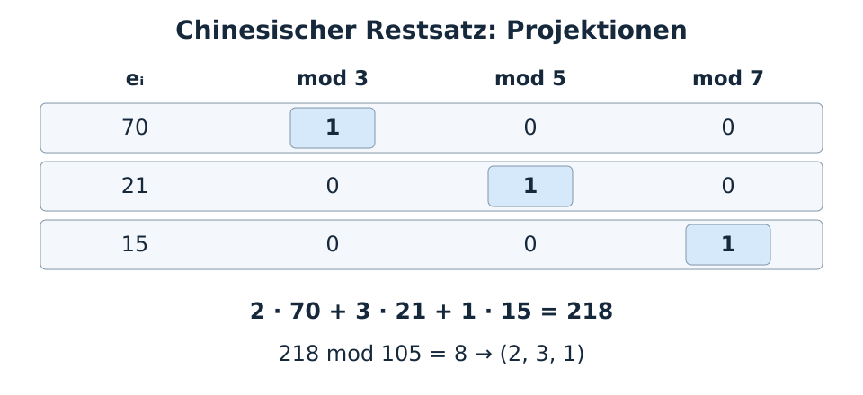

# M5-L2 – Kongruenzen und chinesischer Restsatz {#L2}

**Kursbereich:** M5 – Algebra und Zahlentheorie

**Niveau:** Bachelor · Wahlpflicht-Brücke

**Vorwissen:** [M5-L1](M5-L1.md)

**Einordnung:** Universitäre Vertiefung der elementaren Zahlentheorie

## Lernziele {#S1}

Du interpretierst Kongruenzen als Gleichheit von Restklassen, beweist das Lösbarkeitskriterium für lineare Kongruenzen und konstruierst den Isomorphismus des chinesischen Restsatzes für paarweise teilerfremde Moduln. Du behandelst auch zwei nicht teilerfremde Moduln und prüfst, wann ein System inkonsistent ist.

## Restklassen und Ringoperationen {#S2}

Für $m\ge2$ schreibe $[a]_m=a+m\mathbb Z$. Die Kongruenz $a\equiv b\pmod m$ bedeutet $m\mid(a-b)$, also $[a]_m=[b]_m$. Die Menge dieser Klassen heißt $\mathbb Z/m\mathbb Z$. Addition und Multiplikation werden durch $[a]_m+[b]_m=[a+b]_m$ bzw. $[a]_m[b]_m=[ab]_m$ definiert. Sie sind wohldefiniert: Ein Austausch von $a$ durch $a+km$ und $b$ durch $b+lm$ verändert Summe und Produkt nur um Vielfache von $m$. Der Ring besitzt genau $m$ Elemente. Eine Klasse ist genau dann eine Einheit (multiplikativ invertierbar), wenn ihr Vertreter zu $m$ teilerfremd ist, wie M5-L1 zeigt.

Beispiel: $[3]_8$ ist seine eigene Inverse, denn $9\equiv1\pmod8$. $[2]_8$ ist dagegen nicht invertierbar; das Produkt mit jeder Klasse bleibt gerade.

## Lineare Kongruenzen {#S3}

Setze $d=\gcd(a,m)$. Die Kongruenz $ax\equiv b\pmod m$ ist äquivalent zu $ax+my=b$ für ein ganzes $y$. Nach Bézout ist sie genau dann lösbar, wenn $d\mid b$. In diesem Fall liefert eine spezielle Lösung $x_0$ alle Lösungen $x=x_0+(m/d)k$. Modulo $m$ entstehen exakt $d$ verschiedene Klassen, weil zwei Parameter genau dann dieselbe Klasse ergeben, wenn ihre Differenz durch $d$ teilbar ist. Der Sonderfall $a=0$ bedeutet: alle Klassen bei $m\mid b$, sonst keine.

Beispiel: $18x\equiv12\pmod{30}$ reduziert sich auf $3x\equiv2\pmod5$. Da $3^{-1}\equiv2$, ist $x\equiv4\pmod5$. Die sechs Lösungen modulo 30 sind $4,9,14,19,24,29$. Dagegen ist $18x\equiv13\pmod{30}$ unlösbar.

## Chinesischer Restsatz: Konstruktion und Beweis {#S4}

Seien $m_1,\ldots,m_k\ge2$ paarweise teilerfremd, $M=\prod_i m_i$, $N_i=M/m_i$. Wegen $\gcd(N_i,m_i)=1$ gibt es $u_i$ mit $N_i u_i\equiv1\pmod{m_i}$. Für $j\ne i$ gilt $N_i u_i\equiv0\pmod{m_j}$. Setze $e_i=[N_i u_i]_M$. Für beliebige Zielreste $a_i$ liefert

$$x=\sum_{i=1}^k a_iN_i u_i\pmod M$$

alle geforderten Kongruenzen zugleich. Ist $x'$ eine zweite Lösung, teilt jedes $m_i$ die Differenz $x-x'$. Paarweise Teilerfremdheit impliziert (durch wiederholte Anwendung der Bézout-Kürzungsregel), dass $M$ die Differenz teilt. Die Lösung ist also eindeutig modulo $M$.

Für $(m_1,m_2,m_3)=(3,5,7)$ und $(a_1,a_2,a_3)=(2,3,1)$ sind $M=105$, $(N_1,N_2,N_3)=(35,21,15)$, $(u_1,u_2,u_3)=(2,1,1)$. Die Summe ist $2\cdot70+3\cdot21+15=218\equiv8\pmod{105}$. Probe: $8$ hat die gewünschten Reste.

{alt="70, 21 und 15 werden auf die drei Einheitsvektoren abgebildet; gewichtete Summe ergibt 8 modulo 105."}

## Ringisomorphismus und Implementierung {#S5}

Die Abbildung $\phi:\mathbb Z/M\mathbb Z\to\prod_i\mathbb Z/m_i\mathbb Z$, $[x]_M\mapsto([x]_{m_i})_i$, ist wohldefiniert, weil jedes $m_i$ ein Teiler von $M$ ist. Sie erhält Addition, Multiplikation und Eins. Der Beweis oben liefert sowohl Surjektivität (Konstruktion) als auch Injektivität (Eindeutigkeit). Sie ist damit ein Ringisomorphismus. Die Elemente $e_i$ werden jeweils auf einen Tupelvektor mit einer einzigen Eins abgebildet; folglich gelten $e_i^2=e_i$, $e_i e_j=0$ für $i\ne j$ und $\sum_i e_i=1$. Man kann deshalb Operationen komponentenweise ausführen und das Ergebnis rekonstruieren.

Das folgende Python-Programm (ab Python 3.8) berechnet einen nichtnegativen Repräsentanten. Es setzt ganzzahlige Eingaben voraus und lehnt nicht paarweise teilerfremde Moduln bewusst ab. Die eingebaute Funktion `pow` mit Exponent −1 liefert das modulare Inverse.

```python
from math import gcd, prod

def crt(residues, moduli):
    if not moduli or len(residues) != len(moduli):
        raise ValueError("nonempty matching lists required")
    if any(m < 2 for m in moduli):
        raise ValueError("moduli must be >= 2")
    if any(gcd(m,n) != 1 for i,m in enumerate(moduli) for n in moduli[i+1:]):
        raise ValueError("pairwise coprime moduli required")
    M = prod(moduli)
    return sum(a*(M//m)*pow(M//m,-1,m)
               for a,m in zip(residues,moduli)) % M

assert crt([2, 3, 1], [3, 5, 7]) == 8
```

## Nicht teilerfremde Moduln und Grenzen {#S6}

Für zwei Moduln $m,n\ge2$ und Zielreste $a,b$ ist das System $x\equiv a\pmod m$, $x\equiv b\pmod n$ genau dann lösbar, wenn $a\equiv b\pmod d$ für $d=\gcd(m,n)$. Denn $x=a+mt$ führt auf $mt\equiv b-a\pmod n$. Das Lösbarkeitskriterium folgt aus S3. Ist das System lösbar, ist die Lösung eindeutig modulo $\operatorname{lcm}(m,n)=mn/d$, nicht notwendigerweise modulo $mn$: Zwei Lösungen unterscheiden sich um ein gemeinsames Vielfaches beider Moduln, und alle Vielfachen des kgV erhalten beide Kongruenzen.

Beispiel: $x\equiv2\pmod6$, $x\equiv5\pmod9$ ist kompatibel. $6t\equiv3\pmod9$ ergibt $2t\equiv1\pmod3$, also $t\equiv2\pmod3$ und $x\equiv14\pmod{18}$. Dagegen ist das Paar $x\equiv2\pmod6$, $x\equiv4\pmod9$ inkompatibel. Der Produkt-Ring-Isomorphismus aus S5 gilt in diesem Fall nicht. Die Lösung größerer Systeme kann durch schrittweises Zusammenführen zweier kompatibler Kongruenzen erfolgen; jedes Zwischenergebnis behält sein kgV als Modul.

## Selbstkontrolle {#S7}

### Aufgaben

1. Löse $14x≡16$ modulo 20.
2. Löse $x≡2$ modulo 5 und $x≡4$ modulo 7 konstruktiv.
3. Bestimme die beiden CRT-Elemente $e_1,e_2$ modulo 35 und prüfe ihre Idempotenz.
4. Löse $x≡3$ modulo 8 und $x≡7$ modulo 12.
5. Begründe, warum paarweise Teilerfremdheit bei Moduln 6, 10, 15 nicht aus ihrem gemeinsamen ggT 1 folgt.

::: {.lc-solutions data-lc-section="S7"}
1. $d=2$, also $7x\equiv8\pmod{10}$; $7^{-1}=3$ modulo 10, daher $x\equiv4\pmod{10}$. Klassen 4 und 14 modulo 20.
2. $M=35$. $N_1=7,u_1=3$; $N_2=5,u_2=3$. Somit $2\cdot21+4\cdot15=102\equiv32\pmod{35}$.
3. $e_1=[21]_{35}$, $e_2=[15]_{35}$. $441\equiv21$, $225\equiv15$, $315\equiv0$; $36\equiv1\pmod{35}$.
4. $d=4$, kompatibel. $x=3+8t$, $8t\equiv4\pmod{12}$, also $2t\equiv1\pmod3$, $t\equiv2\pmod3$. $x\equiv19\pmod{24}$.
5. $\gcd(6,10)=2$, $\gcd(6,15)=3$, $\gcd(10,15)=5$. Gemeinsamer ggT 1 genügt nicht: etwa die Reste 0 modulo 6 und 1 modulo 10 sind unvereinbar.
:::

## Quellen {#S8}

- [Bruce Ikenaga – Linear Congruences (Millersville University)](https://sites.millersville.edu/bikenaga/number-theory/linear-congruences/linear-congruences.html) · theorem and proof, lines 2–46 · Zuletzt abgerufen: 2026-11-24 · Inhaltlich geprüft: 2026-11-24
- [Bruce Ikenaga – The Chinese Remainder Theorem (Millersville University)](https://sites.millersville.edu/bikenaga/number-theory/chinese-remainder-theorem/chinese-remainder-theorem.html) · construction and compatibility theorem, lines 58–105, 164–172 · Zuletzt abgerufen: 2026-11-24 · Inhaltlich geprüft: 2026-11-24
