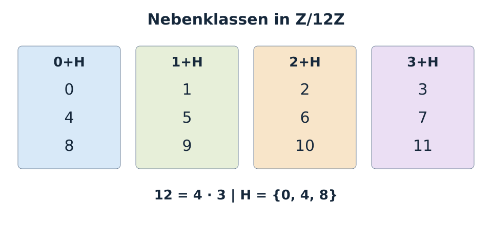

# M5-L3 – Untergruppen, Nebenklassen und Satz von Lagrange {#L3}

**Kursbereich:** M5 – Algebra und Zahlentheorie

**Niveau:** Bachelor · Wahlpflicht

**Vorwissen:** [M2-L3](M2-L3.md)

**Einordnung:** Vertiefung der universitären Algebra

## Lernziele {#S1}

Du prüfst Untergruppen mit einem einzigen Kriterium, zerlegst eine Gruppe in Nebenklassen und beweist den Satz von Lagrange. Du bestimmst Elementordnungen und unterscheidest notwendige von hinreichenden Bedingungen für die Existenz von Untergruppen.

## Untergruppen und Erzeuger {#S2}

Sei $G$ eine Gruppe mit neutralem Element $e$. Eine nichtleere Teilmenge $H\subseteq G$ ist genau dann eine Untergruppe, wenn $ab^{-1}\in H$ für alle $a,b\in H$ gilt. Beweis: Für $a=b$ erhält man $e\in H$; mit $a=e$ folgt $b^{-1}\in H$. Setzt man anschließend $b^{-1}$ als zweites Argument ein, ergibt sich $ab\in H$. Assoziativität wird von $G$ geerbt. Umgekehrt erfüllen Untergruppen das Kriterium wegen ihrer Abgeschlossenheit.

Die von $g$ erzeugte zyklische Untergruppe $\langle g\rangle$ besteht aus allen ganzzahligen Potenzen von $g$. Additiv schreibt man $\langle g\rangle=\{kg:k\in\mathbb Z\}$. In $\mathbb Z/12\mathbb Z$ erzeugt 4 die Untergruppe $H=\{0,4,8\}$. Die Menge $\{0,2,4\}$ ist keine Untergruppe, da $0-2\equiv10\pmod{12}$ fehlt. Ein Schnitt beliebig vieler Untergruppen ist wieder eine Untergruppe, da das Kriterium in jedem Faktor gilt; Vereinigungen sind dagegen im Allgemeinen nicht abgeschlossen.

## Nebenklassen als Partition {#S3}

Für $a\in G$ ist $aH=\{ah:h\in H\}$ eine Linksnebenklasse, $Ha$ eine Rechtsnebenklasse. Die Relation $a\sim b$ genau dann, wenn $a^{-1}b\in H$, ist reflexiv, symmetrisch und transitiv: Die drei Eigenschaften folgen aus $e\in H$, Inversenbildung und Multiplikation in $H$. Ihre Äquivalenzklasse von $a$ ist exakt $aH$. Folglich sind zwei Linksnebenklassen entweder gleich oder disjunkt; jedes Element liegt in genau einer. Die Abbildung $h\mapsto ah$ ist bijektiv von $H$ auf $aH$, mit Umkehrung $x\mapsto a^{-1}x$.

Im additiven Beispiel modulo 12 ergeben sich vier Klassen: $H,1+H,2+H,3+H$. Die Zahl 5 vertritt dieselbe Klasse wie 1. Die Grafik gruppiert alle zwölf Elemente nach ihrem Rest modulo 4. Eine Nebenklasse ist im Allgemeinen keine Untergruppe; nur $H$ selbst enthält 0.

{alt="Vier Nebenklassen mit je drei Elementen modulo 12."}

## Satz von Lagrange und Konsequenzen {#S4}

Für endliches $G$ bezeichnet $[G:H]$ die Anzahl der Linksnebenklassen. Die Partition und die Bijektionen aus S3 liefern

$$|G|=[G:H]\,|H|.$$

Insbesondere teilt $|H|$ die Gruppenordnung. Die Ordnung eines Elements $g$ ist die kleinste positive Zahl $d$ mit $g^d=e$, falls sie existiert. In einer endlichen Gruppe existiert sie, weil unter $e,g,\ldots,g^{|G|}$ zwei Potenzen gleich sein müssen. Die Potenzen $e,g,\ldots,g^{d-1}$ sind verschieden und bilden die zyklische Untergruppe. Somit gilt $d\mid |G|$ und $g^{|G|}=e$. Hat $G$ Primzahlordnung $p$, erzeugt jedes $g\ne e$ die ganze Gruppe, da $d>1$ und $d\mid p$.

## Zyklische Gruppen: Berechnung {#S5}

In $\mathbb Z/n\mathbb Z$ hat $a$ die Ordnung $n/\gcd(n,a)$. Denn $ka=0$ modulo $n$ bedeutet $n\mid ka$; nach Division durch den ggT sind die verbleibenden Faktoren teilerfremd. Die kleinste positive Wahl ist daher $k=n/\gcd(n,a)$. Für $n=12,a=8$ ergibt sich 3. Jede Untergruppe der zyklischen Gruppe entsteht durch einen Teiler $d$ von $n$: Das Urbild der Untergruppe in $\mathbb Z$ ist eine additive Untergruppe, die $n\mathbb Z$ enthält. Jede solche Untergruppe ist $d\mathbb Z$ (Division mit Rest durch ihr kleinstes positives Element), also $d\mid n$. Die erzeugte Untergruppe hat $n/d$ Elemente.

## Grenzen des Satzes {#S6}

Die Umkehrung von Lagrange gilt nicht für beliebige Gruppen. Die alternierende Gruppe $A_4$ der geraden Permutationen von vier Objekten hat zwölf Elemente: Identität, drei Doppeltranspositionen und acht 3-Zyklen. Eine Untergruppe der Ordnung 6 hätte Index 2. Ihre zwei Links- und Rechtsnebenklassen wären jeweils die Untergruppe und ihr Komplement, also wäre sie normal. Die Quotientengruppe der Ordnung 2 (Satz in M5-L4) kann kein nichttriviales Bild eines Elements der Ordnung 3 enthalten: Die Bildordnung teilt sowohl 3 als auch 2. Alle acht 3-Zyklen müssten deshalb zur Untergruppe gehören, ein Widerspruch. Obwohl 6 ein Teiler von 12 ist, existiert hier keine Untergruppe dieser Ordnung. Für zyklische Gruppen gilt die Umkehrung dagegen nach S5.

## Selbstkontrolle {#S7}

### Aufgaben

1. Prüfe $\{0,6,12,18\}$ in $\mathbb Z/24\mathbb Z$ auf Untergruppeneigenschaft und bestimme den Index.
2. Liste die Nebenklassen von $\langle 6\rangle$ in $\mathbb Z/15\mathbb Z$.
3. Bestimme die Ordnung von 18 modulo 42.
4. Beweise, dass eine Gruppe der Ordnung 17 zyklisch ist.
5. Zeige, dass die Vereinigung der von 2 und 3 erzeugten Untergruppen modulo 6 keine Untergruppe ist.

::: {.lc-solutions data-lc-section="S7"}
1. Die Menge besteht aus den Vielfachen von 6 modulo 24; Differenzen bleiben darin. Ordnung 4, Index 6.
2. $H=\{0,3,6,9,12\}$; $1+H=\{1,4,7,10,13\}$; $2+H=\{2,5,8,11,14\}$.
3. $42/\gcd(42,18)=42/6=7$.
4. Jedes nichtneutrale Element besitzt eine Ordnung größer als 1, die 17 teilt. Daher erzeugt es 17 Elemente.
5. Die Vereinigung ist $\{0,2,3,4\}$; $2+3=5$ fehlt.
:::

## Quellen {#S8}

- [Bruce Ikenaga – Subgroups (Millersville University)](https://sites.millersville.edu/bikenaga/abstract-algebra-1/subgroups/subgroups.html) · subgroup criterion · Zuletzt abgerufen: 2026-11-24 · Inhaltlich geprüft: 2026-11-24
- [Bruce Ikenaga – Cosets (Millersville University)](https://sites.millersville.edu/bikenaga/abstract-algebra-1/cosets/cosets.html) · lines 94–141: partition, index, Lagrange · Zuletzt abgerufen: 2026-11-24 · Inhaltlich geprüft: 2026-11-24
