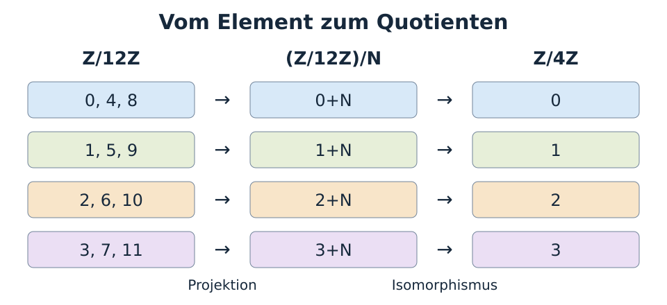

# M5-L4 – Normalteiler und Quotientengruppen {#L4}

**Kursbereich:** M5 – Algebra und Zahlentheorie

**Niveau:** Bachelor · Wahlpflicht

**Vorwissen:** [M5-L3](M5-L3.md)

**Einordnung:** Vertiefung der universitären Algebra

## Lernziele {#S1}

Du erkennst Normalteiler, beweist die Wohldefiniertheit einer Quotientenoperation und nutzt den ersten Isomorphiesatz. Du unterscheidest eine Nebenklassenmenge von einer Quotientengruppe und diagnostizierst das Scheitern der Multiplikation bei nichtnormalen Untergruppen.

## Normalität und Konjugation {#S2}

Eine Untergruppe $N\le G$ heißt normal, geschrieben $N\triangleleft G$, falls $gNg^{-1}=N$ für jedes $g\in G$. Konjugation ist ein Automorphismus von $G$; es genügt, $gNg^{-1}\subseteq N$ für alle $g$ zu zeigen, da die Anwendung auf $g^{-1}$ die andere Inklusion liefert. Durch Rechtsmultiplikation mit $g$ ergibt sich die äquivalente Bedingung $gN=Ng$. In abelschen Gruppen ist jede Untergruppe normal. Auch jede Untergruppe mit Index 2 ist normal: Links- und Rechtsnebenklassen eines Elements außerhalb der Untergruppe sind jeweils das gesamte Komplement.

In $S_3$, der Permutationsgruppe dreier Symbole, ist $N=\{e,(123),(132)\}$ normal (Index 2). Dagegen ist $H=\{e,(12)\}$ nicht normal: $(123)(12)(123)^{-1}=(23)\notin H$. Permutationen werden hier von rechts nach links angewandt. Die Untergruppe $H$ hat drei Linksnebenklassen, aber deren bloße Existenz liefert noch keine Gruppenstruktur.

## Quotientenoperation: Beweis {#S3}

Für einen Normalteiler definiere $(aN)(bN)=abN$. Wähle andere Vertreter $a'=an_1$, $b'=bn_2$ mit $n_1,n_2\in N$. Dann gilt

$$a'b'=ab(b^{-1}n_1b)n_2\in abN.$$

Normalität garantiert $b^{-1}n_1b\in N$, folglich ist $a'b'N=abN$. Das Produkt hängt nicht von der Vertreterwahl ab. Assoziativität folgt von $G$; $N$ ist neutral, $a^{-1}N$ ist invers zu $aN$. Umgekehrt erzwingt Wohldefiniertheit Normalität: Wegen $nN=N$ müsste für jedes $g,n$ mit $n\in N$ das Produkt $(gN)(nN)(g^{-1}N)$ die Klasse $N$ liefern. Also gehört $gng^{-1}$ zu $N$.

Für $H=\{e,(12)\}$ aus S2 zeigen die Vertreter $e,(12)$ derselben Klasse den Konflikt: Mit $b=(123)$ sind $bH$ und $(12)bH$ verschieden, da $b^{-1}(12)b=(13)\notin H$. Man darf die Quotientenoperation hier nicht definieren.

## Kern, Bild und Isomorphiesatz {#S4}

Sei $f:G\to K$ ein Homomorphismus. Sein Kern $N=\{g:f(g)=e_K\}$ ist eine Untergruppe nach dem Untergruppenkriterium. Für $n\in N$ gilt $f(gng^{-1})=f(g)e_K f(g)^{-1}=e_K$; damit ist $N$ normal. Das Bild $f(G)$ ist ebenfalls eine Untergruppe, da $f(a)f(b)^{-1}=f(ab^{-1})$.

Definiere $\bar f:G/N\to f(G)$ durch $\bar f(gN)=f(g)$. Gleiche Klassen bedeuten $g^{-1}h\in N$ und sind somit äquivalent zu $f(g)=f(h)$. Das beweist zugleich Wohldefiniertheit und Injektivität. Surjektivität folgt aus der Definition des Bildes; $\bar f$ erhält das Produkt. Damit ist $G/\ker f\cong f(G)$. Die kanonische Projektion $\pi:g\mapsto gN$ ist surjektiv und hat Kern $N$. Jeder Normalteiler tritt also als Kern auf.

## Rechenbeispiel und Faktorisierung {#S5}

Die Abbildung $f:\mathbb Z/12\mathbb Z\to\mathbb Z/4\mathbb Z$, $[a]_{12}\mapsto[a]_4$, ist wohldefiniert, da 4 ein Teiler von 12 ist. Sie ist additiv und surjektiv. Ihr Kern ist $\{0,4,8\}$. Die vier Klassen aus M5-L3 bilden deshalb eine Gruppe, deren Addition genau Addition modulo 4 entspricht. Insbesondere gilt $(3+N)+(2+N)=1+N$. Die Projektion fasst drei Elemente pro Klasse zusammen, während $\bar f$ jede Klasse bijektiv einem Rest zuordnet.

{alt="Projektion und Isomorphismus auf vier Restklassen modulo 4."}

Allgemeiner faktorisiert jeder Homomorphismus $h:G\to K$ mit $N\subseteq\ker h$ eindeutig über $G/N$: Die notwendige Wahl ist $\tilde h(gN)=h(g)$; sie ist wegen $N\subseteq\ker h$ wohldefiniert und erhält das Produkt. Die Surjektivität von $\pi$ erzwingt die Eindeutigkeit. Ohne diese Kernbedingung ist eine solche Faktorisierung unmöglich.

## Quotienten und Symmetrien {#S6}

Die Signumabbildung $\operatorname{sgn}:S_3\to\{1,-1\}$ unterscheidet gerade von ungeraden Permutationen. Ihre Multiplikativität folgt etwa aus der Determinante der zugeordneten Permutationsmatrizen. Ihr Kern ist $A_3$, ihr Bild die gesamte zweielementige Gruppe; also $S_3/A_3\cong\{1,-1\}$. Der Quotient erfasst nur die Parität, nicht die einzelne Permutation. Er ist kein Untergruppenersatz: Das Bild kann abelsch sein, obwohl $G$ nicht abelsch ist. Bei endlichen Gruppen berechnet Lagrange die Ordnung des Quotienten als $|G|/|N|$, aber nicht automatisch seine Isomorphieklasse.

## Selbstkontrolle {#S7}

### Aufgaben

1. Zeige, dass jede Untergruppe einer abelschen Gruppe normal ist.
2. Bestimme Kern und Bild von $[a]_{18}\mapsto[a]_6$.
3. Berechne im Quotienten aus Aufgabe 2 die Summe der Klassen von 14 und 17.
4. Begründe, weshalb die Abbildung $[a]_6\mapsto[a]_4$ nicht wohldefiniert ist.
5. Für $h:\mathbb Z\to\mathbb Z/8\mathbb Z$ als Restabbildung: Faktorisiert $h$ über $\mathbb Z/12\mathbb Z$ oder über $\mathbb Z/24\mathbb Z$?

::: {.lc-solutions data-lc-section="S7"}
1. Kommutativität ergibt $gng^{-1}=n$ für alle $n$.
2. Kern $\{0,6,12\}$, Bild alle sechs Restklassen. Der Quotient ist isomorph zu $\mathbb Z/6\mathbb Z$.
3. $14+17=31\equiv1\pmod6$; die Klasse ist $1+N=\{1,7,13\}$.
4. 0 und 6 sind dieselbe Klasse modulo 6, aber 0 und 2 modulo 4 sind verschieden.
5. Kern $8\mathbb Z$. $12\mathbb Z$ ist keine Teilmenge des Kerns, $24\mathbb Z$ schon. Nur über den zweiten Quotienten.
:::

## Quellen {#S8}

- [Bruce Ikenaga – Normal Subgroups and Quotient Groups (Millersville University)](https://sites.millersville.edu/bikenaga/abstract-algebra-1/normal-subgroups/normal-subgroups.html) · lines 139–166: well-defined product · Zuletzt abgerufen: 2026-11-24 · Inhaltlich geprüft: 2026-11-24
- [Bruce Ikenaga – The First Isomorphism Theorem (Millersville University)](https://sites.millersville.edu/bikenaga/abstract-algebra-1/first-isomorphism-theorem/first-isomorphism-theorem.html) · kernel and quotient examples · Zuletzt abgerufen: 2026-11-24 · Inhaltlich geprüft: 2026-11-24
