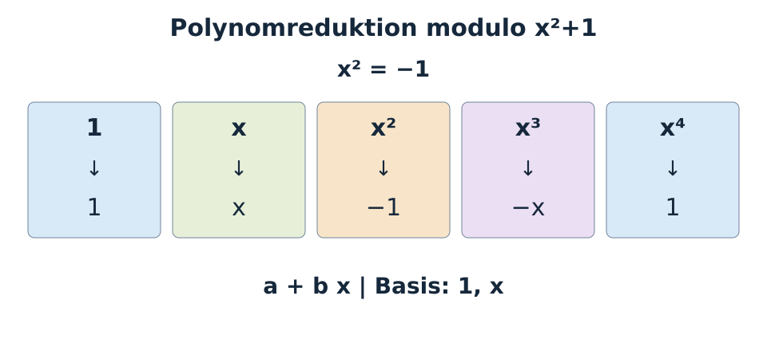

# M5-L5 – Ideale, Polynomringe und Körpererweiterungen {#L5}

**Kursbereich:** M5 – Algebra und Zahlentheorie

**Niveau:** Bachelor · Wahlpflicht / Master-Brücke

**Vorwissen:** [M5-L4](M5-L4.md); [M1-L5](M1-L5.md)

**Einordnung:** Vertiefung der universitären Algebra

## Lernziele {#S1}

Du konstruierst Quotientenringe aus Idealen, begründest das Körperkriterium für irreduzible Polynome und stellst endliche einfache Körpererweiterungen mit einer Basis dar. Du unterscheidest die Rolle des Grundkörpers von der Form eines Polynoms.

## Ideale und Quotientenringe {#S2}

In dieser Lektion seien Ringe kommutativ mit Eins. Ein Ideal $I\subseteq R$ ist eine additive Untergruppe mit $ri\in I$ für alle $r\in R,i\in I$. Die Klasse $a+I$ besteht aus den Elementen, die sich von $a$ um ein Element von $I$ unterscheiden. Definiere Addition und Multiplikation durch die Summe bzw. das Produkt von Vertretern. Die Addition ist bereits nach M5-L4 wohldefiniert. Für $a'=a+i,b'=b+j$ gilt $a'b'-ab=aj+bi+ij\in I$. Somit ist auch die Multiplikation wohldefiniert. Der entstehende Ring $R/I$ hat Eins $1+I$ (im Nullring gleich null). Ein echtes Ideal enthält keine Eins, denn andernfalls wäre jedes $r=r\cdot1$ in $I$.

Beispiel: $n\mathbb Z$ ist ein Ideal von $\mathbb Z$ und der Quotient ist der bekannte Restklassenring. Dagegen ist $\mathbb Z\subset\mathbb Q$ zwar ein Unterring, aber kein Ideal: $1/2\cdot1\notin\mathbb Z$.

## Polynomdivision und Normalform {#S3}

Sei $F$ ein Körper und $p\in F[x]$ ein Polynom positiven Grades $d$. Für jedes $f\in F[x]$ gibt es eindeutige $q,r$ mit $f=qp+r$ und $r=0$ oder $\deg r<d$. Zur Existenz subtrahiert man wiederholt ein geeignetes Monom-Vielfaches von $p$, sodass der führende Term verschwindet und der Grad sinkt. Der Leitkoeffizient von $p$ ist invertierbar. Zur Eindeutigkeit: Zwei Darstellungen ergäben $(q-q')p=r'-r$; ein nichtnulles Produkt links hätte Grad mindestens $d$, rechts aber kleineren Grad. Also stimmen beide Darstellungen überein.

Das Hauptideal $(p)=\{qp:q\in F[x]\}$ erlaubt daher eine eindeutige Normalform jeder Klasse in $F[x]/(p)$: $a_0+a_1x+\dots+a_{d-1}x^{d-1}$. Die Klassen $1,x,\dots,x^{d-1}$ bilden eine Basis über $F$, da ein nichtnulles Polynom kleineren Grades kein Vielfaches von $p$ sein kann. Konstanten betten $F$ injektiv ein.

## Irreduzibilität und Körperkriterium {#S4}

Ein Polynom positiven Grades ist irreduzibel über $F$, wenn es nicht als Produkt zweier Polynome positiven Grades in $F[x]$ darstellbar ist. Ist $p$ irreduzibel, hat jedes $f\notin(p)$ mit $p$ den ggT 1 (normiert). Die Polynomdivision ermöglicht denselben euklidischen Algorithmus wie bei ganzen Zahlen; Rückwärtseinsetzen liefert $uf+vp=1$. Modulo $(p)$ folgt $[u][f]=[1]$. Jede nichtnullige Klasse ist also invertierbar. Ist dagegen $p=ab$ mit beiden Faktoren positiven Grades, sind $[a]$ und $[b]$ nicht null (ihre Grade sind kleiner als $d$), aber $[a][b]=0$. Ein Körper besitzt keine solchen Nullteiler. Damit ist $F[x]/(p)$ genau dann ein Körper, wenn $p$ irreduzibel ist.

## Konkrete Erweiterung von Q {#S5}

Über $\mathbb Q$ ist $p=x^2+1$ irreduzibel, weil ein quadratisches Polynom genau dann zerfällt, wenn es eine Nullstelle besitzt, und rationale Quadrate nicht negativ sind. Setze $\alpha=[x]$. Es gilt $\alpha^2=-1$. Jedes Element besitzt eindeutig die Form $a+b\alpha$ mit rationalen $a,b$. Für zwei Elemente gilt

$$(a+b\alpha)(c+d\alpha)=(ac-bd)+(ad+bc)\alpha.$$

Beispiel: $(2+3\alpha)(1-\alpha)=5+\alpha$. Für $(a,b)\ne(0,0)$ ist das Inverse $(a-b\alpha)/(a^2+b^2)$. Die Erweiterung hat Grad 2 und Basis $1,\alpha$. Sie ist isomorph zum Körper $\mathbb Q(i)$, nicht zum ganzen Körper $\mathbb C$: Nur rationale Koeffizienten sind zugelassen.

{alt="Reduktion von Potenzen modulo x²+1 auf die Basis 1 und x."}

## Grundkörper und endliche Erweiterungen {#S6}

Über $\mathbb C$ ist dasselbe Polynom reduzibel, denn $x^2+1=(x-i)(x+i)$. Der Quotient besitzt Nullteiler. Über $\mathbb F_2$ ist $x^2+1=(x+1)^2$ ebenfalls reduzibel, aber $x^2+x+1$ hat weder 0 noch 1 als Nullstelle und ist irreduzibel. Der Quotient besitzt vier Elemente $0,1,\beta,1+\beta$, wobei $\beta^2=\beta+1$ und $\beta(1+\beta)=1$. Allgemein enthält ein Quotient über einem endlichen Körper mit $q$ Elementen bei Polynomgrad $d$ genau $q^d$ Klassen. Ist das Polynom irreduzibel, entsteht ein Körper. Der Grad einer Körpererweiterung ist die Vektorraumdimension über dem Grundkörper, nicht die Anzahl der Elemente. Für Grade ab 4 reicht ein Nullstellentest nicht zur Irreduzibilitätsprüfung: Ein Produkt zweier irreduzibler quadratischer Polynome hat keine Nullstelle im Grundkörper.

## Selbstkontrolle {#S7}

### Aufgaben

1. Zeige, dass die geraden ganzen Zahlen ein Ideal von $\mathbb Z$ sind.
2. Reduziere $x^4+2x^3+3$ modulo $x^2+1$ über $\mathbb Q$.
3. Berechne das Inverse von $3+4\alpha$ aus S5.
4. Bestimme $(1+\beta)^2$ im Körper aus S6.
5. Gib nichtnullige Nullteiler in $\mathbb Q[x]/(x^2-1)$ an und begründe, weshalb der Quotient kein Körper ist.

::: {.lc-solutions data-lc-section="S7"}
1. Differenzen gerader Zahlen sind gerade; für beliebige ganze $r$ ist $r(2k)=2(rk)$ gerade.
2. $x^2\equiv-1$, $x^3\equiv-x$, $x^4\equiv1$; Rest $4-2x$.
3. $(3-4\alpha)/25$; Produkt $25/25=1$.
4. $1+2\beta+\beta^2=1+0+\beta+1=\beta$.
5. $[x-1]$ und $[x+1]$ sind nicht null, da Grad 1 kleiner als 2. Ihr Produkt ist $[x^2-1]=0$, also fehlt beiden eine multiplikative Inverse.
:::

## Quellen {#S8}

- [Bruce Ikenaga – Quotient Rings of Polynomial Rings (Millersville University)](https://sites.millersville.edu/bikenaga/abstract-algebra-1/quotient-rings-of-polynomial-rings/quotient-rings-of-polynomial-rings.html) · lines 70–97: field criterion and proof · Zuletzt abgerufen: 2026-11-24 · Inhaltlich geprüft: 2026-11-24
