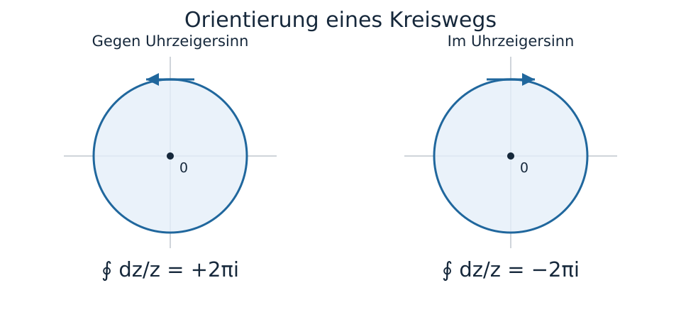

# M6-L1 – Kurvenintegrale und Cauchys Integralformel {#L1}

**Kursbereich:** M6 – Komplexe Analysis

**Niveau:** Bachelor · Wahlpflicht

**Vorwissen:** [M2-L5](M2-L5.md); [M1-L3](M1-L3.md)

**Einordnung:** Vertiefung der komplexen Analysis

## Lernziele {#S1}

Du parametrisierst komplexe Integrationswege, berechnest Kurvenintegrale direkt und wendest Cauchys Integralsatz und Integralformel unter überprüften Voraussetzungen an. Du erklärst den Zusammenhang zwischen Randwerten und Ableitungen holomorpher Funktionen.

## Parametrisierung und Orientierung {#S2}

Ein stückweise stetig differenzierbarer Weg $\gamma:[a,b]\to\mathbb C$ definiert für stetiges $f$ auf seiner Spur das Integral

$$\int_\gamma f(z)\,dz=\int_a^b f(\gamma(t))\gamma'(t)\,dt.$$

Das rechte Integral wird komponentenweise über einem reellen Parameter berechnet. Die gerichtete Tangente gehört zum Integranden; die Bogenlänge allein genügt nicht. Umkehrung der Orientierung negiert das Integral, Aneinanderfügen von Wegen addiert ihre Integrale. Eine orientierungserhaltende reguläre Umparametrisierung ändert den Wert nicht (Substitution).

Beispiel: Auf $\gamma(t)=t(1+i)$, $0\le t\le1$, ist $\int_\gamma z\,dz=(1+i)^2/2=i$. Für $f(z)=\bar z$ ergibt sich auf demselben Weg dagegen $\int_0^1 2t\,dt=1$. Auf dem gebrochenen Weg $0\to1\to1+i$ lautet das Integral von $\bar z$ zunächst $1/2$, dann $\int_0^1(1-it)i\,dt=1/2+i$. Die Summe $1+i$ unterscheidet sich vom Wert auf der Strecke.

## Abschätzung und Stammfunktionen {#S3}

Ist $|f(z)|\le M$ auf der Spur und $L=\int_a^b|\gamma'(t)|dt$ die Weglänge, folgt aus der Dreiecksungleichung

$$\left|\int_\gamma f(z)\,dz\right|\le ML.$$

Existiert eine holomorphe Stammfunktion $F$ mit $F'=f$ in einer offenen Umgebung des Weges, liefert die Kettenregel $\int_\gamma f(z)dz=F(\gamma(b))-F(\gamma(a))$. Geschlossene Wege ergeben dann null. Beispielsweise hat $z^2$ die globale Stammfunktion $z^3/3$. Für $1/z$ auf $\mathbb C\setminus\{0\}$ gibt es dagegen keine globale Stammfunktion: Auf $\gamma(t)=Re^{it}$ für $0\le t\le2\pi$ gilt $\gamma'/\gamma=i$, das Integral ist $2\pi i$. Im Uhrzeigersinn entsteht $-2\pi i$.

{alt="Positiv und negativ orientierter Kreisweg um 0."}

## Integralsatz und Gebietsbedingungen {#S4}

Der Cauchysche Integralsatz besagt insbesondere: Ist $f$ holomorph auf einem einfach zusammenhängenden Gebiet $D$, dann ist das Integral entlang jedes geschlossenen stückweise glatten Weges in $D$ null. Für eine einfache geschlossene Kurve genügt Holomorphie auf einer offenen Umgebung der Kurve samt eingeschlossenem Gebiet. Der Satz ist ein tieferer analytischer Befund als die bloße Kettenregel; hier verwenden wir ihn als bewiesenen Standardsatz. Auf einem Gebiet mit Loch ist Holomorphie entlang des Weges allein nicht ausreichend, wie $1/z$ in S3 zeigt. Bei einem Kreis um 0 mit Radius 1 ist dagegen das Integral von $1/(z-2)$ null, da die Singularität außerhalb liegt.

## Cauchys Integralformel {#S5}

Sei $\gamma$ eine einfache positiv (gegen den Uhrzeigersinn) orientierte geschlossene stückweise glatte Kurve und $f$ holomorph in einer offenen Umgebung ihres Abschlussgebiets. Für einen inneren Punkt $c$ gilt

$$f(c)=\frac1{2\pi i}\int_\gamma\frac{f(z)}{z-c}\,dz.$$

Begründung: Entferne einen kleinen Kreis um $c$ aus dem Innengebiet. Auf der verbleibenden Fläche ist der Integrand holomorph; der Integralsatz für deren Rand (äußere positive, innere negative Orientierung, etwa mittels Zerlegung) setzt das äußere Integral mit dem positiv orientierten kleinen Kreisintegral gleich. Mit $z=c+\rho e^{it}$ wird dieses zu $i\int_0^{2\pi}f(c+\rho e^{it})dt$. Die Stetigkeit bei $c$ erlaubt den Grenzübergang $\rho\to0$, der $2\pi i f(c)$ ergibt. Der innere Punkt darf nicht auf der Kurve liegen. Liegt er außerhalb, ist der Integrand im Abschlussgebiet holomorph und das Integral null. Bei Umkehr der Orientierung ändert sich das Vorzeichen.

Beispiel: Für $|z|=2$ gegen den Uhrzeigersinn liefert $\int_\gamma (z^2+1)/(z-i)\,dz=2\pi i(i^2+1)=0$. Die Null entsteht durch eine hebbare Singularität, nicht durch einen äußeren Punkt.

## Ableitungsformel und Cauchy-Abschätzung {#S6}

Differenzieren nach $c$ unter dem Integral ist lokal zulässig: In einer kleinen Umgebung von $c$ bleibt der Abstand zur kompakten Spur positiv, sodass die entsprechenden Differenzenquotienten gleichmäßig konvergieren. Wiederholung liefert für $n\ge0$

$$f^{(n)}(c)=\frac{n!}{2\pi i}\int_\gamma\frac{f(z)}{(z-c)^{n+1}}\,dz.$$

Für den Kreis mit Mittelpunkt $c$ und Radius $R$ sowie $|f|\le M$ auf dem Kreis ergibt S3 die Abschätzung $|f^{(n)}(c)|\le n!M/R^n$. Ist $f$ auf ganz $\mathbb C$ holomorph und global beschränkt, so folgt für $n=1$ und $R\to\infty$ überall $f'=0$; damit ist $f$ konstant (Satz von Liouville). Beispiel: Auf $|z|=3$ ist das Integral von $e^z/(z-1)^3$ gleich $2\pi i e/2!=\pi i e$.

## Selbstkontrolle {#S7}

### Aufgaben

1. Berechne das Integral von $z^2$ auf der Strecke von 0 nach $1+i$.
2. Integriere $1/z$ über $z(t)=2e^{-it}$, $0\le t\le2\pi$.
3. Berechne $\int_{|z|=2}(z+1)/(z-1)\,dz$ positiv orientiert.
4. Berechne $\int_{|z|=2}z^4/(z-1)^3\,dz$ positiv orientiert.
5. Auf $|z-c|=3$ sei $|f|\le9$ und $f$ auf einer Umgebung der abgeschlossenen Kreisscheibe holomorph. Schätze $|f''(c)|$ ab.

::: {.lc-solutions data-lc-section="S7"}
1. Stammfunktion $z^3/3$; Ergebnis $(-2+2i)/3$.
2. $\gamma'/\gamma=-i$; Ergebnis $-2\pi i$.
3. $2\pi i(1+1)=4\pi i$.
4. Zweite Ableitung von $z^4$ bei 1 ist 12; Integral $2\pi i\cdot12/2!=12\pi i$.
5. $2!\cdot9/3^2=2$.
:::

## Quellen {#S8}

- [Alan Reynolds – The Cauchy formula and power series](https://alan-reynolds.quarto.pub/introduction-to-complex-analysis/power.html) · §7.1–7.2 · Zuletzt abgerufen: 2026-11-24 · Inhaltlich geprüft: 2026-11-24
