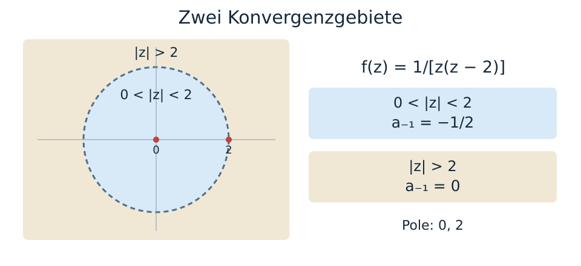

# M6-L2 – Laurentreihen, Pole und Residuensatz {#L2}

**Kursbereich:** M6 – Komplexe Analysis

**Niveau:** Bachelor · Wahlpflicht

**Vorwissen:** [M6-L1](M6-L1.md); [M1-L2](M1-L2.md)

**Einordnung:** Vertiefung der komplexen Analysis

## Lernziele {#S1}

Du entwickelst Laurentreihen auf passenden Kreisringen, klassifizierst isolierte Singularitäten, bestimmst Residuen auch bei höheren Polordnungen und berechnest geschlossene Integrale mit dem Residuensatz. Du unterscheidest lokale Singularitäten von globalen Konvergenzgrenzen.

## Laurententwicklung und Konvergenzgebiet {#S2}

Ist $f$ holomorph auf $r<|z-c|<R$, $0\le r<R\le\infty$, besitzt sie dort eine eindeutige Laurententwicklung

$$f(z)=\sum_{n=-\infty}^{\infty}a_n(z-c)^n,\qquad a_n=\frac1{2\pi i}\int_{|\zeta-c|=\rho}\frac{f(\zeta)}{(\zeta-c)^{n+1}}\,d\zeta$$

für jedes $r<\rho<R$ mit positiver Kreisorientierung. Die Reihe ist als Summe zweier Reihen (nichtnegative und negative Potenzen) zu verstehen. Sie konvergiert absolut und lokal gleichmäßig auf dem Kreisring. Der Laurententwicklungssatz folgt durch die Cauchy-Formel auf einem ringförmigen Gebiet mit zwei Randkreisen und geometrische Entwicklungen des Cauchy-Kerns: Für einen inneren Kreis $|\zeta-c|<|z-c|$ entstehen negative Potenzen, für einen äußeren Kreis $|\zeta-c|>|z-c|$ nichtnegative Potenzen. Die geometrischen Reihen konvergieren auf den jeweiligen Integrationskreisen gleichmäßig. Eindeutigkeit folgt durch gliedweise Integration auf einem Zwischenkreis, weil nur die passende Potenz einen von null verschiedenen Beitrag liefert.

## Zwei Reihen derselben Funktion {#S3}

Betrachte $f(z)=1/[z(z-2)]$ um $c=0$. Für $0<|z|<2$ gilt

$$f(z)=-\frac1{2z}\frac1{1-z/2}=-\sum_{k=0}^\infty\frac{z^{k-1}}{2^{k+1}}.$$

Für $|z|>2$ gilt stattdessen

$$f(z)=\frac1{z^2}\frac1{1-2/z}=\sum_{k=0}^\infty 2^k z^{-k-2}.$$

Die erste Reihe hat Koeffizient $a_{-1}=-1/2$, die äußere dagegen $a_{-1}=0$. Das ist kein Widerspruch zur Eindeutigkeit: Die Kreisringe unterscheiden sich. Der äußere Koeffizient ist nicht das lokale Residuum bei 0; er erfasst das Integral um beide Pole. Bei $|z|=2$ gelten die angegebenen geometrischen Entwicklungen nicht. Die Singularität $z=2$ verhindert eine einzige Laurentreihe um 0 über beide Ringbereiche hinweg.

{alt="Konvergenzgebiete und Laurentkoeffizient der Potenz minus eins."}

## Isolierte Singularitäten {#S4}

Sei $f$ holomorph auf $0<|z-c|<R$. Der Hauptteil der dortigen Laurentreihe enthält die negativen Potenzen. Ist er null, ist die Singularität hebbar und der Fortsetzungswert ist $a_0$ (Beispiel $(e^z-1)/z$ bei 0). Endet er bei $a_{-m}\ne0$, $m\ge1$, so liegt ein Pol der Ordnung $m$ vor (Beispiel $\cos z/z^2$ bei 0). Hat der Hauptteil unendlich viele nichtverschwindende Koeffizienten, handelt es sich um eine wesentliche Singularität (Beispiel $e^{1/z}$ bei 0). Ein Residuum von null schließt einen Pol nicht aus, etwa bei $1/z^2$. Eine Häufung von Singularitäten, wie die Pole von $1/\sin(1/z)$ nahe 0, ist keine isolierte Singularität bei 0 und kann nicht durch diese Klassifikation behandelt werden.

## Residuen berechnen {#S5}

Das Residuum an einer isolierten Singularität ist der Koeffizient $a_{-1}$ der lokalen Laurentreihe. Bei einem einfachen Pol gilt $\operatorname{Res}(f,c)=\lim_{z\to c}(z-c)f(z)$. Ist $f=g/h$ mit holomorphen $g,h$, $h(c)=0$, $h'(c)\ne0$ und $g(c)\ne0$, folgt aus $h(z)=(z-c)(h'(c)+O(z-c))$ die Formel $g(c)/h'(c)$. Bei einem Pol der Ordnung $m$ ist $G(z)=(z-c)^mf(z)$ holomorph fortsetzbar und das Residuum gleich $G^{(m-1)}(c)/(m-1)!$. Das ergibt sich durch Taylorentwicklung von $G$ und Division durch $(z-c)^m$.

Beispiel: Für $e^z/z^3$ ist $G=e^z$, $m=3$, also das Residuum $1/2$. Für $1/[z(z-2)]$ sind die Residuen bei 0 und 2 gleich $-1/2$ und $1/2$.

## Residuensatz und Anwendungen {#S6}

Sei $\gamma$ eine einfache positiv orientierte geschlossene stückweise glatte Kurve. In einer offenen Umgebung ihres abgeschlossenen Innengebiets sei $f$ holomorph bis auf endlich viele isolierte Singularitäten $c_j$ im Inneren; keine liegt auf der Spur. Dann gilt

$$\int_\gamma f(z)\,dz=2\pi i\sum_j\operatorname{Res}(f,c_j).$$

Begründung: Entferne disjunkte kleine Scheiben um die Singularitäten. Der Integralsatz auf der verbleibenden Region setzt das äußere Integral gleich der Summe der positiv orientierten kleinen Kreisintegrale. Auf jedem Kreis kann die Laurentreihe gleichmäßig integriert werden; das Integral von $(z-c_j)^n$ ist null für ganzzahlige $n\ne-1$ und $2\pi i$ für $n=-1$. Für allgemeine geeignete geschlossene Wege werden die Residuen mit den jeweiligen Umlaufzahlen gewichtet; hier beschränken wir uns auf einfache Kurven. Ein Pol auf der Kurve erfordert andere Verfahren, nicht das direkte Einsetzen in den Satz.

Beispiel: Das positiv orientierte Integral von $1/[z(z-2)]$ über $|z|=1$ ist $-\pi i$, über $|z|=3$ hingegen null. Eine weitere Anwendung: Für $f(z)=1/(1+z^2)$ auf dem oberen Halbkreis mit Radius $R>1$ und dem Durchmesser von $-R$ nach $R$ liegt nur der Pol $i$ innen, Residuum $1/(2i)$. Der Halbkreisbogen hat Länge $\pi R$ und $|f|\le1/(R^2-1)$. Sein Integral verschwindet für $R\to\infty$; daher $\int_{-\infty}^\infty dx/(1+x^2)=\pi$.

## Selbstkontrolle {#S7}

### Aufgaben

1. Entwickle $1/[z(z-3)]$ für $0<|z|<3$ und für $|z|>3$.
2. Klassifiziere $\sin z/z$, $1/z^4$ und $\sin(1/z)$ bei 0.
3. Berechne das Residuum von $e^{2z}/z^3$ bei 0.
4. Integriere $1/(z^2-1)$ auf $|z-1|=1/2$ und auf $|z|=2$, beide positiv orientiert.
5. Erkläre, warum der Residuensatz auf $|z|=1$ für $1/(z-1)$ nicht direkt anwendbar ist.

::: {.lc-solutions data-lc-section="S7"}
1. Innerer Ring: $-\sum_{k\ge0} z^{k-1}/3^{k+1}$; äußerer Ring: $\sum_{k\ge0}3^k z^{-k-2}$.
2. Hebbar mit Fortsetzungswert 1; Pol vierter Ordnung; wesentlich, da unendlich viele negative ungerade Potenzen auftreten.
3. $G''(0)/2!=4/2=2$.
4. Residuum bei 1: $1/2$, bei $-1$: $-1/2$. Erstes Integral $\pi i$, zweites null.
5. Bei $z=1$ liegt der Pol auf der Spur; der gewöhnliche Integrand ist dort undefiniert. Ein Hauptwert wäre eine gesondert definierte Größe.
:::

## Quellen {#S8}

- [NIST DLMF – Functions of a Complex Variable](https://dlmf.nist.gov/1.10) · §1.10(iii)–(iv) · Zuletzt abgerufen: 2026-11-24 · Inhaltlich geprüft: 2026-11-24
- [Alan Reynolds – Singularities and the Residue Theorem](https://alan-reynolds.quarto.pub/introduction-to-complex-analysis/singularities.html) · §8.1–8.3 · Zuletzt abgerufen: 2026-11-24 · Inhaltlich geprüft: 2026-11-24
