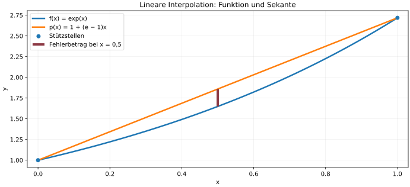

# M7-L1 – Interpolation und Approximation {#L1}

**Kursbereich:** M7 – Numerik und Optimierung

**Niveau:** Bachelor · Wahlpflicht

**Vorwissen:** [M1-L2](M1-L2.md); [M1-L3](M1-L3.md); [M1-L6](M1-L6.md)

**Einordnung:** Numerische Vertiefung des gemeinsamen Bachelor-Kerns

## Lernziele {#S1}

Du konstruierst ein Interpolationspolynom, leitest eine Fehlerabschätzung her und unterscheidest Approximationsfehler, Datenfehler und Rundungsfehler. Du entscheidest, wann ein Ausgleichsmodell geeigneter ist als exakte Interpolation.

## Existenz, Eindeutigkeit und Lagrange-Basis {#S2}

Seien $x_0,\dots,x_n$ paarweise verschiedene reelle Stützstellen und $y_i$ die zugehörigen Werte. Gesucht ist $p\in\mathcal P_n$, also ein Polynom vom Grad höchstens $n$, mit $p(x_i)=y_i$. Setze

$$L_i(x)=\prod_{j\ne i}\frac{x-x_j}{x_i-x_j},\qquad p(x)=\sum_{i=0}^n y_iL_i(x).$$

Wegen $L_i(x_j)=\delta_{ij}$ erfüllt $p$ alle Bedingungen. Zwei Lösungen hätten eine Differenz vom Grad höchstens $n$ mit $n+1$ verschiedenen Nullstellen; diese Differenz ist daher das Nullpolynom. Das zeigt sowohl Existenz als auch Eindeutigkeit.

Beispiel: Für die Punkte $(-1,1),(0,0),(2,4)$ sind die Daten Werte von $x^2$. Die eindeutige Lösung lautet folglich $p=x^2$, auch ohne Ausmultiplizieren. Für $(0,1),(1,2),(2,5)$ erhältst du $p=1+x^2$. Bei vielen Auswertungen ist eine baryzentrische Darstellung meist günstiger als die direkte Produktform; die folgende Implementierung dient kleinen Lehrbeispielen.

```python
from math import prod

def lagrange(xs, ys, x):
    if not xs or len(xs) != len(ys) or len(set(xs)) != len(xs):
        raise ValueError("distinct nodes and matching data required")
    return sum(yi * prod((x-xj)/(xi-xj)
                        for j, xj in enumerate(xs) if j != i)
               for i, (xi, yi) in enumerate(zip(xs, ys)))

assert abs(lagrange([0, 1, 2], [1, 2, 5], 1.5)-3.25) < 1e-12
```

## Fehlerformel und Beweis {#S3}

Wenn $f\in C^{n+1}([a,b])$ und alle Stützstellen sowie $x$ im Intervall liegen, gilt für einen Zwischenpunkt $\xi\in(a,b)$ (bei $x$ außerhalb der Stützstellen, aber im Intervall, auf deren gemeinsamer konvexer Hülle)

$$f(x)-p(x)=\frac{f^{(n+1)}(\xi)}{(n+1)!}\prod_{i=0}^n(x-x_i).$$

An Stützstellen ist der Fehler unmittelbar null. Für andere $x$ setze $\omega(t)=\prod_i(t-x_i)$ und $c=(f(x)-p(x))/\omega(x)$. Die Funktion $g=f-p-c\omega$ hat $n+2$ verschiedene Nullstellen. Wiederholte Anwendung des Satzes von Rolle liefert $g^{(n+1)}(\xi)=0$. Da $p^{(n+1)}=0$ und $\omega^{(n+1)}=(n+1)!$, folgt die Formel. Mit $M=\max_{[a,b]}|f^{(n+1)}|$ ergibt sich eine obere Schranke $M|\omega(x)|/(n+1)!$.

Für $f(x)=x^3$ und Stützstellen $-1,0,1$ ist $p=x$ und die Formel liefert exakt $x^3-x=x(x-1)(x+1)$. Für lineare Interpolation von $e^x$ zwischen 0 und 1 beträgt die Schranke bei $x=1/2$ genau $e/8$. Der tatsächliche Fehler hat Betrag $(1+e)/2-\sqrt e\approx0{,}2104$ und liegt darunter.

{alt="Exponentialfunktion und lineares Interpolationspolynom mit Fehler am Mittelpunkt."}

## Kondition, Stützstellen und Extrapolation {#S4}

Eine Erhöhung des Polynomgrades bei äquidistanten Stützstellen garantiert keine gleichmäßige Konvergenz. Die Runge-Funktion $1/(1+25x^2)$ auf $[-1,1]$ zeigt Randoszillationen. Die Nullstellen des Chebyshev-Polynoms $T_{n+1}$, also $x_i=\cos((2i+1)\pi/(2n+2))$, häufen sich nahe den Rändern und verkleinern das maximale Betragsniveau des monischen Stützstellenpolynoms. Das verbessert die Fehlerkontrolle, sofern die Ableitungsschranke geeignet ist. Alternativ zerlegt man das Intervall und verwendet stückweise Polynome niedrigen Grades.

Bei Datenstörungen $|\Delta y_i|\le\varepsilon$ gilt $|\Delta p(x)|\le\varepsilon\sum_i|L_i(x)|$. Diese Verstärkung beschreibt die Kondition bezüglich der Daten, unabhängig von der Implementierung. Rundungsfehler entstehen zusätzlich beim Rechnen. Außerhalb des Datenintervalls können sowohl das Stützstellenprodukt als auch die Verstärkung wachsen: Extrapolation verlangt eine begründete Modellannahme, nicht nur eine Formel.

## Ausgleich statt Interpolation {#S5}

Bei verrauschten Messungen sollen nicht zwingend alle Datenpunkte getroffen werden. Für die Gerade $a+bx$ minimiert die Methode der kleinsten Quadrate $\sum_i(a+bx_i-y_i)^2$. Die Ableitungen nach $a,b$ ergeben $ma+b\sum x_i=\sum y_i$ und $a\sum x_i+b\sum x_i^2=\sum x_iy_i$ für $m$ Messwerte. Bei nicht konstanten $x_i$ ist die Lösung eindeutig. Für $(0,1),(1,3),(2,2)$ erhältst du $b=1/2$, $a=3/2$. Die Residuen (Modell minus Daten) sind $1/2,-1,1/2$; ihre Quadratsumme ist $3/2$. Das quadratische Interpolationspolynom hätte Nullresiduen, aber daraus folgt keine bessere Vorhersage. In größeren Problemen sind QR-Zerlegung oder SVD numerisch oft günstiger als explizite Normalgleichungen.

## Selbstkontrolle {#S6}

### Aufgaben

1. Bestimme das Interpolationspolynom für $(0,2),(1,3),(2,6)$.
2. Beweise die Eindeutigkeit für vier verschiedene Stützstellen.
3. Interpoliere $x^3$ bei $0,1,2$ und bestimme den Fehler bei $x=1/2$.
4. Bestimme eine Fehlerobergrenze für lineare Interpolation von $\sin x$ auf $[0,\pi/2]$ am Mittelpunkt.
5. Bestimme die Ausgleichsgerade für $(0,0),(1,2),(2,1)$ und erkläre, warum sie nicht interpoliert.

::: {.lc-solutions data-lc-section="S6"}
1. $p(x)=2+x^2$.
2. Die Differenz hat Grad höchstens 3 und vier verschiedene Nullstellen, ist also null.
3. $p=3x^2-2x$, Fehler $x(x-1)(x-2)=3/8$ bei $1/2$.
4. $|f''|\le1$, daher $\pi^2/32$.
5. $a=1/2,b=1/2$; Vorhersagen $1/2,1,3/2$ stimmen nicht mit allen Daten überein.
:::

## Quellen {#S7}

- [Driscoll/Braun – Fundamentals of Numerical Computation](https://tobydriscoll.net/fnc-julia/globalapprox/polynomial.html) · §9.1 · Zuletzt abgerufen: 2026-11-24 · Inhaltlich geprüft: 2026-11-24
