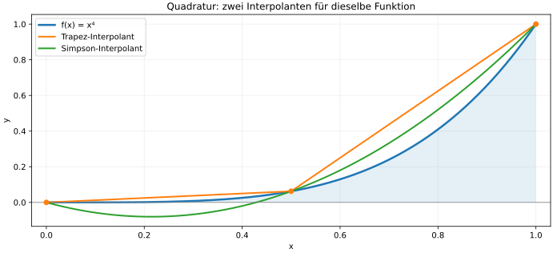

# M7-L2 – Numerische Quadratur und Fehlerabschätzung {#L2}

**Kursbereich:** M7 – Numerik und Optimierung

**Niveau:** Bachelor · Wahlpflicht

**Vorwissen:** [M1-L3](M1-L3.md); [M7-L1](M7-L1.md)

**Einordnung:** Numerische Vertiefung des gemeinsamen Bachelor-Kerns

## Lernziele {#S1}

Du leitest Quadraturregeln aus Polynominterpolation ab, wendest zusammengesetzte Trapez- und Simpsonregeln an, bestimmst Fehlergrenzen und konstruierst die Gaußregel mit zwei Knoten. Du unterscheidest Polynomexaktheit, Fehlerordnung und tatsächlichen Rechenfehler.

## Quadratur aus Interpolation {#S2}

Die Quadratur approximiert $I=\int_a^b f(x)\,dx$ durch gewichtete Funktionswerte $Q=\sum_i w_if(x_i)$. Integriert man das Lagrange-Interpolationspolynom, erhält man Gewichte $w_i=\int_a^b L_i(x)\,dx$. Für zwei Endpunkte ist das Interpolationspolynom linear; seine Integration ergibt $T=(b-a)(f(a)+f(b))/2$. Für drei äquidistante Knoten $a,m=(a+b)/2,b$ liefert die Integration der quadratischen Basis die Simpsonregel $S=(b-a)(f(a)+4f(m)+f(b))/6$.

Die Simpsonregel ist sogar für kubische Polynome exakt: Nach Verschiebung auf das symmetrische Intervall $[-h,h]$ werden die ungeraden Monome $x$ und $x^3$ sowohl exakt als auch durch die symmetrische Regel zu null integriert. Die Monome 1 und $x^2$ sind durch die Konstruktion exakt. Für $x^4$ gilt dies nicht mehr.

{alt="Trapez- und Simpson-Interpolant für x hoch vier auf dem Einheitsintervall."}

## Zusammengesetzte Regeln und Fehlergrenzen {#S3}

Für $n\ge1$, $h=(b-a)/n$ und $x_i=a+ih$ lautet die zusammengesetzte Trapezregel

$$T_n=h\left(\frac{f(x_0)+f(x_n)}2+\sum_{i=1}^{n-1}f(x_i)\right).$$

Für gerades $n\ge2$ ist die zusammengesetzte Simpsonregel

$$S_n=\frac h3\left(f(x_0)+f(x_n)+4\sum_{i\ \mathrm{ungerade}}f(x_i)+2\sum_{\substack{0<i<n\\i\ \mathrm{gerade}}}f(x_i)\right),$$

wobei die ungerade Summe nur innere Knoten umfasst. Unter $f\in C^2([a,b])$ bzw. $f\in C^4([a,b])$ gelten

$$|I-T_n|\le\frac{b-a}{12}h^2\max|f''|,\qquad |I-S_n|\le\frac{b-a}{180}h^4\max|f^{(4)}|.$$

Die erste Schranke folgt durch Integration des linearen Interpolationsrestes auf jedem Teilintervall: $\int_0^h t(h-t)\,dt=h^3/6$. Für Simpson kann man auf $[-h,h]$ den Fehleroperator $E=I-S$ auf die Taylorformel mit Integralrest vierter Ordnung anwenden. Er annihiliert Polynome bis Grad 3; sein Peano-Kern ist $K(t)=E[(x-t)_+^3/6]$. Für $0\le t\le h$ ergibt sich $K(t)=-(h-t)^3(h+3t)/72$, für negative $t$ gilt $K(-t)=K(t)$ durch Symmetrie und Polynomexaktheit. Der Kern ist nichtpositiv und $\int K=-h^5/90$. Somit ist der Fehler pro Doppelintervall höchstens $h^5\max|f^{(4)}|/90$. Addition über $n/2$ Doppelintervalle liefert die angegebene Schranke.

## Gauß-Legendre-Quadratur {#S4}

Bei Gauß-Legendre-Quadratur werden auch die Knoten optimiert. Auf $[-1,1]$ suche eine symmetrische Regel mit Knoten $\pm c$ und gleichem Gewicht $w$. Exaktheit für 1 erfordert $2w=2$, also $w=1$. Für $x^2$ folgt $2c^2=2/3$, also $c=1/\sqrt3$. Ungerade Monome bis Grad 3 werden wegen Symmetrie exakt integriert. Damit gilt

$$\int_{-1}^1 f(x)\,dx\approx f(-1/\sqrt3)+f(1/\sqrt3).$$

Allgemein auf $[a,b]$ setze $m=(a+b)/2$, $d=(b-a)/2$; die Näherung lautet $d[f(m-d/\sqrt3)+f(m+d/\sqrt3)]$. Die allgemeine Gauß-Legendre-Regel mit $k$ Knoten verwendet Nullstellen des Legendre-Polynoms $P_k$ und ist exakt für Polynome bis Grad $2k-1$. Bei $x^4$ auf $[-1,1]$ liefert die Zweipunktregel $2/9$ statt $2/5$. Exaktheit für niedrige Grade bedeutet also nicht Fehlerfreiheit für beliebige Funktionen.

## Konvergenzexperiment und Grenzen {#S5}

Für $f=x^4$ auf $[0,1]$ ist $I=1/5$. Mit $n=2$ ergeben sich $T_2=9/32$, $S_2=5/24$, und mit $n=4$ $S_4=77/384$. Die Simpsonfehler verhalten sich exakt wie $16:1$. Der folgende Code ermöglicht weitere Experimente.

```python
def quadrature(f, a, b, n, simpson=False):
    if n < 1 or (simpson and n % 2):
        raise ValueError("positive n, even for Simpson")
    h = (b-a)/n
    y = [f(a+i*h) for i in range(n+1)]
    if simpson:
        return h/3*(y[0]+y[-1]+sum((4 if i%2 else 2)*y[i]
                                    for i in range(1,n)))
    return h*((y[0]+y[-1])/2+sum(y[1:-1]))

for n in (2, 4, 8, 16):
    print(n, abs(quadrature(lambda x: x**4, 0, 1, n, True)-0.2))
```

Unter ausreichender Glattheit und im asymptotischen Bereich ist bei Halbierung von $h$ typischerweise ein Fehlerfaktor 4 beziehungsweise 16 zu beobachten. Bei verschwindendem führendem Fehlerterm oder dominanter Rundung gilt dies nicht zwingend. Für eine unbekannte Lösung kann bei einer Fehlerentwicklung $I-Q_h=Ch^p+o(h^p)$ die Differenz $|Q_{h/2}-Q_h|/(2^p-1)$ den feineren Fehler schätzen. Ein solcher Schätzer ist ohne weitere Annahmen keine garantierte Schranke. Singularitäten und Sprünge verlangen angepasste Verfahren; bloße Verdopplung der Stützstellen ist kein Nachweis zuverlässiger Genauigkeit.

## Selbstkontrolle {#S6}

### Aufgaben

1. Berechne $T_2$ und $S_2$ für $x^2$ auf $[0,1]$.
2. Bestimme eine Simpson-Fehlerschranke für $e^x$ auf $[0,1]$ mit $n=4$.
3. Wende die Zweipunkt-Gaußregel auf $x^3+2x^2+1$ auf $[-1,1]$ an.
4. Zeige, dass die Zweipunkt-Gaußregel $x^2$ auf $[0,2]$ exakt integriert.
5. Eine Rechnung mit Simpson liefert $Q_h=1{,}0024$ und $Q_{h/2}=1{,}00015$. Schätze den feineren Fehler unter angenommener vierter Ordnung.

::: {.lc-solutions data-lc-section="S6"}
1. $T_2=3/8$, $S_2=1/3$.
2. $e/(180\cdot4^4)=e/46080$.
3. $2+4/3=10/3$; der ungerade Term verschwindet.
4. $m=d=1$; $(1-1/\sqrt3)^2+(1+1/\sqrt3)^2=8/3$.
5. $0{,}00225/15=0{,}00015$; dies ist eine Schätzung unter der angegebenen Annahme.
:::

## Quellen {#S7}

- [Driscoll/Braun – Fundamentals of Numerical Computation](https://tobydriscoll.net/fnc-julia/localapprox/integration.html) · §5.6 · Zuletzt abgerufen: 2026-11-24 · Inhaltlich geprüft: 2026-11-24
- [NIST DLMF – Quadrature](https://dlmf.nist.gov/3.5) · §3.5(v) · Zuletzt abgerufen: 2026-11-24 · Inhaltlich geprüft: 2026-11-24
