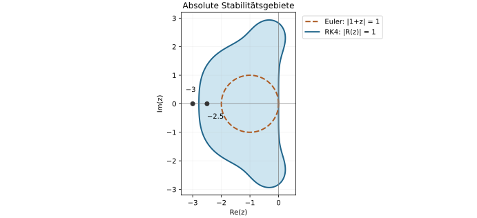

# M7-L3 – Runge–Kutta-Verfahren und numerische Stabilität {#L3}

**Kursbereich:** M7 – Numerik und Optimierung

**Niveau:** Bachelor · Wahlpflicht

**Vorwissen:** [M1-L9](M1-L9.md); [M1-L8](M1-L8.md)

**Einordnung:** Numerische Vertiefung des gemeinsamen Bachelor-Kerns

## Lernziele {#S1}

Du berechnest einen klassischen Runge–Kutta-Schritt, unterscheidest lokale und globale Fehlerordnung, leitest die Stabilitätsfunktion auf einer linearen Testgleichung her und begründest, warum steife Probleme besondere Integratoren erfordern können.

## Ein-Schritt-Verfahren und RK4 {#S2}

Gegeben sei $y'=f(t,y)$, $y(t_0)=y_0$, mit einer hinreichend glatten rechten Seite. Für einen Schritt der Länge $h>0$ berechnet Euler die Näherung $y_{n+1}=y_n+hf(t_n,y_n)$. Ein explizites Runge–Kutta-Verfahren verwendet mehrere Steigungen innerhalb desselben Schritts. Beim klassischen vierstufigen Verfahren gilt

$$\begin{aligned}k_1&=f(t_n,y_n),\\ k_2&=f(t_n+h/2,y_n+hk_1/2),\\ k_3&=f(t_n+h/2,y_n+hk_2/2),\\ k_4&=f(t_n+h,y_n+hk_3),\\ y_{n+1}&=y_n+h(k_1+2k_2+2k_3+k_4)/6.\end{aligned}$$

Die $k_i$ sind Steigungen, keine bereits mit $h$ multiplizierten Inkremente. Die mittleren Stufen verwenden unterschiedliche Zustandsschätzungen. Das Verfahren ist explizit: Jede Stufe hängt nur von früheren Stufen ab. Beispiel $y'=y$, $y_0=1$, $h=1/2$: Die Steigungen sind $1,5/4,21/16,53/32$. Der neue Wert ist $211/128=1{,}6484375$, während $e^{1/2}\approx1{,}6487213$.

## Lokaler Defekt und globale Ordnung {#S3}

Für ein Verfahren der Ordnung $p$ ist der unskalierte lokale Defekt bei Start am exakten Wert $O(h^{p+1})$. Der globale Fehler auf einem festen Zeitintervall ist unter geeigneten Glattheits- und Lipschitzannahmen $O(h^p)$. Für RK4 ist $p=4$, für Euler $p=1$. Eine Begründung der Übertragung: Schreibe den Schritt als $\Phi_h(t,y)$. Gilt $|\Phi_h(t,u)-\Phi_h(t,v)|\le(1+Lh)|u-v|$ und ist der lokale Defekt durch $Ch^{p+1}$ beschränkt, dann folgt für $e_n=|y(t_n)-y_n|$ die Rekursion $e_{n+1}\le(1+Lh)e_n+Ch^{p+1}$. Iteration bei $e_0=0$ liefert für $L>0$ die Schranke $Ch^p(e^{L(t_n-t_0)}-1)/L$; für $L=0$ gilt $C(t_n-t_0)h^p$. Die vierte Ordnung des klassischen Verfahrens für allgemeine glatte $f$ folgt aus dem Taylorvergleich der Stufen bis Grad vier (hier nicht vollständig hergeleitet). Auf $y'=\lambda y$ lässt sie sich direkt am Stabilitätspolynom nachvollziehen. Ein einzelner Test der linearen Gleichung beweist die allgemeine Ordnung nicht.

## Absolute Stabilität und Steifigkeit {#S4}

Für $y'=\lambda y$, $z=h\lambda$, ist die exakte Verstärkung $e^z$. Einsetzen der vier Stufen ergibt $y_{n+1}=R(z)y_n$ mit

$$R(z)=1+z+z^2/2+z^3/6+z^4/24.$$

Damit ist $y_n=R(z)^ny_0$. Bei $|R(z)|\le1$ bleiben die Werte beschränkt; bei $|R(z)|<1$ klingen sie ab. Euler besitzt $R_E(z)=1+z$ und die Stabilitätsscheibe $|z+1|\le1$. Auf der negativen reellen Achse reicht RK4 ungefähr von $-2{,}7853$ bis 0, Euler nur von $-2$ bis 0. Auf der Grenze ist Beschränktheit nicht gleich Abklingen. Die RK4-Grenze folgt aus $R(-r)=1$, also $r^3-4r^2+12r-24=0$ für $r>0$; dieses Polynom ist streng monoton. Tatsächlich ist $24R(-r)=(r^2-2r)^2+8(r-3/2)^2+6>0$.

{alt="Stabilitätsgebiete von Euler und RK4 mit Testpunkten −3 und −2,5."}

Für $\lambda=-100$, $h=0{,}03$ ist $z=-3$; RK4 verstärkt mit $11/8>1$, obwohl die exakte Lösung abklingt. Bei $h=0{,}025$ liegt $z=-2{,}5$ im RK4-Stabilitätsbereich, aber außerhalb des Eulerbereichs. Stabilität garantiert keine hohe Genauigkeit. Ein steifes System wie $u'=-u$, $v'=-1000v$ besitzt sehr verschiedene Zeitskalen. Auch wenn die schnelle Komponente schon klein ist, kann sie die explizite Schrittweite beschränken. Rückwärts-Euler besitzt $R_B(z)=1/(1-z)$ und ist für $\operatorname{Re}z\le0$ absolut stabil (A-stabil); für stark negative reelle $z$ geht $R_B$ gegen null. Der Preis ist im Allgemeinen das Lösen eines impliziten Gleichungssystems.

## Experiment und Verfahrenswahl {#S5}

```python
from math import exp

def rk4(f, t, y, h):
    k1 = f(t, y)
    k2 = f(t+h/2, y+h*k1/2)
    k3 = f(t+h/2, y+h*k2/2)
    k4 = f(t+h, y+h*k3)
    return y+h*(k1+2*k2+2*k3+k4)/6

def solve(f, a, b, y, n):
    if n < 1 or b <= a:
        raise ValueError("positive step count and interval required")
    h = (b-a)/n
    for i in range(n):
        y = rk4(f, a+i*h, y, h)
    return y

for n in (10, 20, 40, 80):
    print(n, abs(solve(lambda t,y: y, 0, 1, 1, n)-exp(1)))
```

Auf $[0,1]$ mit $y'=y$ nähert sich der Quotient der Endpunktfehler bei halbierter Schrittweite dem Wert 16. Bei sehr kleinen Schritten können Rundungsfehler dominieren. Für einen lokalen Fehlerschätzer kann man einen Schritt der Länge $h$ mit zwei halben Schritten vergleichen. Bei glatter Lösung und führendem Defektterm der Ordnung $h^5$ schätzt der Betrag ihrer Differenz geteilt durch 15 den lokalen Fehler der zwei halben Schritte. Dies ist keine globale Fehlergarantie. In realen Anwendungen sind eingebettete RK-Verfahren mit adaptiver Schrittsteuerung üblich; bei Steifigkeit sind geeignete implizite Verfahren vorzuziehen. Neben Toleranzen sind Modellfehler, Ereignisse, Singularitäten und Erhaltungsgrößen zu prüfen.

## Selbstkontrolle {#S6}

### Aufgaben

1. Berechne einen RK4-Schritt für $y'=2$, $y_0=3$, $h=1/4$.
2. Leite $R(z)$ aus den vier RK4-Stufen für $y'=\lambda y$ her.
3. Prüfe Euler und RK4 auf Abklingen bei $z=-5/2$.
4. Für $\lambda=-1000$: Bestimme die ungefähre maximale RK4-Schrittweite für Beschränktheit.
5. Begründe die globale Ordnung vier aus einem lokalen Defekt $O(h^5)$ und einer Lipschitz-Schranke des Schritts.

::: {.lc-solutions data-lc-section="S6"}
1. Alle Steigungen sind 2; $y_1=7/2$.
2. $hk_1=zy$, $hk_2=z(1+z/2)y$, $hk_3=z(1+z/2+z^2/4)y$, $hk_4=z(1+z+z^2/2+z^3/4)y$. Gewichtete Summe ergibt das angegebene Polynom.
3. Euler: $|-3/2|>1$. RK4: $R(-5/2)=83/128<1$ und positiv; nur RK4 klingt ab.
4. $h\le 2{,}7853/1000\approx0{,}0027853$; für Abklingen strikt darunter, bei $h>0$.
5. Die Fehlerrekursion summiert $O(1/h)$ lokale Defekte mit auf dem festen Zeitintervall beschränkten Verstärkungsfaktoren. Daher $O(h^4)$.
:::

## Quellen {#S7}

- [Driscoll/Braun – Fundamentals of Numerical Computation](https://tobydriscoll.net/fnc-julia/ivp/rk.html) · §6.4 · Zuletzt abgerufen: 2026-11-24 · Inhaltlich geprüft: 2026-11-24
- [Driscoll/Braun – Fundamentals of Numerical Computation](https://tobydriscoll.net/fnc-julia/diffusion/absstab-diffusion.html) · §11.3 · Zuletzt abgerufen: 2026-11-24 · Inhaltlich geprüft: 2026-11-24
