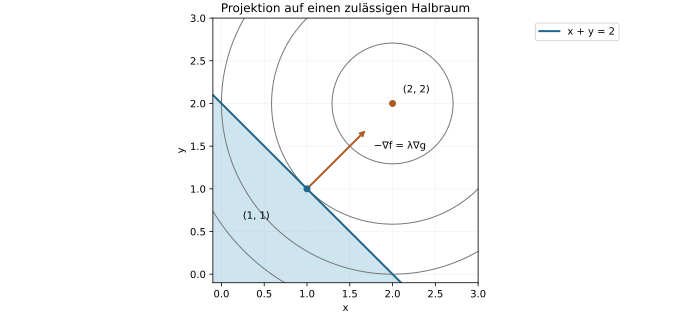

# M7-L4 – KKT-Bedingungen und aktive Nebenbedingungen {#L4}

**Kursbereich:** M7 – Numerik und Optimierung

**Niveau:** Masterorientierung · Fortgeschrittene Vertiefung

**Vorwissen:** [M1-L4](M1-L4.md); [M3-L6](M3-L6.md)

**Einordnung:** Vertiefung auf Master-Niveau

## Lernziele {#S1}

Du formulierst die Karush–Kuhn–Tucker-Bedingungen (KKT) für glatte Optimierungsprobleme, bestimmst aktive Nebenbedingungen und Multiplikatoren, beweist die globale Optimalität im konvexen Fall und erkennst, wann KKT weder einen Optimalitätsnachweis noch eine notwendige Bedingung liefert.

## Lagrange-Funktion und KKT-System {#S2}

Betrachte die Minimierung einer differenzierbaren Funktion $f:\mathbb R^n\to\mathbb R$ unter $g_i(x)\le0$ ($i=1,\dots,m$) und $a_j(x)=0$ ($j=1,\dots,q$), ebenfalls differenzierbar. Die Vorzeichenkonvention bestimmt die Lagrange-Funktion

$$\mathcal L(x,\lambda,\nu)=f(x)+\sum_i\lambda_i g_i(x)+\sum_j\nu_j a_j(x).$$

Die vier KKT-Bedingungen lauten:

- Primale Zulässigkeit: $g_i(x)\le0$, $a_j(x)=0$.
- Duale Zulässigkeit: $\lambda_i\ge0$; die $\nu_j$ sind frei.
- Stationarität: $\nabla f(x)+\sum_i\lambda_i\nabla g_i(x)+\sum_j\nu_j\nabla a_j(x)=0$.
- Komplementärer Schlupf: $\lambda_i g_i(x)=0$ für jedes $i$.

Eine Ungleichung ist aktiv, wenn $g_i(x)=0$. Eine strikt inaktive Bedingung hat zwingend $\lambda_i=0$. Umgekehrt kann eine aktive Bedingung durchaus einen verschwindenden Multiplikator besitzen. Geometrisch kompensiert die negative Zielfunktionssteigung am regulären Minimum die Normale der aktiven Bedingungen; sie liegt im Kegel der aktiven Ungleichungsgradienten plus dem linearen Raum der Gleichungsgradienten.

## Aktive Mengen und Rechenbeispiel {#S3}

Minimiere $f(x,y)=((x-2)^2+(y-2)^2)/2$ unter $g=x+y-2\le0$. Das unbeschränkte Minimum $(2,2)$ ist unzulässig. Ist die Bedingung aktiv, gilt $x+y=2$. Stationarität ergibt $x-2+\lambda=0$, $y-2+\lambda=0$; damit $x=y=1$ und $\lambda=1$. Alle vier Bedingungen sind erfüllt. Der Zielfunktionswert ist 1. Die Hesse-Matrix von $f$ ist die Einheitsmatrix; das Problem ist streng konvex mit affiner Nebenbedingung, also ist dies das eindeutige globale Minimum.

{alt="Niveaulinien, zulässiger Halbraum und negative Zielfunktionssteigung am Optimum."}

Allgemeiner für $f=((x-a)^2+(y-b)^2)/2$ und $x+y\le c$ folgt durch Fallunterscheidung $\lambda=\max(0,(a+b-c)/2)$, $x=a-\lambda$, $y=b-\lambda$. Bei $a+b=c$ ist die Bedingung aktiv, aber $\lambda=0$. Das Beispiel zeigt den Kern einer Active-Set-Strategie: Man nimmt eine aktive Menge an, löst das Gleichungssystem und verwirft Kandidaten mit negativer dualer Variable oder verletzter primaler Nebenbedingung. Bei vielen Nebenbedingungen ist naive Enumeration teuer.

## Notwendigkeit und Hinreichendheit {#S4}

An einem lokalen Minimum liefern die KKT-Bedingungen unter einer geeigneten Regularitätsbedingung notwendige Bedingungen. Eine hinreichende solche Bedingung ist LICQ: Die Gradienten der Gleichungen und aller aktiven Ungleichungen sind linear unabhängig. Ohne Regularität ist die Existenz von Multiplikatoren nicht gesichert.

Für konvexe differenzierbare $f,g_i$ und affine $a_j$ sind erfüllte KKT-Bedingungen dagegen ohne zusätzliche Regularitätsannahme hinreichend für globale Optimalität: Bei festen zulässigen Multiplikatoren ist $\mathcal L$ konvex in $x$. Stationarität macht $x^*$ zu einem globalen Minimierer von $\mathcal L$. Für jeden primal zulässigen Punkt $z$ gilt wegen $\lambda_i\ge0$ und $g_i(z)\le0$:

$$f(z)\ge\mathcal L(z,\lambda,\nu)\ge\mathcal L(x^*,\lambda,\nu)=f(x^*).$$

Die letzte Gleichheit folgt aus komplementärem Schlupf und den Gleichungsbedingungen. Für konvexe Probleme auf $\mathbb R^n$ mit endlichem erreichtem Optimalwert sichert ein strikt zulässiger Punkt ($g_i<0$, alle Gleichungen erfüllt; Slater-Bedingung) die Existenz geeigneter Multiplikatoren. In diesem Fall ist KKT notwendig und hinreichend. Strikte Konvexität von $f$ sichert bei Existenz des Minimums dessen Eindeutigkeit, nicht zwingend eindeutige Multiplikatoren.

## Gegenbeispiele und numerische Kontrolle {#S5}

Nichtkonvex: Minimiere $-x^2$ unter $x^2-1\le0$. Der Punkt $x=0$, $\lambda=0$ erfüllt KKT, ist aber ein striktes lokales Maximum; die globalen Minima liegen bei $x=\pm1$. Fehlende Regularität: Minimiere $f=x$ unter $x^2\le0$. Der einzige zulässige Punkt $x=0$ ist optimal, aber die Stationarität würde $1+\lambda\cdot0=0$ verlangen. Kein Multiplikator existiert. Slater und LICQ versagen.

```python
def project_halfplane(a, b, c):
    # x+y <= c
    lam = max(0, (a+b-c)/2)
    return a-lam, b-lam, lam

x, y, lam = project_halfplane(2, 2, 2)
assert (x, y, lam) == (1, 1, 1)
assert x+y <= 2 and lam >= 0 and lam*(x+y-2) == 0
```

Bei numerischer Optimierung sollte man getrennt Residuen messen: maximale Ungleichungsverletzung $\max_i\max(0,g_i)$, Gleichungsnorm, maximale negative duale Komponente, Stationaritätsnorm und maximale absolute Komplementaritätsprodukte. Leere Mengen tragen jeweils null bei. Kleine Residuen sind toleranz- und skalierungsabhängig und bei nichtkonvexen Problemen kein globales Optimalitätszertifikat. Im konvexen Fall kann eine rigorose duale Schranke zusätzlich die Zielfunktionslücke begrenzen. Für das Projektionsbeispiel ist bei geänderter Schranke $c$ der optimale Wert $v(c)=(\max(0,a+b-c))^2/4$; seine Ableitung ist $-\lambda$. Diese Sensitivitätsaussage folgt hier unmittelbar aus der expliziten Formel und darf nicht ohne Voraussetzungen verallgemeinert werden.

## Selbstkontrolle {#S6}

### Aufgaben

1. Minimiere $(x-3)^2/2$ unter $x\le1$ und finde den Multiplikator.
2. Löse die Projektion mit $a=1,b=0,c=3$; ist die Bedingung aktiv?
3. Löse sie mit $a=1,b=2,c=3$; was zeigt der Multiplikator?
4. Zeige, dass $x=0$ bei Minimierung von $x$ unter $x^2\le0$ kein KKT-Punkt ist.
5. Beweise für ein konvexes Problem, dass jeder KKT-Punkt global optimal ist, und nenne die benötigten Annahmen.

::: {.lc-solutions data-lc-section="S6"}
1. $x=1$, $\lambda=2$; $x-3+\lambda=0$ und komplementärer Schlupf.
2. $(x,y)=(1,0)$, $\lambda=0$; $g=-2$, inaktiv.
3. $(1,2)$, $\lambda=0$; aktive Bedingung mit verschwindendem Multiplikator.
4. Der Gradient der Nebenbedingung ist null; $1+2\lambda x=1$ kann bei $x=0$ nicht verschwinden.
5. Konvexe differenzierbare Zielfunktion und Ungleichungen, affine Gleichungen, primale und duale Zulässigkeit, Stationarität und Komplementarität. Die konvexe Lagrange-Funktion hat bei $x^*$ ein Minimum und ist für alle zulässigen $z$ höchstens $f(z)$; bei $x^*$ stimmt sie mit $f(x^*)$ überein.
:::

## Quellen {#S7}

- [Stanford EE364A – Stephen Boyd, Convex Optimization I](https://see.stanford.edu/materials/lsocoee364a/transcripts/ConvexOptimizationI-Lecture09.html) · Lecture 9, KKT and Slater · Zuletzt abgerufen: 2026-11-24 · Inhaltlich geprüft: 2026-11-24
