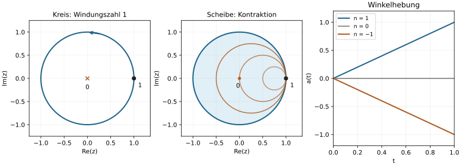

# M8-L1 – Homotopie und Fundamentalgruppe {#L1}

**Kursbereich:** M8 – Algebraische Topologie

**Niveau:** Bachelor · Wahlpflicht

**Vorwissen:** [M2-L4](M2-L4.md); [M5-L3](M5-L3.md)

**Einordnung:** Bachelor-Vertiefung und Brücke zum Master

## Lernziele {#S1}

Du definierst Homotopien von Wegen mit festen Endpunkten, konstruierst die Fundamentalgruppe und erklärst ihre Gruppenstruktur. Du beweist, dass die Fundamentalgruppe der Kreisscheibe trivial, die des Kreises dagegen isomorph zu den ganzen Zahlen ist. Du berechnest Windungszahlen polygonaler Schleifen und unterscheidest einen topologischen Beweis von einer numerischen Stichprobe.

## Wege und Homotopie relativ zu den Endpunkten {#S2}

Sei $X$ ein topologischer Raum, $I=[0,1]$. Ein Weg ist eine stetige Abbildung $\alpha:I\to X$. Zwei Wege $\alpha,\beta$ mit gleichen Endpunkten $a,b$ heißen homotop relativ zu den Endpunkten, falls eine stetige Abbildung $H:I\times I\to X$ existiert mit

$$H(t,0)=\alpha(t),\quad H(t,1)=\beta(t),\quad H(0,s)=a,\quad H(1,s)=b.$$

Die gemeinsame Stetigkeit in beiden Variablen ist wesentlich; eine beliebige Familie stetiger Wege genügt nicht. Eine Schleife am Basispunkt $x_0$ erfüllt $a=b=x_0$. Die konstante Schleife ist $c(t)=x_0$. Eine Schleife ist nullhomotop, wenn sie zu $c$ relativ zum Basispunkt homotop ist. Die Relation ist reflexiv durch $H(t,s)=\alpha(t)$, symmetrisch durch Umkehrung von $s$ und transitiv durch Aneinanderfügen zweier Homotopien an $s=1/2$. Das Verklebungslemma für stetige Abbildungen auf endlich vielen abgeschlossenen Teilmengen sichert die Stetigkeit an der Naht.

In einem konvexen Teilraum von $\mathbb R^n$ ist $H(t,s)=(1-s)\alpha(t)+s\beta(t)$ stets zulässig. Bei einem nichtkonvexen Raum muss der gesamte Homotopieverlauf im Raum bleiben; die geradlinige Interpolation kann ihn verlassen.

## Fundamentalgruppe und Funktorialität {#S3}

Die Fundamentalgruppe $\pi_1(X,x_0)$ besteht aus den Homotopieklassen basierter Schleifen. Für Schleifen $\alpha,\beta$ setzt man

$$ (\alpha*\beta)(t)=\begin{cases}\alpha(2t)&0\le t\le1/2,\\\beta(2t-1)&1/2\le t\le1.\end{cases}$$

Die Multiplikation $[\alpha][\beta]=[\alpha*\beta]$ ist wohldefiniert: Verklebe zwei Homotopien in derselben Weise in der Wegvariablen. Die Assoziativität gilt für Klassen, nicht unbedingt für die parametrisierten Wege. Die beiden Klammerungen durchlaufen dieselben drei Wege mit verschiedenen Zeitaufteilungen; eine stetige lineare Interpolation zwischen den beiden monotonen stückweise linearen Umparametrisierungen liefert eine Homotopie. Auch ein eingefügtes konstantes Wegstück kann durch Umparametrisierung entfernt werden. Daher ist $[c]$ das neutrale Element. Für $\bar\alpha(t)=\alpha(1-t)$ zeigt $H(t,s)=\alpha((1-s)\min(2t,2-2t))$ die Kontraktion von $\alpha*\bar\alpha$; analog kontrahiert $\bar\alpha*\alpha$. Damit ist $[\bar\alpha]$ invers zu $[\alpha]$.

Eine stetige basierte Abbildung $f:(X,x_0)\to(Y,y_0)$ induziert den Homomorphismus $f_*([\alpha])=[f\circ\alpha]$, denn die Komposition mit $f$ erhält Homotopien und Verkettungen. Für komponierte Abbildungen gilt $(g\circ f)_*=g_*\circ f_*$. Insbesondere induziert ein Homöomorphismus einen Isomorphismus. Fundamentalgruppen sind nicht in jedem Raum abelsch und nicht vollständig klassifizierend.

## Kreis, Scheibe und Windungszahl {#S4}

Identifiziere die Ebene mit $\mathbb C$. Setze $S^1=\{z:|z|=1\}$, $D^2=\{z:|z|\le1\}$ und $x_0=1$. In $D^2$ kontrahiert $H(t,s)=(1-s)\alpha(t)+s$ jede basierte Schleife, also $\pi_1(D^2,1)=\{e\}$. Der gleiche Ansatz bleibt für die einmal umlaufende Kreisschleife nicht in $S^1$.

{alt="Umlaufschleife im Kreis, basierte Kontraktion in der Scheibe und Hebungen mit Endwerten −1, 0, 1."}

Für $S^1$ betrachte $p(u)=e^{2\pi i u}$ für $u\in\mathbb R$. Jede stetige Schleife $\alpha$ mit $\alpha(0)=1$ hat eine eindeutige stetige Hebung $a:I\to\mathbb R$ mit $a(0)=0$ und $p(a(t))=\alpha(t)$. Begründung: Aufgrund gleichmäßiger Stetigkeit zerlege $I$ so fein, dass auf jedem Teilintervall $|\alpha(t)-\alpha(t_j)|<1$ gilt. Dann besitzt der Quotient $\alpha(t)/\alpha(t_j)$ einen stetigen Hauptwinkel $\theta(t)\in(-\pi,\pi)$, der bei $t_j$ null ist. Setze dort $a(t)=a(t_j)+\theta(t)/(2\pi)$; sukzessive Verklebung liefert die Hebung. Zwei Hebungen unterscheiden sich stetig um ganze Zahlen und stimmen am Anfang überein, also überall.

Da $p(a(1))=1$, ist $n=a(1)\in\mathbb Z$, die Windungszahl. Für eine basierte Homotopie $H$ liefert gleichmäßige Stetigkeit auf dem Quadrat eine gemeinsame feine Unterteilung in $t$ für alle $s$. Dieselbe Winkelkonstruktion, jetzt mit Quotienten $H(t,s)/H(t_j,s)$, ergibt eine in $(t,s)$ stetige Hebung $A$ mit $A(0,s)=0$. Der Endwert $A(1,s)$ ist ganzzahlig und stetig, also konstant. Somit ist $n$ homotopieinvariant.

Umgekehrt ist jede Hebung mit Endwert $n$ durch $(1-s)a(t)+snt$ in $\mathbb R$ relativ zu den Endpunkten zum linearen Weg homotop. Anwenden von $p$ zeigt, dass jede Schleife mit Windungszahl $n$ zur Standardschleife $e^{2\pi i nt}$ homotop ist. Jede ganze Zahl tritt auf; Verkettung addiert Endwerte, da die Hebung des zweiten Weges beim Endwert des ersten startet. Damit gilt

$$\pi_1(S^1,1)\cong(\mathbb Z,+).$$

Folge: Kreis und Scheibe sind nicht homöomorph. Auch eine Retraktion $r:D^2\to S^1$ mit $r|_{S^1}=\operatorname{id}$ ist unmöglich: Komponierte man die Kontraktion einer Umlaufschleife in der Scheibe mit $r$, ergäbe sich eine Kontraktion der Windungszahl 1 im Kreis. Für die punktierte Ebene $\mathbb C\setminus\{0\}$ liefert $F(z,s)=((1-s)+s/|z|)z$ eine Deformationsretraktion auf $S^1$. Deshalb ist auch ihre Fundamentalgruppe am Basispunkt 1 isomorph zu $\mathbb Z$. Für das Produkt $S^1\times S^1$ klassifizieren die Windungszahlen beider Koordinaten die Schleifen, also $\pi_1(S^1\times S^1,(1,1))\cong\mathbb Z^2$. Die Homotopien beider Komponenten können gemeinsam ausgeführt werden; Verkettung addiert komponentenweise.

## Polygonale Windungszahl und Grenzen der Abtastung {#S5}

Für eine geschlossene polygonale Schleife mit Eckpunkten $z_0,\ldots,z_N=z_0$ in der punktierten Ebene sei jede Strecke vom Ursprung getrennt. Die Winkeländerung entlang einer geraden Kante ist dann der Hauptwinkel von $(z_{j+1}/|z_{j+1}|)\overline{(z_j/|z_j|)}$ in $(-\pi,\pi)$. Denn eine Strecke, die den Ursprung nicht enthält, liegt in einem offenen Halbraum durch den Ursprung (etwa durch die Normale vom Ursprung zum nächstgelegenen Punkt der Strecke). Die gesamte Windungszahl ist die Summe dieser Winkel geteilt durch $2\pi$. Bei exakt entgegengesetzten Richtungen führt die Strecke durch null und die Methode ist nicht definiert.

```python
import cmath
from math import pi, fsum

def polygon_winding(vertices, tol=1e-10):
    # Explicitly closed polygon; all vertices and edges avoid 0.
    if len(vertices) < 2 or vertices[0] != vertices[-1]:
        raise ValueError("closed polygon required")
    if any(abs(z) <= tol for z in vertices):
        raise ValueError("vertex too close to zero")
    angles = []
    for a, b in zip(vertices, vertices[1:]):
        q = (b/abs(b)) * (a/abs(a)).conjugate()
        theta = cmath.phase(q)
        if pi-abs(theta) <= tol:
            raise ValueError("edge through or nearly opposite zero")
        angles.append(theta)
    turns = fsum(angles)/(2*pi)
    n = round(turns)
    if abs(turns-n) > tol:
        raise ArithmeticError("numerically uncertain result")
    return n

assert polygon_winding([1, 1j, -1, -1j, 1]) == 1
assert polygon_winding([1, -1j, -1, 1j, 1]) == -1
```

Der Code berechnet die Windungszahl des Polygons, nicht automatisch die eines unbekannten glatten Weges zwischen den Stichproben. Beispielsweise ergibt die Abtastung von $e^{2\pi i 8t}$ bei $t=j/8$ theoretisch stets den Punkt 1; das interpolierte Polygon ist konstant, der wahre Weg hat Windungszahl 8. Für eine bekannte Kreisschleife mit dem Betrag der gehobenen Winkeländerung strikt unter $\pi$ auf jedem Abtastintervall stimmen die entfalteten Winkel dagegen überein. Gleitkommatoleranzen sind zusätzliche praktische Sicherheitsprüfungen, keine rigorose Intervallarithmetik; bei sehr kleinen oder fast entgegengesetzten Punkten sollte die Rechnung neu skaliert oder mit höherer Präzision geprüft werden.

## Selbstkontrolle {#S6}

### Aufgaben

1. Gib eine basierte Homotopie der Schleife $e^{2\pi it}$ zur konstanten Schleife in $D^2$ an. Was geschieht bei $t=s=1/2$?
2. Bestimme die Windungszahl der Schleife $e^{2\pi i(3t+\sin(2\pi t))}$ und einer rückwärts durchlaufenen Kopie.
3. Bestimme die Klasse der Verkettung von Standardschleifen mit Windungszahlen 4 und −7. Warum ist sie nicht nullhomotop?
4. Beweise, dass zwei basierte Kreisschleifen mit gleichem gehobenen Endwert homotop sind, ohne die Kurven zu differenzieren.
5. Berechne die Windungszahl des Polygons $1, i,-1,-i,1$ und begründe, warum die Kante von 1 nach −1 in der punktierten Ebene unzulässig ist.

::: {.lc-solutions data-lc-section="S6"}
1. $H(t,s)=(1-s)e^{2\pi it}+s$; bei $t=s=1/2$ ist der Wert 0, also außerhalb von $S^1$, aber in $D^2$.
2. Die Hebung $a(t)=3t+\sin(2\pi t)$ beginnt bei 0 und endet bei 3; der rückwärts durchlaufene Weg hat Windungszahl −3 (Hebung $a(1-t)-3$).
3. Die Klasse entspricht $4-7=-3\ne0$ in $\mathbb Z$. Eine basierte Homotopie kann den ganzzahligen Endwert nicht ändern.
4. Sind $a,b$ die Hebungen mit Anfang 0 und gemeinsamem Endwert $n$, so ist $H(t,s)=p((1-s)a(t)+sb(t))$ eine stetige basierte Homotopie. Differenzierbarkeit ist nicht erforderlich.
5. Jede der vier Kanten liefert $\pi/2$, insgesamt $2\pi$ und Windungszahl 1. Die Strecke von 1 nach −1 enthält den Ursprung.
:::

## Quellen {#S7}

- [Allen Hatcher – Algebraic Topology](https://math.uchicago.edu/~farb/algtop2023/Hatcher.pdf) · §1.1, Theorem 1.7; path homotopy and product groups · Zuletzt abgerufen: 2026-11-24 · Inhaltlich geprüft: 2026-11-24
- [Laurentiu Maxim – Math 751, Lecture Notes Week 3](https://people.math.wisc.edu/~lmaxim/751f14w3.pdf) · §1, Theorem 1 and Lemmas 1.1–1.3 · Zuletzt abgerufen: 2026-11-24 · Inhaltlich geprüft: 2026-11-24
