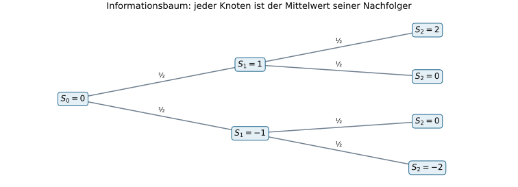

# M9-L1 – Bedingte Erwartung und Martingale {#L1}

**Kursbereich:** M9 – Stochastik, Finanz- und Versicherungsmathematik

**Niveau:** Bachelor · Wahlpflicht

**Vorwissen:** [M3-L1](M3-L1.md); [M3-L4](M3-L4.md)

**Einordnung:** Bachelor-Vertiefung und Brücke zum Master

## Lernziele {#S1}

Du berechnest bedingte Erwartungen auf endlichen Wahrscheinlichkeitsräumen, formulierst ihre maßtheoretische Charakterisierung und verwendest die Turmeigenschaft. Du prüfst die Martingaleigenschaft einer symmetrischen Zufallsbewegung und beweist den Erwartungswerterhalt bei beschränkten Stoppzeiten. Du erkennst, weshalb eine fast sicher endliche Stoppzeit allein nicht ausreicht.

## Bedingte Erwartung als Informationsprojektion {#S2}

Sei $(\Omega,\mathcal F,P)$ ein Wahrscheinlichkeitsraum und $X$ integrierbar, also $E|X|<\infty$. Eine Unter-$\sigma$-Algebra $\mathcal G\subseteq\mathcal F$ beschreibt beobachtbare Ereignisse. Die bedingte Erwartung $Y=E[X\mid\mathcal G]$ ist eine integrierbare, $\mathcal G$-messbare Zufallsvariable mit

$$\int_A Y\,dP=\int_A X\,dP\qquad(A\in\mathcal G).$$

Existenz folgt aus dem Satz von Radon–Nikodym, angewandt auf die signierte Maßfunktion $A\mapsto\int_A X\,dP$ auf $\mathcal G$. Eindeutigkeit gilt bis auf Nullmengen: Für zwei Kandidaten $Y,Z$ liefert die Wahl $A=\{Y>Z\}$ das Integral einer positiven Differenz gleich null; entsprechend für $Z>Y$. Auf den Zellen $A_j$ einer endlichen Partition mit positiver Wahrscheinlichkeit gilt

$$Y|_{A_j}=\frac{\sum_{\omega\in A_j}X(\omega)P(\{\omega\})}{P(A_j)}$$

für endliches $\Omega$. Zellen mit Wahrscheinlichkeit null beeinflussen das Ergebnis nicht. Beispiel: Vier gleichwahrscheinliche Ergebnisse tragen Werte $2,4,0,10$. Die Information unterscheidet nur die ersten beiden von den letzten beiden. Dann sind die bedingten Werte 3 und 5, der unbedingte Mittelwert 4.

Aus der Integralcharakterisierung folgt Linearität. Für $\mathcal H\subseteq\mathcal G$ gilt die Turmeigenschaft $E[E[X\mid\mathcal G]\mid\mathcal H]=E[X\mid\mathcal H]$, denn beide Seiten besitzen auf jedem $A\in\mathcal H$ das gleiche Integral. Insbesondere ist $E[Y]=E[X]$. Für beschränktes $\mathcal G$-messbares $H$ gilt $E[HX\mid\mathcal G]=H E[X\mid\mathcal G]$ (zuerst für Indikatoren, dann einfache Funktionen, schließlich durch beschränkte Approximation). Ist $X$ unabhängig von $\mathcal G$, so ist $Y=E[X]$ konstant. Für $X\in L^2$ folgt zunächst aus bedingter Jensen-Ungleichung $E[Y^2]\le E[X^2]$. Dann gilt $E[(X-Y)Z]=0$ für jedes $\mathcal G$-messbare $Z\in L^2$; durch Approximation aus der Integralcharakterisierung. Daher minimiert $Y$ den mittleren quadratischen Vorhersagefehler unter solchen $Z$: $E[(X-Z)^2]=E[(X-Y)^2]+E[(Y-Z)^2]$.

## Filtration und Martingale {#S3}

Eine Filtration $(\mathcal F_n)_{n\ge0}$ ist eine wachsende Folge von $\sigma$-Algebren. Ein Prozess $(M_n)$ ist adaptiert, wenn $M_n$ bereits anhand der Information $\mathcal F_n$ bestimmbar ist. Er ist ein Martingal, wenn jedes $M_n$ integrierbar und adaptiert ist und

$$E[M_{n+1}\mid\mathcal F_n]=M_n\quad\text{fast sicher}.$$

Durch Iteration der Turmeigenschaft folgt $E[M_m\mid\mathcal F_n]=M_n$ für $m\ge n$. Ein konstanter Erwartungswert allein reicht nicht: Die Bedingung muss für die jeweilige Vergangenheit gelten. Bei Submartingalen steht $\ge$, bei Supermartingalen $\le$ statt Gleichheit.

Seien $X_i$ unabhängige Schritte mit $P(X_i=1)=P(X_i=-1)=1/2$, $S_n=\sum_{i=1}^n X_i$ und $\mathcal F_n=\sigma(X_1,\ldots,X_n)$. Weil $X_{n+1}$ unabhängig von $\mathcal F_n$ ist, gilt $E[S_{n+1}\mid\mathcal F_n]=S_n$. Außerdem ist $S_n^2-n$ ein Martingal, denn $E[(S_n+X_{n+1})^2\mid\mathcal F_n]=S_n^2+1$. Für eine integrierbare Endgröße $Z$ ist $M_n=E[Z\mid\mathcal F_n]$ ebenfalls ein Martingal (Turmeigenschaft).

{alt="Zweistufiger Random Walk mit bedingten Wahrscheinlichkeiten 1/2 und Knotenwerten."}

## Beschränkte Stoppzeiten {#S4}

Eine ganzzahlige Zufallszeit $\tau\in\{0,1,\ldots\}\cup\{\infty\}$ ist eine Stoppzeit, wenn $\{\tau\le n\}\in\mathcal F_n$ für jedes $n$. Man kann also im Zeitpunkt $n$ feststellen, ob bereits gestoppt wurde. Erster Eintritt in eine beobachtbare Menge ist eine Stoppzeit; der letzte positive Schritt vor einem festen Endzeitpunkt im Allgemeinen nicht.

Sei $\tau\le N$ fast sicher. Dann gilt für ein Martingal

$$M_\tau=M_0+\sum_{k=1}^N\mathbf 1_{\{\tau\ge k\}}(M_k-M_{k-1}).$$

Der Indikator ist $\mathcal F_{k-1}$-messbar, da $\{\tau\ge k\}=\{\tau\le k-1\}^c$. Jeder Summand hat Erwartungswert null: Bedinge auf $\mathcal F_{k-1}$ und nutze die Martingaleigenschaft. Damit folgt $E[M_\tau]=E[M_0]$. Analog ist $M_{n\wedge\tau}$ ein Martingal, auch bei unbeschränktem $\tau$, weil sein Zuwachs der entsprechende indikatorgewichtete Zuwachs von $M$ ist. Die Endlichkeit von $N$ vermeidet einen unzulässigen Tausch von Grenzwert und Erwartung.

Beispiel: Stoppe den symmetrischen Random Walk spätestens nach zwei Schritten oder beim ersten Erreichen von 1. Der Wert 1 tritt mit Wahrscheinlichkeit $1/2$ auf, 0 und −2 mit je $1/4$. Somit ist der Erwartungswert $1/2-2/4=0$. Die Endverteilung ist nicht symmetrisch, obwohl der Mittelwert erhalten bleibt.

## Exakte Enumeration und Grenzen {#S5}

Die folgende exakte Enumeration verwendet gleichwahrscheinliche vollständige Pfade. Auch wenn ein Pfad früher stoppt, zählen seine Fortsetzungen weiter als verschiedene Ergebnisse; dadurch entstehen die korrekten Wahrscheinlichkeiten ohne doppelte Gewichtung.

```python
from itertools import product
from fractions import Fraction

def stopped_walk(steps, level):
    s = 0
    for k, x in enumerate(steps, 1):
        s += x
        if s >= level:
            return k, s
    return len(steps), s

def exact_stopped_mean(n, level):
    paths = product((-1, 1), repeat=n)
    return Fraction(sum(stopped_walk(p, level)[1]
                        for p in paths), 2**n)

assert exact_stopped_mean(8, 2) == 0
```

Die Laufzeit wächst exponentiell in $n$; die Rechnung eignet sich für kleine Horizonte. Ein alternativer Nachweis verwendet eine Zustandsverteilung mit absorbierten Zuständen. Die Beschränktheit ist substanziell: Für eine symmetrische Zufallsbewegung ist $\tau=\inf\{n:S_n=1\}$ fast sicher endlich, aber $S_\tau=1$. Zum Beweis der fast sicheren Endlichkeit betrachte den ersten Eintritt in $\{-a,1\}$ für ganze $a\ge1$. Dieser Eintritt ist fast sicher endlich, denn in Blöcken von $a+1$ Schritten führt eine Folge ausschließlich positiver Schritte sicher zum Austritt, falls noch nicht gestoppt wurde. Die gestoppten Werte liegen zwischen −a und 1. Wende den beschränkten Satz auf $\tau_a\wedge N$ an und lasse $N\to\infty$ mittels dominierter Konvergenz. Aus $0=p\cdot1+(1-p)(-a)$ folgt $p=a/(a+1)$. Die Wahrscheinlichkeit, jemals 1 zu erreichen, ist mindestens $p$ für jedes $a$, also 1. Dennoch ist $E[S_\tau]=1\ne0$. Die gestoppten Werte sind hier nicht durch eine gemeinsame integrierbare Schranke kontrolliert; der Grenzübergang aus beschränkten Zeiten ist nicht gerechtfertigt.

## Selbstkontrolle {#S6}

### Aufgaben

1. Auf vier gleichwahrscheinlichen Ergebnissen habe $X$ die Werte −2, 6, 4, 8. Berechne die bedingte Erwartung für die Partition in die ersten zwei und letzten zwei Ergebnisse sowie ihren Mittelwert.
2. Zeige, dass $S_n^2-n$ ein Martingal für den oben definierten Random Walk ist.
3. Ist der erste Zeitpunkt $n$ mit $S_n\ge2$ eine Stoppzeit? Ist der letzte Zeitpunkt mit $S_n\ge2$ vor dem festen Horizont 10 (mit Standardwert 0, wenn keiner existiert) eine Stoppzeit?
4. Stoppe den Random Walk beim ersten Erreichen von 1 oder spätestens nach drei Schritten. Ermittle die Endverteilung und den Erwartungswert.
5. Warum kann man den Satz für beschränkte Stoppzeiten nicht allein aufgrund fast sicherer Endlichkeit auf beliebige Stoppzeiten übertragen?

::: {.lc-solutions data-lc-section="S6"}
1. Die Zellenmittel sind 2 und 6; die bedingte Zufallsvariable hat Erwartung 4.
2. Bedingung auf $\mathcal F_n$: $E[X_{n+1}]=0$, $E[X_{n+1}^2]=1$, also $E[S_{n+1}^2-(n+1)\mid\mathcal F_n]=S_n^2-n$; Adaptivität und Integrabilität folgen aus $|S_n|\le n$.
3. Ja: $\{\tau\le n\}=\bigcup_{j\le n}\{S_j\ge2\}$. Nein: Nach zwei positiven Schritten können spätere Schritte einen weiteren Besuch erzeugen oder vollständig unter 2 bleiben; ob der letzte Besuch bei 2 liegt, ist zu diesem Zeitpunkt nicht entscheidbar.
4. Die Wege beginnen entweder mit +1 (Wert 1, Wahrscheinlichkeit 1/2), oder mit −1. Von diesen erreichen −++ den Wert 1 (1/8), −+− und −−+ den Wert −1 (je 1/8), −−− den Wert −3 (1/8). Insgesamt $P(1)=5/8$, $P(-1)=1/4$, $P(-3)=1/8$; Erwartung 0.
5. Weil fast sichere Konvergenz nicht automatisch Erwartungswertkonvergenz impliziert. Die erste Treffzeit von 1 liefert den Gegenbeweis; zusätzliche Voraussetzungen wie geeignete dominierende Schranken sind erforderlich.
:::

## Quellen {#S7}

- [Ellen G. Powell, Stochastic Processes, Durham University](https://www.maths.dur.ac.uk/users/ellen.g.powell/SPnotes.html) · §4.1–4.4 · Zuletzt abgerufen: 2026-11-24 · Inhaltlich geprüft: 2026-11-24
