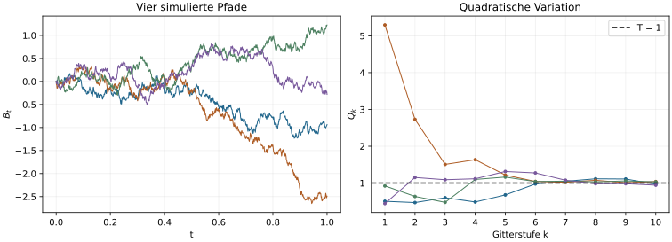

# M9-L2 – Brownsche Bewegung und quadratische Variation {#L2}

**Kursbereich:** M9 – Stochastik, Finanz- und Versicherungsmathematik

**Niveau:** Bachelor · Wahlpflicht

**Vorwissen:** [M9-L1](M9-L1.md)

**Einordnung:** Bachelor-Vertiefung und Brücke zum Master

## Lernziele {#S1}

Du charakterisierst eine Standard-Brownsche Bewegung durch ihre Zuwächse und Stetigkeit, leitest ihre Kovarianz und Skalierung her und beweist die quadratische Variation entlang deterministischer Partitionen in $L^2$. Du unterscheidest Pfadeigenschaften von Verteilungsaussagen und untersuchst die Konvergenz numerisch.

## Definition und Skalierung {#S2}

Eine Standard-Brownsche Bewegung $(B_t)_{t\ge0}$ startet bei $B_0=0$ fast sicher, besitzt fast sicher stetige Pfade und unabhängige Zuwächse auf disjunkten Zeitintervallen. Für $0\le s<t$ gilt $B_t-B_s\sim N(0,t-s)$, wobei der zweite Parameter die Varianz bezeichnet. Der Zuwachs ist unabhängig von der natürlichen Vergangenheit $\mathcal F_s=\sigma(B_u:0\le u\le s)$. Insbesondere ist $B_t\sim N(0,t)$; die Werte $B_s,B_t$ selbst sind im Allgemeinen abhängig. Für $s\le t$ folgt

$$E[B_sB_t]=E[B_s^2]+E[B_s(B_t-B_s)]=s,$$

also $\operatorname{Cov}(B_s,B_t)=\min(s,t)$. Die gemeinsame Verteilung endlich vieler Werte ist multivariat normal, da jeder Wert eine lineare Kombination unabhängiger normalverteilter Zuwächse ist. Für $c>0$ hat $\widetilde B_t=c^{-1/2}B_{ct}$ wieder die definierenden Eigenschaften: Die Zuwachsvarianz ist $c^{-1}c(t-s)=t-s$, Unabhängigkeit und Stetigkeit bleiben erhalten. Das ist eine Gleichheit im Gesetz, keine Gleichheit der Pfade.

Die natürliche Zeitdiskretisierung bei Schrittweite $h$ erzeugt Zuwächse $\sqrt h Z_k$ mit unabhängigen $Z_k\sim N(0,1)$. Anders als ein symmetrischer Random Walk mit Schritten $\pm\sqrt h$ liefert dies exakt die endlichdimensionalen Verteilungen der Brownschen Bewegung auf dem Gitter. Lineare Interpolation zwischen Gitterpunkten ist jedoch keine Brownsche Bewegung.

## Quadratische Variation und Konvergenz {#S3}

Für eine deterministische Partition $\pi=(0=t_0<\cdots<t_n=T)$ setze $h_j=t_j-t_{j-1}$, $|\pi|=\max_j h_j$ und

$$Q_\pi=\sum_{j=1}^n(B_{t_j}-B_{t_{j-1}})^2.$$

Da ein normalverteilter Zuwachs mit Varianz $h_j$ das zweite Moment $h_j$ und das vierte Moment $3h_j^2$ besitzt, hat sein Quadrat Varianz $2h_j^2$. Die vierte Standardnormal-Momentformel folgt etwa durch partielle Integration mit der Normaldichte $\phi'(z)=-z\phi(z)$: $E[Z^4]=3E[Z^2]=3$. Wegen unabhängiger Zuwächse addieren sich die Varianzen ihrer Quadrate. Somit

$$E[Q_\pi]=T,\qquad E[(Q_\pi-T)^2]=2\sum_jh_j^2\le2T|\pi|.$$

Für jede Folge deterministischer Partitionen mit Maschenweite gegen null konvergiert $Q_\pi$ in $L^2$ und daher in Wahrscheinlichkeit gegen $T$. Auf äquidistanten Gittern mit $n$ Intervallen gilt exakt $\operatorname{Var}(Q)=2T^2/n$; ferner $nQ/T\sim\chi_n^2$. Für die dyadischen Partitionen $n=2^k$ gilt für jedes $\epsilon>0$ nach Tschebyscheff

$$\sum_{k\ge0}P(|Q_k-T|>\epsilon)\le \frac{2T^2}{\epsilon^2}\sum_{k\ge0}2^{-k}<\infty.$$

Das erste Borel–Cantelli-Lemma (keine Unabhängigkeit der Ereignisse nötig) zeigt, dass nur endlich viele dieser Abweichungen eintreten. Durch die abzählbare Wahl $\epsilon=1/m$ folgt fast sichere Konvergenz entlang dieser Gitter für festes $T$. Dies ist stärker als die Konvergenz in Wahrscheinlichkeit, aber keine Aussage über jede beliebig pfadabhängig gewählte Partition.

{alt="Vier simulierte Brownsche Pfade und ihre Variationssummen auf dyadischen Gittern; Referenzwert 1."}

## Pfadregularität und Martingale {#S4}

Für eine stetig differenzierbare Funktion $f$ auf $[0,T]$ gilt mit $C=\max|f'|$ die Abschätzung $\sum(\Delta f)^2\le C^2T|\pi|\to0$. Allgemeiner gilt für einen stetigen Pfad endlicher Totalvariation $V$ die Schranke $\sum(\Delta f)^2\le V\max_j|\Delta f_j|\to0$ durch gleichmäßige Stetigkeit. Da die Brownsche Bewegung entlang dyadischer Gitter auf jedem festen Intervall positiver Länge fast sicher positive quadratische Variation besitzt (derselbe Beweis mit verschobenem Anfang), hat sie dort fast sicher unendliche Totalvariation. Durch Betrachtung aller rationalen Teilintervalle gilt dies gleichzeitig auf jedem nichttrivialen Intervall. Insbesondere ist kein Teilintervall ein stetig differenzierbarer Pfad. Die stärkere Aussage, dass Brownsche Pfade fast sicher nirgends differenzierbar sind, erfordert einen weiteren Beweis; sie folgt nicht allein aus unendlicher Totalvariation.

Bezüglich der natürlichen Filtration sind $B_t$ und $B_t^2-t$ Martingale: $E[B_t\mid\mathcal F_s]=B_s$ und $E[B_t^2\mid\mathcal F_s]=B_s^2+t-s$. Damit liefert der deterministische Term $t$ genau die Kompensation der erwarteten quadratischen Zuwächse. Dies bereitet die Itô-Formel vor. Die Schreibweise $(dB_t)^2=dt$ ist dafür eine symbolische Merkhilfe, keine Gleichung gewöhnlicher Differentiale oder einzelner endlicher Zuwächse.

## Reproduzierbare Simulation {#S5}

Im folgenden Code werden zuerst feine Pfade simuliert. Gröbere Gitter entstehen durch Teilabtastung derselben Pfade. Das ist für eine pfadbezogene Konvergenzbeobachtung wichtig: neue unabhängige Pfade bei jedem Gitter würden zwar die Randverteilungen korrekt wiedergeben, aber keine Annäherung entlang eines gemeinsamen Pfades zeigen.

```python
import numpy as np

def brownian_grid(T, m, paths=1, seed=42):
    if T <= 0 or m < 0 or paths < 1:
        raise ValueError("positive T and paths, nonnegative m")
    rng = np.random.default_rng(seed)
    n = 2**m
    increments = rng.normal(0, np.sqrt(T/n), (paths, n))
    return np.column_stack((np.zeros(paths),
                            np.cumsum(increments, axis=1)))

def qv_at_level(grid, k):
    n = grid.shape[1] - 1
    if n < 1 or n & (n-1) or not 0 <= k <= n.bit_length()-1:
        raise ValueError("invalid dyadic grid or level")
    step = n // 2**k
    return np.sum(np.diff(grid[:, ::step], axis=1)**2, axis=1)

grid = brownian_grid(1, 10, paths=2000)
for k in (2, 5, 8, 10):
    q = qv_at_level(grid, k)
    print(k, q.mean(), q.var(), 2/2**k)
```

Die vier Ausgaben enthalten Gitterstufe, empirischen Mittelwert, empirische Varianz (mit Divisor Anzahl der Pfade) und theoretische Varianz. Bei $T=1$ und $k=5$ ist die theoretische Varianz $1/16$, die Standardabweichung $1/4$; bei $k=10$ beträgt die Varianz $1/512$. Ein einzelnes $Q_k$ muss nicht monoton gegen 1 konvergieren. Zufallszahlen sind pseudorandomisiert, und Rundung sowie endliche Stichprobengröße begrenzen die Genauigkeit. Eine Simulation belegt keine fast sichere Aussage. Speicherbedarf wächst mit Anzahl der Pfade mal Gittergröße; für große Experimente sollten Pfade blockweise erzeugt werden.

## Selbstkontrolle {#S6}

### Aufgaben

1. Berechne die Verteilung von $B_5-B_2$ und die Kovarianz von $B_2$ und $B_5$.
2. Zeige, dass $\tfrac12 B_{4t}$ eine Standard-Brownsche Bewegung ist.
3. Berechne für $T=2$ und 128 äquidistante Intervalle Erwartung und Varianz der quadratischen Variationssumme.
4. Beweise, dass $f(t)=t^2$ auf $[0,1]$ quadratische Variation null besitzt.
5. Zeige mit bedingter Erwartung, dass $B_t^2-t$ ein Martingal ist, und erkläre, warum $B_t^2$ keines ist.

::: {.lc-solutions data-lc-section="S6"}
1. $N(0,3)$ mit Varianz 3; Kovarianz $\min(2,5)=2$.
2. Die Zuwachsvarianz ist $\tfrac14\cdot4(t-s)=t-s$; Startwert, Unabhängigkeit, Normalverteilung und Stetigkeit bleiben erhalten.
3. $E[Q]=2$, $\operatorname{Var}(Q)=2\cdot4/128=1/16$.
4. $|f'|\le2$, daher $\sum(\Delta f)^2\le4|\pi|\to0$.
5. Aus unabhängigen Zuwächsen folgt $E[B_t^2-t\mid\mathcal F_s]=B_s^2+(t-s)-t=B_s^2-s$. $B_t^2$ hat den zeitabhängigen Erwartungswert $t$ und ist deshalb kein Martingal.
:::

## Quellen {#S7}

- [Lorenzo Naranjo, Stochastic Foundations for Finance: Brownian Motion](https://lorenzonaranjo.com/class-materials/stochastic-processes/notes/brownian-motion.html) · Brownian Motion; Quadratic Variation of Brownian Motion · Zuletzt abgerufen: 2026-11-24 · Inhaltlich geprüft: 2026-11-24
