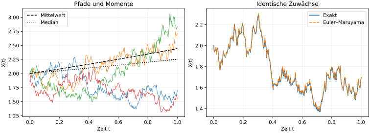

# M9-L3 – Itô-Formel und stochastische Differentialgleichungen {#L3}

**Kursbereich:** M9 – Stochastik, Finanz- und Versicherungsmathematik

**Niveau:** Master · Wahlpflicht

**Vorwissen:** [M9-L2](M9-L2.md); [M1-L4](M1-L4.md)

**Einordnung:** Master-Vertiefung

## Lernziele {#S1}

Du leitest die Itô-Korrektur für das Quadrat einer Brownschen Bewegung aus endlichen Summen her, formulierst die allgemeine Itô-Regel unter geeigneten Voraussetzungen und konstruierst die Lösung einer geometrischen Brownschen Bewegung. Du unterscheidest Drift, Diffusion und Diskretisierungsfehler.

## Vom Gitter zum Itô-Integral {#S2}

Sei $B$ eine Standard-Brownsche Bewegung mit ihrer natürlichen Filtration. Für ein adaptiertes stückweise konstantes $H_s=H_j$ auf $[t_j,t_{j+1})$, wobei $H_j$ quadratintegrierbar und zur Zeit $t_j$ messbar ist, definiert man

$$I(H)=\sum_j H_j(B_{t_{j+1}}-B_{t_j}).$$

Die Zuwächse haben bedingt auf die Vergangenheit Mittelwert null und Varianz $h_j=t_{j+1}-t_j$. Für $i<j$ verschwindet der gemischte Erwartungswert durch Konditionieren auf $\mathcal F_{t_j}$. Damit gelten $E[I(H)]=0$ und die Itô-Isometrie $E[I(H)^2]=\sum_j h_jE[H_j^2]$. Durch stetige Fortsetzung in der Norm $\|H\|^2=E\int_0^T H_s^2ds$ entsteht das Integral für quadratintegrierbare vorhersehbare Prozesse. Die Vollständigkeits- und Approximationsdetails dieser Konstruktion werden hier vorausgesetzt.

Für $H_s=B_s$ approximieren die linken Gitterwerte das Integrand in dieser Norm: $\sum_j\int_{t_j}^{t_{j+1}}E[(B_s-B_{t_j})^2]ds=\tfrac12\sum_jh_j^2\to0$. Die algebraische Identität

$$B_T^2=2\sum_j B_{t_j}\Delta B_j+\sum_j(\Delta B_j)^2$$

und die quadratische Variation aus [M9-L2](M9-L2.md) liefern in $L^2$ die Gleichung $B_T^2=2\int_0^T B_s\,dB_s+T$. Die rechte Summe der Quadrate darf nicht wie bei glatten Pfaden weggelassen werden. Rechte statt linker Stützstellen würden hier die Summe um $\sum_j(\Delta B_j)^2$ verändern; die Wahl der Stützstellen ist also wesentlich.

## Itô-Formel und stochastische Differentialgleichung {#S3}

Ein Itô-Prozess $X_t=X_0+\int_0^t a_s ds+\int_0^t b_s dB_s$ benötigt adaptierte, für die Integrale geeignete Koeffizienten (insbesondere lokal integrierbare Drift und lokal quadratintegrierbaren vorhersehbaren Diffusionskoeffizienten). Für $f\in C^{1,2}$, einmal stetig nach der Zeit und zweimal nach dem Ort differenzierbar, lautet die Itô-Formel lokal

$$df(t,X_t)=\left(f_t+a_tf_x+\tfrac12 b_t^2 f_{xx}\right)dt+b_tf_xdB_t.$$

Die Ableitungen werden bei $(t,X_t)$ ausgewertet. Der Ausdruck ist eine Kurzschreibweise für eine Integralgleichung, keine Gleichung klassischer Ableitungen. Formal gilt $(dB)^2=dt$, $dt\,dB=(dt)^2=0$. Für allgemeine $f$ ist dies nur eine Merkregel; der vollständige Satz benötigt Grenzwertargumente und gegebenenfalls Lokalisierung. Für $f(x)=x^2$ und $X=B$ wurde die Formel bereits bewiesen.

In einer SDE $dX_t=\mu(t,X_t)dt+\sigma(t,X_t)dB_t$ beschreibt $\mu$ die lokale Drift und $\sigma^2$ die lokale Varianzrate. Nicht jede Wahl der Koeffizienten garantiert Existenz und Eindeutigkeit. Globale Lipschitz-Stetigkeit im Ort und lineares Wachstum mit geeigneter Zeitmessbarkeit und quadratintegrierbarem Anfangswert sind klassische hinreichende Bedingungen. Im folgenden linearen Beispiel sind sie erfüllt.

## Geometrische Brownsche Bewegung {#S4}

Betrachte $dX_t=\mu X_tdt+\sigma X_tdB_t$ mit konstanten reellen $\mu$, $\sigma\ge0$ und $X_0=x_0>0$. Statt Positivität vorab anzunehmen, konstruiere

$$Y_t=x_0\exp((\mu-\sigma^2/2)t+\sigma B_t).$$

Itô auf $f(t,b)=x_0\exp((\mu-\sigma^2/2)t+\sigma b)$ ergibt $f_t=(\mu-\sigma^2/2)f$, $f_b=\sigma f$, $f_{bb}=\sigma^2 f$. Daher $dY_t=\mu Y_tdt+\sigma Y_tdB_t$. Eindeutigkeit liefert $X=Y$; insbesondere ist $X$ positiv. Mit der Momentenerzeugenden Funktion der Normalverteilung folgt $E[X_t]=x_0e^{\mu t}$ und

$$\operatorname{Var}(X_t)=x_0^2e^{2\mu t}(e^{\sigma^2t}-1).$$

Die Logarithmusverteilung hat Mittelwert $\log x_0+(\mu-\sigma^2/2)t$ und Varianz $\sigma^2t$; der Median des Prozesses ist $x_0e^{(\mu-\sigma^2/2)t}$. Für $x_0=2,\mu=0{,}2,\sigma=0{,}4$ beträgt die Log-Drift $0{,}12$. Mittelwert und Median sind verschieden, obwohl die Drift des Prozesses positiv ist. Bei $\mu=0$ ist $X$ ein Martingal, denn der Exponentialfaktor des unabhängigen Zuwachses hat bedingten Mittelwert eins.

{alt="Geometrische Brownsche Bewegung: vier simulierte Pfade, theoretischer Mittelwert und Median; exakter und Euler-Pfad mit gleichen Zuwächsen."}

## Simulation und Euler–Maruyama {#S5}

Für äquidistante Gitter mit Schritt $h$ wird $X_{j+1}^{EM}=X_j^{EM}(1+\mu h+\sigma\Delta B_j)$ verwendet. Die exakte Gitterlösung multipliziert dagegen mit $\exp((\mu-\sigma^2/2)h+\sigma\Delta B_j)$. Die gleichen Zuwächse in beiden Verfahren erlauben einen pfadweisen Vergleich; $\Delta B_j\sim N(0,h)$. Euler kann negative Werte erzeugen, die exakte Lösung nicht. Bei $\sigma>0$ besitzt der Euler-Faktor für jedes $h>0$ eine positive Wahrscheinlichkeit, negativ zu sein. Für diese SDE konvergiert Euler–Maruyama im quadratischen Mittel mit starker Ordnung $1/2$ (allgemeiner Konvergenzsatz, hier nicht bewiesen). Eine einzelne Simulation belegt diese Ordnung nicht. Der Code erwartet bereits skalierte Zuwächse; er ist ein Lehrmodell, keine Prognose realer Marktpreise.

```python
import numpy as np

def gbm_paths(x0, mu, sigma, h, increments):
    increments = np.asarray(increments, dtype=float)
    if x0 <= 0 or h <= 0 or sigma < 0 or increments.ndim != 1:
        raise ValueError("invalid parameters")
    t = h * np.arange(len(increments)+1)
    b = np.r_[0., np.cumsum(increments)]
    exact = x0 * np.exp((mu-sigma**2/2)*t + sigma*b)
    euler = x0 * np.r_[1., np.cumprod(1+mu*h+sigma*increments)]
    return t, exact, euler

rng = np.random.default_rng(41)
h = 1/256
db = rng.normal(0, np.sqrt(h), 256)
t, exact, euler = gbm_paths(2, .2, .4, h, db)
print(exact[-1], euler[-1])
```

## Selbstkontrolle {#S6}

### Aufgaben

1. Leite die Itô-Isometrie für zwei unabhängige Brown-Zuwächse mit vorhersehbaren Integranden her.
2. Bestimme $\int_0^T B_s\,dB_s$ und seinen Erwartungswert.
3. Wende die Itô-Formel auf $B_t^3$ an.
4. Berechne Log-Drift und Median bei $x_0=1,\mu=0,\sigma=1,T=2$.
5. Zeige mit $h=1,\mu=0,\sigma=1,\Delta B=-2$, dass Euler die Positivität verletzen kann.

::: {.lc-solutions data-lc-section="S6"}
1. Die gemischten Terme verschwinden durch bedingte Erwartung zum zweiten Startzeitpunkt. Die Diagonalterme sind $h_jE[H_j^2]$.
2. $(B_T^2-T)/2$; Erwartungswert null.
3. $d(B_t^3)=3B_t^2dB_t+3B_tdt$.
4. Log-Drift $-1/2$, Median $e^{-1}$.
5. Euler-Faktor $-1$, exakter Faktor $e^{-5/2}>0$.
:::

## Quellen {#S7}

- [MIT OpenCourseWare, 18.642: Stochastic Calculus](https://ocw.mit.edu/courses/18-642-topics-in-mathematics-with-applications-in-finance-fall-2024/mit18_642_f24_lec19_1.pdf) · S. 21–23 (PDF-Text) (Prüfumfang: Text) · Zuletzt abgerufen: 2026-11-24 · Inhaltlich geprüft: 2026-11-24
