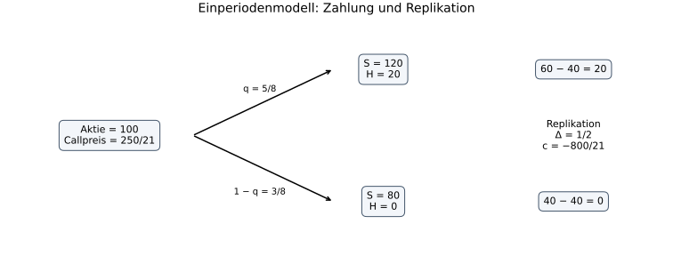

# M9-L4 – Arbitragefreie Bewertung im Binomialmodell {#L4}

**Kursbereich:** M9 – Stochastik, Finanz- und Versicherungsmathematik

**Niveau:** Master · Wahlpflicht

**Vorwissen:** [M1-L7](M1-L7.md); [M9-L1](M9-L1.md)

**Einordnung:** Master-Vertiefung

## Lernziele {#S1}

Du prüfst Arbitragefreiheit im Einperiodenmodell, leitest das eindeutige replizierende Portfolio und die risikoneutrale Bewertung her und wendest sie auf einen selbst konstruierten Optionsanspruch an. Du trennst Modellwahrscheinlichkeit, Bewertung und reale Risiken.

## Marktmodell und Arbitrage {#S2}

Zum Zeitpunkt 0 kostet eine Aktie $s>0$, zum Zeitpunkt 1 ist sie entweder $su$ oder $sd$ wert, mit $u>d>0$. Beide Zustände besitzen positive tatsächliche Wahrscheinlichkeit. Ein Geldkonto wächst pro Periode um den Faktor $R>0$, d. h. ein Anfangsbetrag $c$ wird zu $Rc$. Die Periode kann beliebig lang sein; $R$ ist kein kontinuierlicher Zinssatz. Wir erlauben beliebige reelle Stückzahlen $\Delta$ und Kontobeträge $c$, also auch Leerverkauf und Kreditaufnahme, ohne Gebühren oder Ausfall. Es gibt keine Dividenden und keine weiteren Handelszeitpunkte.

Ein Portfolio hat Anfangswert $V_0=s\Delta+c$ und Endwerte $V_u=su\Delta+Rc$, $V_d=sd\Delta+Rc$. Arbitrage bedeutet $V_0=0$, beide Endwerte nichtnegativ und wenigstens einer strikt positiv. Bei $V_0=0$ gilt $c=-s\Delta$, also $V_u=s\Delta(u-R)$ und $V_d=s\Delta(d-R)$. Wenn $d<R<u$, haben diese Werte für $\Delta\ne0$ entgegengesetzte Vorzeichen. Ist dagegen $R\le d$, liefert $\Delta=1$ eine Arbitrage; bei $R\ge u$ liefert $\Delta=-1$ eine. Wegen $u>d$ ist jeweils mindestens ein Endwert positiv, auch im Gleichheitsfall. Somit ist $d<R<u$ genau die Bedingung für Arbitragefreiheit.

## Replikation und eindeutiger Preis {#S3}

Ein Anspruch auf die Endzahlungen $H_u,H_d$ ist durch das lineare System

$$su\Delta+Rc=H_u,\qquad sd\Delta+Rc=H_d$$

replizierbar. Die Differenz beider Gleichungen ergibt

$$\Delta=\frac{H_u-H_d}{s(u-d)},\qquad c=\frac{uH_d-dH_u}{R(u-d)}.$$

Die Determinante ist $sR(u-d)>0$, also ist jede Auszahlung in diesem Zwei-Zustands-Markt eindeutig replizierbar (Vollständigkeit). Der Preis muss $H_0=s\Delta+c$ sein: Ist der Anspruch teurer, verkauft man ihn und erwirbt die Replikation; ist er billiger, kehrt man die Positionen um. Der positive Anfangsüberschuss wird auf dem Geldkonto angelegt, die späteren Anspruchszahlungen heben sich genau auf. Das beweist die Eindeutigkeit, sofern der Anspruch ebenfalls frei handelbar ist. Umgekehrt erzeugt der Preis $s\Delta+c$ keine neue Arbitrage, denn jede Anspruchsposition lässt sich durch ihr replizierendes Portfolio ersetzen.

## Risikoneutrales Maß {#S4}

Setze $q=(R-d)/(u-d)$. Unter strikter Arbitragefreiheit gilt $0<q<1$ und $qu+(1-q)d=R$. Damit ist der abgezinste Aktienpreis unter dem Wahrscheinlichkeitsmaß $Q=(q,1-q)$ ein Martingal. Dieses Maß ist wegen $u>d$ eindeutig; es ist zum tatsächlichen Maß äquivalent, da beide Zustände positive Wahrscheinlichkeit haben. Durch Einsetzen der Portfoliowerte folgt

$$H_0=\frac{qH_u+(1-q)H_d}{R}.$$

Das ist eine Bewertungsidentität, keine Schätzung der tatsächlichen Aufwärtswahrscheinlichkeit $p$. Sie entsteht aus der Replikation. Für nichtnegative Auszahlungen ist der Preis nichtnegativ und liegt zwischen $\min(H_u,H_d)/R$ und $\max(H_u,H_d)/R$. Für zwei geordnete Auszahlungsvektoren sind auch die Preise geordnet, strikt bei mindestens einer strikten Zustandsungleichung. Diese Eigenschaften folgen aus den positiven Gewichten.

{alt="Einperiodenbaum mit Aktienwerten, Zahlungsansprüchen, replizierendem Portfolio und risikoneutralen Gewichten."}

## Rechenbeispiel und Grenzen {#S5}

Wähle $s=100$, $u=6/5$, $d=4/5$, $R=21/20$. Ein europäischer Call mit Ausübungspreis 100 zahlt $(20,0)$. Damit $\Delta=1/2$, $c=-800/21$, $q=5/8$ und $H_0=250/21\approx11{,}90$. Im oberen Zustand ist der Aktienanteil 60 wert, die Schuld beträgt 40; unten sind es 40 und 40. So entstehen genau 20 bzw. 0. Für einen Put mit gleichem Ausübungspreis ist $H=(0,20)$, sein Preis $50/7$. Die Put-Call-Parität folgt aus der zustandsweisen Identität $C_1-P_1=S_1-K$: $C_0-P_0=s-K/R=100/21$. Dies ist ein Konsistenztest.

```python
from fractions import Fraction as F

def replicate(s, u, d, R, hu, hd):
    s, u, d, R, hu, hd = map(F, (s,u,d,R,hu,hd))
    if not (s > 0 and 0 < d < R < u):
        raise ValueError("strict no-arbitrage condition required")
    delta = (hu-hd)/(s*(u-d))
    cash = (u*hd-d*hu)/(R*(u-d))
    q = (R-d)/(u-d)
    price = s*delta+cash
    assert price == (q*hu+(1-q)*hd)/R
    return delta, cash, q, price

print(replicate(100, F(6,5), F(4,5), F(21,20), 20, 0))
```

Die Brüche vermeiden Rundungsfehler; Dezimalparameter als Zeichenkette oder exakter Bruch eingeben, nicht als binären Gleitkommawert. Ohne die idealisierten Annahmen (etwa bei Gebühren, Handelsbeschränkungen oder mehr Zuständen als unabhängigen Basiswerten) kann die Replikation scheitern; dann existiert unter Umständen kein eindeutiger Preis. Im Mehrperiodenmodell kann man unter analogen Annahmen an jedem Knoten rückwärts replizieren; die dynamische Handelsstrategie muss selbstfinanzierend sein. Dieses Beispiel ist keine Anlageempfehlung.

## Selbstkontrolle {#S6}

### Aufgaben

1. Prüfe Arbitragefreiheit bei $s=50,d=0{,}9,u=1{,}1,R=1{,}1$. Gib eine Nullkostenposition an.
2. Berechne $q$ für $d=0{,}7,u=1{,}3,R=1$.
3. Bestimme die Replikation einer konstanten Zahlung 9 bei $R=1{,}125$.
4. Berechne den Put-Preis des Beispiels aus dem risikoneutralen Maß und kontrolliere die Parität.
5. Die tatsächliche Aufwärtswahrscheinlichkeit ist 0,9. Ändert das im Beispiel den Call-Preis? Begründe.

::: {.lc-solutions data-lc-section="S6"}
1. Nein, $R=u$. $\Delta=-1,c=50$ liefert oben 0 und unten 10.
2. $(1-0{,}7)/(1{,}3-0{,}7)=1/2$.
3. $\Delta=0,c=9/1{,}125=8$.
4. $20(3/8)/(21/20)=50/7$; $250/21-50/7=100/21$.
5. Nein. Solange beide Zustände positive tatsächliche Wahrscheinlichkeit besitzen, bleibt die Replikation unverändert; $q=5/8$ ist durch die Preise bestimmt.
:::

## Quellen {#S7}

- [Clare Wallace, Durham University: Mathematical Finance, Chapter 2](https://www.maths.dur.ac.uk/users/clare.wallace/MF/Chapter2.html) · §2.2–2.5 · Zuletzt abgerufen: 2026-11-24 · Inhaltlich geprüft: 2026-11-24
