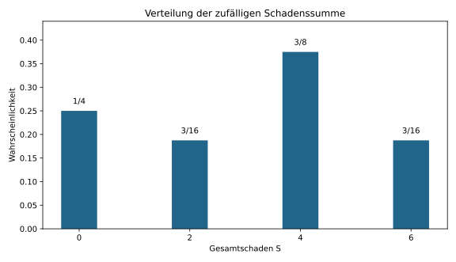

# M9-L5 – Versicherungsrisiko und kollektives Risikomodell {#L5}

**Kursbereich:** M9 – Stochastik, Finanz- und Versicherungsmathematik

**Niveau:** Master · Wahlpflicht

**Vorwissen:** [M1-L7](M1-L7.md); [M3-L4](M3-L4.md); [M9-L1](M9-L1.md)

**Einordnung:** Master-Wahlpflichtvertiefung

## Lernziele {#S1}

Du modellierst eine zufällige Gesamtschadenssumme, leitest deren Erwartungswert und Varianz durch Konditionierung her und berechnest eine endliche Schadensverteilung durch Faltung. Du unterscheidest mittleren Schaden, Schwankungsrisiko und Modellrisiko.

## Schadenanzahl und Schadenhöhe {#S2}

Sei $N$ die nichtnegative ganzzahlige Anzahl von Schäden innerhalb eines festen Zeitraums. Sei $(X_i)_{i\ge1}$ eine Folge unabhängiger, identisch verteilter nichtnegativer Schadenhöhen, unabhängig von $N$. Die Gesamtsumme ist

$$S=\sum_{i=1}^{N}X_i,$$

wobei bei $N=0$ die leere Summe null ist. Das Modell beschreibt ein Portfolio, nicht zwingend einzelne Verträge. Alle Beträge werden in derselben Geldeinheit und zum selben Bewertungszeitpunkt gemessen. Wir setzen $E[N^2]<\infty$ und $E[X_1^2]<\infty$ voraus. Schreibe $\mu=E[X_1]$, $\sigma^2=\operatorname{Var}(X_1)$. Frequenz und Schweregrad werden getrennt modelliert; ein einzelner großer Schaden kann trotz kleiner Anzahl erheblich sein.

## Momente durch Konditionierung {#S3}

Bei gegebenem $N=n$ besitzt $S$ die Verteilung einer Summe aus genau $n$ unabhängigen Kopien von $X_1$. Linearität der Erwartung und verschwindende Kovarianzen ergeben $E[S\mid N]=N\mu$ und $\operatorname{Var}(S\mid N)=N\sigma^2$. Aus der Turmeigenschaft (siehe [M9-L1](M9-L1.md)) und der Zerlegung der Gesamtvarianz folgt

$$E[S]=E[N]\mu,\qquad \operatorname{Var}(S)=E[N]\sigma^2+\operatorname{Var}(N)\mu^2.$$

Zur Begründung der zweiten Zerlegung schreibe $S-E[S]=(S-E[S\mid N])+(E[S\mid N]-E[S])$. Der gemischte Term des quadrierten Ausdrucks hat Erwartung null, weil der erste Summand bedingt auf $N$ Mittelwert null hat und der zweite von $N$ abhängt. Die beiden verbleibenden Quadrate liefern die Formel. Für $N\sim\operatorname{Poisson}(\lambda)$ erhält man $E[S]=\lambda\mu$ und $\operatorname{Var}(S)=\lambda E[X_1^2]$. Der zweite Rohmoment ist nicht die Varianz: Auch konstante Schadenhöhen erzeugen durch die zufällige Anzahl Schwankungen.

## Verteilung und vollständiges Beispiel {#S4}

Bei ganzzahligen Schadenhöhen mit erzeugender Funktion $G_X(z)=E[z^X]$ gilt für $0\le z\le1$ die Identität $G_S(z)=G_N(G_X(z))$, denn bedingt auf $N=n$ faktorisiert die Erwartung des Produkts zu $G_X(z)^n$. Für Poisson-Frequenz ist dies $\exp(\lambda(G_X(z)-1))$. Für endliche Verteilungen lassen sich alle Koeffizienten durch wiederholte Faltung exakt ermitteln.

Beispiel: $P(N=0)=1/4$, $P(N=2)=3/4$; unabhängig davon ist $X=1$ oder $3$ mit je Wahrscheinlichkeit $1/2$. Dann $E[N]=3/2$, $\operatorname{Var}(N)=3/4$, $\mu=2$, $\sigma^2=1$. Folglich $E[S]=3$ und $\operatorname{Var}(S)=9/2$. Die Verteilung lautet $P(S=0)=1/4$, $P(S=2)=3/16$, $P(S=4)=3/8$, $P(S=6)=3/16$. Die Wahrscheinlichkeit für $S>4$ beträgt $3/16$. Die Summe der Wahrscheinlichkeiten ist eins; die Momente aus den vier Atomen stimmen mit der allgemeinen Formel überein.

{alt="Vier Schadenswerte mit ihren Wahrscheinlichkeiten"}

## Berechnung und Modellgrenzen {#S5}

Die folgende Funktion faltet die Schadenhöhenverteilung schrittweise und gewichtet die Resultate mit der Anzahlverteilung. Sie ist für kleine endliche Modelle mit exakten rationalen Wahrscheinlichkeiten gedacht, nicht für unbeschränkte Poisson-Verteilungen.

```python
from fractions import Fraction as F

def aggregate(count, severity):
    # Finite probability mass functions: nonnegative integer keys.
    for pmf in (count, severity):
        if (not pmf or any(type(k) is not int or k < 0 or v < 0
                          for k, v in pmf.items())
                or sum(pmf.values()) != 1):
            raise ValueError("invalid probability mass function")
    result, current = {}, {0: F(1)}
    for n in range(max(count)+1):
        for s, weight in current.items():
            result[s] = result.get(s, F(0)) + count.get(n, 0)*weight
        if n < max(count):
            new = {}
            for s, a in current.items():
                for x, b in severity.items():
                    new[s+x] = new.get(s+x, F(0)) + a*b
            current = new
    return {s: w for s, w in sorted(result.items()) if w}

print(aggregate({0:F(1,4), 2:F(3,4)}, {1:F(1,2), 3:F(1,2)}))
```

Der Nettorisikobeitrag $E[S]$ berücksichtigt weder Verwaltungskosten noch Kapitalbedarf. Ein Stop-Loss-Vertrag mit Selbstbehalt $a$ zahlt $(S-a)_+$; im Beispiel kostet die erwartete Auszahlung bei $a=4$ genau $3/8$. Abhängigkeit kann die Formeln ändern: Sei $N$ mit gleicher Wahrscheinlichkeit 0 oder 2 und seien alle $X_i=N$; dann ist $E[S]=2$, obwohl $E[N]E[X_1]=1$. Gemeinsame Katastrophenfaktoren und schwere Verteilungsschwänze verlangen eigene Modelle. Endliche Momente garantieren keine geringe Überschreitungswahrscheinlichkeit. Die Zahlen sind reine Lehrmodelle und keine Tarif- oder Solvenzempfehlungen.

## Selbstkontrolle {#S6}

### Aufgaben

1. Bestimme Erwartung und Varianz für konstante Schadenhöhe 5 und Poisson-Anzahl mit Parameter 4.
2. Berechne die Varianz im Beispiel direkt aus der Verteilung.
3. Bestimme die Wahrscheinlichkeit für $S\ge4$ im Beispiel.
4. Berechne dort die erwartete Stop-Loss-Auszahlung bei $a=2$.
5. Sei $N=2$ sicher und $X_1=X_2=Y$, wobei $Y$ gleichwahrscheinlich 0 oder 2 ist. Vergleiche die tatsächliche Varianz mit der Formel für unabhängige Schadenhöhen.

::: {.lc-solutions data-lc-section="S6"}
1. $20$ und $100$.
2. $E[S^2]=4(3/16)+16(3/8)+36(3/16)=27/2$; minus $9$ ergibt $9/2$.
3. $3/8+3/16=9/16$.
4. $2(3/8)+4(3/16)=3/2$.
5. $S=2Y$ hat Varianz 4, statt 2 unter Unabhängigkeit. Der Kovarianzterm erklärt die Differenz.
:::

## Quellen {#S7}

- [Loss Data Analytics, 2nd ed., Chapter 7](https://openacttexts.github.io/LDAVer2/ChapAggLossModels.html) · §7.3 · Zuletzt abgerufen: 2026-11-24 · Inhaltlich geprüft: 2026-11-24
